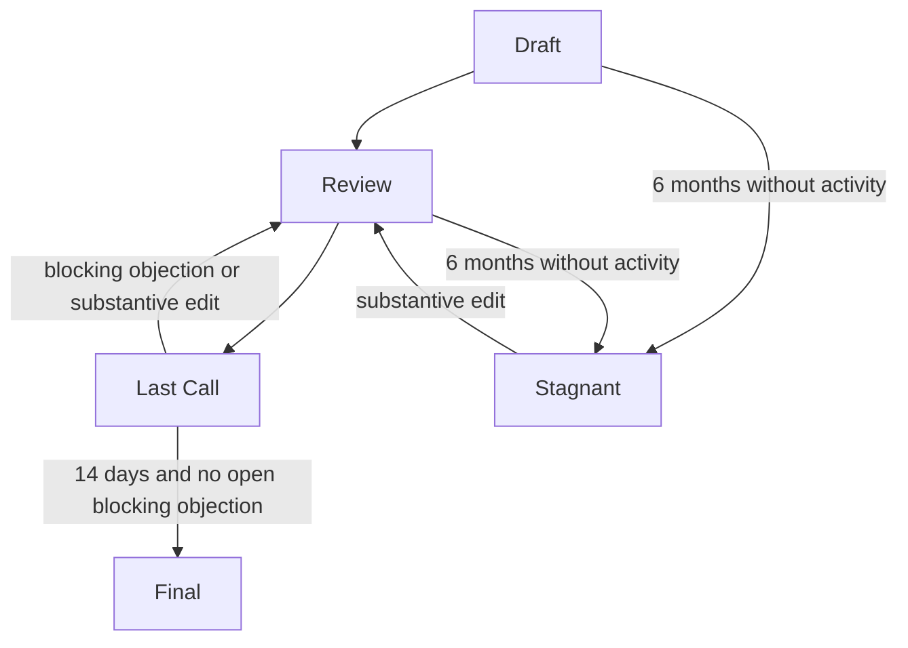

# Governance — how Comuns changes
Author: Comuns contributors
Status: Draft
Category: Decision
Created: 2026-10-12
**Reference:** docs/cip/README.md, docs/adr/README.md, CONTRIBUTING.md, MAINTAINERS.md, docs/project-charter.md
---

## 1 Summary

Comuns is a community proposal for an open-source decentralized network for LLM inference. Nothing runs yet. No protocol implementation exists. `scripts/` holds documentation checkers, which are not a node, relay, client or contract. The project domain is comuns.ai, written here as plain text. This repository does not present that domain as a running service.

Decisions are Comuns Improvement Proposals (CIPs). A CIP moves Draft → Review → Last Call (14 days) → Final. One clock only marks a Draft or Review CIP Stagnant after 6 months without activity; that clock is suspended during Last Call, so a CIP has exactly one terminal state. Comuns has no protocol token and no coin vote. ARB balances are not this project's votes. No maintainers are seated. The first people with merge authority must be named by a public CIP. Until then, nobody has private authority. The protocol fee is 0, so no treasury exists. Scope is LLM inference only.

This file is Draft: no CIP has adopted it, and it is not itself Final. The rules in this file are still the binding proposal for how participants write, review, and accept later documents, including the bootstrap CIP. A later CIP may replace this file. Participants do not grant themselves private exceptions while it is Draft.

External facts are cited as the evidence register section that actually contains the fact (docs/evidence-register.md, §1–§16, with How to cite at §17), with the tag recorded there; the governance and licensing facts in this file live in §8. [V] is a verified external fact in that register. [L] is a legal characterization. [V/L] is both. This document is not legal advice. A factual claim about the outside world that is not in the register is marked UNVERIFIED.

### Licensing

Code and documentation are licensed under the Apache License, Version 2.0. The license text is in the file LICENSE at the repository root. This document does not stand in for LICENSE, and it does not restate the license terms.

Copyright 2026 Comuns contributors

Licensed under the Apache License, Version 2.0 (see LICENSE)

Contributors keep their copyright. Comuns uses no copyright assignment and no CLA. The contribution certification is the Developer Certificate of Origin, recorded as a Signed-off-by line, as CONTRIBUTING.md describes. The DCO grants no license, while a CLA may enable relicensing (evidence register §8 [V/L]).

Apache-2.0 likely includes a patent grant. MIT likely does not (evidence register §8 [L]). That comparison is not legal advice.

BSL 1.1 is not open source (evidence register §8 [V]). Comuns does not use BSL 1.1 for code or documentation.

AGPL requires offering source to network users of a modified version (evidence register §8 [L]). Whether Comuns should take up that obligation is deferred to a later CIP. Until such a CIP is Final, code and documentation stay under Apache-2.0.

## 2 Principles

### 2.1 Open code

Code and documentation in Comuns are available under Apache-2.0, at the path LICENSE. A contribution is welcome under that license with the Developer Certificate of Origin. The project takes no CLA and no copyright assignment.

### 2.2 Written rough consensus

A decision is a written CIP. Rough consensus means the objections raised in public on that CIP are either reflected in the text or answered there with a written reason, and Last Call then finishes. There is no numerical vote, no coin vote, and no tally of holdings. Silence is not an approval. A disagreement that names no specific defect does not block.

### 2.3 No token gate

Comuns has no protocol token and no coin vote. The Ethereum EIP lifecycle likewise uses no coin vote (evidence register §8 [V]). A balance of any asset, including ARB, does not pass, block, or weight a CIP. ARB balances are not this project's votes.

### 2.4 Equal proposal rights

Anyone may file a CIP regardless of hardware class, stake or holdings. A class S operator has the same rights. Merge authority is a separate, empty seat and is described in section 6.

### 2.5 Honest privacy limits

This governance file does not promise that LLM inference hides a prompt from the operator who processes it. This file also does not promise that the network hides what a prompt's content reveals about its author. Identity unlinkability and content privacy are stated in docs/security/privacy-and-contexts.md. Until that document is accepted, participants speak about privacy as an open design problem. An emergency action cannot be used to expose prompts.

### 2.6 The reference client is not the protocol

When code exists, a reference client will be one implementation. The protocol is the specification a CIP has made Final. Another client that follows that specification is a valid implementation. Today no client exists, and the written CIPs and their companion documents are the proposal.

## 3 Who may propose

Anyone may file a CIP regardless of hardware class, stake or holdings. A class S operator has the same rights as any other person. Filing does not require merge access, a seated role, a token, a stake, or an ARB balance.

To file, copy docs/cip/0000-template.md to docs/cip/NNNN-kebab-title.md and fill it in. Numbering, required sections, and merge rules are in docs/cip/README.md. While no maintainers are seated, the file is a public proposal. Nobody merges it on private authority.

A person joins the discussion by commenting on the CIP in public. Working-group participation is described in section 5. It is not a filing requirement.

## 4 CIP lifecycle

The stage names follow the Ethereum EIP lifecycle (evidence register §8 [V]): written stages, and no coin vote. Durations below are this project's own, except the Rust comparison that is cited.

The path is Draft → Review → Last Call → Final. A CIP in Draft or Review becomes Stagnant after 6 months without activity. One clock only runs for that outcome. Draft and Review share the same clock, and a move between them does not start a second clock. The clock is suspended while the CIP is in Last Call and resumes from the same point if the CIP returns to Review; a CIP in Last Call cannot become Stagnant. Final and Stagnant are the two end states, and a CIP can be in only one of them: Final requires a completed Last Call, and Stagnant applies only to Draft and Review. A Stagnant CIP returns to Review only through a substantive edit of its text; comments alone never change a status. This paragraph is the one statement of those rules, and the rest of this file and docs/cip/README.md follow it. This draft defines no further status.

The two arrows into Stagnant are one clock only, drawn once from Draft and once from Review so each status shows the same exit. They are not two clocks. There is no arrow from Last Call to Stagnant because the clock is suspended there.

### 4.1 What each status means

- **Draft.** The author is writing the CIP. Anyone may comment.
- **Review.** The author sets this status when the CIP is ready for objection and revision.
- **Last Call.** The author sets this status when every blocking objection is addressed in the text or answered with a written reason. Last Call lasts 14 days. The 6-month clock is suspended for as long as the CIP is in Last Call. Rust's RFC final comment period is 10 days (evidence register §8 [V]). That figure is a comparison. Comuns uses 14 days.
- **Final.** Last Call has run its full 14 days and no blocking objection is open. A status line that says Final without a completed Last Call, or after a substantive edit during Last Call that has not gone through Review and a new, full 14-day Last Call, is void. Final means the decision is accepted under this process. Merging it into the repository is a separate act, and section 6 says who may do it.
- **Stagnant.** The CIP was in Draft or Review and the one clock has run 6 months without substantive activity. The CIP is Stagnant when that time has passed, even if the author has not edited the status line. A substantive edit of the text returns it to Review and starts the same single clock from that edit. A comment, including one that raises or answers an objection, does not take a CIP out of Stagnant.

The author may also return a CIP from Review to Draft while revising it. That label change, by itself, does not reset the clock.

### 4.2 The one clock

While a CIP is in Draft or Review, substantive activity resets the single 6-month clock. Substantive activity means an edit to the CIP text, or a public comment that raises a specific objection or answers one. A comment that only signals agreement does not reset the clock. A status-label edit with no other change does not reset the clock. The clock does not run during Last Call; it resumes from the point it reached if the CIP returns to Review.

Resetting a running clock is not the same as leaving Stagnant. Once the clock has run out, the CIP is Stagnant, and a comment of any kind leaves it there. Only a substantive edit of the text returns a Stagnant CIP to Review, as section 4 states.

Anyone may record in public that the 6 months have elapsed. The author then sets the status line to Stagnant. If the author is absent, the CIP is still Stagnant by this rule.

### 4.3 Blocking objections

A blocking objection is written on the CIP, names a specific defect, and asks for a specific change. The author closes it by changing the text, or by recording a reason the change is deferred. An objection that rests on hardware class, stake, holdings, or an ARB balance does not block. A vote tally does not block, and a vote tally does not pass a CIP.

If a blocking objection is opened during Last Call, the CIP returns to Review. The unfinished 14-day period stops. A later Last Call is a new 14 days. The return does not start a new 6-month clock; the suspended clock resumes from where it stopped, and the objection itself, as a comment that raises a specific objection, resets it.

A person who is temporarily excluded from discussion under CODE_OF_CONDUCT.md keeps the right to file a blocking objection. They file it through the public record of the CIP, and it is treated like any other blocking objection.

Any substantive edit made during Last Call returns the CIP to Review and stops the unfinished 14-day period. A new, full 14-day Last Call must then start from the edited text. A substantive edit is any change to normative text, to names of people or roles (including bootstrap maintainer names), to parameters, numbers or addresses, or to the decision itself. The only non-substantive edits are typo, formatting and link fixes that change no meaning; each such edit made during Last Call must be listed in the CIP's change log.

While no shared repository history is the public record, the dates the author writes on the CIP are the start of Last Call and the mark of activity. Which hosted timestamp should replace those written dates is an open question. The public repository is Comuns-ai/documentation on GitHub. Host product behaviour not in the evidence register is UNVERIFIED.

### 4.4 Reviews before Last Call

Review counts are proposed policy in CONTRIBUTING.md until maintainers are seated. Protocol, cryptography, and contracts documents take two reviews. Other documents take one. Those counts structure the discussion. They are not a coin vote, and they are not a merge by themselves.

### 4.5 ADRs

Architecture decision records live under docs/adr/, in files named docs/adr/NNNN-kebab-title.md. ADRs under docs/adr/ are proposed until docs/cip/0001-adopt-baseline-adrs.md is accepted. Accepted means that CIP is Final. After acceptance, a change that contradicts an ADR needs a superseding ADR. A silent edit does not overturn an accepted ADR. The file docs/cip/0001-adopt-baseline-adrs.md holds CIP-0001, which is a Draft. This document links it by path. None of the CIPs are Final.

## 5 Working groups

Working groups review documents and recommend changes. A working group does not decide. A CIP decides. A working group has no token weight, no separate vote, and no chair. This draft seats no working-group chairs and sets no meeting schedule.

Anyone may join a working group. Hardware class, stake, and holdings do not affect joining. To join, a person writes in public, on a relevant CIP or in an issue on the Comuns-ai/documentation repository, which group they are taking part in, and then reviews that group's documents in public.

| Working group | What it reviews |
| --- | --- |
| Protocol | Inference messages, state, and protocol specifications |
| Node | Node obligations once a CIP specifies them, including equal proposal rights for every hardware class |
| Cryptography | Cryptographic constructions a CIP proposes for the protocol |
| Contracts | Settlement contracts and the bond they lock |
| Applications | Clients that request LLM inference |
| Documentation | Repository documents, CIP and ADR form, and this governance set |

The Applications group does not widen the scope past LLM inference. The Node group does not gain extra proposal rights. Detail of settlement stays in contract CIPs and in docs/protocol/contracts-and-settlement.md. This file does not restate that document.

## 6 Maintainers and the bootstrap rule

None seated.

No maintainers are seated. The first people with merge authority must be named by a public CIP. Until that CIP is Final, nobody has private authority. A Draft, a Review copy, or a Last Call copy that lists names does not seat anyone. Nobody may merge, cut a software release, execute a timelock, take an emergency action, or act as a private enforcement contact on the strength of an unfinished CIP.

Participants follow section 4 for the bootstrap CIP itself. It becomes Final only after Last Call lasts 14 days and no blocking objection is open. On the day it becomes Final, the people it names are the first people with merge authority. Their first use of that authority is to merge the public record of the CIP that names them. Authority does not reach backward to cover earlier private acts.

The bootstrap CIP must also name the enforcement contact that CODE_OF_CONDUCT.md requires before enforcement is active, and the private vulnerability channel that SECURITY.md requires as a release gate, together with the seated people who monitor it. Until those are named in a Final bootstrap CIP, enforcement is inactive and the channel does not exist. This file names no person and no channel.

### 6.1 Seating and removal only by a Final CIP

A maintainer is seated, and a maintainer is removed, only by a CIP that becomes Final under section 4. No group of seated maintainers, however large, can seat or remove anyone outside a CIP, and the change takes effect on the day the CIP becomes Final, not before. This holds when one maintainer is seated: the path to remove that person is still a CIP, which anyone may file, and the sole maintainer's merge authority does not block the CIP from becoming Final, because Final is a state of the public record and not a merge. Until a removal CIP is Final, the seated person keeps merge authority; after it, they have none.

A CIP that proposes to seat a person with a pending conduct matter under CODE_OF_CONDUCT.md is stopped the ordinary way: a blocking objection that names the matter returns the CIP to Review, where the author may change the names and start a new Last Call. No rule asks for a name to be dropped during Last Call.

Review policy until that seating is the rule in CONTRIBUTING.md. Seating does not silently replace it. A change to the review counts is a CIP.

## 7 Protocol parameters

Price bands, deadlines, and the bond are protocol parameters. The protocol fee is a protocol parameter too. Its value in this proposal is 0.

A protocol parameter changes only by a CIP that reaches Final, then a timelock, executed by seated maintainers. Every CIP that changes a parameter states its own timelock in its Specification. The timelock that applies is the longer of 7 days and the timelock the CIP states, and both are counted from the date the CIP becomes Final. A CIP may not set a timelock shorter than 7 days. Section 7.1 supersedes that longer-of-7-days rule and that ban for Arbitrum Sepolia only. After the CIP is Final, seated maintainers announce the execution time in public; the announcement does not start or shorten the wait. They apply the change no sooner than the day that timelock ends.

Until maintainers are seated, no one can make that announcement, and a parameter does not change through this path. Numbers written in a draft specification are proposals.

Optimism uses a 7-day veto window (evidence register §8 [V]). That window is a comparison only. Comuns uses a timelock of at least 7 days counted from the date the CIP becomes Final, executed by seated maintainers. On Arbitrum Sepolia, section 7.1 applies; mainnet unchanged.

Because the protocol fee is 0, no treasury exists. This repository does not hold funds. A CIP that would set the fee above 0 would also have to create a treasury this project does not have. No such CIP is Final.

### 7.1 Disposable testnet configuration

For Arbitrum Sepolia only, this subsection supersedes the longer-of-7-days rule and the ban on a timelock shorter than 7 days in section 7. It applies only to the deployment, and to `setBands`, `setCreditParameters`, `registerModel` and `updateModel`, executed with no timelock from a disposable testnet key held by the seated maintainer, after a Final CIP whose every value is labelled testnet-only and non-normative. The exception does not apply to Arbitrum One, does not permit a mainnet timelock under 7 days, and makes no testnet value a default. Section 7's rule that nothing changes before seating still holds. Mainnet stays at a timelock of at least 7 days. [docs/cip/0004-sepolia-testnet-configuration.md](docs/cip/0004-sepolia-testnet-configuration.md) (Draft) is the CIP that uses this exception.

## 8 Emergency actions

Emergency actions are narrow. They require retrospective public disclosure. They cannot seize escrow or expose prompts.

### 8.1 When one may be used

After maintainers are seated, an emergency action is a temporary pause of a protocol-parameter change that is still inside its timelock, or a hold on publishing a software release, when waiting for an ordinary CIP would leave a known defect in effect. The action is the smallest pause that addresses that defect. Permanent parameter changes continue to require a Final CIP and the timelock in section 7.

A pause is bounded. It states its end date when it is taken, lasts at most 30 days, and expires on that date by itself; no renewal is possible without a CIP. The 30-day maximum is a proposal of this draft and is listed in section 12. When the pause expires, the paused change executes on the later of its original timelock end and the expiry date. A pause cannot cancel a Final change; only a later CIP that becomes Final can reverse or replace it, and a CIP that merely records the pause does not do that.

### 8.2 Limits

An emergency action cannot seize escrow. An emergency action cannot expose prompts. It cannot seat or unseat maintainers, change the license, move the protocol fee off 0, declare a CIP Final, cancel a Final change, outlast its stated end date, or weight any balance as a vote.

### 8.3 Retrospective public disclosure

Every emergency action is followed by retrospective public disclosure: the defect, the pause that was used, its end date, and the CIP, if any, that proposes to reverse the paused change. The disclosure omits prompts, keys, and seed phrases. Maintainers publish it as soon as they can do so without those secrets. If no such CIP becomes Final before the pause expires, the paused change executes as section 8.1 states.

### 8.4 Before anyone is seated

No maintainers are seated. Nobody may take an emergency action. Nobody has private authority to improvise one.

## 9 Relationship to Arbitrum DAO governance

Comuns governance and Arbitrum DAO governance are separate. A decision of the Arbitrum DAO does not change a CIP, an ADR, or a protocol parameter of Comuns. A CIP does not change Arbitrum DAO governance.

ARB balances are not this project's votes. Comuns has no protocol token and no coin vote. Holding ARB confers no extra right to file, to block, or to merge.

## 10 Funding

Arbitrum DAO grant programs exist, including an Audit Program (evidence register §8 [V]). None have been awarded to Comuns. This project claims no grant award and no audit. Whether any application is pending is UNVERIFIED. This document records no application.

The protocol fee is 0, so no treasury exists. This draft creates no bounty. Funds that a person or a company receives outside this repository stay outside it. They do not become a Comuns treasury and they do not become voting weight. This draft names no recipient and no schedule.

## 11 Risks

Severity labels below are this draft's judgment of governance risk. They are not scores from docs/security/threat-model.md.

### R1 — Nothing can be merged or executed **[RISK] · High**

No maintainers are seated, so a CIP that finishes Last Call still has no one who may merge it, run a timelock, or publish a software release. The public record can show consensus while the repository is unchanged. The bootstrap rule in section 6 is the only path this draft allows out of that state.

### R2 — The bootstrap CIP names the first authority **[RISK] · High**

The first people with merge authority are whoever that public CIP names. A narrow seating, or a Last Call with little review, concentrates the first merge, the first timelock, and the first enforcement contact. Later CIPs can change the seating, and until they are Final the first names remain the only merge authority.

### R3 — Privacy statements can outrun the design **[RISK] · High**

Scope is LLM inference. Inference involves prompts. This file states honest limits and forbids emergency disclosure of prompts. A later document or comment can still promise secrecy the design cannot keep. The privacy write-up belongs in docs/security/privacy-and-contexts.md and is not settled here.

### R4 — Rough consensus can stall without a closer **[RISK] · Medium**

Last Call starts when the author judges that blocking objections are addressed. With nobody seated, no maintainer can close a dispute about whether an objection still blocks. A CIP can remain in Review until the one clock marks it Stagnant.

### R5 — ARB balances or a grant can be misread as votes **[RISK] · Medium**

Arbitrum DAO governance, ARB balances, and external grant programs sit beside this project. A reader can treat them as Comuns votes. Sections 2, 9, and 10 say they are not. A future grant award, none of which exists now, would raise the same misreading.

### R6 — Parameter changes have no executor **[RISK] · Medium**

Price bands, deadlines, the bond, and the protocol fee change only by a Final CIP and a timelock of at least 7 days from the Final date, executed by seated maintainers. On Arbitrum Sepolia, section 7.1 applies; mainnet unchanged. With none seated, that path cannot be executed. Draft numbers can be mistaken for parameters already in force. Nothing runs yet, so there is no network on which to apply them.

### R7 — License assumptions can diverge from Apache-2.0 **[RISK] · Medium**

The binding license is Apache-2.0 for code and documentation. Apache-2.0 likely includes a patent grant, and MIT likely does not (evidence register §8 [L]; not legal advice). AGPL's network-source obligation is deferred to a later CIP (evidence register §8 [L]). Contributors who assume MIT, AGPL, BSL, or a CLA will be wrong until a Final CIP says otherwise. BSL 1.1 is not open source (evidence register §8 [V]).

### R8 — One inactivity clock covers every pre-Final status **[RISK] · Low**

Stagnant arrives after 6 months without activity on one clock only, in Draft or Review. An author who expects a fresh 6 months at Review will lose that expectation. Section 4.2 states what resets the clock and that it is suspended during Last Call.

### R9 — Emergency pause could be widened by custom **[RISK] · Medium**

Section 8 allows only a narrow pause of at most 30 days, with retrospective public disclosure, and it forbids seizing escrow, exposing prompts, or cancelling a Final change. Once maintainers exist, habit could stretch "pause" into a quiet parameter change or a rolling series of pauses. A widening is a CIP, not an emergency custom.

### R10 — Late substantive edits can bypass review **[RISK] · Medium**

An author could replace substantive text near the end of Last Call and claim Final before anyone reviews the replacement. Section 4 requires every substantive edit during Last Call to return the CIP to Review and a new, full 14-day Last Call to start from the edited text; a Final status reached without that review is void. Only typo, formatting and link fixes that change no meaning are non-substantive, and each must be listed in the CIP's change log during Last Call.

## 12 Open questions

- What is the minimum content of the bootstrap CIP: how many maintainers, whether the names must be distinct people, the wording of the enforcement contact, and the form of the private vulnerability channel it names? [docs/cip/0003-bootstrap-first-maintainer-and-channels.md](docs/cip/0003-bootstrap-first-maintainer-and-channels.md) (Draft) proposes an answer.
- Is 30 days the right maximum for an emergency pause (section 8.1)? This draft proposes 30 days as the most conservative bound that still lets an ordinary CIP run a 14-day Last Call to reverse a defective change.
- Is 90 days the right maximum for temporary exclusion from discussion (CODE_OF_CONDUCT.md section 5.2)? This draft proposes 90 days; a longer sanction is a removal CIP, not a longer exclusion.
- Should a Stagnant CIP ever be revived by comments alone? This draft says no: only a substantive edit returns it to Review, so that the status of a Stagnant CIP can be read from the file.
- Should a working group have to concur before the author enters Last Call? This draft lets the author enter Last Call when blocking objections are addressed.
- Which public timestamp should start the 14-day Last Call on the Comuns-ai/documentation repository? While none is specified, the date written on the CIP is the record. Host product behaviour not in the evidence register is UNVERIFIED. [docs/cip/0003-bootstrap-first-maintainer-and-channels.md](docs/cip/0003-bootstrap-first-maintainer-and-channels.md) (Draft) proposes an answer.
- Should an author be able to close their own CIP before the 6-month clock runs out? This draft has no status for that, and a Draft or Review CIP goes Stagnant when the one clock expires.
- Can the protocol fee ever move above 0, and where would value sit if it did? Today the fee is 0 and no treasury exists.
- Should section 8 grow narrower once docs/security/threat-model.md is accepted?
- How should participants treat dates on the bootstrap CIP if the file is copied in more than one place before anyone can merge? This draft has no hosting workflow. The repository mechanics of the first merge are UNVERIFIED. [docs/cip/0003-bootstrap-first-maintainer-and-channels.md](docs/cip/0003-bootstrap-first-maintainer-and-channels.md) (Draft) proposes an answer.
- Hardware classes other than class S are not listed here. Every class has the same filing right. A taxonomy in docs/project-charter.md, if that file defines one, is outside this document. Any class list not written here is UNVERIFIED.
- Should Last Call stay 14 days? The Rust RFC comparison is a 10-day final comment period (evidence register §8 [V]). This draft chooses 14 days.
