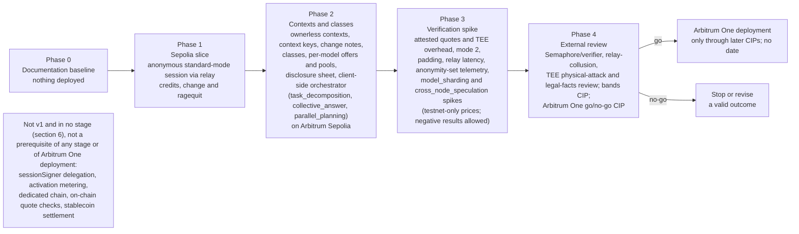

# Deployment and decentralization — stages, dependencies and what stays central

Author: Comuns contributors
Status: Draft
Category: Technical Proposal
Created: 2026-10-12
**Reference:** docs/project-charter.md, docs/evidence-register.md, docs/requirements.md, docs/security/privacy-and-contexts.md, docs/security/threat-model.md, docs/security/inference-verification.md, docs/protocol/contracts-and-settlement.md, docs/protocol/off-chain-api.md, docs/economics/cost-and-pricing.md, docs/node/node-design.md, docs/node/hardware-classes-and-benchmarks.md, docs/node/model-registry-and-licenses.md, docs/product/dapp-and-sdk.md, docs/protocol/orchestration.md, docs/protocol/collective-answers.md, docs/node/distributed-execution.md, docs/adr/README.md, docs/project-plan.md, GOVERNANCE.md, docs/cip/0003-bootstrap-first-maintainer-and-channels.md, docs/cip/0004-sepolia-testnet-configuration.md

---

## 1. Summary

Comuns is a community proposal for open-source, decentralized LLM inference settled on Arbitrum One. Nothing runs yet. **This document authorizes no deployment**: it describes, in relative order and without dates, the stages through which the proposal would move from documents to an Arbitrum Sepolia testnet to a go/no-go decision about Arbitrum One, what each stage depends on, and — honestly — which parts of the system stay central at each stage and what would measurably reduce that. No mainnet date exists; no audit, grant or partnership is claimed; "no-go" is a valid outcome of the last stage.

The stages map exactly to the five phases of docs/project-charter.md 4.11 and 4.18, which docs/project-plan.md owns in detail: **Phase 0 Documentation baseline**, **Phase 1 Sepolia slice** (one anonymous standard-mode paid session through a relay with a distinct operator, plus change, zero-use return and ragequit), **Phase 2 Contexts and classes** (ownerless contexts with context keys, change-note UX, hardware classes, per-model offers and pools, the disclosure sheet and the client-side orchestrator with `task_decomposition`, `collective_answer` and `parallel_planning` on Arbitrum Sepolia), **Phase 3 Verification spike** (attested quote checks and TEE overhead measurement, padding, relay latency and anonymity-set telemetry, verifiable-mode experiments plus the `model_sharding` and `cross_node_speculation` spikes under testnet-only prices, each allowed to end in a published negative result), and **Phase 4 External review** (Semaphore integration and verifier, relay collusion, TEE physical attacks and legal facts), which ends in an Arbitrum One go/no-go CIP. `sessionSigner` delegation to orchestrator nodes and activation metering are later CIPs and belong to no stage here.

What stays central, at every stage, is stated rather than hidden: the single Arbitrum sequencer; whoever holds the testnet deployer key and, later, the contract upgrade authority; the trust placed in self-published benchmarks; relay operators; the Groth16 setup and verifier artifacts; CPU and GPU vendors and attestation services; context hosts trusted for sequencing and availability and the indexer backends users choose; the first maintainers a bootstrap CIP seats; the planner models and optional orchestrator nodes that thin clients lean on. Section 4 names a measurable reduction step for each. The system has central points at every stage described here, and this document does not describe it as free of them.

Standard mode separates anonymity from content privacy: the node can read the prompt and answer but should not learn who asked. Attested mode adds the Phase 3 promise: This node should not be able to read your prompt. A physical attack on the hardware can break that. Inference runs only on network nodes; clients perform transport, orchestration and sampling decisions, with no model computation. These are the proposed boundaries of ADRs 0010–0012, not evidence of deployed protection.

Evidence marks follow docs/evidence-register.md: **[V]** verified, **[L]** likely, **[U]** unsure; a claim not in the register is labeled UNVERIFIED. Every stage, criterion and option below is PROPOSED.

## 2. Scope

In scope: the five stages and their exit criteria; the centralization points at each stage and a reduction step for each; the dependencies on Arbitrum One and the condition under which Stylus would be revisited; future options that a later CIP could adopt; the decentralization metrics the community can observe; risks and open questions.

Out of scope and owned elsewhere: the phase contents and task lists (docs/project-plan.md); the contracts and their testing plan (docs/protocol/contracts-and-settlement.md §13); the node (docs/node/node-design.md); the client (docs/product/dapp-and-sdk.md); governance and the CIP lifecycle (GOVERNANCE.md, docs/cip/README.md); the system's components and flows (docs/architecture/system-architecture.md). This document sets no wei value, no duration and no date.

Two words are kept apart. The **stages** of this document are the five phases. L2BEAT's "Stage 1" classification of the Arbitrum One rollup (section 5) is a different scale and is always written "L2BEAT Stage 1".

## 3. Stages mapped to the five phases

Relative order only; there are no dates. Each stage ends when its exit criteria hold and the community records that in public; nothing advances a stage automatically, and nobody is seated to advance one on private authority.

| Stage | What exists | Where it runs | Exit criteria (no dates) |
|---|---|---|---|
| **Phase 0 — Documentation baseline** | This document set: charter, evidence register, requirements, protocol, security, economics, node, product and architecture documents, ADRs 0001–0012, the CIP template and docs/cip/0001-adopt-baseline-adrs.md, GOVERNANCE.md | Nowhere; no protocol implementation and no deployment. The repository owner merges the documentation pull request that carries Draft CIP-0003 as a pre-authority act that grants no authority ([CIP-0003](../cip/0003-bootstrap-first-maintainer-and-channels.md) item 8); no governance execution happens before seating. The documentation checkers under scripts/ are tooling for this documentation, not a protocol implementation and not a deployment | Every path in the charter's document map exists; every document carries the header block, evidence citations and risks; no document claims a mainnet date, audit, grant, partnership or users; docs/cip/0001-adopt-baseline-adrs.md is filed as a Draft; the open questions of every document are collected; and the **bootstrap CIP** that names the first maintainers, the enforcement contact and the monitored private security channel has reached Final — the only seating path (GOVERNANCE.md §6 and §6.1); the proposed bootstrap CIP is [CIP-0003](../cip/0003-bootstrap-first-maintainer-and-channels.md), Draft — before any merge under seated authority, any governance execution and any software release, because GOVERNANCE.md §6 forbids merging or releasing before seating and SECURITY.md §3 makes the monitored private channel a release gate, so no later phase could publish without it. Nobody is seated today |
| **Phase 1 — Sepolia slice** | The four contracts `NodeRegistry`, `ModelRegistry`, `ContextRegistry` and non-upgradeable `SessionEscrow`, with 23 state-changing function names per ADR 0011; relays registered in NodeRegistry from Phase 1; per-denomination Semaphore groups, nullifiers and root window inside SessionEscrow using only the stateless Groth16 verifier; one standard-mode Rust node with the llama.cpp adapter and reference client; a Sepolia CIP setting testnet-only, non-normative models, bands and a ladder of at least two denominations. Values are unset here; the proposed Sepolia CIP is [CIP-0004](../cip/0004-sepolia-testnet-configuration.md), Draft, which holds the testnet-only, non-normative table | Arbitrum Sepolia | Someone other than the author completes **one single-node standard-mode paid session through a relay with a distinct operator**: `depositNote`, node-submitted `openSessionFromCredit`, checked input/chunk receipts, cumulative vouchers, `closeWithVoucher`, node `withdraw()` and `claimChange` into at least one smaller note plus dust. The walkthrough also demonstrates a zero-use session settled and claimed back in full with a fresh note identity, and `ragequit` of an unused note within the caller's net deposits in the group. Credit conservation, nullifier replay, commitment reuse, `relay == node` revert, reentrancy, band, EIP-712 conformance, recovery and withdrawal checks pass, including abandoned-client recovery and a simulated delayed-inbox submission. Deposit screen, relay choice, the observed denomination-group size display and standard-mode banner precede spend authorization; the display states that no minimum anonymity set is adopted, and no warning threshold is set (RR-39). No contexts, attested or verifiable mode, multi-node features or wallet `openSession` demo |
| **Phase 2 — Contexts and classes** | Ownerless contexts with independent context signing keys, signed grants and heads, per-version encryption keys, re-wrap, checkpoints and backups; default off-chain hosts and anonymous public anchors when global multi-device consistency is promised; full change-note vault/recovery UX beyond the Phase 1 change demonstrations; class and per-model benchmarks; per-model offers and **pools**; full **disclosure sheet**; **client-side orchestrator** with `task_decomposition`, `collective_answer` and `parallel_planning`; optional orchestrator nodes and capability documents | Arbitrum Sepolia | Two independent operators in two classes, with one model offered across classes. Someone other than the author completes a collective answer and a decomposed plan, preceded by confirmed sheets. Parallel planning requires confirmation before execution. Context re-wrap, restore with available ciphertext, checkpoint rollback rejection, anchored multi-device consistency and change-note recovery pass. Pool clearing, no-quote handling, aggregate caps and sheet-to-envelope conformance pass; RPC/indexer reads stay tunnelled through a relay. No class-to-tier gate. Still single-node by default |
| **Phase 3 — Verification spike** | `attested` (mode 1) client-side quote path with accepted measurements, freshness and binding to both gateway and job keys; TEE overhead measurement; padding/batching, relay latency and opt-in aggregate anonymity-set telemetry; deterministic-profile experiments, `verifiable` (mode 2) re-execution and TOPLOC-style assessment where supported; **`model_sharding`** and **`cross_node_speculation`** spikes under testnet-only, non-normative parameters | Arbitrum Sepolia | Publish a demonstrated check or a negative result for each stronger mode; enable neither without its own evidence gate. Record TEE TTFT/throughput overhead against the same configuration without confidential computing (external evidence register §14 [V], not Comuns measurements), physical-attack limits, relay latency and padding costs without exposing note-to-session links. Measure each spike against a single node of the same class running the same model: sharding against that one node, speculation against the target node alone; a co-located draft comparison is only an extra report, not the speed-up baseline. Publish throughput, TTFT, RTT sensitivity, failure/replay, compatibility and accounting evidence, or why the spike could not run. **Each spike may end in a published negative result** without affecting collective answers or decomposition. All shard holders, including embedding and output-layer nodes, are disclosed unpaid volunteer readers with no sessions; activations use relayed OHTTP to each holder's registered `ohttpKeyConfig`, with no inner job HPKE envelope. The reference client refuses both spikes under mainnet parameters |
| **Phase 4 — External review** | Independent review of contracts, node, client and specification, explicitly including Semaphore integration and Groth16 verifier, relay collusion, TEE physical attacks and legal facts from evidence register §16 [V]/[L]/[U] (not legal advice; regulatory classification UNVERIFIED); model-license review; recheck of seated maintainers and the monitored private security channel; a bands CIP with all forty directional entries, the denomination ladder and `RELAY_FEE_WEI`, a mainnet models CIP and the **Arbitrum One go/no-go CIP** (mainnet stays blocked while the price bands, the denomination ladder or `RELAY_FEE_WEI` are unset) | Arbitrum Sepolia, and the public CIP record | Review findings and responses are public, fixed or recorded as accepted risks; canonical LICENSE and model licenses are confirmed; governance and security-channel prerequisites hold. The go/no-go CIP reaches Final under GOVERNANCE.md (Draft → Review → Last Call of 14 days → Final). No audit is claimed. A “go” alone deploys nothing: Arbitrum One deployment needs its own CIPs and governing execution safeguards, including the timelock, with no date. A “no-go” stops or revises the proposal and is a valid outcome |

Stages do not overlap in what they promise: Phase 1 stays a single-node standard-mode slice, including its required change, zero-use and ragequit cases, even if contributors have multi-node code ready, because the single-node path is what every later stage builds on; Phase 2's three client-side features are the only multi-node features that are proposed for v1; Phase 3's two spikes are experiments and never become v1 features by passing through the stage — only a later CIP can withdraw their experimental label.

## 4. Centralization points at each stage

Every row names something a single party controls, or that users must trust, at each stage, and a **measurable reduction step**: something whose effect can be counted, not a promise. No row has a numeric target; thresholds are for a later CIP.

| Point | Phase 0–1 | Phase 2–3 | Phase 4 and any later deployment | Measurable reduction step |
|---|---|---|---|---|
| **Sequencer** | Arbitrum Sepolia's sequencer orders the testnet | Same | Arbitrum One has a single sequencer; L1 force inclusion after about one day; no sequencer-decentralization date (evidence register §1, [V] and [U]) | Not reducible by Comuns. Publish, per stage, the count of transactions that had to use the delayed inbox and the longest observed inclusion gap; size `CLOSE_WINDOW` against them; nodes redeem promptly. Any change comes from Arbitrum, not from a Comuns CIP |
| **Contract code and parameter authority** | The testnet deployer can deploy a new instance; SessionEscrow itself has no proxy or upgrade path. [CIP-0004](../cip/0004-sepolia-testnet-configuration.md) proposes all four contracts non-upgradeable on Arbitrum Sepolia, fixed by redeployment, with testnet governance the seated maintainer's disposable key without a timelock ([GOVERNANCE.md](../../GOVERNANCE.md) section 7.1); mainnet is unchanged | Same; a redeployment is public in the CIP record and cannot mutate existing notes | SessionEscrow stays non-upgradeable. `setBands` and `setCreditParameters` stay timelocked. The other three contracts retain the non-upgradeable-or-timelocked choice, with at least 7 days for the latter; no upgrade may redirect escrow or change funded terms | Count code-changing keys separately from parameter-changing keys: zero code-changing keys for SessionEscrow; publish timelock membership and executed changes for the other contracts and parameters |
| **Relay operators** | Registered in NodeRegistry from Phase 1; the relay sees client network addresses and traffic metadata; the node is the gateway | Same; the reference client randomly selects a registered relay, shows the choice and fails closed when none is available | Relay-collusion review; address separation cannot establish separate beneficial operators | Publish relay/operator concentration and diversity, with no client identifiers. Test role-registration exclusion and `relay == node` rejection; disclose Sybil and timing-correlation residuals (evidence register §15–§16 [V]/[L]) |
| **Groth16 trusted setup** | Credits depend on the selected Semaphore circuit's setup artifacts (evidence register §15 [V]); the production artifacts come from the 2025 Binary Merkle Root Fix ceremony [V]; its participant count, close date and final beacon were not found in the sources examined on 2026-10-15 [U] (evidence register §15, recheck 2026-10-15) | Same; circuit/proving-key/verifying-key provenance must stay reproducible | Independent review of artifact provenance and integration; no upstream assurance transfers to the wrapper | Publish pinned artifact provenance and counts of independent reproductions; verify the circuit-fix ceremony artifacts before implementation |
| **Groth16 verifier** | Immutable, ownerless stateless verifier from Semaphore packages; escrow owns trees, nullifiers and root window and never calls shared `validateProof` | Same; implementation correctness and artifact selection remain dependencies | Independent verifier and Semaphore-integration review | Publish bytecode/artifact checks and independent conformance results; no verifier administrator or shared nullifier store |
| **Benchmark trust** | No benchmark yet; the one Sepolia node's class is declared | Self-published `benchmarkHash` and `modelBenchmarkHash`, signed claims, not proofs; a reported fake-GPU incident elsewhere shows such claims are gamed (evidence register §2, [L]) | Same; verifiable mode covers only mode-2 sessions | Spot re-benchmarks by community verifiers or the client on a private, rotating prompt set at random times (never the public set); opt-in unannounced spot checks of standard-mode sessions. Metric: the number of distinct verifiers publishing spot results per stage and the gap between claimed and measured speed per node |
| **Attestation vendors** (attested mode) | Not used | Phase 3 only: quote checks trust CPU/GPU vendor roots and attestation services, a published measurement list and quote binding to both keys; physical attacks remain a limit (evidence register §14 [V]/[L]) | Same; external physical-attack review; on-chain quote verification remains a later option | Publish the revocable measurement list. Count accepted vendors/services and the share of attested sessions depending on each; report quote rejection and service unavailability without linking users |
| **Context hosts** | No context feature in Phase 1 | User-chosen hosts store ciphertext and signed heads and are trusted for sequencing as well as availability; accepted-head checkpoints persist in vaults and backups | Unsynced devices can receive equivocated heads; stale backups miss newer heads until synchronization. Globally consistent multi-device heads require broadcaster-submitted anonymous `setContext` anchors | Publish compare-and-swap and rollback/rebase tests; count independent hosts, second ciphertext copies and anchored contexts only through opt-in aggregate reports |
| **Indexers** | Optional chain-read backend behind a relay | Community indexers build pool views from `OfferSet`; the client can use RPC without an indexer, still through a relay | Session lookup, settlement/change monitoring and witness/root queries always use an anonymity-preserving transport | Count independent indexers whose views agree with RPC queries tunnelled through a relay; an indexer is never a substitute for the relay |
| **RPC providers** | User-chosen backends reached through a relay for session-specific reads | Same | Same; endpoint choice does not remove the anonymity transport requirement | Compare results across RPC backends through relays; count endpoints only in opt-in aggregate telemetry |
| **Bootstrap maintainers** | None seated today; the bootstrap CIP naming the first maintainers, the enforcement contact and the monitored private security channel is a Phase 0 exit item, required before any merge under seated authority, any governance execution and any software release (GOVERNANCE.md §6, SECURITY.md §3); it is proposed as [CIP-0003](../cip/0003-bootstrap-first-maintainer-and-channels.md), Draft; until it is Final nobody can merge under seated authority or execute governance, and the pre-authority merge of the pull request carrying the Draft (section 3, Phase 0 row) grants no authority. On Arbitrum Sepolia, testnet governance under [CIP-0004](../cip/0004-sepolia-testnet-configuration.md) is the seated maintainer's disposable key without a timelock (GOVERNANCE.md section 7.1); mainnet is unchanged | The maintainers seated by that Final bootstrap CIP hold the only merge authority; the testnet-only CIPs are written by whoever volunteers and merged only by them | The seating holds the first merge, the first timelock and the first enforcement contact, and a narrow seating concentrates all three; seating and removal only through a Final CIP | Metric: the number of distinct seated maintainers and the number of distinct organizations among them, as named in the Final bootstrap CIP; the number of removal or seating CIPs that reached Final |
| **Reference implementations** | One reference node, one reference client | Same | The protocol is the Final specification, not the reference code | Conformance tests assert the identifiers, the voucher type string and the disclosure-sheet replay. Metric: the number of independent client and node implementations that pass them |
| **Planner models** | None | A delegated planner session gives one node the full prompt and the structure of the user's problem; if one planner model dominates, the operators of its pool see most orchestrated prompts | Same | Assessment uses client heuristics first, with model computation on disclosed network nodes; the planner model is user-chosen from any pool; privacy-flagged prompts stay single-node. Metric: the share of planner sessions on the top planner model, and on the top operator, per stage |
| **Orchestrator nodes** | None | Optional nodes advertising `roles.orchestration` serve thin clients; a few popular ones could concentrate the full prompts and plans of thin clients | Same; `sessionSigner` delegation, if a later CIP ever allows it, would raise the stakes | They are never mandatory; the SDK runs orchestration on the client, with model computation on disclosed network nodes; they hold no `sessionSigner`. Metric: the concentration of orchestrator-node sessions — the share held by the top node and the top operator — and the share of orchestrated requests that used no orchestrator node at all |
| **Testnet-only CIP authors** | The Sepolia bands, denomination ladder and models come from a testnet-only CIP written by volunteers, proposed as [CIP-0004](../cip/0004-sepolia-testnet-configuration.md), and are executed by the seated maintainer's disposable testnet key without a timelock (GOVERNANCE.md section 7.1); mainnet is unchanged | Same | Replaced by the bands CIP and the mainnet models CIP under seated governance | Metric: the number of distinct authors and reviewers on the testnet-only CIPs, recorded in the public CIP record |

Executing-node concentration is measured alongside relay concentration in section 7. Standard-mode operators can read content but should not learn who asked; attested mode retains the physical-attack limit. Distinct addresses never prove distinct operators.

## 5. Dependencies on Arbitrum

Comuns settles on Arbitrum One and tests on Arbitrum Sepolia; it changes nothing about either chain and inherits their properties as they are. The facts below are evidence register §1 unless noted.

- **Rollup maturity.** Arbitrum One is classified L2BEAT Stage 1, and BoLD permissionless validation is live on Arbitrum One, with a challenge period of about 6 days 8 hours and a 3,600 ETH stake [V]. Comuns relies on the rollup's correctness and fraud-proof system and does not audit them (threat model, out of scope).
- **Single sequencer and force inclusion.** One sequencer orders transactions; a transaction it ignores can be force-included through L1 after about one day [V]; ordering moved to priority gas auctions [L/V]; no sequencer-decentralization date exists [U]. Consequences for Comuns: `CLOSE_WINDOW` must exceed an expected outage plus about one day; nodes redeem promptly; "settled" means L2 inclusion under the sequencer, not L1 finality; the residual risk that an outage shortly before `closeDeadline` costs a node its unredeemed vouchers is stated and not guaranteed away.
- **Fees.** At the Arbiscan snapshot of 2026-10-13: gas 0.02 gwei, an ERC-20 transfer about $0.003 [V], an ETH transfer about $0.001 derived [U]. This snapshot does not price anonymous credits: deposits, proof verification, settlement, change and withdrawal add distinct costs that must be measured.
- **Withdrawals and chains.** Withdrawals to L1 take about 6.4 days; Arbitrum chains support a custom ERC-20 gas token; L3s on One or Nova owe no revenue share, other chains 10 % [V]. These matter only to the future options of section 6.
- **Governance separation.** The Arbitrum DAO's votes, treasury and grant programs are separate from Comuns; ARB balances are not this project's votes; no grant has been awarded and none is claimed (GOVERNANCE.md §9–§10).
- **Stylus.** New Stylus activations on One and Nova are paused since 2026-10-02 by the Security Council after hand-crafted WASM caused chain-liveness problems; active programs keep running; no reopening date [V]. ADR 0001 settles on Solidity/EVM. **Revisit condition:** a public reopening of activations **and** a new ADR that supersedes ADR 0001 through the CIP process, after docs/cip/0001-adopt-baseline-adrs.md is Final. Even then Stylus would only change how the four contracts are written: a model never runs inside a contract, and contract compute (Stylus compute is 10–100× cheaper than EVM in ink, memory 100–500× cheaper, SLOAD/SSTORE the same [V]) is a small part of this design's cost, so the case for revisiting is weak unless a later CIP adds heavier on-chain logic such as quote verification.

## 6. Future options

Each option below is **a later CIP, not a plan**; none is proposed for v1, none has a date, and adopting any of them requires amending the documents it touches.

| Option | What it would change | What the CIP must specify | Why it is not v1 |
|---|---|---|---|
| **Dedicated Arbitrum chain with a custom gas token** | Comuns contracts on their own Arbitrum chain (L3 on One, or another configuration) with a custom ERC-20 gas token [V]; lower and more predictable fees; its own sequencer | Who runs the sequencer and the chain's upgrade keys (a new centralization point); the gas token and its relation to ETH settlement and the wei-denominated bands; the operating cost versus Arbitrum One; the revenue-share rule that applies [V]; migration of open sessions | The operating cost and the new sequencer trust are unjustified before usage exists; the charter's open question 7 |
| **On-chain quote verification** | Attested status as a public on-chain fact instead of a client-side check: about 3M gas for a direct DCAP check or about 350k gas via a ZK wrapper (evidence register §4, [V/L]) | Which verifier contract, who pays the gas, how the measurement list is published and revoked on-chain, what happens to a session whose node's measurement is revoked mid-session | Cost and the remaining physical-attack limit; client-side verification suffices for Phase 3 |
| **Stablecoin settlement** | An ERC-20 stablecoin as a second settlement asset beside ETH | Bands are denominated in wei; the CIP must define per-asset bands or a conversion rule, the asset's contract risk, and how `withdraw()` handles two assets | ETH-only keeps the 23-function contract set and the pull-payment rule simple; the contracts document's open question 5; see proposed [ADR 0016](../adr/0016-funding-edge-and-deposit-key.md): rejected as an escrow asset; funding-edge conversion only; still not v1 and in no stage |
| **`sessionSigner` delegation** (thin clients) | A trusted device or an orchestrator node signs vouchers and envelopes for a client that cannot sign per chunk | Bounded caps, revocation, what the delegate may and may not do, and an amendment to the contracts document; ADR 0009 forbids it in v1 | A delegate that signs vouchers is a custodian; the orchestration document's R8 |
| **Activation metering** | A component-scoped offer and meter so cross-operator sharding could be paid | What is metered (token positions per component, never activation bytes relabeled as tokens), scoped sessions, how the client signs per step | The spike must first show that cross-operator sharding is usable at all; the distributed-execution document §7 |
| **Anyone-can-close idle timeout** | A third party may `closeSession` on a session idle beyond a governance-set bound | The bound, its effect on a slow-to-redeem node, and a 24th function | A new function needs a CIP; credit-session close requires the node or a sessionSigner-authorized broadcaster; it is not permissionless |

## 7. Observable decentralization metrics

These are quantities anyone can compute from public chain data, the public CIP record, or opt-in client reports. **No target value is set here**; a later CIP may set thresholds, and a number alone proves nothing about who is behind an address.

- **Distinct operators per class** — from `NodeRegistered`, `NodeUpdated` and `NodeDeregistered`: how many operators hold each of S, M, L and X.
- **Distinct operators per model pool** — from `OfferSet`: how many operators currently offer each `modelId`, and how many pools have a single operator (a thin pool is a single reader).
- **Share of sessions by the top node and the top operator** — from `SessionOpened` and `SessionSettled`, per model and overall; also the share of settled wei.
- **Number of context hosts** — independent hosts in use, and the share of contexts with a second ciphertext copy, from opt-in client reports only.
- **Number of indexers** — independent indexers publishing pool views, and whether their views agree with RPC reads tunnelled through a relay.
- **Concentration of orchestrator nodes** — the share of orchestrator-node sessions held by the top node and the top operator, and the share of orchestrated requests that used no orchestrator node; available only through opt-in aggregate client reports; credit sessions have no public payer identity, and telemetry must not reconstruct wallet-to-session or fan-out links.
- **Share of planner sessions by the top planner model** — from opt-in aggregate reports; a model ID on-chain does not prove a planning role.
- **Relay concentration and latency** — registered relay diversity and public session shares, plus opt-in aggregate latency reports; addresses do not prove independent operators.
- **Anonymity sets** — observed denomination-group sizes with explicit limits: leaves are not independent users and timing can shrink effective anonymity; no minimum is claimed (evidence register §15 [U]). Phase 3 telemetry never reports deposit-to-session links.
- **Sessions redeemed through the delayed inbox** — a count of force-inclusions per stage, and the longest observed sequencer gap.
- **Independent implementations** — clients and nodes passing the conformance tests.
- **Seated maintainers** — the number of distinct people and organizations named by Final CIPs, and the number of distinct CIP authors and reviewers per stage.
- **Governance activity** — CIPs filed, reaching Final, and going Stagnant per stage.

A row that cannot be computed from public data is marked as opt-in, and the client never reports it without consent.

## 8. Risks

### R1 — Nothing is deployable until bands are set and maintainers are seated **[RISK] · High**

Mainnet needs forty directional band entries, the denomination ladder, `RELAY_FEE_WEI`, registered models and a seated governance able to execute a timelock; none exists, and mainnet stays blocked while the price bands, the denomination ladder or `RELAY_FEE_WEI` are unset. Mitigation: Phase 1–3 run on Arbitrum Sepolia under testnet-only CIPs; the Phase 4 go/no-go CIP; no document claims a mainnet date.

### R2 — Single sequencer at every stage **[RISK] · High**

Liveness and ordering of sessions, change claims and public exits depend on one sequencer; force inclusion takes about one day and no decentralization date exists (evidence register §1, [V] and [U]). Mitigation: disclosed dependency, prompt redemption, `CLOSE_WINDOW` sizing; residual risk stated, no guarantee promised.

### R3 — Contract upgrade authority **[RISK] · Medium**

SessionEscrow is non-upgradeable; a bug needs a new deployment and voluntary migration by spending down or public ragequit. For the other three contracts a timelock limits delay, not upgrade content. Publish code and parameter authority separately, timelock membership and planned changes; never imply that an escrow upgrade can recover notes.

### R4 — Testnet deployer and testnet-only CIP authors concentrate the early stages **[RISK] · Medium**

Whoever deploys to Sepolia and writes the testnet-only CIPs decides the early parameters. Under [CIP-0004](../cip/0004-sepolia-testnet-configuration.md) the deployer and testnet governance are one disposable key held by the seated maintainer, without a timelock (GOVERNANCE.md section 7.1); mainnet is unchanged. Mitigation: every act is public on the CIP record and in docs/deployments/arbitrum-sepolia.md; testnet parameters are non-normative; the bands and models for mainnet need their own CIPs under seated governance.

### R5 — The stages stall because nobody contributes **[RISK] · High**

A community proposal with no seated maintainers and no funding claims may never leave Phase 0. Mitigation: a small Phase 1 slice; open CIPs; honest documents; a stalled proposal is recorded as such.

### R6 — A Phase 3 negative result is read as failure of the proposal **[RISK] · Medium**

No practical deterministic profile, no usable sharding and no WAN speed-up are each acceptable, publishable outcomes that leave v1 as specified. Mitigation: the stage table says so; a negative result for a spike touches neither collective answers nor decomposition; the pitch and charter carry the same wording.

### R7 — Planner, orchestrator-node and indexer concentration **[RISK] · Medium**

Thin clients and convenience can concentrate full prompts on a few planner pools or orchestrator nodes, and pool views on a few indexers. Mitigation: client heuristic assessment by default, model inference on disclosed network nodes; orchestrator nodes optional and without `sessionSigner`; the enumeration rule public; the metrics of section 7 published per stage.

### R8 — Attestation vendor dependence **[RISK] · Medium**

Attested mode trusts CPU and GPU vendors and an attestation service, with a physical-attack limit (evidence register §14 [V]/[L]). Mitigation: the measurement list is published and revocable by CIP; attested mode is optional and fails closed; on-chain verification is a later option.

### R9 — Decentralization is overclaimed **[RISK] · High**

Readers of a summary may take "decentralized" to mean that no central point remains. Mitigation: section 4 names every central point per stage; the system-architecture document, the charter and the pitch carry the same honesty constraints; the metrics of section 7 are published rather than asserted.

### R10 — The go/no-go CIP is decided by a narrow seating **[RISK] · Medium**

The first maintainers named by the bootstrap CIP hold the first merge and the first timelock. Mitigation: seating and removal only through Final CIPs; a Last Call of 14 days with public objections; the number of distinct seated people and organizations is a published metric.

### R11 — Stylus is revisited for its own sake **[RISK] · Low**

A reopening of activations may prompt a rewrite that adds no value. Mitigation: the revisit condition requires a superseding ADR through the CIP process, and contract compute is a small part of this design's cost.

### R12 — Sepolia results mistaken for mainnet economics **[RISK] · Medium**

Testnet-only prices, bands and gas say nothing about mainnet costs. Mitigation: every testnet value is labeled non-normative; the fee snapshot is dated; no document claims a price lower than hosted APIs.

### R13 — Relay collusion and small anonymity sets **[RISK] · High**

An operator can register separate addresses, and timing, sizes and identifying content can correlate sessions. A denomination group’s leaf count is not its effective anonymity set (evidence register §15–§16 [V]/[L]/[U]). Mitigation: distinct relay/node operators, relayed reads, warnings, padding/batching measurements and Phase 4 collusion review; no minimum anonymity guarantee.

### R14 — Trusted setup and verifier integration **[RISK] · High**

Credit soundness depends on setup artifacts, the stateless verifier and correct escrow-owned roots/nullifiers; the production artifacts come from the 2025 Binary Merkle Root Fix ceremony [V]; its participant count, close date and final beacon were not found in the sources examined on 2026-10-15 [U] (evidence register §15, recheck 2026-10-15); per-file artifact hashes were not found in the sources examined on 2026-10-15 [U] (evidence register §15, recheck 2026-10-15). Mitigation: artifact provenance checks, replay and invariant tests, and independent Phase 4 review. No upstream audit claim covers the Comuns wrapper.

## 9. Open questions

1. **Exit criteria ownership.** Which criteria in section 3 belong in docs/project-plan.md as task-level acceptance, and which stay here as stage-level gates.
2. **Who records a stage exit** while nobody is seated — the public CIP record is the only candidate, and its timestamp source is an open question in GOVERNANCE.md.
3. **Thresholds for the metrics** of section 7: whether a later CIP should set any (for example a minimum number of distinct operators per class before a mainnet go), and how to avoid rewarding Sybil addresses.
4. **Testnet deployer key.** Whether the Sepolia contracts should be deployed from a published multi-party key even on testnet, to rehearse the mainnet arrangement. Testnet answer proposed in [CIP-0004](../cip/0004-sepolia-testnet-configuration.md) for Phase 1: one disposable key held by the seated maintainer, not multi-party, because one person is seated. Whether a later testnet stage should rehearse a multi-party key, and the mainnet arrangement, stay open.
5. **Other registry upgrades and migration.** SessionEscrow is non-upgradeable under ADR 0011. Which permitted upgrade choice should the other three contracts use, and how should voluntary migration preserve settlement on an old immutable escrow? Testnet answer proposed in [CIP-0004](../cip/0004-sepolia-testnet-configuration.md): all four contracts non-upgradeable on Arbitrum Sepolia, with a redeployment as the fix, so `UPGRADE_TIMELOCK` is not applicable there. The mainnet choice for the three registries and the migration question stay open.
6. **Attested-mode implementation evidence.** Client-side quote checks and TEE overhead measurements belong in **Phase 3**. Which volunteer hardware, measurement list and quote-verification implementation can meet the gate, or document a negative result?
7. **Dedicated chain economics.** What usage level, if any, would make a dedicated Arbitrum chain cheaper than Arbitrum One once its sequencer and upgrade keys are counted as new central points.
8. **Stablecoin bands.** How bands denominated in wei would be stated for a second settlement asset, if a later CIP adds one. See proposed [ADR 0016](../adr/0016-funding-edge-and-deposit-key.md): rejected as an escrow asset; funding-edge conversion only; still not v1 and in no stage.
9. **Sequencer-decentralization follow-up.** What Comuns should change, if anything, when Arbitrum's sequencer arrangement changes; today there is no date [U].
10. **Opt-in reporting.** Which client-side metrics (hosts, second copies, RPC endpoints) are worth asking users to report, and in what privacy-preserving form.
