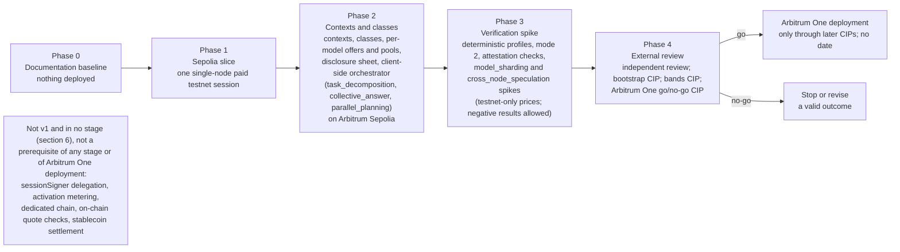

# Deployment and decentralization — stages, dependencies and what stays central

Author: Comuns contributors
Status: Draft
Category: Technical Proposal
Created: 2026-10-12
**Reference:** docs/project-charter.md, docs/evidence-register.md, docs/requirements.md, docs/security/privacy-and-contexts.md, docs/security/threat-model.md, docs/security/inference-verification.md, docs/protocol/contracts-and-settlement.md, docs/protocol/off-chain-api.md, docs/economics/cost-and-pricing.md, docs/node/node-design.md, docs/node/hardware-classes-and-benchmarks.md, docs/node/model-registry-and-licenses.md, docs/product/dapp-and-sdk.md, docs/protocol/orchestration.md, docs/protocol/collective-answers.md, docs/node/distributed-execution.md, docs/adr/README.md, docs/project-plan.md

---

## 1. Summary

Comuns is a community proposal for open-source, decentralized LLM inference settled on Arbitrum One. Nothing runs yet. **This document authorizes no deployment**: it describes, in relative order and without dates, the stages through which the proposal would move from documents to an Arbitrum Sepolia testnet to a go/no-go decision about Arbitrum One, what each stage depends on, and — honestly — which parts of the system stay central at each stage and what would measurably reduce that. No mainnet date exists; no audit, grant or partnership is claimed; "no-go" is a valid outcome of the last stage.

The stages map exactly to the five phases of docs/project-charter.md 4.11 and 4.18, which docs/project-plan.md owns in detail: **Phase 0 Documentation baseline**, **Phase 1 Sepolia slice** (one single-node paid testnet session), **Phase 2 Contexts and classes** (contexts, hardware classes, per-model offers and pools, the disclosure sheet and the client-side orchestrator with `task_decomposition`, `collective_answer` and `parallel_planning` on Arbitrum Sepolia), **Phase 3 Verification spike** (verification experiments plus the `model_sharding` and `cross_node_speculation` spikes under testnet-only prices, each allowed to end in a published negative result), and **Phase 4 External review**, which ends in an Arbitrum One go/no-go CIP. `sessionSigner` delegation to orchestrator nodes and activation metering are later CIPs and belong to no stage here.

What stays central, at every stage, is stated rather than hidden: the single Arbitrum sequencer; whoever holds the testnet deployer key and, later, the contract upgrade authority; the trust placed in self-published benchmarks; the CPU and GPU vendors behind attested mode; the context hosts and indexers users choose; the first maintainers a bootstrap CIP seats; the planner models and optional orchestrator nodes that thin clients lean on. Section 4 names a measurable reduction step for each. The system has central points at every stage described here, and this document does not describe it as free of them.

Evidence marks follow docs/evidence-register.md: **[V]** verified, **[L]** likely, **[U]** unsure; a claim not in the register is labeled UNVERIFIED. Every stage, criterion and option below is PROPOSED.

## 2. Scope

In scope: the five stages and their exit criteria; the centralization points at each stage and a reduction step for each; the dependencies on Arbitrum One and the condition under which Stylus would be revisited; future options that a later CIP could adopt; the decentralization metrics the community can observe; risks and open questions.

Out of scope and owned elsewhere: the phase contents and task lists (docs/project-plan.md); the contracts and their testing plan (docs/protocol/contracts-and-settlement.md §13); the node (docs/node/node-design.md); the client (docs/product/dapp-and-sdk.md); governance and the CIP lifecycle (GOVERNANCE.md, docs/cip/README.md); the system's components and flows (docs/architecture/system-architecture.md). This document sets no wei value, no duration and no date.

Two words are kept apart. The **stages** of this document are the five phases. L2BEAT's "Stage 1" classification of the Arbitrum One rollup (section 5) is a different scale and is always written "L2BEAT Stage 1".

## 3. Stages mapped to the five phases

Relative order only; there are no dates. Each stage ends when its exit criteria hold and the community records that in public; nothing advances a stage automatically, and nobody is seated to advance one on private authority.

| Stage | What exists | Where it runs | Exit criteria (no dates) |
|---|---|---|---|
| **Phase 0 — Documentation baseline** | This document set: charter, evidence register, requirements, protocol, security, economics, node, product and architecture documents, ADRs 0001–0009, the CIP template and docs/cip/0001-adopt-baseline-adrs.md, GOVERNANCE.md | Nowhere; no code, no deployment | Every path in the charter's document map exists; every document carries the header block, evidence citations and risks; no document claims a mainnet date, audit, grant, partnership or users; docs/cip/0001-adopt-baseline-adrs.md is filed as a Draft; the open questions of every document are collected; and the **bootstrap CIP** that names the first maintainers, the enforcement contact and the monitored private security channel has reached Final — the only seating path (GOVERNANCE.md §6 and §6.1) — before any merge or software release, because GOVERNANCE.md §6 forbids merging or releasing before seating and SECURITY.md §3 makes the monitored private channel a release gate, so no later phase could publish without it. Nobody is seated today |
| **Phase 1 — Sepolia slice** | The four contracts `NodeRegistry`, `ModelRegistry`, `ContextRegistry` and `SessionEscrow` with their fifteen functions; one reference Rust node (standard mode, llama.cpp adapter first); the reference client; testnet-only, non-normative bands and models registered through a testnet-only CIP | Arbitrum Sepolia | **One single-node paid testnet session** completes the happy path (`openSession` with expected prices, input receipt, input voucher, chunk receipts, cumulative vouchers, `closeWithVoucher`, `withdraw()`); every walkthrough of the contracts document §12 is exercised, including the abandoned-client procedure and a simulated delayed-inbox submission; the Foundry unit, reentrancy, invariant, band and EIP-712 conformance suites of §13 pass; the single-node disclosure sheet and plaintext banner are shown before signing. No multi-node feature, no context sharing, no class benchmark yet |
| **Phase 2 — Contexts and classes** | Contexts (`setContext`, `ContextSet` history, per-version keys, wallet-signed grants, inline upload, the backup export, optional hosts); the class benchmark and per-model benchmarks producing `benchmarkHash` and `modelBenchmarkHash`; per-model offers written replace-all and **pools** enumerated from `OfferSet`; the **disclosure sheet** with `readersOfFullPrompt` by node and operator; the **client-side orchestrator** with `task_decomposition`, `collective_answer` and `parallel_planning`; the optional orchestrator-node role; the capability document | Arbitrum Sepolia | Context resume on a different node (re-wrap) works against the registry history; the pool rule of the contracts document §9 is reproduced by at least one community indexer and by the client without one; a node of each class present offers a model it can load, and `openSession` never compares class to tier; the disclosure-sheet conformance test (docs/security/privacy-and-contexts.md §12, item 6) passes for each of the three features: the sheet's counts match the envelopes actually sent, checked by replaying the client's log against the AAD it emitted on the wire (`requestId`, `sheetVersion`, `role` and the reader set per envelope), never against the sheet alone; a collective answer shows the "contested" label and the original answers; a decomposed request retries a sub-task only on a sheet-listed node and fails closed when the confirmed set cannot be filled. Still single-node by default |
| **Phase 3 — Verification spike** | Attempts to demonstrate a deterministic profile on the llama.cpp and mistral.rs adapters; `verifiable` (mode 2) sessions with a user-chosen verifier; assessment of TOPLOC-style commitments on backends that have them; `attested` (mode 1) client-side quote checks against a volunteer TEE node where one exists; the **`model_sharding`** and **`cross_node_speculation`** spikes, each measured against a single node of the same class, under testnet-only, non-normative prices | Arbitrum Sepolia | A published result for each experiment, positive or negative: whether any practical deterministic profile exists on the network's backends; mode-2 mismatch rates under a demonstrated profile; the spike numbers of docs/node/distributed-execution.md §10 (throughput, TTFT, RTT sensitivity, failure and replay, acceptance rate, accounting, compatibility); the conditions of docs/security/inference-verification.md §10 recorded as met or not met. **Each spike may end in a published negative result**, and a negative result for either spike touches neither collective answers nor decomposition. Shard holders hold no session and are never paid; the reference client refuses both spikes under mainnet parameters |
| **Phase 4 — External review** | Independent review of the contracts, the cryptography, the node and the client, and of this specification; a recheck that the maintainers seated by the Phase 0 bootstrap CIP and its monitored private security channel are still in place; a bands CIP with all forty directional entries; a mainnet models CIP; the **Arbitrum One go/no-go CIP** | Arbitrum Sepolia, and the public CIP record | The go/no-go CIP reaches Final under GOVERNANCE.md (Draft → Review → Last Call of 14 days → Final); the review's findings are public and either fixed or recorded as accepted risks; whether the review is a paid audit, and who pays, is decided by the community — none is claimed here. A "go" authorizes nothing by itself: deployment to Arbitrum One then needs its own CIPs, executed by seated maintainers after the ≥7-day timelock, and still has no date. A "no-go" stops or revises the proposal and is recorded as a valid outcome |

Stages do not overlap in what they promise: Phase 1 stays one single-node session even if contributors have multi-node code ready, because the single-node path is what every later stage builds on; Phase 2's three client-side features are the only multi-node features that are proposed for v1; Phase 3's two spikes are experiments and never become v1 features by passing through the stage — only a later CIP can withdraw their experimental label.

## 4. Centralization points at each stage

Every row names something a single party controls, or that users must trust, at each stage, and a **measurable reduction step**: something whose effect can be counted, not a promise. No row has a numeric target; thresholds are for a later CIP.

| Point | Phase 0–1 | Phase 2–3 | Phase 4 and any later deployment | Measurable reduction step |
|---|---|---|---|---|
| **Sequencer** | Arbitrum Sepolia's sequencer orders the testnet | Same | Arbitrum One has a single sequencer; L1 force inclusion after about one day; no sequencer-decentralization date (evidence register §1, [V] and [U]) | Not reducible by Comuns. Publish, per stage, the count of transactions that had to use the delayed inbox and the longest observed inclusion gap; size `CLOSE_WINDOW` against them; nodes redeem promptly. Any change comes from Arbitrum, not from a Comuns CIP |
| **Contract upgrade authority** | Whoever holds the testnet deployer key deploys and can redeploy; central by construction | Same; a redeploy of the Sepolia contracts is a public act recorded on the CIP thread | Non-upgradeable contracts, or a timelock of at least 7 days controlled by seated maintainers; no upgrade may redirect escrow or change a funded session's terms (contracts document §2, R3) | Prefer non-upgradeable. Metric: the number of keys that can change contract code or parameters (zero for non-upgradeable; otherwise the published membership of the timelock), and the number of executed upgrades per stage |
| **Benchmark trust** | No benchmark yet; the one Sepolia node's class is declared | Self-published `benchmarkHash` and `modelBenchmarkHash`, signed claims, not proofs; a reported fake-GPU incident elsewhere shows such claims are gamed (evidence register §2, [L]) | Same; verifiable mode covers only mode-2 sessions | Spot re-benchmarks by community verifiers or the client on a private, rotating prompt set at random times (never the public set); opt-in unannounced spot checks of standard-mode sessions. Metric: the number of distinct verifiers publishing spot results per stage and the gap between claimed and measured speed per node |
| **Attestation vendors** (attested mode) | Not used | Client-side quote checks against a published measurement list; trust in CPU and GPU vendor roots, the attestation service (DCAP or Intel Trust Authority as the remaining CPU paths, evidence register §4, [L]), and the absence of physical access (TEE.fail, [L]) | Same; on-chain quote verification is a later option (section 6) | The measurement list is published and revocable by CIP. Metric: the number of distinct vendors and attestation services the list accepts, and the share of attested-mode sessions that depend on any single one |
| **Context hosts** | None; contexts are local-only in Phase 1 | Owner-chosen hosts store ciphertext and key-wrap records; a user with one host and no second device depends on it for ciphertext availability | Same | Publish the host protocol ("store and return by hash") so anyone can run one; the client recommends a host or a second device. Metric: the number of independent hosts in use and the share of contexts with at least two ciphertext copies (a client-side count, reported only with consent) |
| **Indexers** | None; the client reads the chain through its RPC | Community indexers build pool views from `OfferSet`; the client works without one | Same | The enumeration rule is normative in the contracts document §9, so any indexer reproduces the same view. Metric: the number of independent indexers whose pool views agree with a client's direct read, and the share of clients configured with no indexer |
| **RPC providers** | User-chosen | Same | Same | The client may use several RPCs and compare; node keys are pinned across sessions and registered with proof of possession. Metric: the number of distinct RPC endpoints clients report using (opt-in telemetry only) |
| **Bootstrap maintainers** | None seated today; the bootstrap CIP naming the first maintainers, the enforcement contact and the monitored private security channel is a Phase 0 exit item, required before any merge or software release (GOVERNANCE.md §6, SECURITY.md §3); until it is Final nobody can merge or execute | The maintainers seated by that Final bootstrap CIP hold the only merge authority; the testnet-only CIPs are written by whoever volunteers and merged only by them | The seating holds the first merge, the first timelock and the first enforcement contact, and a narrow seating concentrates all three; seating and removal only through a Final CIP | Metric: the number of distinct seated maintainers and the number of distinct organizations among them, as named in the Final bootstrap CIP; the number of removal or seating CIPs that reached Final |
| **Reference implementations** | One reference node, one reference client | Same | The protocol is the Final specification, not the reference code | Conformance tests assert the identifiers, the voucher type string and the disclosure-sheet replay. Metric: the number of independent client and node implementations that pass them |
| **Planner models** | None | A delegated planner session gives one node the full prompt and the structure of the user's problem; if one planner model dominates, the operators of its pool see most orchestrated prompts | Same | Assessment runs locally first; the planner model is user-chosen from any pool; privacy-flagged prompts stay single-node. Metric: the share of planner sessions on the top planner model, and on the top operator, per stage |
| **Orchestrator nodes** | None | Optional nodes advertising `roles.orchestration` serve thin clients; a few popular ones could concentrate the full prompts and plans of thin clients | Same; `sessionSigner` delegation, if a later CIP ever allows it, would raise the stakes | They are never mandatory; the SDK runs the same code locally; they hold no `sessionSigner`. Metric: the concentration of orchestrator-node sessions — the share held by the top node and the top operator — and the share of orchestrated requests that used no orchestrator node at all |
| **Testnet-only CIP authors** | The Sepolia bands and models come from a testnet-only CIP written by volunteers | Same | Replaced by the bands CIP and the mainnet models CIP under seated governance | Metric: the number of distinct authors and reviewers on the testnet-only CIPs, recorded in the public CIP record |

The table does not include the executing node, because that is not a centralization point: it is the one party the user chose and paid, and its plaintext access is the stated limit of the design, not a stage-dependent concentration.

## 5. Dependencies on Arbitrum

Comuns settles on Arbitrum One and tests on Arbitrum Sepolia; it changes nothing about either chain and inherits their properties as they are. The facts below are evidence register §1 unless noted.

- **Rollup maturity.** Arbitrum One is classified L2BEAT Stage 1, and BoLD permissionless validation is live on Arbitrum One, with a challenge period of about 6 days 8 hours and a 3,600 ETH stake [V]. Comuns relies on the rollup's correctness and fraud-proof system and does not audit them (threat model, out of scope).
- **Single sequencer and force inclusion.** One sequencer orders transactions; a transaction it ignores can be force-included through L1 after about one day [V]; ordering moved to priority gas auctions [L/V]; no sequencer-decentralization date exists [U]. Consequences for Comuns: `CLOSE_WINDOW` must exceed an expected outage plus about one day; nodes redeem promptly; "settled" means L2 inclusion under the sequencer, not L1 finality; the residual risk that an outage shortly before `closeDeadline` costs a node its unredeemed vouchers is stated and not guaranteed away.
- **Fees.** At the Arbiscan snapshot of 2026-10-13: gas 0.02 gwei, an ERC-20 transfer about $0.003 [V], an ETH transfer about $0.001 derived [U]. This is why payment is per session, not per prompt, and why multi-node requests pay N transaction pairs.
- **Withdrawals and chains.** Withdrawals to L1 take about 6.4 days; Arbitrum chains support a custom ERC-20 gas token; L3s on One or Nova owe no revenue share, other chains 10 % [V]. These matter only to the future options of section 6.
- **Governance separation.** The Arbitrum DAO's votes, treasury and grant programs are separate from Comuns; ARB balances are not this project's votes; no grant has been awarded and none is claimed (GOVERNANCE.md §9–§10).
- **Stylus.** New Stylus activations on One and Nova are paused since 2026-10-02 by the Security Council after hand-crafted WASM caused chain-liveness problems; active programs keep running; no reopening date [V]. ADR 0001 settles on Solidity/EVM. **Revisit condition:** a public reopening of activations **and** a new ADR that supersedes ADR 0001 through the CIP process, after docs/cip/0001-adopt-baseline-adrs.md is Final. Even then Stylus would only change how the four contracts are written: a model never runs inside a contract, and contract compute (Stylus compute is 10–100× cheaper than EVM in ink, memory 100–500× cheaper, SLOAD/SSTORE the same [V]) is a small part of this design's cost, so the case for revisiting is weak unless a later CIP adds heavier on-chain logic such as quote verification.

## 6. Future options

Each option below is **a later CIP, not a plan**; none is proposed for v1, none has a date, and adopting any of them requires amending the documents it touches.

| Option | What it would change | What the CIP must specify | Why it is not v1 |
|---|---|---|---|
| **Dedicated Arbitrum chain with a custom gas token** | Comuns contracts on their own Arbitrum chain (L3 on One, or another configuration) with a custom ERC-20 gas token [V]; lower and more predictable fees; its own sequencer | Who runs the sequencer and the chain's upgrade keys (a new centralization point); the gas token and its relation to ETH settlement and the wei-denominated bands; the operating cost versus Arbitrum One; the revenue-share rule that applies [V]; migration of open sessions | The operating cost and the new sequencer trust are unjustified before usage exists; the charter's open question 7 |
| **On-chain quote verification** | Attested status as a public on-chain fact instead of a client-side check: about 3M gas for a direct DCAP check or about 350k gas via a ZK wrapper (evidence register §4, [V/L]) | Which verifier contract, who pays the gas, how the measurement list is published and revoked on-chain, what happens to a session whose node's measurement is revoked mid-session | Cost and the remaining physical-attack limit; client-side verification suffices for Phase 3 |
| **Stablecoin settlement** | An ERC-20 stablecoin as a second settlement asset beside ETH | Bands are denominated in wei; the CIP must define per-asset bands or a conversion rule, the asset's contract risk, and how `withdraw()` handles two assets | ETH-only keeps the fifteen-function contract set and the pull-payment rule simple; the contracts document's open question 5 |
| **`sessionSigner` delegation** (thin clients) | A trusted device or an orchestrator node signs vouchers and envelopes for a client that cannot sign per chunk | Bounded caps, revocation, what the delegate may and may not do, and an amendment to the contracts document; ADR 0009 forbids it in v1 | A delegate that signs vouchers is a custodian; the orchestration document's R8 |
| **Activation metering** | A component-scoped offer and meter so cross-operator sharding could be paid | What is metered (token positions per component, never activation bytes relabeled as tokens), scoped sessions, how the client signs per step | The spike must first show that cross-operator sharding is usable at all; the distributed-execution document §7 |
| **Anyone-can-close idle timeout** | A third party may `closeSession` on a session idle beyond a governance-set bound | The bound, its effect on a slow-to-redeem node, and a sixteenth function | A new function needs a CIP; v1 keeps "only the user or the node closes" |

## 7. Observable decentralization metrics

These are quantities anyone can compute from public chain data, the public CIP record, or opt-in client reports. **No target value is set here**; a later CIP may set thresholds, and a number alone proves nothing about who is behind an address.

- **Distinct operators per class** — from `NodeRegistered`, `NodeUpdated` and `NodeDeregistered`: how many operators hold each of S, M, L and X.
- **Distinct operators per model pool** — from `OfferSet`: how many operators currently offer each `modelId`, and how many pools have a single operator (a thin pool is a single reader).
- **Share of sessions by the top node and the top operator** — from `SessionOpened` and `SessionSettled`, per model and overall; also the share of settled wei.
- **Number of context hosts** — independent hosts in use, and the share of contexts with a second ciphertext copy, from opt-in client reports only.
- **Number of indexers** — independent indexers publishing pool views, and whether their views agree with a direct chain read.
- **Concentration of orchestrator nodes** — the share of orchestrator-node sessions held by the top node and the top operator, and the share of orchestrated requests that used no orchestrator node; inferable from sessions opened on planner models by payers that also open fan-out sessions, with the caveat that chain metadata only approximates it.
- **Share of planner sessions by the top planner model** — which models' pools see most delegated planning.
- **Sessions redeemed through the delayed inbox** — a count of force-inclusions per stage, and the longest observed sequencer gap.
- **Independent implementations** — clients and nodes passing the conformance tests.
- **Seated maintainers** — the number of distinct people and organizations named by Final CIPs, and the number of distinct CIP authors and reviewers per stage.
- **Governance activity** — CIPs filed, reaching Final, and going Stagnant per stage.

A row that cannot be computed from public data is marked as opt-in, and the client never reports it without consent.

## 8. Risks

### R1 — Nothing is deployable until bands are set and maintainers are seated **[RISK] · High**

Mainnet needs forty directional band entries, registered models and a seated governance able to execute a timelock; none exists. Mitigation: Phase 1–3 run on Arbitrum Sepolia under testnet-only CIPs; the Phase 4 go/no-go CIP; no document claims a mainnet date.

### R2 — Single sequencer at every stage **[RISK] · High**

Liveness and ordering of every session and refund depend on one sequencer; force inclusion takes about one day and no decentralization date exists (evidence register §1, [V] and [U]). Mitigation: disclosed dependency, prompt redemption, `CLOSE_WINDOW` sizing; residual risk stated, no guarantee promised.

### R3 — Contract upgrade authority **[RISK] · Medium**

A timelock cannot enforce the content of an upgrade, only its delay. Mitigation: prefer non-upgradeable contracts; publish the timelock membership; the client and node warn users to settle before a scheduled upgrade executes.

### R4 — Testnet deployer and testnet-only CIP authors concentrate the early stages **[RISK] · Medium**

Whoever deploys to Sepolia and writes the testnet-only CIPs decides the early parameters. Mitigation: every act is public on the CIP record; testnet parameters are non-normative; the bands and models for mainnet need their own CIPs under seated governance.

### R5 — The stages stall because nobody contributes **[RISK] · High**

A community proposal with no seated maintainers and no funding claims may never leave Phase 0. Mitigation: a small Phase 1 slice; open CIPs; honest documents; a stalled proposal is recorded as such.

### R6 — A Phase 3 negative result is read as failure of the proposal **[RISK] · Medium**

No practical deterministic profile, no usable sharding and no WAN speed-up are each acceptable, publishable outcomes that leave v1 as specified. Mitigation: the stage table says so; a negative result for a spike touches neither collective answers nor decomposition; the pitch and charter carry the same wording.

### R7 — Planner, orchestrator-node and indexer concentration **[RISK] · Medium**

Thin clients and convenience can concentrate full prompts on a few planner pools or orchestrator nodes, and pool views on a few indexers. Mitigation: local assessment by default; orchestrator nodes optional and without `sessionSigner`; the enumeration rule public; the metrics of section 7 published per stage.

### R8 — Attestation vendor dependence **[RISK] · Medium**

Attested mode trusts CPU and GPU vendors and an attestation service, with a physical-attack limit (evidence register §4, [L]). Mitigation: the measurement list is published and revocable by CIP; attested mode is optional and fails closed; on-chain verification is a later option.

### R9 — Decentralization is overclaimed **[RISK] · High**

Readers of a summary may take "decentralized" to mean that no central point remains. Mitigation: section 4 names every central point per stage; the system-architecture document, the charter and the pitch carry the same honesty constraints; the metrics of section 7 are published rather than asserted.

### R10 — The go/no-go CIP is decided by a narrow seating **[RISK] · Medium**

The first maintainers named by the bootstrap CIP hold the first merge and the first timelock. Mitigation: seating and removal only through Final CIPs; a Last Call of 14 days with public objections; the number of distinct seated people and organizations is a published metric.

### R11 — Stylus is revisited for its own sake **[RISK] · Low**

A reopening of activations may prompt a rewrite that adds no value. Mitigation: the revisit condition requires a superseding ADR through the CIP process, and contract compute is a small part of this design's cost.

### R12 — Sepolia results mistaken for mainnet economics **[RISK] · Medium**

Testnet-only prices, bands and gas say nothing about mainnet costs. Mitigation: every testnet value is labeled non-normative; the fee snapshot is dated; no document claims a price lower than hosted APIs.

## 9. Open questions

1. **Exit criteria ownership.** Which criteria in section 3 belong in docs/project-plan.md as task-level acceptance, and which stay here as stage-level gates.
2. **Who records a stage exit** while nobody is seated — the public CIP record is the only candidate, and its timestamp source is an open question in GOVERNANCE.md.
3. **Thresholds for the metrics** of section 7: whether a later CIP should set any (for example a minimum number of distinct operators per class before a mainnet go), and how to avoid rewarding Sybil addresses.
4. **Testnet deployer key.** Whether the Sepolia contracts should be deployed from a published multi-party key even on testnet, to rehearse the mainnet arrangement.
5. **Upgradeable or not.** Whether v1 contracts on Arbitrum One should be non-upgradeable outright, given R3, and how a bug would then be handled (redeploy and migrate, with open sessions settling on the old contract).
6. **Attested mode's stage.** Whether the client-side quote checks belong in Phase 2 with the other client work or in Phase 3 with verification, which depends on a volunteer TEE node existing.
7. **Dedicated chain economics.** What usage level, if any, would make a dedicated Arbitrum chain cheaper than Arbitrum One once its sequencer and upgrade keys are counted as new central points.
8. **Stablecoin bands.** How bands denominated in wei would be stated for a second settlement asset, if a later CIP adds one.
9. **Sequencer-decentralization follow-up.** What Comuns should change, if anything, when Arbitrum's sequencer arrangement changes; today there is no date [U].
10. **Opt-in reporting.** Which client-side metrics (hosts, second copies, RPC endpoints) are worth asking users to report, and in what privacy-preserving form.
