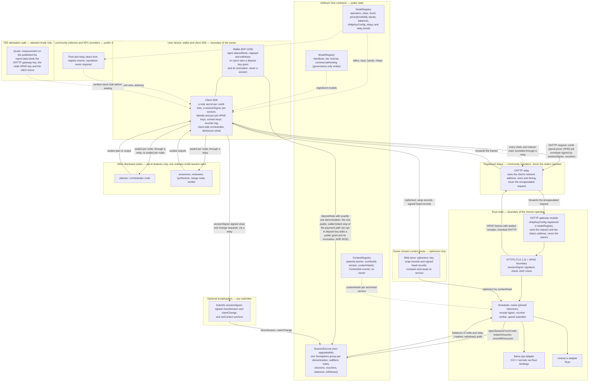

# System architecture — decentralized LLM inference on Arbitrum One

Author: Comuns contributors
Status: Draft
Category: Technical Proposal
Created: 2026-10-12
**Reference:** docs/project-charter.md, docs/evidence-register.md, docs/requirements.md, docs/security/privacy-and-contexts.md, docs/security/threat-model.md, docs/security/inference-verification.md, docs/protocol/contracts-and-settlement.md, docs/protocol/off-chain-api.md, docs/economics/cost-and-pricing.md, docs/node/node-design.md, docs/node/hardware-classes-and-benchmarks.md, docs/node/model-registry-and-licenses.md, docs/product/dapp-and-sdk.md, docs/protocol/orchestration.md, docs/protocol/collective-answers.md, docs/node/distributed-execution.md, docs/adr/README.md, docs/project-plan.md, docs/cip/0002-anonymous-credits-relays-and-ownerless-contexts.md, docs/adr/0013-repositories-toolchains-ci-and-releases.md (proposed), docs/adr/0014-relay-authentication-to-gateways.md (proposed), docs/adr/0015-node-key-possession.md (proposed), docs/adr/0016-funding-edge-and-deposit-key.md (proposed), docs/adr/0017-accounts-and-decentralized-access.md (proposed), docs/adr/0018-one-client-stack.md (proposed)

---

## 1. Summary

Comuns is a community proposal for an open-source, decentralized network that runs inference on large language models. Nothing runs yet: no contract is deployed, no node exists, no relay exists, no maintainer is seated, no audit has been performed and no mainnet date exists. This document is the integrating view of the proposal. It names the components, the trust boundary around each one, and the flows that connect them; every detail belongs to the document that owns it (the Reference list above), and this document reuses those documents' identifiers without redefining them. Where this document and an owning document disagree, the owning document wins. The decisions behind the privacy design are docs/adr/0010-anonymous-by-default.md, docs/adr/0011-anonymous-credits.md and docs/adr/0012-contexts-without-a-wallet-link.md, proposed for adoption by docs/cip/0002-anonymous-credits-relays-and-ownerless-contexts.md.

The architecture in twelve sentences:

- **The chain settles and coordinates; it never runs a model.** Four Solidity/EVM contracts on Arbitrum One — `NodeRegistry`, `ModelRegistry`, `ContextRegistry` and `SessionEscrow`, with a closed list of twenty-three state-changing functions — record who offers which model at what price, which relays exist, which models exist, which context versions exist by hash, and how an anonymous credit pays a node for a session. Inference is not a contract call.
- **The chain stores offers, notes and sessions, never pool lists, plans or sub-task assignments.** A model's pool is an off-chain view of the offers `prices[modelId]` in `NodeRegistry`; a plan is a client-side object; nothing orchestration-related is on-chain.
- **Inference runs off-chain in Rust nodes** with pluggable backends (llama.cpp through Rust bindings first, mistral.rs second; evidence register §3, [V]) run by independent operators. Rust alone is not claimed to make inference faster. Inference runs only on network nodes; the client performs no model computation.
- **Two promises, kept apart.** In standard mode the executing node can read the content but should not learn who asked. In attested mode the node should not be able to read your prompt either, barring a physical attack on the hardware (evidence register §14). v1 encrypts the hop with two-way HPKE, not the computation; everyone not selected for a request sees ciphertext and public metadata only.
- **Every request goes through a registered relay.** Client-to-node traffic uses Oblivious HTTP (RFC 9458): the relay sees the client's network address and not the prompt, the node sees the prompt and not the network address. Relays are community operators distinct from nodes; the project operates none; with no relay available the request fails closed and never connects directly.
- **One node runs a request by default (single-node execution).** The per-request `executionFeatures` set is empty unless the user opts in; every multi-node execution feature — `collective_answer`, `parallel_planning`, `task_decomposition`, and the experimental `model_sharding` and `cross_node_speculation` — is opt-in per request and disclosed on a disclosure sheet before the user spends anything.
- **Payment is an anonymous ETH credit with pull payments**: the user deposits once into a fixed-denomination note group in `SessionEscrow` (`depositNote`, the one public, wallet-linked step of the payment path; an opt-in deposit key adds a public grant and its revocation, [ADR 0016](../adr/0016-funding-edge-and-deposit-key.md)); a node or broadcaster later opens a session with a zero-knowledge spend proof (`openSessionFromCredit`), so the session has no payer address; client-signed cumulative EIP-712 vouchers pay each delivered chunk; `claimChange` returns unused value as fresh notes; and the only function that sends ETH is `withdraw()`. The inference payment is not L2 gas; protocol fee 0; no token.
- **No slashing in v1.** Withdrawable registration bonds only, for nodes and for relays; disputes are reputation events; a signed voucher is never reversed; the user's remedy is to stop signing.
- **Stylus is not the v1 target** because new Stylus activations are paused on Arbitrum One and Nova since 2026-10-02 with no reopening date (evidence register §1, [V]) — and a model could not run inside a contract in any case.
- **A context is owned by a key, not by a wallet address.** The client holds a random per-context key; `contextId = keccak256(contextPubKey)`; the chain never records which wallet holds which context. "Shared between the nodes" means portable ciphertext whose per-version keys the client re-wraps to each node, never a plaintext replica.
- **Hardware classes S < M < L < X price work through governance-set bands and never gate which model a node may offer**; tiers T0–T4 label models by parameter count.
- **Everything here is PROPOSED** and binds only once adopted through the CIP process in GOVERNANCE.md.

Evidence marks follow docs/evidence-register.md: **[V]** verified, **[L]** likely, **[U]** unsure; a claim not in the register is labeled UNVERIFIED.

## 2. Scope and non-goals

**In scope:** the components of the proposal and their trust boundaries; the actors, including relay operators; the credit, session and job lifecycle; context resume on a different node; a summary of privacy modes and execution features, payments, verification, nodes, models and pools, applications and orchestration; what is public versus private; failure handling; what the community owns; risks and open questions. Each summary points at its owning document.

**Non-goals**, each deliberately:

- Training, fine-tuning and federated learning — the scope is LLM inference only (docs/project-charter.md 4.1).
- A new L1 — settlement is on Arbitrum One.
- A dedicated Arbitrum (Orbit) chain in v1 — a later option, not a v1 plan (docs/architecture/deployment-and-decentralization.md).
- A protocol token, staking rewards or emissions.
- Cryptographic private inference as a v1 path — see section 14.
- Model computation on the user's device — inference runs only on network nodes, and the client keeps transport, orchestration and sampling decisions only.
- A project-operated relay, matcher or proxy — relays are registered community operators, distinct from nodes; no part of the protocol requires a project-run service; the hosted funding and sign-in conveniences of [ADR 0016](../adr/0016-funding-edge-and-deposit-key.md) and [ADR 0017](../adr/0017-accounts-and-decentralized-access.md) are optional and are not such a service.
- Slashing — no slashing function exists in v1, for nodes or for relays.
- A dedicated anonymous withdrawal entry point — credits are spent on sessions or exited by a public, bounded `ragequit` (section 10).
- On-chain plans, pool lists or sub-task assignments — there is no `PlanRegistry`, `OrchestratorRegistry` or pool payee.
- Multi-party sessions — a session has one credit, one node, one model.
- A mandatory orchestrator — the orchestrator is open-source code in the user's app; orchestrator nodes are optional.
- Open-internet sharding as a v1 promise — `model_sharding` is an experimental Phase 3 spike that may end in a published negative result.

## 3. Design principles

1. **Open source.** Code and documents are Apache-2.0 with a DCO; the specifications, the contracts and the node are forkable (GOVERNANCE.md).
2. **Community-driven.** Decisions are CIPs under rough consensus; no coin vote; ARB balances are not this project's votes; no maintainers are seated and the first are named by a public CIP.
3. **Key-owned history.** Contexts — transcripts, documents, system prompts — are owned by a per-context key held in the client vault, encrypted client-side under a random key per version, tied together by a signed hash chain, optionally anchored on-chain by hash only, and shared with a node only by a client-signed grant. One wallet owns one-to-many contexts, but that list never leaves the device.
4. **Honest privacy limits.** The chosen node reads the prompt in standard mode but should not learn who asked; attested mode adds that the node should not be able to read the prompt, barring a physical attack; every multi-node feature adds readers; the disclosure sheet counts them by distinct node and distinct operator before the user spends anything. Identifying text and writing style can deanonymize the author whatever the transport hides.
5. **Small hardware can join.** A class S node may offer any registered model it can load; the small-hardware path is a target to validate, not a measured minimum (docs/node/hardware-classes-and-benchmarks.md §8).
6. **Prices rise with class.** For the same model, `floorIn(c+1) > ceilingIn(c)` and `floorOut(c+1) > ceilingOut(c)` for adjacent classes, so stronger hardware charges more and weaker hardware charges less (docs/economics/cost-and-pricing.md §6).
7. **Inference only.** The protocol provides answers, never permission to act; planner output and every intermediate text are untrusted data.
8. **Anonymous by default.** No wallet address, account, API key or persistent identifier reaches a node; `sessionSigner` is a fresh key per session; every session-specific chain read goes through the same relay transport as the jobs; a missing relay fails closed (docs/adr/0010-anonymous-by-default.md).

## 4. Actors

| Actor | What it does | What it holds | Trust in v1 |
|---|---|---|---|
| User | Owns prompts, contexts and credit notes; picks a model, then a node from its pool; opts into execution features per request | Wallet key (signs `depositNote`, `ragequit` and `withdraw`; only if the user opts in does it also sign account setup, bounded swaps or intents in its own account, and a deposit-key grant and its revocation ([ADR 0016](../adr/0016-funding-edge-and-deposit-key.md), proposed); the deposit key signs only `depositNote`; no account key, deposit key or login ever signs a voucher, envelope, spend, close or `claimChange`, and none is sent to a node or a relay); a note secret per credit note; client identity HPKE key and backup; context keys; `sessionSigner` per session; voucher log | Trusted with its own data; a compromised client defeats every client-side guarantee |
| Chosen operator (executor) | Runs the selected Rust node, which is also an OHTTP gateway; serves one session per `(node, modelId)`; submits `openSessionFromCredit` for the user's spend | Node HPKE keyring, OHTTP gateway key, receipt-signing key, operator Ethereum key, bond | Reads plaintext in standard mode, should not learn who asked; chosen by the user, paid from the credit |
| Relay operator | Runs a registered relay that forwards OHTTP requests and responses between clients and node gateways; earns the relay fee `RELAY_FEE_WEI` (may be 0) per credit session | Relay endpoint, relay bond, operator Ethereum key; no OHTTP key and no HPKE key | Sees the client's network address, sizes, timing and the target gateway, never the encapsulated request; untrusted for content; must be a different entity from the node for the separation to hold (evidence register §15, [V]) |
| Broadcaster (any submitter) | Submits a `sessionSigner`-signed `closeSession` or `claimChange` for a credit session, so the deposit wallet never does | Nothing; the signature authorizes the call | Untrusted; learns no more than the public call |
| Other operators | Run unselected nodes | Their own keys | Untrusted; see ciphertext only |
| Governance (none seated) | Through the timelock: `setBands`, `setCreditParameters`, `registerModel`, `updateModel`; seats maintainers only through a Final CIP | Nothing yet | Nothing governance-gated can happen until a bootstrap CIP is Final. On Arbitrum Sepolia, GOVERNANCE.md section 7.1 applies: the seated maintainer executes the deployment and the permitted setters from a disposable testnet key after the required testnet-only CIP is Final, with no timelock; mainnet is unchanged. |
| Sequencer | Orders Arbitrum One transactions; single sequencer, L1 force inclusion after about one day (evidence register §1, [V]) | — | Untrusted for confidentiality; semi-trusted for liveness |
| RPC provider | Serves chain reads and relays transactions; reached through a relay for every session-specific read | — | Untrusted; may lie about state (threat model T7) |
| Context host | Stores context ciphertext, key-wrap records and signed head records; owner-chosen | Ciphertext only | Untrusted for content; trusted for availability **and for sequencing** unless the context is anchored on-chain |
| Community indexer | Enumerates pools and relays from registry events, surfaces reputation; optional; a backend behind the relay transport, never an alternative to it | Public data only | Untrusted; the client works without one |
| Planner or assessor node (opt-in) | Receives the full prompt to assess or plan it | Its own session | Full-prompt reader; its plan is data |
| Peer answerer, reviewer, synthesizer (opt-in) | `collective_answer` and `parallel_planning` roles | Their own sessions | Full-prompt readers |
| Merge node (opt-in) | Joins named sub-task outputs | Its own session | Full-prompt reader (inputs assumed to quote the prompt) |
| Verifier (opt-in, mode 2) | User-chosen second node that re-executes under a demonstrated deterministic profile | Its own session, funded by its own credit | Disclosed full-prompt reader |
| Orchestrator node (optional) | Serves thin clients; plans, merges or synthesizes through an ordinary session | Its own session; **no** `sessionSigner` | Full-prompt reader whenever it plans, merges or synthesizes; never mandatory |
| Shard holder, draft node, target node (experimental) | Phase 3 spike roles only; shard holders also run embedding and output-layer computation, which the client does not | Shard holders hold no session and are unpaid volunteers; draft and target hold ordinary credit sessions under testnet-only prices | Treated as full-prompt readers (evidence register §10, [V]) |
| Network observer | Sees TLS traffic sizes and timing | — | Untrusted; TLS and OHTTP hide content, not sizes or timing |

## 5. Components and trust boundaries

Each subgraph below is a trust boundary. The client mediates every exchange of intermediate data between nodes: outputs return sealed to the client, which re-seals only the approved parts to the next disclosed recipient. Every client-to-node message, and every session-specific chain read, passes through a relay. No pool appears, because a pool is a view of offers and never a payee.



| Component | Responsibility | Trust assumption | Data it can see | Failure behavior | Operator |
|---|---|---|---|---|---|
| Wallet (EIP-1193) | Signs `depositNote`, `ragequit` and `withdraw`; only on opt-in, also account setup, bounded swaps or intents in its own account, and a deposit-key grant and its revocation ([ADR 0016](../adr/0016-funding-edge-and-deposit-key.md), proposed); never a session; never derives encryption keys; `eth_getEncryptionPublicKey` and `eth_decrypt` are forbidden (deprecated, evidence register §4, [V]) | Trusted with the user's funds; its address is public at the deposit | Transaction fields; never the prompt, never a session | A declined signature sends nothing | User |
| Client SDK and reference dapp, including the **client-side orchestrator** | Holds a fresh Semaphore identity per note, the identity and per-job HPKE keys and the context keys; generates `sessionSigner` and `commitKey` per session; proves the credit spend; keeps the voucher log; assesses and plans with the open-source orchestrator code, computes and shows the disclosure sheet, seals every envelope, re-seals intermediate data, signs every voucher and every grant; performs transport, orchestration and sampling decisions only, never model computation | The user's own device, not a reader; a compromised client defeats every guarantee (privacy doc R5) | **The full prompt, locally**; every context in plaintext; every intermediate result; it **holds the keys and signs every session's vouchers** | Lost voucher log: signs nothing more on that session, closes unilaterally through a broadcaster, reclaims `pendingWei` with `claimChange`; lost note secret: that note is gone; lost identity key and backup: every context lost | User |
| Rust node (executor) with backend adapters and the **OHTTP gateway module** | Terminates OHTTP with its registered `ohttpKeyConfig`; verifies the `sessionSigner` signature and AAD, decrypts, admits, meters with the pinned tokenizer, runs the backend, signs receipts, verifies vouchers, submits `openSessionFromCredit` and redeems on-chain; llama.cpp (C/C++ kernels via Rust bindings; CPU, CUDA, Metal, Vulkan, ROCm) and mistral.rs (Rust; CUDA, Metal, CPU) adapters (evidence register §3, [V]) | Chosen by the user; reads plaintext in standard mode; no-logging is a policy, not a protection | Prompt, granted context versions, completion, token counts, job metadata, the relay's address; never the client's network address | Offline mid-stream: the answer is truncated; the node redeems its highest non-final voucher while legal, then `closeSession`; unpaid exposure one chunk | Independent operator |
| **Relay** (role of a registered operator) | Forwards OHTTP requests and responses between clients and node gateways; also forwards relay-tunnelled chain reads; paid `relayFeeWei` from the first value a credit session settles; authenticates to each gateway per TLS connection with an operator-signed credential that carries no client data (docs/adr/0014-relay-authentication-to-gateways.md, proposed), and the gateway serves nothing without it | Untrusted for content; a relay and a node that collude, or one operator holding both roles under two addresses, can correlate timing and sizes (not checked on-chain) | Client network address, sizes, timing, target gateway; never the envelope | Unavailable relay: the client picks another at random; with none, the request fails closed, never a direct connection | Community operators |
| `NodeRegistry` | Operators, class, bond, `maxTier` (informational), `prices[modelId]` offers written replace-all, `ohttpKeyConfig`, relay records `(operator, endpoint, bondWei, unlockAt)`, bands via `setBands`, released bonds in `balances[]`; one address is never both node and relay | Contract code; governance timelock for `setBands` only | Public metadata | A bands change blocks new sessions on offers outside the new band; open sessions keep copied prices | Nobody; governance for bands |
| `ModelRegistry` | `modelId = keccak256(manifestHash)`, tier, `licenseSpdx`, `commercialHosting`, `metadataUri`; `registerModel` and `updateModel` governance-only in v1 | Governance registered the manifest honestly | Public | With nobody seated there is no mainnet registration; Sepolia models come from a testnet-only CIP | Governance |
| `ContextRegistry` | Optional public anchor: latest `(version, contentHash)` per `contextId`; `ContextSet` per version; `version == previous + 1`; `setContext` by any caller with a context-key signature | Contract code; the default client does not need it | Hashes and a context public key only; no owner, never content or ciphertext | A `setContext` race reverts the loser, which rebases and republishes | Nobody |
| `SessionEscrow` (non-upgradeable) | Credit groups (one Semaphore v4 LeanIMT per denomination index, own nullifier set and root window), `depositNote`, `openSessionFromCredit`, `redeemVoucher`, `closeWithVoucher`, `closeSession`, `finalize`, `claimChange`, `ragequit`, `withdraw()`; wallet `openSession` and `topUp` stay specified for a direct caller; pull payments; checks-effects-interactions and `nonReentrant` on every function | Contract code; no upgrade path (ADR 0011); only `setBands` and `setCreditParameters` are governance-timelocked; the Semaphore verifier is stateless (evidence register §15, [V]) | Node, relay, model, mode, `sessionSigner`, prices, denomination index, nullifier, cumulative counts, `outputCommitment`; no payer | Sequencer outage delays redemption; `CLOSE_WINDOW` must exceed an outage plus about one day of force inclusion; residual risk stated | Nobody |
| Owner-chosen context host | Stores ciphertext blobs, key-wrap records and signed head records by `contentHash`; accepts a new version only by compare-and-swap on `version == head + 1` | Untrusted for content; trusted for availability and for sequencing by the owner's choice | Ciphertext, wrap records it cannot open, sizes | Unavailable host: a version whose ciphertext exists nowhere else cannot be resumed; the backup carries keys, not ciphertext | Owner-chosen |
| Community indexer (optional) | Builds pool and relay views from `OfferSet`, `NodeDeregistered`, `RelayRegistered` and `BondWithdrawn`; surfaces staleness and reputation; reached through a relay | Untrusted; user-chosen; a client can read the chain without one | Public chain data | Client falls back to relay-tunnelled RPC reads | Community |
| RPC provider | Chain reads and transaction relay | Untrusted; user-chosen; may be compared against another | Public chain data; the relay's address when reached through a relay | A hostile RPC can point the client at a wrong node key; the client reads keys only from the latest `NodeRegistered` or `NodeUpdated` event in its own relay-tunnelled chain view, may compare RPCs, and pins keys across sessions. The `key_probe` of docs/adr/0015-node-key-possession.md (proposed) checks that the live gateway holds the registered keys and does not by itself stop a hostile RPC presenting a key the attacker holds | User-chosen |
| TEE attestation path (attested mode) | The node generates its OHTTP gateway key and its HPKE key inside the TEE; the quote's report data commits to both and to the client's nonce, and docs/adr/0015-node-key-possession.md (proposed) adds `receiptPublicKey` before attested mode is enabled; the quote does not replace the client's key probe; the client checks the measurement list and vendor collateral before sealing | CPU and GPU vendor roots of trust, the attestation service, and no physical access (TEE.fail, evidence register §14, [V]) | In attested mode the node should not be able to read your prompt; a physical attack on the hardware can break that | Any failed check fails closed; never a silent downgrade to standard | Node operator plus vendors |
| Sequencer | Orders transactions | Untrusted for confidentiality; semi-trusted for liveness | Public metadata | Outage: force inclusion through L1 after about one day (evidence register §1, [V]) | The single Arbitrum One sequencer operator |
| **Optional orchestrator node** | Runs the same open-source orchestrator for thin clients: assesses, plans, may merge or synthesize, returns `(node, modelId, cap)` lists sealed to the client | Full-prompt reader whenever it plans, merges or synthesizes; **paid through an ordinary credit session**; takes no cut; **holds no `sessionSigner`** and custodies no session; never mandatory | **The full prompt and the plan when planning is delegated**; merge inputs and answers assumed to quote the prompt | Its output is data the client validates; offline: the client's own orchestrator code plans or the request stops; it cannot add a recipient, raise a cap or change a model | Independent operator |
| **Planner node** (stage 1 of orchestration; every planner in `parallel_planning`) | Returns an Assessment and a plan DAG, sealed to the client | Full-prompt reader; its plan never authorizes recipients, spending, tools or actions | The full prompt and the structure of the user's problem | An invalid DAG is rejected by the client's validator; the user can reject the plan | Independent operator |
| **Peer answerers** (`collective_answer`) | k ≥ 2 nodes answer the same prompt independently, each sealed separately | Each is a full-prompt reader; no payment consequence of disagreement | The full prompt and granted context | One disappears: the run continues only if the result still meets the confirmed k; otherwise it fails closed and the user decides | Independent operators |
| **Reviewers and synthesizer** (`collective_answer`, `parallel_planning`, sub-task review) | In `collective_answer` and `parallel_planning` a reviewer critiques the anonymized answers or plans under stable IDs `A1…Ak`, in randomized order, twice with positions swapped; the synthesizer returns the merged answer, the splits list and an agreement level. A sub-task reviewer receives only that sub-task and its output, judged twice with positions swapped where there is more than one candidate output (docs/protocol/collective-answers.md §4 and §11) | Collective and plan reviewers receive the prompt and are full-prompt readers; the synthesizer is a remote full-prompt reader; a sub-task reviewer is a full-prompt reader only when its payload contains prompt text, which is assumed unless the client verified it contains none | Prompt plus all answers or plans (collective and plan reviewers); prompt, answers and critiques (synthesizer); one sub-task and its output (sub-task reviewer) | A synthesis is incomplete only when required fields are missing or malformed; then raw answers and critiques are shown; a difference between the two swapped passes is expected | Independent operators |
| **Merge node** (`task_decomposition`) | Receives exactly the named outputs and produces one text (strategy `synthesize`); `concatenate` needs no merge node | Full-prompt reader: its inputs are assumed to quote the prompt | Sub-task outputs | A contested merge is shown beside its inputs and objections, never as verified | Independent operator |
| **Verifier** (verifiable mode) | Re-executes the same prompt under a demonstrated deterministic profile; the client compares locally; reached through a relay and funded by its own credit | Disclosed full-prompt reader; two operators that do not collude | The full prompt | Mismatch: both outputs shown, reputation event at the user's choice, no refund, penalty or slash | Independent operator, user-chosen |
| **Shard holders** (EXPERIMENTAL, Phase 3 spike) | Each holds a contiguous layer range; embedding and output-layer computation run on disclosed network nodes, which are readers and unpaid volunteers like the other holders; the client mediates every stage boundary and keeps transport, orchestration and sampling decisions only; activations travel through a relay, OHTTP-encapsulated to the holder's registered `ohttpKeyConfig`, with no inner job HPKE envelope, and no direct client-to-holder connection exists | **Treated as plaintext readers**: prompt inversion from activations reaches 88.4 % token accuracy on a 65B model and 86.88 token F1 on a 4,112-token prompt (evidence register §10, [V]) | Activations of its layer range, hence in effect the prompt | A lost holder: restart on a new sheet-listed chain, or client-mediated replay of cached stage inputs; **holds no session, never paid**, in v1 or in the spike (the unpaid spike is exempt from the rule that every paid recipient has a credit session) | Volunteer operators |
| **Draft node and target node** (EXPERIMENTAL, Phase 3 spike) | The draft node proposes γ ≤ `MAX_DRAFT_TOKENS` tokens per round with per-token probability distributions as sealed metadata (or greedy-only); the target verifies; drafts are routed through the client | **Both are full-prompt readers**; the target also sees the drafts; refused under mainnet parameters; incompatible with verifiable mode | Prompt (both); drafts and distributions (target) | Draft node dropped: the target continues alone; rejected drafts are still billed to the draft session; no WAN speed-up is promised (evidence register §9, quote [V], not independently replicated [U]) | Independent operators, testnet only |

The contract list is closed and has **twenty-three** state-changing functions, defined in full, with signatures, in docs/adr/0011-anonymous-credits.md and transcribed in docs/protocol/contracts-and-settlement.md. Of the original fifteen, `registerNode`, `updateNode`, `setContext`, `redeemVoucher`, `closeWithVoucher`, `closeSession`, `finalize` and `withdrawBond` are amended or extended; eight names are new.

| # | Function | Contract | What it does |
|---|---|---|---|
| 1 | `registerNode` | NodeRegistry | Registers a node with its HPKE key and `ohttpKeyConfig`, offers and bond; reverts for a registered relay |
| 2 | `updateNode` | NodeRegistry | Replace-all update of the same fields |
| 3 | `deregisterNode` | NodeRegistry | Starts the bond unlock and clears offers |
| 4 | `withdrawBond` | NodeRegistry | Releases a node's bond, or a deregistered relay's bond, to `balances[operator]` after `BOND_UNLOCK_DELAY` |
| 5 | `withdraw` | NodeRegistry and SessionEscrow | Sends the caller's whole credited balance; the only function that sends ETH |
| 6 | `registerModel` | ModelRegistry | Governance-only model registration |
| 7 | `updateModel` | ModelRegistry | Governance-only metadata update |
| 8 | `setContext` | ContextRegistry | Publishes a context version with `contextPubKey` and a context-key signature; any caller |
| 9 | `openSession` | SessionEscrow | Wallet-funded session, retained for a direct caller; the reference client has no call site |
| 10 | `topUp` | SessionEscrow | Raises a wallet session's deposit; reverts on a credit session |
| 11 | `redeemVoucher` | SessionEscrow | Pays an incremental voucher; credit sessions split the payout between relay and node |
| 12 | `closeWithVoucher` | SessionEscrow | Cooperative close; credit sessions record `pendingWei` instead of a user refund |
| 13 | `closeSession` | SessionEscrow | Starts the unilateral close; for a credit session the node, or any caller with a `sessionSigner` signature |
| 14 | `finalize` | SessionEscrow | Anyone, after `closeDeadline`; credit sessions record `pendingWei` |
| 15 | `setBands` | NodeRegistry | Governance-only price bands |
| 16 | `setCreditParameters` | SessionEscrow | Governance-only. A non-zero `denominationWei` appends one denomination; every call sets `RELAY_FEE_WEI`, and `denominationWei == 0` only sets the fee |
| 17 | `depositNote` | SessionEscrow | Deposits exactly one denomination and inserts a commitment into that group |
| 18 | `openSessionFromCredit` | SessionEscrow | Opens a session from a Semaphore spend proof; submitted by the node or any broadcaster |
| 19 | `claimChange` | SessionEscrow | Mints fresh change notes for a settled session's `pendingWei`, dust to the node |
| 20 | `ragequit` | SessionEscrow | Public, linkable exit of one note, bounded by the caller's own net deposits in that group |
| 21 | `registerRelay` | NodeRegistry | Registers a relay with a bond |
| 22 | `updateRelay` | NodeRegistry | Updates a relay's endpoint |
| 23 | `deregisterRelay` | NodeRegistry | Starts the relay bond unlock |

## 6. Wallets, notes and contexts

A wallet is the only on-chain account a user needs. It signs `depositNote` (and, if ever needed, `ragequit` and `withdraw`); only if the user opts in does it also sign account setup, bounded swaps or intents in its own account, and a deposit-key grant and its revocation ([ADR 0016](../adr/0016-funding-edge-and-deposit-key.md), proposed). The deposit key signs only `depositNote`. No account key, deposit key or login ever signs a voucher, envelope, spend, close or `claimChange`, and none is sent to a node or a relay. On the core path there is no email login, no password and no seed-phrase collection; an optional embedded wallet with email or social sign-in ([ADR 0017](../adr/0017-accounts-and-decentralized-access.md), proposed) is a funding-surface convenience whose identity is never sent to a node or a relay. No wallet address ever reaches a node. A wallet never signs a session. Each wallet owns many **contexts** — versioned, content-addressed blobs of transcripts, documents and system prompts — but that ownership is local: no chain record and no node learns which wallet holds which context (docs/adr/0012-contexts-without-a-wallet-link.md; docs/security/privacy-and-contexts.md §7, normative).

- **Notes.** Every credit note, whether from a deposit or from change, carries a fresh Semaphore identity generated by the client, which stores the note secret durably before the commitment is published. A reused identity would make a second note unspendable and a commitment in two groups would link them, so `SessionEscrow` rejects any commitment it has already seen. A note whose secret is lost is gone; there is no recovery and no admin (docs/adr/0011-anonymous-credits.md).
- **The context identity is a key.** The client generates a random per-context signing key from the operating-system CSPRNG, never the wallet key and never derived from it. `contextId = keccak256(contextPubKey)`, and a node verifies that equality before it accepts anything about the context.
- **Per-version keys and the hash chain.** Each context version `v` has its own random 256-bit key `K_v` from the client CSPRNG; ciphertext = ChaCha20-Poly1305(`K_v`, nonce = 12 random bytes in the blob header, AAD = contextId ‖ v ‖ prevContentHash); there is no owner field. `contentHash` = keccak256 of the complete stored blob (header ‖ ciphertext ‖ tag) — the one canonical definition. Each version has a head record `(contextId, version, contentHash, prevContentHash)` signed as EIP-712 typed data by the context key; the chain runs back to version 1, whose `prevContentHash` is zero.
- **The default integrity path is off-chain.** The context host accepts a new version only by compare-and-swap on `version == head + 1`; a client that loses the race keeps its local edit, rebases on the new head and publishes the next version — no silent merge. With the chain no longer the default anchor, **the context host is trusted for sequencing as well as for availability.** Clients persist every accepted head checkpoint in the vault and in the identity-key backup and reject any head behind a checkpoint they hold. A host can still equivocate between two devices that have never compared checkpoints, and a device restored from a stale backup accepts a head that a newer device would reject until the two sync. Whenever a globally consistent multi-device head is promised, an anonymous public anchor is required: `setContext(contextId, version, contentHash, contextPubKey, signature)` submitted by a broadcaster or a node, never by the user's wallet.
- **"Shared between the nodes" means portable ciphertext, never a plaintext replica.** A grant carries `contextPubKey` and `contextSignature` (a signature by the context key, never by the wallet and never by `sessionSigner`), wraps exactly the `K_v` of the granted versions to the node's registered HPKE key, names `contextId`, `fromVersion`, `toVersion`, `expiresAt` (unix seconds, `uint64`, never a block number) and `nodeKeyHash`, and travels inside the job plaintext under the job's HPKE envelope. A narrow grant restricts decryption cryptographically. Nodes never exchange plaintext or keys. Revocation is not granting later versions; a node cannot be made to forget what it already decrypted, and every document says so.
- **Identity key and backup.** Every `K_v` is also wrapped to the client's long-lived identity HPKE key (mandatory) and stored as a key-wrap record beside the ciphertext. The list of the wallet's context keys lives only in the local vault, encrypted under the identity key, and in the backup; it is never sent to a node and never written on-chain. The backup export contains the identity key, that list and every key-wrap record, and no ciphertext: a context whose ciphertext existed only on a lost device is gone even with the backup. The client recommends at least one context host or a second device for ciphertext.
- **Residual linkage.** A `contextId` is a pseudonym: every node that receives grants for it can group the sessions that granted it, and a public anchor links that context's versions on-chain. Turns within one conversation are inherently linkable; the shipping precedent accepts the same (evidence register §16, [V]). A client may fork a context under a new key to break the chain, at the cost of a new pseudonym with no history; the disclosure sheet's `anonymity.contextLinkage` field states which of these apply to a request.
- **Delivery.** By default the client uploads a granted version's ciphertext inline in the job's upload frames; an optional `blobUrl` is allowed only as https to a public address under the SSRF rules of docs/protocol/off-chain-api.md §9, is never a signed grant field, and a node may refuse it.
- **Forbidden:** sign-to-derive as a default, `eth_getEncryptionPublicKey`, `eth_decrypt`, any dependency on ERC-5630 (a Draft, evidence register §4, [V]), deriving a context key or a note secret from the wallet key, and identity reuse across notes.

Context tokens are input tokens: they appear in the input receipt and the input voucher.

## 7. Credit, session and job lifecycle

One credit session pays one node for one model in one mode; many jobs run inside it, one at a time (`maxConcurrentJobsPerSession = 1`). A user deposits once; each session then follows the same path: client → relay → node, the node submits `openSessionFromCredit`, vouchers pay each chunk off-chain, `closeWithVoucher` settles it, and `claimChange` turns the unused remainder into fresh notes. Details: docs/protocol/contracts-and-settlement.md (contracts, the canonical `Voucher`), docs/protocol/off-chain-api.md (wire), docs/security/privacy-and-contexts.md (envelopes, receipts, `outputCommitment`).

```mermaid
sequenceDiagram
    participant W as Wallet
    participant C as Client SDK (note secrets, sessionSigner, HPKE keys, voucher log)
    participant R as Relay (OHTTP, registered operator)
    participant N as Chosen node (OHTTP gateway)
    participant E as SessionEscrow and NodeRegistry
    participant B as Broadcaster (optional)
    C->>C: fresh Semaphore identity, note secret stored durably before the commitment is published
    W->>E: depositNote(identityCommitment, denominationIndex) + exactly one denomination, once: the only public wallet-linked step
    C->>R: discover through a relay-tunnelled read: models, OfferSet for modelId, registered relays, BandsSet, group root and witness
    R-->>C: pool of modelId (price, class, modes, endpoint, ohttpKeyConfig) and the relay set
    C->>C: pick a relay at random, relay is not the node, quote check against the band, mode advertised, commercialHosting true
    C->>C: disclosure sheet v1: standard mode, this node can read the prompt and should not learn who asked, relay sentence, group size, caps, user confirms
    C->>C: fresh sessionSigner, Semaphore proof: scope keccak256(chainId, escrow, denominationIndex), message binds node, relay, model, mode, sessionSigner and the two expected prices
    C->>R: OHTTP request to the node's ohttpKeyConfig: credit_spend (denomination, root, nullifier, points, expected prices)
    R->>N: forwards, the relay sees the client's address and not the request, the node sees the request and not the address
    N->>E: openSessionFromCredit(node, relay, modelId, mode, sessionSigner, expected prices, denominationIndex, depth, root, nullifier, points), the node pays the gas
    E-->>N: SessionOpened (user = address(0), depositWei = maxSpendWei = the denomination) and CreditSessionOpened, relayFeeWei copied
    N-->>C: session_opened, through the relay, information only
    C->>R: read the session record through the relay, compare copied prices and nullifier with sheet v1, on a difference sign nothing and close
    C->>R: hello, signed by sessionSigner, then the job envelope: HPKE to the node key (prompt, grant, commitKey, clientJobPublicKey, params), AAD, sessionSigner signature
    R->>N: forwards the encapsulated envelope
    N->>N: verify the signature before decrypting, check AAD, grant, contentHash, tokenize with the pinned tokenizer
    N-->>C: input receipt (sessionId, jobId, jobInputTokens, cumulativeInputTokensAfter), before prefill, through the relay
    C->>R: input voucher (seq 1, cumulative inputTokens) only if both client checks pass
    R->>N: forwards the voucher
    loop each chunk of at most CHUNK_TOKENS output tokens
        N-->>C: HPKE frame to clientJobPublicKey through the relay, chunk receipt sealed inside
        C->>R: cumulative voucher (seq n, outputCommitment = keccak256(commitKey ‖ sessionId ‖ n ‖ transcriptHash))
        R->>N: forwards the voucher
    end
    N-->>C: last frame, endOfJob = true (never copied into final)
    Note over C,N: later jobs reuse the session one at a time, counts never fall below a signed voucher; when the cap is used up the client spends a new note in a new session
    C->>R: closing voucher, final = true
    R->>N: forwards the closing voucher
    N->>E: closeWithVoucher: payout = min(cumulativeWei, cap) − settledWei, relayDelta to balances[relay], nodeDelta = payout − relayDelta to balances[node]
    E->>E: pendingWei = depositWei − settledWei (the full denomination when nothing was used), status settled, no user refund, no leaf inserted
    Note over C,E: unilateral close instead: closeSession by the node, or by a broadcaster with a sessionSigner signature over (chainId, escrow, sessionId, "close"); anyone calls finalize after closeDeadline
    C->>C: greedy change: decompose pendingWei into fresh notes, a fresh identity per note, dust stays below the smallest denomination, delay before spending change
    C->>B: sessionSigner signature over (chainId, escrow, sessionId, keccak256(changeCommitments), keccak256(denominationIndexes)), sent through a relay
    B->>E: claimChange(sessionId, changeCommitments, denominationIndexes, signature), allowed in status settled, no deadline
    E->>E: insert each fresh commitment into its group, dust = pendingWei − sum to balances[node], pendingWei = 0
    N->>E: withdraw(): the node pulls its whole balance in one call
    R->>E: withdraw(): the relay's operator pulls the relay fee
    Note over W,E: exits: spend the change notes on a new session, or ragequit one note from an address whose own net deposits in that group cover it, public and linkable by design
```

Rules the diagram relies on, all owned by the referenced documents:

- `openSessionFromCredit` reverts if the node's current offer differs from the expected prices bound in the proof's message, so an offer change can never lock a note: a reverted transaction consumes no nullifier. The client still re-reads the copied prices through a relay as defence in depth, and prices a node reports in `welcome` never trigger a close. The contract recomputes scope and message itself and never trusts caller-supplied values; `relay` must be a registered, non-deregistering relay other than `node`.
- A note has exactly one nullifier per group, so it is spent once; a note secret exists only on the client, and a node that accepts a proof and never submits it costs the client a timeout, after which the client may re-prove the same note elsewhere (docs/protocol/off-chain-api.md §13, R9).
- The voucher is the one canonical EIP-712 type `Voucher(bytes32 sessionId,uint64 seq,uint256 cumulativeWei,uint64 inputTokens,uint64 outputTokens,bytes32 outputCommitment,bool final)`; counts are cumulative for the session; `seq` starts at 1 and strictly increases; a later voucher never lowers what is owed; `final` means only "the client closes the session"; `redeemVoucher` rejects `final == true`.
- The node starts prefill only after the input voucher, streams at most one chunk ahead of the highest voucher it holds, and accepts a voucher that covers the acknowledged prefix even if one more chunk was already sent. Unsigned receipts bind nobody. A resent identical voucher or frame is a no-op.
- Effective cap = the note's denomination (`depositWei = maxSpendWei`); the client never signs above it; `topUp` reverts on a credit session.
- A credit session can be closed without the node: `closeSession` is callable by the node or by any broadcaster presenting a `sessionSigner` signature, and the reference client submits it through a relay or broadcaster, never from the deposit wallet. If both the node and the `sessionSigner` key are gone, the session stays open; close is not made permissionless.
- The node keeps `commitKey`, the transcript chain and the highest voucher in persistent encrypted storage until the session is settled; nodes keep a keyring of every HPKE key used by an unsettled session.
- Every session-specific chain read (session lookup, settlement and change monitoring, witness and root queries) is tunnelled through a relay; an indexer is a backend behind that transport.

## 8. Context resume on a different node

Switching node is a new credit session with a new reader, a new relay choice and a new grant; nothing sealed to node A can be given to node B. Resuming a context on node B means re-wrapping the keys of exactly the granted versions to B's registered key, and letting B receive the ciphertext and verify it against the context's signed head records (and against `ContextRegistry` when the context is anchored).

```mermaid
sequenceDiagram
    participant O as Owner client (identity key, context key, key-wrap records, voucher log)
    participant R as Relay (OHTTP)
    participant H as Context host (ciphertext, wrap records and signed head records only)
    participant BC as Broadcaster
    participant CR as ContextRegistry (optional anchor)
    participant A as Node A (old session)
    participant B as Node B (new session)
    O->>R: closing voucher final = true to A, or a broadcaster calls closeSession with the sessionSigner signature; A keeps only what it already decrypted
    O->>O: write version 7 locally under a fresh K_7, wrap K_7 to the identity key, store the wrap record, sign the head record (contextId, 7, contentHash, prevContentHash) with the context key
    O->>H: store ciphertext v7, its head record and its key-wrap record beside the v6 blob already held there, compare-and-swap on version == head + 1
    opt a globally consistent multi-device head is promised
        BC->>CR: setContext(contextId, 7, contentHash, contextPubKey, signature), submitted by a broadcaster, never by the user's wallet
    end
    O->>O: disclosure sheet v2: node B and its operator will read the prompt and versions 6–7, relay sentence, contextLinkage, user confirms
    O->>R: credit_spend for B with a new note and a new sessionSigner, B submits openSessionFromCredit as in section 7
    O->>O: unwrap K_6 and K_7 with the identity key, re-wrap exactly K_6 and K_7 to B's registered HPKE key, sign the grant with the context key: contextPubKey, contextSignature, contextId, fromVersion 6, toVersion 7, wrappedKeys, expiresAt, nodeKeyHash of B
    O->>R: job envelope sealed to B, signed by B's sessionSigner, grant inside, ciphertext v6 and v7 inline in upload frames by default
    R->>B: forwards the encapsulated envelope
    B->>B: verify the sessionSigner signature before decrypting, check the AAD and the session on-chain, then check keccak256(contextPubKey) == contextId, contextSignature and nodeKeyHash against its keyring
    opt owner-chosen host instead of inline (blobUrl, https to a public address, opened only after every check above has passed, and a node may refuse it)
        B->>H: fetch blobs v6 and v7 by contentHash
        H-->>B: ciphertext v6, v7 with signed head records
    end
    B->>B: verify the head-record signatures and the prevContentHash chain back to version 1, check that each blob hashes to its contentHash, check the AAD chain, unwrap K_6 and K_7 in memory only
    B-->>O: input receipt (context tokens are input tokens), frames and receipts as in section 7
    Note over A,B: A and B never exchange plaintext or keys, A was never given K_7 and cannot read version 7
```

The example writes version 7 before the resume so that every version the grant names exists with its own key and its own ciphertext; a client that wrote nothing new would grant `6–6` instead, and B would hold only `K_6`. Every granted version's blob must reach B: inline by default, or — only if the node accepts `blobUrl` — from a host that holds all of them. The order of B's checks is the one of docs/protocol/off-chain-api.md §6 and §9: the `sessionSigner` signature, the AAD and the session first, then the context key's signature and `nodeKeyHash`, and only then any outbound fetch, because `blobUrl` is not a signed grant field and a node that connected earlier could be turned into a proxy by anyone who can sign an envelope. A grant's idempotency key includes `jobId`, so the next prompt on the same session that grants the same range is a new grant. A node discards unwrapped keys at `expiresAt` or job end, whichever is earlier; this cannot be verified remotely in standard mode.

Without the optional anchor, B and the owner trust the context host for sequencing: the host could present two devices with different heads, and a device restored from a stale backup accepts an older head until it syncs. The client's persisted head checkpoints let it reject any rollback behind them, and an anchored context closes the multi-device gap at the price of a public record linking that context's versions.

## 9. Privacy modes and execution features summarized

**Two promises, kept apart** (docs/adr/0010-anonymous-by-default.md; docs/security/privacy-and-contexts.md §8.1, normative). The first is about who asked, the second about what the operator can read.

- **Anonymity, in every mode.** The node and chain observers should not learn who asked. No wallet address, account or persistent identifier reaches a node; `sessionSigner` is fresh per session; every hop goes through a relay.
- **Content, per mode.** In `standard` the node can read the prompt, the granted context and the answer. In `attested` the node should not be able to read your prompt; a physical attack on the hardware can break that.

**Privacy modes are per node**: `standard` (0), the default — the selected node can read content and should not learn who asked, disclosed before the user spends anything; `attested` (1) — opt-in; the client verifies a TEE quote that binds the node's OHTTP gateway key, its HPKE key and the client's nonce against a published measurement list before sealing, fails closed when no eligible node exists, never downgrades silently, and is not a defence against physical access (TEE.fail, evidence register §14, [V]); `verifiable` (2) — opt-in re-execution by a user-chosen second node under a demonstrated deterministic profile, reached through a relay and funded by its own credit, which adds a second content reader and is not a privacy upgrade. A node advertises its modes in `NodeRegistry`; a session's mode is public on-chain.

**The disclosure sheet** (docs/security/privacy-and-contexts.md §8.3, normative) keeps `readersOfFullPrompt` and adds `recipients[].operatorReadable` (false only for a verified attested recipient), `counts.operatorReadable`, `counts.attestedRecipients` and an `anonymity` object with `transport`, `relay`, `funding` and `contextLinkage`. The headline banner is computed from `counts.operatorReadable`, and an attested request fails closed unless every plaintext recipient on the sheet is attested. The banner sentences are the normative ones of ADR 0010:

- standard: This node can read your prompt and your answer. It should not learn who you are.
- attested: This node should not be able to read your prompt. A physical attack on the hardware can break that.
- verifiable: This node and the verifier you chose can read your prompt. They should not learn who you are.
- relay: The relay sees your network address and not your prompt. The node sees your prompt and not your network address.

**Execution features are per request** and never stored on-chain. `executionFeatures` is a client-side set drawn from `collective_answer`, `parallel_planning`, `task_decomposition`, `model_sharding` and `cross_node_speculation`. **The empty set is single-node execution — the default.** Every non-empty set is opt-in per request and disclosed on the disclosure sheet with reader counts; consent from an earlier request or a funded session is not consent.

| Feature | Readers it adds | Status |
|---|---|---|
| (empty) — single-node | Exactly one remote reader (plus the verifier in mode 2) | Default; the only v1 node process |
| `collective_answer` | k ≥ 2 answerers, every reviewer, a remote synthesizer | v1, opt-in; a quality mechanism, not verification; the client suggests self-consistency or Self-MoA first when one strong model is in a pool |
| `parallel_planning` | Every planner, every plan reviewer, the plan synthesizer; the objection round is not blind | v1, opt-in; a rank is never executed automatically |
| `task_decomposition` | The remote assessor or planner; every sub-task executor or reviewer whose payload contains prompt text (assumed unless verified); the merge node | v1, opt-in; math, coding, Fermi and tight writing not decomposed by default (evidence register §12, [V]) |
| `model_sharding` | Every shard holder, treated as a plaintext reader (evidence register §10, [V]), including the nodes that run the embedding and output layers | **EXPERIMENTAL**, Phase 3 spike, testnet-only prices, unpaid volunteer holders; refused under mainnet parameters |
| `cross_node_speculation` | Both the draft node and the target node | **EXPERIMENTAL**, Phase 3 spike, testnet-only prices; refused under mainnet parameters; incompatible with verifiable mode |

**Who sees what.** Unselected nodes see ciphertext. Selected extra nodes see exactly what the sheet's `receives[]` lists for them: full prompt; a sub-task, which may quote the prompt; sub-task outputs; the plan; all answers and critiques; activations of layers a–b; prompt plus draft tokens; granted context versions. The sheet's `readersOfFullPrompt`, counted by distinct node and distinct operator, is derived from the actual payloads and the named reader list is a floor, never a ceiling. Any change of node, relay, model, data scope, price, cap or reader set creates a new sheet version that must be confirmed before any credit spend or job under it.

## 10. Payments summarized

Two payments are always kept apart (docs/economics/cost-and-pricing.md §3): **L2 gas**, paid to the chain for `depositNote`, `withdraw()` and, in a credit session, for `openSessionFromCredit`, `redeemVoucher`, `closeWithVoucher`, `closeSession`, `finalize` and `claimChange`, whose gas is borne by whoever submits them (the node prices its share into its offers); and the **inference payment**, ETH credited by `SessionEscrow` to the node, and a relay fee to the relay, for signed cumulative token usage. The client shows them separately, in ETH as a decimal with the unit, never as raw wei. **Protocol fee 0**; no token. No denomination value and no relay fee value is adopted in any document.

- **Credits are the client path.** The user deposits once with `depositNote(identityCommitment, denominationIndex)`, paying exactly one listed denomination; the commitment joins that denomination's Semaphore group inside `SessionEscrow`. A spend proves membership without revealing which note, under a scope fixed per group so each note has one nullifier. The wallet `openSession` and `topUp` stay specified for a direct caller, and the reference client has no call site for them; no document offers them as a privacy mode.
- **Formula**, applied once to the session's cumulative counts, integer floor division, recomputed on-chain: `paymentWei = (priceInPerMillion × inputTokens + priceOutPerMillion × outputTokens) / 1000000`.
- **Settlement accounting** (normative in docs/protocol/contracts-and-settlement.md §6 and §7). `redeemVoucher`: `payout = min(cumulativeWei, min(depositWei, maxSpendWei)) − settledWei`; `settledWei += payout`; **no refund**, status unchanged; on a credit session the payout splits as `relayDelta = min(relayFeeWei, newSettled) − min(relayFeeWei, oldSettled)` to `balances[relay]` and `nodeDelta = payout − relayDelta` to `balances[node]`, so the first `relayFeeWei` of settled value goes to the relay and the rest to the node. `closeWithVoucher` and `finalize` on a credit session credit nothing to a user: they record `pendingWei = depositWei − settledWei`, the full denomination when nothing was settled, and insert no leaf. Wallet sessions keep the original rule: `closeWithVoucher` credits the node, then `refund = depositWei − settledWei` computed after the update to `balances[user]`; `finalize` refunds and pays the node nothing.
- **Change.** `claimChange(sessionId, changeCommitments[], denominationIndexes[], signature)` is callable by anyone, with no deadline, while `pendingWei > 0`, even in status `settled`; a `sessionSigner` EIP-712 signature authorizes it; the listed denominations must sum to at most `pendingWei`, each commitment must be fresh, each is inserted into its group; dust `pendingWei − sum` goes to `balances[node]` and `pendingWei` is zeroed. At most `MAX_CHANGE_NOTES` entries; the client decomposes greedily so dust is below the smallest denomination; a governance append of a denomination is rejected unless every remainder decomposes that way.
- **Invariants.** Per credit session, at all times: `nodeCredited + relayCredited + remainingLockedWei + pendingWei + mintedChangeValue = depositWei`, with `remainingLockedWei = depositWei − settledWei` while open or closing and 0 after settlement, and dust counted once, after `claimChange`. Pool-wide: the contract's ETH balance equals all `balances[]` plus every open and closing session's `depositWei − settledWei` plus every `pendingWei` plus every unspent note's face value.
- **Pull payments** (docs/protocol/contracts-and-settlement.md §6). No contract pushes ETH during settlement, change or bond release; only `withdraw()` sends. `withdraw()` takes no session id: it reads `balances[msg.sender]`, zeroes it, then sends that whole amount to `msg.sender` — one call per address covers every settled session (a second call with a zero balance reverts). Node and relay operators pull this way. A wallet that cannot receive ETH never locks anyone else's funds.
- **`ragequit`.** `ragequit(denominationIndex, merkleTreeDepth, merkleTreeRoot, nullifier, points)` credits `balances[msg.sender]` one denomination for one note of that group that the caller proves, and is allowed only while the caller's own deposits into that group minus its earlier ragequits cover it. It is public and linkable by design, and it cannot tell deposit notes from change notes. There is no dedicated anonymous withdrawal entry point. A credit holder who operates a node can open a session to it, sign vouchers and withdraw that node's balance, because the contract does not verify that inference happened. Regulatory classification is UNVERIFIED and is a Phase 4 review item (facts in evidence register §16, not legal advice).
- **No debit from silence.** A user who disappears pays only what they signed; an unsigned receipt binds nobody; a job whose input voucher was never signed never enters the counts; `finalize` only records the remainder and never pays the node from a posted usage figure. The abandoned-client procedure is: redeem the highest non-final voucher while legal, `closeSession`, `finalize` after `closeDeadline`, then `claimChange`.
- **Why sessions.** At the Arbiscan snapshot of 2026-10-13 (gas 0.02 gwei, an ERC-20 transfer about $0.003, evidence register §1, [V]) the L2 fees of settling one small-model prompt on-chain would exceed the inference by a factor on the order of fifty (derived/UNVERIFIED; docs/protocol/contracts-and-settlement.md §3, from evidence register §1 [V] and §6 [V]); a session amortizes the spend and the close over many prompts. A spend costs about 230–270k L2 gas, an estimate for Semaphore's own `validateProof` and not a measurement of this contract (evidence register §15, [U]); LeanIMT insertion gas is UNVERIFIED.
- **Multi-node requests** pay one credit session per distinct `(node, modelId)`: N notes spent, N spends and N closes plus L2 gas; no payment moves between nodes; the sheet sums the caps as `totalCapWei`. Comuns does not claim to be cheaper than hosted APIs.
- **Residual risks, stated plainly:** a node can redeem the input voucher and never run the prompt (loss bounded by that prompt's input fee); a stolen `sessionSigner` can sign up to the effective cap until settlement and can also authorize a `claimChange` to notes it controls; a lost note secret loses the note.

## 11. Verification summarized

v1 proves who paid whom for what was delivered, and nothing about what ran (docs/security/inference-verification.md §3). The baseline every session gets: authenticated session binding (`sessionSigner`-signed envelopes), chunked cumulative vouchers, node-signed input and chunk receipts, a keyed `outputCommitment` that is never checked on-chain and discloses the session's output when opened, public reputation events, and optional client-checked attestation.

- **Verifiable mode** is re-execution by a user-chosen second node under a **demonstrated** deterministic profile, compared locally by the client; never a random validator; the verifier is on the sheet before signing. A profile is demonstrated only when byte-identical outputs have been shown on a published test set; pinned versions, temperature 0 and disabled speculative decoding are necessary but not sufficient (1,000 temperature-0 runs gave 80 unique outputs without batch-invariant kernels, evidence register §5, [V]). A TOPLOC-style activation commitment is at most an addition on backends that support it (not claimed for llama.cpp or mistral.rs), may go only to the disclosed verifier, and cannot detect speculative decoding (evidence register §5, [V]).
- **Verifiable mode is visible.** A session's mode is public on-chain, so mode-2 checks cover only mode-2 sessions; the mitigation is opt-in, unannounced client-side spot checks of standard-mode sessions, which disclose the sampled prompt to one more node.
- **Attested mode** adds no reader; it moves trust to the CPU and GPU vendors and the attestation service and has a physical-attack limit (TEE.fail, evidence register §14, [V]; TDXRay, evidence register §14, [L]).
- **No slashing, no forced refund.** A mismatch is information for the user and a reputation event; a penalty mechanism needs a later CIP that meets the conditions of docs/security/inference-verification.md §10.
- **Quality features are not verification.** A collective answer, a sharded pipeline and a cross-node speculative pair add readers and prove nothing about weights or correctness.

## 12. Nodes, models and pools summarized

- **Node.** One Rust binary per operator (docs/node/node-design.md): chain listener, HTTPS listener, OHTTP gateway module, HPKE boundary, scheduler and admission, backend trait with the llama.cpp and mistral.rs adapters, meter, receipt signer and voucher verifier, context store, optional attestation module, chain client. A LAN cluster behind one endpoint is one node with an ordinary offer. v1 node processes implement single-node execution; the open-internet shard, draft and target roles are Phase 3 spike work.
- **Classes price but do not gate.** `hardwareClass ∈ {S, M, L, X}` is decided by passing per-class bars on the public class benchmark and selects the price band; `maxTier ∈ {T0..T4}` is a separate, informational field, never read by `openSession`. A class is not a tier. Tiers partition the parameter count: T0 ≤ 4B; T1 > 4B and ≤ 8B; T2 > 8B and ≤ 32B; T3 > 32B and ≤ 70B; T4 > 70B.
- **Offers.** Any node may offer any registered model it can load through `prices[modelId] = (priceInPerMillion, priceOutPerMillion, modelBenchmarkHash)`, written replace-all by `registerNode` or `updateNode`, with both prices inside the band for (model tier, node class) and a non-zero `modelBenchmarkHash` — the signed hash of a public per-model self-benchmark, a self-published claim, not an unfakeable proof. A removed model emits a cleared `OfferSet`; clearing is always allowed.
- **Pools.** A model's **pool** is the set of nodes with such an offer, enumerated off-chain from `OfferSet` events by clients and indexers; it is not a registry and not a payee. The client picks node(s) by price, measured speed, reputation, mode and class. A thin pool may hold no quote inside a band; the client says so and never silently picks another model.
- **Bands.** `setBands(tier, bands[4])` writes floors and ceilings for input and output for all four classes of one tier, with `floorIn(c+1) > ceilingIn(c)` and `floorOut(c+1) > ceilingOut(c)`; every (tier, class) pair has a band once its tier is set — forty directional entries over five tiers and all four classes, none adopted yet, so mainnet is not deployable until a bands CIP is Final.
- **Models and licenses.** `modelId = keccak256(manifestHash)`; the manifest pins files, hashes, quantization, context limit and the tokenizer that node and client both count with. `commercialHosting` gates offers and `openSession`; the registry grants no license and operators are responsible for the files they load (docs/node/model-registry-and-licenses.md).

## 13. Applications and orchestration

The reference dapp and TypeScript SDK (docs/product/dapp-and-sdk.md) are one client; the client is not the protocol. The user connects a wallet to deposit credit notes (and, if ever needed, to `ragequit` or `withdraw`); only if the user opts in does it also sign account setup, bounded swaps or intents in its own account, and a deposit-key grant and its revocation ([ADR 0016](../adr/0016-funding-edge-and-deposit-key.md), proposed). The deposit key signs only `depositNote`. No account key, deposit key or login ever signs a voucher, envelope, spend, close or `claimChange`, and none is sent to a node or a relay. The user then **picks a model first**, picks a node from its pool or confirms a ranked set, chooses execution features (none by default), reads the disclosure sheet and the banner sentences of section 9, and chats; the client picks a relay at random, builds the spend proof for one note without any wallet signature, and reaches every node and every session-specific chain read through that relay. A session's cap is the note's denomination. Sessions are keyed by the pair `(node, modelId)`.

**The orchestrator is open-source code in the user's app** (docs/protocol/orchestration.md): it assesses the task locally with heuristics that never leave the device; optionally asks a planner node after a disclosure sheet saying that node will see the full prompt; plans a DAG of sub-tasks in waves (topological levels; tasks in a wave have disjoint `outputName`s and no mutual dependency); opens one session per distinct `(node, modelId)`; runs a wave concurrently across different sessions and sequentially within one; routes easy work to cheaper confirmed models and hard work to the strongest confirmed model without a trained router; reviews each output with a different model family, judging twice with positions swapped; merges on a merge node or concatenates locally; verifies structural completeness and, as a separate opt-in with the verifier already on the sheet, re-executes the final result in verifiable mode. Replanning after a wave re-validates and re-shows the sheet when it adds a node, widens what a node receives or raises a cap.

**Collective answers** (docs/protocol/collective-answers.md): k ≥ 2 answerers answer independently; reviewers cross-check blind under stable anonymous IDs `A1…Ak` in randomized order, twice with positions swapped; a user-chosen synthesizer returns the merged answer, a splits list and an agreement level; the client labels the result "contested" when splits exist or agreement is low and offers every original answer and critique. A plurality vote is never applied to free text. The collective is always the user's choice.

**Optional orchestrator nodes** serve thin clients, advertise `roles.orchestration` in their capability document, are paid through an ordinary session on their planner model, hold no `sessionSigner`, custody no session, take no cut, and are never mandatory; `sessionSigner` delegation for thin clients is a later CIP.

```mermaid
sequenceDiagram
    participant U as User
    participant C as Client SDK (orchestrator, a sessionSigner per session)
    participant E as SessionEscrow
    participant P as Planner node (model p)
    participant A as Node A (model a)
    participant B as Node B (model a)
    participant M as Merge node (model m)
    U->>C: prompt, opts into task_decomposition for this request
    Note over C,M: every message from the client to a node, and every session-specific chain read, travels through a relay
    C->>C: assess: stage 0 local heuristics, never contacts a node, non-trivial
    C-->>U: sheet v1: one planner node will read the full prompt, user confirms
    C->>P: credit_spend: Semaphore proof for a note, node P, model p, mode, sessionSigner_P, expected prices — no wallet signature; P submits openSessionFromCredit
    C->>P: planner job: full prompt sealed to P, signed by sessionSigner_P, receipts and vouchers as usual
    P-->>C: Assessment + plan DAG, sealed to the client (data, never authority)
    C->>C: validate the DAG: no cycles, unique outputName per task, confirmed models, waves
    C-->>U: user confirms every modelId and node, or forces single-node
    C-->>U: sheet v2: A and B executors (sub-task), M reviewer and merge node, readersOfFullPrompt by node and operator, totalCapWei, L2 gas separately, user confirms
    par one credit spend per distinct (node, modelId), each with its own note, relay choice and fresh sessionSigner
        C->>A: credit_spend (a, ...), A submits openSessionFromCredit
        C->>B: credit_spend (a, ...), B submits openSessionFromCredit
        C->>M: credit_spend (m, ...), M submits openSessionFromCredit
    end
    C->>C: re-read each session's copied prices on-chain through a relay, abort with a sessionSigner-signed close on any difference
    par wave 1, concurrent across different sessions, one job at a time per session
        C->>A: job t1 (AAD is the full tuple of the privacy document section 6, here planId, taskId, role executor, sheetVersion 2 — wave is advisory metadata, never in the AAD)
        C->>B: job t2
    end
    A-->>C: output 1 sealed to the client (input receipt, chunk receipts, vouchers per chunk)
    B-->>C: output 2 sealed to the client
    C->>M: wave 2, review job pass 1: outputs 1 and 2 under stable IDs A1 and A2 in one order, re-sealed to M only
    M-->>C: critique per ID, pass 1, sealed to the client
    C->>M: review job pass 2: the same outputs under the same IDs, positions swapped (one job at a time on M's session)
    M-->>C: critique per ID, pass 2, sealed to the client
    C->>M: merge job: exactly the named outputs re-sealed to M (strategy synthesize)
    M-->>C: merged result sealed to the client
    C->>C: structural completeness check, optional verifiable mode only with a verifier already on sheet v2
    C-->>U: merged result, critiques and every disagreement, never presented as verified
    par cooperative close, one final voucher per session
        C->>A: voucher final = true
        C->>B: voucher final = true
        C->>M: voucher final = true
        C->>P: voucher final = true
    end
    Note over C,E: each node calls closeWithVoucher, node payout and relay fee credited and pendingWei recorded per session, change claimed into fresh notes, later one withdraw() per address for its whole balance
```

Orchestration is a cost until shown otherwise: the planner and the final join cannot be parallelized and the slowest task sets a wave's pace (evidence register §12, [V]); debate variants cost 2.1–3.4× the tokens of self-correction for equal or lower accuracy (evidence register §11, [V]). The reference client's default is single-node and the assessment must argue its way out of it.

## 14. What is public, what the chosen node sees, what is encrypted, what is hidden from everyone but the client

"Public on-chain" is readable by anyone. "Chosen executing node" is the single-node executor in standard mode (in attested mode the node should not be able to read the prompt, barring a physical attack on the hardware; evidence register §14). "Other disclosed nodes" are those the sheet names for an opt-in feature; each sees exactly what its `receives[]` lists. "Everyone else" is unselected operators, relays, the sequencer, RPC providers, indexers, context hosts and network observers. The last column asks one question: is this hidden from every party except the client?

| Data | Public on-chain | Chosen executing node | Other disclosed nodes | Everyone else | Hidden from everyone but the client? |
|---|---|---|---|---|---|
| Prompt body | Never | Plaintext in standard mode; in attested mode it should not be readable, barring a physical attack | Plaintext for every full-prompt reader on the sheet (floor list of section 9) | Ciphertext, sizes, timing; the relay never sees the encapsulated request | No: the chosen node and every sheet reader can read it in standard mode |
| Completion body | `outputCommitment` only, keyed under `commitKey` — reveals nothing | Plaintext in standard mode | Plaintext for the node that produced it; answers of peers for reviewers and the synthesizer | Ciphertext, sizes, timing | No: the node that produced it can read it in standard mode; decrypted only by the client's per-job key on the way back |
| Asker identity | Never: a credit session records `user = address(0)` | Not sent: no wallet address, account or persistent identifier; a fresh `sessionSigner` per session | Not sent | The relay sees the client's network address, never the request; the node never sees the address | Hidden from the node and the chain, not from the relay (network address); writing style and content can still identify the author |
| Deposit → session link | Public: the depositor's address, the denomination and the deposit time; later the node, relay, model, denomination index and nullifier of each session; nothing joins a deposit to a spend except the group's membership proof | Learns the denomination index and nullifier, not which deposit | Same | Public; the link is hidden only up to the size of the group's anonymity set, which is small at launch and has no adopted minimum (evidence register §15, [U]) | Hidden up to the anonymity set only; timing, change-note spending and fund-flow patterns can narrow it (evidence register §15, [V]) |
| Context body | `contentHash` per anchored version only, with no owner | Plaintext for granted versions only | Plaintext for granted versions if the sheet lists them | Ciphertext and wrap records they cannot open | No: in standard mode the chosen node reads granted versions and holds those K_v until expiry or job end; in attested mode the node should not be able to read them, barring a physical attack (evidence register §14) |
| Context grant | Never | The wrapped `K_v` of its range, `contextPubKey`, `contextSignature`, `expiresAt`, `nodeKeyHash` | Their own grants | Inside the HPKE envelope | No: each granted node sees its grant; a `contextId` is a pseudonym nodes can group sessions by |
| Sub-task text | Never | Not applicable (single-node) | Plaintext for the sub-task node, the merge node (via outputs that may quote it) and the optional reviewer of that sub-task | Ciphertext, sizes | No: the sub-task node reads it |
| The plan | Never | Not applicable | Plaintext for the planner that wrote it and the orchestrator node if delegated; sub-task nodes see only their task | Ciphertext | No: the planner that wrote it holds it, and an orchestrator node holds it too when planning is delegated; sub-task nodes see only their task |
| All answers and critiques | Never | Not applicable | Plaintext for reviewers (answers) and the synthesizer (answers and critiques) | Ciphertext, sizes | No: reviewers and the synthesizer read them |
| Activations of layers a–b (experimental) | Never | Not applicable | Plaintext for each shard holder of that range, which also includes the nodes running the embedding and output layers; sent through a relay, OHTTP-encapsulated to the holder's `ohttpKeyConfig`, with no inner HPKE envelope; invertible to the prompt (evidence register §10, [V]) | Sizes and timing; the relay never sees the encapsulated request | No: every holder is a reader |
| Draft tokens and draft distributions (experimental) | Never | Not applicable | Plaintext for the draft node (produces them) and the target node (verifies them) | Ciphertext, sizes | No: both nodes read them |
| `commitKey` and `transcriptHash` | Never | Known | Each session has its own | Never (a keyed check value only) | Shared only with the node of that session |
| Job parameters (`maxOutputTokens`, sampling), `clientJobPublicKey` | Never | Plaintext, inside the signed digest | Per their own jobs | Inside the HPKE envelope | No: the node sees its own job's parameters |
| AAD tuple, exactly as docs/security/privacy-and-contexts.md §6 binds it, in order: `chainId`, `escrow`, `sessionId`, `jobId`, `requestId`, `sheetVersion`, `planId`, `taskId`, `role`, `contextId`, `contextVersion`, `direction`, frame `seq`, `endOfJob` (`wave` is advisory metadata and is never in the AAD) | Never | Visible (unencrypted, authenticated) | Visible for their own jobs | Visible on the wire inside TLS only | No: the node sees it |
| `executionFeatures` and the disclosure sheet | Never | Not sent | Not sent | Not sent | Yes: client only (bound into the AAD by `requestId` and `sheetVersion`) |
| Token counts | Public, cumulative, in `VoucherRedeemed` | Known | Known for own session | Public; sizes inferable from traffic | No |
| Node, relay, `modelId`, mode, `sessionSigner` address, denomination index, nullifier | Public in `SessionOpened` and `CreditSessionOpened`; no payer | Known | Public | Public; the client's IP is seen by the relay only | No |
| Prices, caps, deposits, change claims, timing of deposit, open, redeem, close, claim, withdraw | Public | Known | Public | Public | No |
| Offers, class, `maxTier`, bands, `benchmarkHash`, `modelBenchmarkHash`, relay records, `ohttpKeyConfig` | Public | Own | Public | Public | No |
| The shape of a multi-node request (several credit sessions opened close in time for different nodes) | Public, inferable from timing; nothing names one payer, and each session has a fresh `sessionSigner` | — | — | Public, inferable | No |

HPKE hides content, not the fact of a transaction; TLS and OHTTP hide content, not sizes or timing; padding and batching narrow what sizes and timing reveal and do not remove it (evidence register §16, [V]). Cryptographic private inference (MPC or FHE) is future work only: the best measured systems take minutes per token even for GPT-2-class models (evidence register §14, [V]), and no work on it is planned in this proposal.

## 15. Failure handling

In every case a signed voucher is never reversed (docs/protocol/contracts-and-settlement.md §8), but it pays the node only if the node redeems it while that is legal: in `open`, or in `closing` before `closeDeadline`. After `closeDeadline`, `finalize` records `depositWei − settledWei` as `pendingWei` and pays the node nothing, so the amount of any voucher that was not redeemed in time returns to the credit holder as change (§6 and §7 of that document). The user never loses more than the signed total of each session, and never the whole denomination for an unsigned tail. `claimChange` works after settlement with no deadline, so a remainder stays claimable while the client holds its `sessionSigner` key.

| Failure | What happens | Client behaviour | Funds |
|---|---|---|---|
| Node failure mid-stream | The stream stops without `endOfJob`; no frame within 2 × the advertised `maxInterFrameMs` | Mark the answer truncated; reconnect through a relay for `reconnectWindow` (the node resends from `lastReceivedFrameSeq + 1`; identical duplicates ignored; the client re-sends its latest voucher); then close — cooperatively if the node returns, otherwise unilaterally with `closeSession` submitted by a broadcaster with a `sessionSigner` signature, `finalize` after `closeDeadline`, then `claimChange` | Chunks already signed for; the remainder returns as change notes after the close window; the node may still `redeemVoucher` while legal |
| Relay unavailable or relay deregistered | No eligible registered relay answers; or a relay's `unlockAt` is set | Pick another relay at random; with none, the request fails closed and the client never connects directly; open sessions that name a deregistered relay continue and still pay it | None lost; no spend sent |
| Node accepts the spend proof and never submits it | No `CreditSessionOpened` for the nullifier within `spendSubmitTimeout` | Keep the note marked in flight, re-prove it to another node, close any late session unilaterally and reclaim it as change (docs/protocol/off-chain-api.md §13, R9) | The note stays whole; the node's late submission reverts once the nullifier is spent elsewhere |
| Expired or failed attestation quote (attested mode) | Report data not bound to the OHTTP gateway key, the node key and the client nonce, measurement not on the list, or collateral expired or revoked | Fail closed; seal nothing; never downgrade to standard; if a session was already opened, close it unilaterally and, after `finalize`, reclaim the full denomination with `claimChange` | None if no spend was sent; otherwise the denomination stays locked until `closeDeadline`, then becomes `pendingWei`, and `claimChange` returns it as fresh notes; the node bears the spend gas |
| Offer changed between confirmation and inclusion (an expired price quote) | `openSessionFromCredit` reverts because the expected prices bound in the proof's message differ from the current offer; no session opens and no nullifier is consumed. Defence in depth behind that revert: a session did open but the prices copied on-chain differ from the sheet | Show the new offer for a fresh confirmation. On the defence-in-depth case: sign nothing, close unilaterally through a broadcaster, `finalize` after `closeDeadline`, then `claimChange` (docs/protocol/off-chain-api.md §5, step 4) | On a revert: the note is still spendable. On a session that opened: the denomination stays locked until `closeDeadline`, then becomes `pendingWei` and returns as change notes |
| Stale context version | `stale_version` or `context_hash_mismatch`: the grant names a version the host or anchor does not know, or the blob does not hash to the recorded `contentHash` | Re-read the head, rebase the local edit, publish the next version, re-grant | Nothing charged for that job |
| Context host equivocates or serves a rolled-back head | Two devices see different heads, or a restored backup accepts a stale head | Reject any head behind a persisted checkpoint; anchor the context on-chain when a globally consistent multi-device head is promised; the limits of an unanchored context are stated, not closed | Nothing charged |
| Revoked or expired grant | A node past `expiresAt` must discard the keys (`grant_expired`); a revoked node never receives later versions' keys | Issue a new grant with a new `expiresAt` if wanted; honest copy: the node keeps what it already decrypted | Nothing charged for the rejected job |
| L2 reorg | "Settled" means L2 inclusion under the single sequencer, not L1 finality; an included transaction can be reordered or dropped before L1 finality | The client sends no job until the session is confirmed on-chain through a relay-tunnelled read; an `unknown_session` after a dropped spend is re-submitted; a client that needs L1 finality waits for it off-chain; the chain client handles reorgs for event following | A voucher is bound to one `sessionId` and one escrow by the EIP-712 domain; `sessionId` derivation under reorg is an open question (section 18) |
| Sequencer interruption | The single sequencer stops including transactions; force inclusion through L1 after about one day (evidence register §1, [V]) | Vouchers continue off-chain; the node submits through the delayed inbox and redeems promptly; `CLOSE_WINDOW` must exceed an expected outage plus about one day; the user is told | Residual risk: an outage that starts shortly before `closeDeadline` can still cost the node its unredeemed vouchers; no guarantee is promised; the user loses nothing |
| No attested node available, or the required mode missing on any sheet node | No node in the pool advertises the mode | The whole request fails closed; never a silent downgrade | None |
| One sub-task node offline mid-wave | A task fails after `reconnectWindow` | Retry **only on a node that was on the confirmed sheet** (a pre-confirmed fallback), with a new credit session; otherwise stop the plan and show partial results. The client closes the failed session itself with `closeSession` (a `sessionSigner` signature through a broadcaster) and calls `finalize` after `closeDeadline`: the offline node cannot run the abandoned-client procedure and nothing closes a session by itself | Signed vouchers on the failed session are not reversed and pay the node if it returns and redeems them before `closeDeadline`; the unredeemed remainder is claimed back as change; the fallback is a new note with its own cap |
| Contested collective answer | The splits list is non-empty or the agreement level is `low` (docs/protocol/collective-answers.md §7) | Show the result as **contested**, with the agreement level beside it and every original answer and critique available on request. Critiques that conflict while the splits list is empty do **not** add the label: an empty splits list is valid, so the merged answer is shown as returned with the conflict surfaced beside it. A synthesis is incomplete only when required fields are missing or malformed; then the raw answers and critiques are shown instead | **No refund**; every session's signed total stands; disagreement has no payment consequence |
| Empty or thin pool | No node offers the model, or no quote lies inside a band the user accepts | **The client says so** — "no node offers this model" or "only n nodes offer this model" — and **never silently picks another model**; a substitution is a new sheet | None |
| Multi-node request cannot fill its confirmed set | A sheet node left the pool, deregistered or refused admission and no pre-confirmed fallback exists | **Fails closed** for the whole request; every session already opened is closed — cooperatively with a `final` voucher where its node delivered something, otherwise unilaterally and reclaimed with `claimChange` after `closeDeadline` | Node spend gas for the opened sessions; each denomination stays locked until its `closeWithVoucher`, or until `closeDeadline` and `finalize`, and the remainder returns as change notes |
| Lost voucher log | The device loses the session's records | Sign nothing more on that session; never resume from the node's totals; unilateral close; a new session needs a new note and a new sheet version | Vouchers the node holds pay it if redeemed before `closeDeadline`; the remainder, including any voucher not redeemed in time, returns as change at `claimChange` |
| Lost note secret or lost `sessionSigner` key | The client can no longer prove the note, or can no longer sign `claimChange` or a close | None possible for that note or remainder; the client says so | The note is gone, or the unclaimed `pendingWei` stays in the contract; there is no recovery and no admin |
| Abandoned session | Neither party closes | Either the node, or a broadcaster with the `sessionSigner` signature, may `closeSession` at any time; nothing closes automatically; if both the node and the `sessionSigner` key are gone the session stays open | Small denominations are the only mitigation; an anyone-can-close idle timeout is an open question |
| Stolen `sessionSigner` | Malware signs vouchers, or a `claimChange` to notes it controls | `closeSession` does not stop it before `closeDeadline`; small denominations; rotation or revocation is a later CIP | Bounded by the session's cap (the denomination) |
| Lost shard holder (experimental spike) | A holder drops mid-generation | Restart on a new sheet-listed chain, or replay cached stage inputs to a sheet-listed replacement; a replacement not on the sheet is a new sheet | Shard holders hold no session; nothing is settled or refunded |

## 16. What the community owns

- **Everything is proposed.** Each ADR stays proposed until its adopting CIP is Final: [CIP-0001](../cip/0001-adopt-baseline-adrs.md) proposes adopting ADRs 0001–0009, [CIP-0002](../cip/0002-anonymous-credits-relays-and-ownerless-contexts.md) ADRs 0010–0012, and [CIP-0005](../cip/0005-phase-one-implementation.md) ADRs 0013–0015; after adoption, a contradicting change needs a superseding ADR. ADRs 0016–0018 are proposed with no adopting CIP yet. No CIP is Final.
- **GOVERNANCE.md is normative for the lifecycle**: a CIP moves Draft → Review → Last Call (14 days) → Final; one clock marks a Draft or Review CIP Stagnant after 6 months without activity; a CIP in Last Call cannot become Stagnant; any substantive edit during Last Call returns it to Review and a new full Last Call; seating and removal of maintainers happen only through a Final CIP; nobody is seated and nobody has private authority. Protocol parameters (bands, deadlines, the bonds, the denominations, the relay fee) change only by a Final CIP and a timelock of at least 7 days executed by seated maintainers. The credit-holding `SessionEscrow` has no upgrade path; only its governance parameters are timelocked. On Arbitrum Sepolia, GOVERNANCE.md section 7.1 applies: the seated maintainer executes the deployment and the permitted setters from a disposable testnet key after the required testnet-only CIP is Final, with no timelock; mainnet is unchanged.
- **Working groups** (Protocol, Node, Cryptography, Contracts, Applications, Documentation) review and recommend; a CIP decides; no coin vote; ARB balances are not this project's votes.
- **The reference client is one client** and the reference node is one node; the protocol is the specification a CIP has made Final, and any implementation that follows it is valid. Conformance tests (identifiers, the voucher type string, the disclosure-sheet replay) are what keep implementations honest.
- **Relays are community operators**, registered with a bond and never slashed; the project runs none.
- **Apache-2.0 and the DCO** for code and documents; no CLA; a forkable specification, contract set and node.
- **The evidence register** is the single list of external facts; adding or changing one is a pull request that states the source and the mark.

## 17. Risks

### R1 — Stylus activations are paused **[RISK] · Medium**

New Stylus activations on Arbitrum One and Nova are paused since 2026-10-02 with no reopening date (evidence register §1, [V]). Mitigation: v1 is Solidity/EVM only; Stylus is not on the critical path; a revisit needs a public reopening plus a new ADR.

### R2 — The executing node can read the prompt in standard mode **[RISK] · High**

An executor must see plaintext unless it runs inside a TEE (evidence register §4, [L]). In standard mode the node can read the prompt, the granted context and the answer, and identifying text, names and writing style can deanonymize the author whatever the transport hides (evidence register §16, [L]/[V]). Mitigation: the anonymity promise (the node should not learn who asked), the banner and disclosure sheet before the user spends anything, and attested mode, in which the node should not be able to read your prompt barring a physical attack on the hardware (TEE.fail, evidence register §14, [V]); the client warns about identifying text and cannot prevent it; the requirement is marked Conditional in docs/requirements.md.

### R3 — Public metadata and timing **[RISK] · Medium**

Node, relay, model, mode, token counts, prices, caps, denomination, nullifier and timing are public on-chain, and the deposit is a public wallet-linked event. There is no payer on a credit session, but a multi-node request still has a shape: several sessions opened close in time. Output length reveals the language (evidence register §14, [V]). Token lengths and Whisper Leak reveal the topic (evidence register §16, [V]); the §14 secondary report of Whisper Leak stays [L]. Mitigation: fresh `sessionSigner` per session, padding to size buckets and batching of output tokens (unset sizes), staggered sessions as an open question; the residual is stated, not closed.

### R4 — Single sequencer **[RISK] · Medium**

One sequencer orders Arbitrum One; force inclusion through L1 takes about one day; no sequencer-decentralization date exists (evidence register §1, [V] and [U]). Mitigation: nodes redeem promptly; `CLOSE_WINDOW` sized against an outage plus about one day; the dependency is disclosed. Residual risk: an outage shortly before `closeDeadline` can still cost a node its unredeemed vouchers.

### R5 — Fake hardware-class claims **[RISK] · High**

`benchmarkHash` and `modelBenchmarkHash` are self-published claims; a reported fake-GPU incident on a compute marketplace shows self-reported hardware is gamed in practice (evidence register §2, [L]). Mitigation: spot re-benchmarks on a private rotating prompt set at random times, measured-speed sorting, reputation; none is an unfakeable proof and none is slashing.

### R6 — Verifiable mode is not private and is visible **[RISK] · High**

Mode 2 adds a disclosed full-prompt reader, and because a session's mode is public, an operator can serve mode-2 sessions honestly and substitute elsewhere. Mitigation: the verifier is user-chosen and counted on the sheet; opt-in, unannounced client-side spot checks of standard-mode sessions; no practical deterministic profile may exist on the network's backends, which Phase 3 may publish as a negative result.

### R7 — Nobody is seated **[RISK] · High**

No maintainers, no bands, no denominations, no registered models: nothing governance-gated can happen until a bootstrap CIP is Final, and a community proposal may attract no contributors. Mitigation: small Phase 1 slice, open CIPs, honest documents; a negative outcome is acceptable and recorded.

### R8 — No audit **[RISK] · High**

No audit has been performed on this design, on any implementation, or, per its own documentation, on the `hpke` crate the implementation would use (evidence register §4, [V]). The Semaphore v4.0.0 audit by PSE and the v3 audit by Veridise (evidence register §15, [V]) do not transfer to the Comuns escrow, which wraps the verifier with its own trees, nullifiers, root window, split and change accounting. Mitigation: the review plans of the privacy and contracts documents, which are unfunded and unscheduled; external review is Phase 4 and is required before mainnet holds notes.

### R9 — Multi-node execution features widen disclosure **[RISK] · High**

Every answerer, reviewer, remote synthesizer, planner, plan reviewer, plan synthesizer, merge node, shard holder, draft node, target node, verifier, remote assessor, sub-task node whose payload contains prompt text, and orchestrator node that plans, merges or synthesizes is a full-prompt reader, and the list is a floor. Mitigation: opt-in per request, the sheet's `readersOfFullPrompt` by node and operator, fail-closed rules, single-node default, the AAD binding of `sheetVersion` for after-the-fact audit.

### R10 — Collective answers can lower quality at k× cost **[RISK] · Medium**

One strong model sampled many times beat a mixed mixture by 6.6 %, agents flip correct answers under peer pressure, and debate costs 2.1–3.4× the tokens of self-correction for equal or lower accuracy (evidence register §11, [V]); the feature costs at least k sessions. Mitigation: the client suggests self-consistency or Self-MoA first; the "contested" label; the cost multiplier on the sheet; never a plurality vote on free text.

### R11 — An orchestrator node that plans sees the prompt **[RISK] · Medium**

Delegated planning gives one remote node the full prompt and the plan. Mitigation: orchestrator nodes are optional, disclosed, paid as ordinary credit sessions, hold no `sessionSigner`, and their output is data.

### R12 — Sharding over the internet is slow and leaks prompts through activations **[RISK] · High**

Pipeline-sharded 70B-class models reach roughly 1–6 tokens per second in the cited settings, and activations are invertible to the prompt at 88.4 % token accuracy (evidence register §10, [V]). Embedding and output-layer computation run on disclosed network nodes, which are readers, because the client performs no model computation. Mitigation: every shard holder counts as a full-prompt reader; activations travel through a relay and never over a direct connection; `model_sharding` is a Phase 3 spike with unpaid volunteer holders, refused under mainnet parameters; llama.cpp's RPC backend is never run on an open network (evidence register §10, [V]).

### R13 — Thin pools **[RISK] · Medium**

A rare model may have one operator, or no quote inside a band. Mitigation: the client says so and never substitutes a model silently; a multi-node request that cannot fill its confirmed set fails closed; the sheet shows the operator count.

### R14 — Price bands and denominations unset, so mainnet is not deployable **[RISK] · High**

Forty directional band entries must be set by a Final CIP before any mainnet session can open, and no denomination or relay fee value is set in any document. Mitigation: fixtures stay non-normative; the Phase 4 go/no-go CIP; indexers show uninitialized pairs as pending.

### R15 — Integration drift between documents and implementation **[RISK] · Medium**

This document restates identifiers owned elsewhere; a later change to an owning document can leave this view stale, and an implementation can drift from both. Mitigation: owning documents win; conformance tests assert the identifiers, the voucher type string and the sheet; this document is revised whenever a referenced document changes.

### R16 — A lost note secret or `sessionSigner` key loses value **[RISK] · Medium**

A note whose secret is lost is gone, and a remainder whose `sessionSigner` key is lost cannot be claimed as change; there is no recovery and no admin. Nothing closes a session automatically. Mitigation: the client stores the note secret durably before the commitment is published; small denominations; honest copy on the backup screen; an anyone-can-close idle timeout is an open question.

### R17 — Small anonymity sets with no adopted minimum **[RISK] · High**

The anonymity set of a session is the group of its denomination, and the relay set is the registered relays; both are small at launch. No authoritative minimum anonymity-set size was found (evidence register §15, [U]), and measured studies trace a share of pool withdrawals through address reuse and fund-flow links (evidence register §15, [V]). Mitigation: the client shows the observed group size and warns below a threshold that is unset; it claims no minimum; fixed-denomination change and a delay before spending change (unset).

### R18 — Relay collusion and Sybil operators **[RISK] · High**

The registry refuses one address in both roles and the spend refuses `relay == node`, but two addresses are two registrations, and Sybil operators are not detected on-chain. A relay and a node that share an operator or collude see a client's network address on one side and the session, and in standard mode the content, on the other, and can correlate them by sizes and timing; chunked OHTTP lets either party measure round-trip time (evidence register §15, [V]). Mitigation: random relay choice from a registry the client can inspect, padding and batching, the `anonymity.relay` field showing the relay-set size; the residual is stated, not closed.

### R19 — Trusted setup, verifier and accounting bugs **[RISK] · High**

Semaphore's Groth16 circuit relies on a trusted setup; the original 2024 ceremony had more than 400 participants and is historical (evidence register §15, [V]), and the production artifacts come from the 2025 Binary Merkle Root Fix ceremony [V]; its participant count, close date and final beacon were not found in the sources examined on 2026-10-15 [U] (evidence register §15, recheck 2026-10-15). A flaw in the setup, the verifier or the Comuns wrapper would break unlinkability or let notes be spent twice. The split, the dust branch and the root window are the highest-severity accounting risk. Mitigation: the escrow calls only the stateless verifier, keeps its own nullifier set, and is non-upgradeable; an external review is required before mainnet holds notes and none has been performed.

### R20 — Legal classification of credits and relays **[RISK] · Medium**

There is no dedicated anonymous withdrawal entry point, but a credit holder who operates a node can open a session to it, sign vouchers and withdraw that node's balance, because the contract does not verify that inference happened. Regulatory classification is UNVERIFIED and is a Phase 4 review item (facts in evidence register §16, not legal advice). Mitigation: `ragequit` is public and bounded by the caller's own deposits; no admin key over notes; association sets are a later CIP.

### R21 — The context host is trusted for sequencing **[RISK] · Medium**

With the chain no longer the default anchor, an unanchored context host can serve different heads to devices that have never compared checkpoints, and a device restored from a stale backup accepts a stale head. Mitigation: persisted head checkpoints in the vault and the backups, rejection of any rollback behind them, and an anonymous public anchor whenever a globally consistent multi-device head is promised.

## 18. Open questions

1. **`CHUNK_TOKENS`** — the value, and whether it is per node or a protocol constant.
2. **`CLOSE_WINDOW`** — the value that covers an expected sequencer outage plus about one day of force inclusion without locking notes too long, and whether a remaining-time rule should narrow the residual risk.
3. **`sessionId` under reorg** — whether the counter-based derivation can reassign an id after a dropped transaction, and whether a plain `bytes32` counter is preferable (contracts document §16).
4. **Chain id** — the EIP-155 chain id of Arbitrum One is commonly published as 42161, UNVERIFIED in every document; confirm at implementation.
5. **Batching credit spends** — a multicall or a batch entry point (a 24th function, hence a CIP) so a plan with N sessions needs one submission.
6. **`sessionSigner` rotation, revocation and delegation** — how a stolen signer is revoked before `closeDeadline`, and how thin clients that cannot sign per chunk are served without making an orchestrator node a custodian (a later CIP).
7. **Activation meter** — what a later CIP would meter for shard holders that emit no tokens, so that cross-operator sharding could ever be paid.
8. **On-chain quote verification** — whether attested status should become a public fact (about 3M gas direct or about 350k gas via ZK, evidence register §4, [V/L]) and who pays.
9. **Padding and correlation defences** — the bucket sizes and batch sizes (unset), and which cross-session mitigation is built first.
10. **Context host protocol** — whether an owner-chosen host needs anything beyond "store and return ciphertext, key-wrap records and signed head records by hash, with compare-and-swap on version".
11. **Indexer interoperability** — whether the pool-enumeration rule and the reputation event formats should be frozen by a CIP so independent indexers agree.
12. **Stylus revisit** — what, beyond a public reopening of activations and a new ADR, would justify revisiting ADR 0001, given that contract compute is a small part of this design.
13. **Which backends can reach a demonstrated deterministic profile** — the precondition of verifiable mode on the engines the nodes run (docs/security/inference-verification.md §12).
14. **Denominations, relay fee and the anonymity-set warning** — the denomination ladder, `RELAY_FEE_WEI`, `MIN_RELAY_BOND_WEI`, `MAX_CHANGE_NOTES`, `MERKLE_TREE_DURATION` and the group size below which the client warns are all unset; no authoritative minimum anonymity-set size was found (evidence register §15, [U]).
15. **Relay selection and the delay before spending change** — how a client picks a relay beyond a random draw, and the deposit-to-spend and change-spend delays, all unset.
