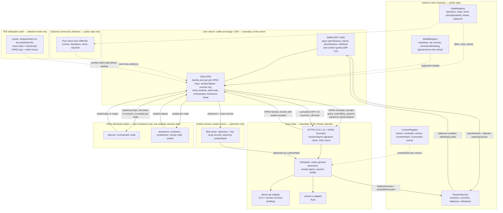
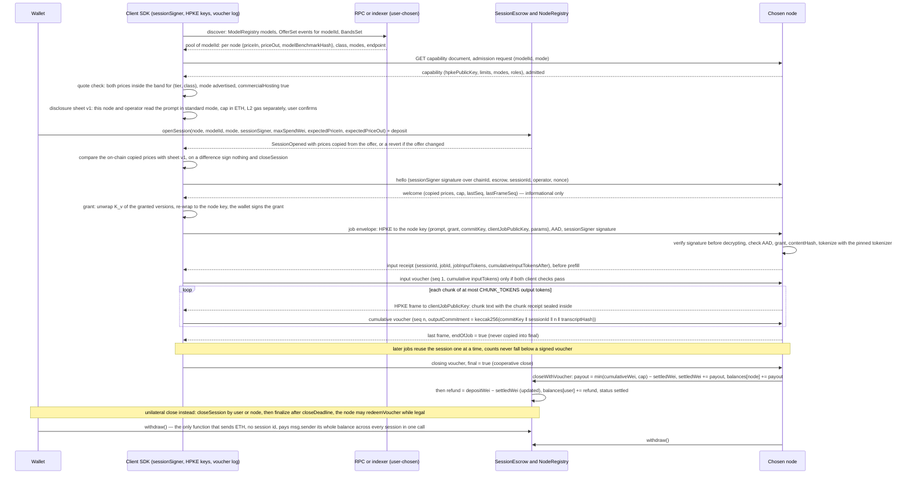
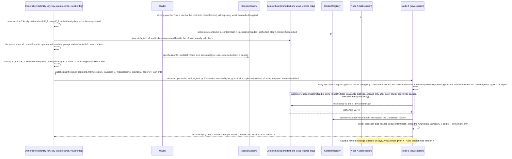
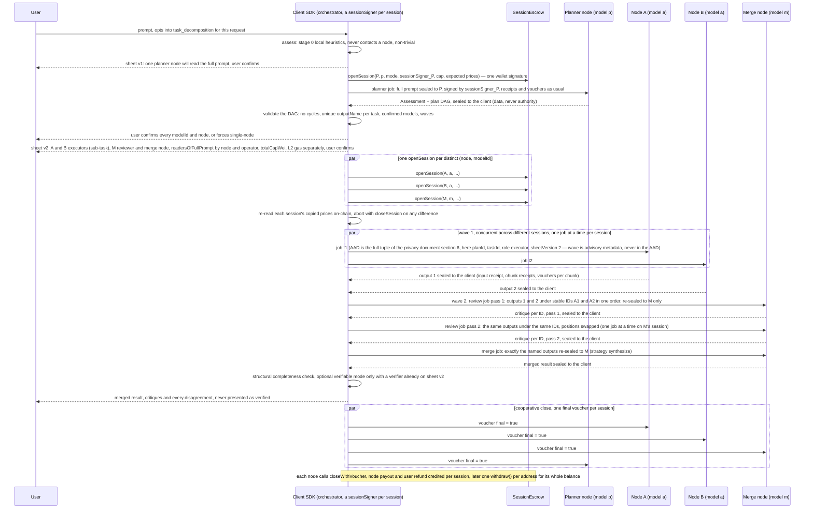

# System architecture — decentralized LLM inference on Arbitrum One

Author: Comuns contributors
Status: Draft
Category: Technical Proposal
Created: 2026-10-12
**Reference:** docs/project-charter.md, docs/evidence-register.md, docs/requirements.md, docs/security/privacy-and-contexts.md, docs/security/threat-model.md, docs/security/inference-verification.md, docs/protocol/contracts-and-settlement.md, docs/protocol/off-chain-api.md, docs/economics/cost-and-pricing.md, docs/node/node-design.md, docs/node/hardware-classes-and-benchmarks.md, docs/node/model-registry-and-licenses.md, docs/product/dapp-and-sdk.md, docs/protocol/orchestration.md, docs/protocol/collective-answers.md, docs/node/distributed-execution.md, docs/adr/README.md, docs/project-plan.md

---

## 1. Summary

Comuns is a community proposal for an open-source, decentralized network that runs inference on large language models. Nothing runs yet: no contract is deployed, no node exists, no maintainer is seated, no audit has been performed and no mainnet date exists. This document is the integrating view of the proposal. It names the components, the trust boundary around each one, and the flows that connect them; every detail belongs to the document that owns it (the Reference list above), and this document reuses those documents' identifiers without redefining them. Where this document and an owning document disagree, the owning document wins.

The architecture in eleven sentences:

- **The chain settles and coordinates; it never runs a model.** Four Solidity/EVM contracts on Arbitrum One — `NodeRegistry`, `ModelRegistry`, `ContextRegistry` and `SessionEscrow`, with a closed list of fifteen state-changing functions — record who offers which model at what price, which models exist, which context versions exist by hash, and how a user pays a node for a session. Inference is not a contract call.
- **The chain stores offers and sessions, never pool lists, plans or sub-task assignments.** A model's pool is an off-chain view of the offers `prices[modelId]` in `NodeRegistry`; a plan is a client-side object; nothing orchestration-related is on-chain.
- **Inference runs off-chain in Rust nodes** with pluggable backends (llama.cpp through Rust bindings first, mistral.rs second; evidence register §3, [V]) run by independent operators. Rust alone is not claimed to make inference faster.
- **The executing node sees plaintext in standard mode.** An executor must see plaintext unless FHE, MPC or a TEE is used (evidence register §4, [L]); v1 encrypts the hop with two-way HPKE, not the computation. Everyone not selected for a request sees ciphertext and public metadata only.
- **One node runs a request by default (single-node execution).** The per-request `executionFeatures` set is empty unless the user opts in; every multi-node execution feature — `collective_answer`, `parallel_planning`, `task_decomposition`, and the experimental `model_sharding` and `cross_node_speculation` — is opt-in per request and disclosed on a disclosure sheet before the user signs anything.
- **Payment is an ETH session escrow with pull payments**: `openSession` deposits, a node-signed input receipt precedes the input voucher, client-signed cumulative EIP-712 vouchers pay each delivered chunk, and the only function that sends ETH is `withdraw()`. The inference payment is not L2 gas; protocol fee 0; no token.
- **No slashing in v1.** A withdrawable registration bond only; disputes are reputation events; a signed voucher is never reversed; the user's remedy is to stop signing.
- **Stylus is not the v1 target** because new Stylus activations are paused on Arbitrum One and Nova since 2026-10-02 with no reopening date (evidence register §1, [V]) — and a model could not run inside a contract in any case.
- **Each wallet owns many encrypted, versioned contexts.** "Shared between the nodes" means portable owner-wrapped ciphertext under per-version keys, never a plaintext replica.
- **Hardware classes S < M < L < X price work through governance-set bands and never gate which model a node may offer**; tiers T0–T4 label models by parameter count.
- **Everything here is PROPOSED** and binds only once adopted through the CIP process in GOVERNANCE.md.

Evidence marks follow docs/evidence-register.md: **[V]** verified, **[L]** likely, **[U]** unsure; a claim not in the register is labeled UNVERIFIED.

## 2. Scope and non-goals

**In scope:** the components of the proposal and their trust boundaries; the actors; the session and job lifecycle; context resume on a different node; a summary of privacy modes and execution features, payments, verification, nodes, models and pools, applications and orchestration; what is public versus private; failure handling; what the community owns; risks and open questions. Each summary points at its owning document.

**Non-goals**, each deliberately:

- Training, fine-tuning and federated learning — the scope is LLM inference only (docs/project-charter.md 4.1).
- A new L1 — settlement is on Arbitrum One.
- A dedicated Arbitrum (Orbit) chain in v1 — a later option, not a v1 plan (docs/architecture/deployment-and-decentralization.md).
- A protocol token, staking rewards or emissions.
- FHE or MPC chat — far from practical for interactive inference (evidence register §4, [L]).
- A mandatory central matcher, relay or proxy — the client talks to the node endpoint from `NodeRegistry` directly.
- Slashing — no slashing function exists in v1.
- On-chain plans, pool lists or sub-task assignments — there is no `PlanRegistry`, `OrchestratorRegistry` or pool payee.
- Multi-party sessions — a session has one user, one node, one model.
- A mandatory orchestrator — the orchestrator is open-source code in the user's app; orchestrator nodes are optional.
- Open-internet sharding as a v1 promise — `model_sharding` is an experimental Phase 3 spike that may end in a published negative result.

## 3. Design principles

1. **Open source.** Code and documents are Apache-2.0 with a DCO; the specifications, the contracts and the node are forkable (GOVERNANCE.md).
2. **Community-driven.** Decisions are CIPs under rough consensus; no coin vote; ARB balances are not this project's votes; no maintainers are seated and the first are named by a public CIP.
3. **Wallet-owned history.** Contexts — transcripts, documents, system prompts — are owned by a wallet, encrypted client-side under a random key per version, content-addressed on-chain by hash only, and shared with a node only by an owner-signed grant.
4. **Honest privacy limits.** The chosen node reads the prompt in standard mode; every multi-node feature adds readers; the disclosure sheet counts them by distinct node and distinct operator before the user signs. Local execution is the only owner-only option.
5. **Small hardware can join.** A class S node may offer any registered model it can load; the small-hardware path is a target to validate, not a measured minimum (docs/node/hardware-classes-and-benchmarks.md §8).
6. **Prices rise with class.** For the same model, `floorIn(c+1) > ceilingIn(c)` and `floorOut(c+1) > ceilingOut(c)` for adjacent classes, so stronger hardware charges more and weaker hardware charges less (docs/economics/cost-and-pricing.md §6).
7. **Inference only.** The protocol provides answers, never permission to act; planner output and every intermediate text are untrusted data.

## 4. Actors

| Actor | What it does | What it holds | Trust in v1 |
|---|---|---|---|
| User | Owns prompts, contexts and the escrow deposit; picks a model, then a node from its pool; opts into execution features per request | Wallet key; client identity HPKE key and backup; `sessionSigner` per session; voucher log | Trusted with its own data; a compromised client defeats every client-side guarantee |
| Chosen operator (executor) | Runs the selected Rust node; serves one session per `(node, modelId)` | Node HPKE keyring, receipt-signing key, operator Ethereum key, bond | Reads plaintext in standard mode; chosen and paid by the user |
| Other operators | Run unselected nodes | Their own keys | Untrusted; see ciphertext only |
| Governance (none seated) | Through the timelock: `setBands`, `registerModel`, `updateModel`; seats maintainers only through a Final CIP | Nothing yet | Nothing governance-gated can happen until a bootstrap CIP is Final |
| Sequencer | Orders Arbitrum One transactions; single sequencer, L1 force inclusion after about one day (evidence register §1, [V]) | — | Untrusted for confidentiality; semi-trusted for liveness |
| RPC provider | Serves chain reads and relays transactions; user-chosen | — | Untrusted; may lie about state (threat model T7) |
| Context host | Stores context ciphertext and key-wrap records; owner-chosen | Ciphertext only | Untrusted for content; trusted for availability only if the owner chooses so |
| Community indexer | Enumerates pools from `OfferSet` events, surfaces reputation; optional | Public data only | Untrusted; the client works without one |
| Planner or assessor node (opt-in) | Receives the full prompt to assess or plan it | Its own session | Full-prompt reader; its plan is data |
| Peer answerer, reviewer, synthesizer (opt-in) | `collective_answer` and `parallel_planning` roles | Their own sessions | Full-prompt readers (a local synthesizer is not) |
| Merge node (opt-in) | Joins named sub-task outputs | Its own session | Full-prompt reader (inputs assumed to quote the prompt) |
| Verifier (opt-in, mode 2) | User-chosen second node that re-executes under a demonstrated deterministic profile | Its own session | Disclosed full-prompt reader |
| Orchestrator node (optional) | Serves thin clients; plans, merges or synthesizes through an ordinary session | Its own session; **no** `sessionSigner` | Full-prompt reader whenever it plans, merges or synthesizes; never mandatory |
| Shard holder, draft node, target node (experimental) | Phase 3 spike roles only | Shard holders hold no session; draft and target hold ordinary sessions under testnet-only prices | Treated as full-prompt readers (evidence register §10, [V]) |
| Network observer | Sees TLS traffic sizes and timing | — | Untrusted; TLS hides content, not sizes or timing |

## 5. Components and trust boundaries

Each subgraph below is a trust boundary. The client mediates every exchange of intermediate data between nodes: outputs return sealed to the client, which re-seals only the approved parts to the next disclosed recipient. No pool appears, because a pool is a view of offers and never a payee.

| Component | Responsibility | Trust assumption | Data it can see | Failure behavior | Operator |
|---|---|---|---|---|---|
| Wallet (EIP-1193) | Signs `openSession`, `topUp`, `closeSession`, `withdraw` and EIP-712 context grants; the only account | Trusted with the user's funds; never derives encryption keys; `eth_getEncryptionPublicKey` and `eth_decrypt` are forbidden (deprecated, evidence register §4, [V]) | Transaction and grant fields; never the prompt | A declined signature sends nothing | User |
| Client SDK and reference dapp, including the **client-side orchestrator** | Holds the identity and per-job HPKE keys, generates `sessionSigner` and `commitKey` per session, keeps the voucher log, assesses and plans locally, computes and shows the disclosure sheet, seals every envelope, re-seals intermediate data, signs every voucher | The user's own device, not a reader; a compromised client defeats every guarantee (privacy doc R5) | **The full prompt, locally**; every context in plaintext; every intermediate result; it **holds the keys and signs every session's vouchers** | Lost voucher log: signs nothing more on that session, closes unilaterally, opens a new session under a new sheet version; lost identity key and backup: every context lost | User |
| Rust node (executor) with backend adapters | Verifies the `sessionSigner` signature and AAD, decrypts, admits, meters with the pinned tokenizer, runs the backend, signs receipts, verifies vouchers, redeems on-chain; llama.cpp (C/C++ kernels via Rust bindings; CPU, CUDA, Metal, Vulkan, ROCm) and mistral.rs (Rust; CUDA, Metal, CPU) adapters (evidence register §3, [V]) | Chosen by the user; reads plaintext in standard mode; no-logging is a policy, not a protection | Prompt, granted context versions, completion, token counts, job metadata | Offline mid-stream: the answer is truncated; the node redeems its highest non-final voucher while legal, then `closeSession`; unpaid exposure one chunk | Independent operator |
| `NodeRegistry` | Operators, class, bond, `maxTier` (informational), `prices[modelId]` offers written replace-all, bands via `setBands`, released bonds in `balances[]` | Contract code; governance timelock for `setBands` only | Public metadata | A bands change blocks new sessions on offers outside the new band; open sessions keep copied prices | Nobody; governance for bands |
| `ModelRegistry` | `modelId = keccak256(manifestHash)`, tier, `licenseSpdx`, `commercialHosting`, `metadataUri`; `registerModel` and `updateModel` governance-only in v1 | Governance registered the manifest honestly | Public | With nobody seated there is no mainnet registration; Sepolia models come from a testnet-only CIP | Governance |
| `ContextRegistry` | Latest `(version, contentHash)` per `(owner, contextId)`; `ContextSet` per version; `version == previous + 1` | Contract code | Hashes only, never content or ciphertext | A `setContext` race reverts the loser, which rebases and republishes | Nobody |
| `SessionEscrow` | `openSession` with price binding, `topUp`, `redeemVoucher`, `closeWithVoucher`, `closeSession`, `finalize`, `withdraw()`; pull payments; checks-effects-interactions and `nonReentrant` on every function | Contract code; no upgrade may redirect escrow (non-upgradeable or ≥7-day timelock) | Payer, node, model, mode, `sessionSigner`, prices, caps, cumulative counts, `outputCommitment` | Sequencer outage delays redemption; `CLOSE_WINDOW` must exceed an outage plus about one day of force inclusion; residual risk stated | Nobody |
| Owner-chosen context host | Stores ciphertext blobs and key-wrap records by `contentHash`; returns them on request | Untrusted for content; trusted for availability only by the owner's choice | Ciphertext, wrap records it cannot open, sizes | Unavailable host: a version whose ciphertext exists nowhere else cannot be resumed; the backup carries keys, not ciphertext | Owner-chosen |
| Community indexer (optional) | Builds pool views from `OfferSet`, `NodeDeregistered` and `BondWithdrawn`; surfaces staleness and reputation | Untrusted; user-chosen; a client can read the chain without one | Public chain data | Client falls back to its own RPC reads | Community |
| RPC provider | Chain reads and transaction relay | Untrusted; user-chosen; may be compared against another | Public chain data; the client's IP | A hostile RPC can point the client at a wrong node key; mitigated by proof of possession at registration and key pinning across sessions | User-chosen |
| TEE attestation path (attested mode) | The node generates its HPKE key inside the TEE; the quote's report data commits to the key hash and the client's nonce; the client checks the measurement list and vendor collateral before sealing | CPU and GPU vendor roots of trust, the attestation service, and no physical access (TEE.fail, evidence register §4, [L]) | The executor still reads plaintext inside the TEE | Any failed check fails closed; never a silent downgrade to standard | Node operator plus vendors |
| Sequencer | Orders transactions | Untrusted for confidentiality; semi-trusted for liveness | Public metadata | Outage: force inclusion through L1 after about one day (evidence register §1, [V]) | The single Arbitrum One sequencer operator |
| **Optional orchestrator node** | Runs the same open-source orchestrator for thin clients: assesses, plans, may merge or synthesize, returns `(node, modelId, cap)` lists sealed to the client | Full-prompt reader whenever it plans, merges or synthesizes; **paid through an ordinary session**; takes no cut; **holds no `sessionSigner`** and custodies no session; never mandatory | **The full prompt and the plan when planning is delegated**; merge inputs and answers assumed to quote the prompt | Its output is data the client validates; offline: the client plans locally or stops; it cannot add a recipient, raise a cap or change a model | Independent operator |
| **Planner node** (stage 1 of orchestration; every planner in `parallel_planning`) | Returns an Assessment and a plan DAG, sealed to the client | Full-prompt reader; its plan never authorizes recipients, spending, tools or actions | The full prompt and the structure of the user's problem | An invalid DAG is rejected by the client's validator; the user can reject the plan | Independent operator |
| **Peer answerers** (`collective_answer`) | k ≥ 2 nodes answer the same prompt independently, each sealed separately | Each is a full-prompt reader; no payment consequence of disagreement | The full prompt and granted context | One disappears: the run continues only if the result still meets the confirmed k; otherwise it fails closed and the user decides | Independent operators |
| **Reviewers and synthesizer** (`collective_answer`, `parallel_planning`, sub-task review) | In `collective_answer` and `parallel_planning` a reviewer critiques the anonymized answers or plans under stable IDs `A1…Ak`, in randomized order, twice with positions swapped; the synthesizer returns the merged answer, the splits list and an agreement level. A sub-task reviewer receives only that sub-task and its output, judged twice with positions swapped where there is more than one candidate output (docs/protocol/collective-answers.md §4 and §11) | Collective and plan reviewers receive the prompt and are full-prompt readers; a remote synthesizer is one, a local synthesizer is not; a sub-task reviewer is a full-prompt reader only when its payload contains prompt text, which is assumed unless the client verified it contains none | Prompt plus all answers or plans (collective and plan reviewers); prompt, answers and critiques (synthesizer); one sub-task and its output (sub-task reviewer) | A synthesis is incomplete only when required fields are missing or malformed; then raw answers and critiques are shown; a difference between the two swapped passes is expected | Independent operators |
| **Merge node** (`task_decomposition`) | Receives exactly the named outputs and produces one text (strategy `synthesize`); `concatenate` needs no merge node | Full-prompt reader: its inputs are assumed to quote the prompt | Sub-task outputs | A contested merge is shown beside its inputs and objections, never as verified | Independent operator |
| **Verifier** (verifiable mode) | Re-executes the same prompt under a demonstrated deterministic profile; the client compares locally | Disclosed full-prompt reader; two operators that do not collude | The full prompt | Mismatch: both outputs shown, reputation event at the user's choice, no refund, penalty or slash | Independent operator, user-chosen |
| **Shard holders** (EXPERIMENTAL, Phase 3 spike) | Each holds a contiguous layer range; the client mediates every stage boundary, holds embeddings and output layer, samples every token | **Treated as plaintext readers**: prompt inversion from activations reaches 88.4 % token accuracy on a 65B model and 86.88 token F1 on a 4,112-token prompt (evidence register §10, [V]); mutual TLS bound to registered operator keys | Activations of its layer range, hence in effect the prompt | A lost holder: restart on a new sheet-listed chain, or client-mediated replay of cached stage inputs; **holds no session, never paid**, in v1 or in the spike | Volunteer operators |
| **Draft node and target node** (EXPERIMENTAL, Phase 3 spike) | The draft node proposes γ ≤ `MAX_DRAFT_TOKENS` tokens per round with per-token probability distributions as sealed metadata (or greedy-only); the target verifies; drafts are routed through the client | **Both are full-prompt readers**; the target also sees the drafts; refused under mainnet parameters; incompatible with verifiable mode | Prompt (both); drafts and distributions (target) | Draft node dropped: the target continues alone; rejected drafts are still billed to the draft session; no WAN speed-up is promised (evidence register §9, quote [V], not independently replicated [U]) | Independent operators, testnet only |

## 6. Wallets and contexts

A wallet is the only account: no email, no password, no seed-phrase collection. Each wallet owns many **contexts** — versioned, content-addressed blobs of transcripts, documents and system prompts (docs/security/privacy-and-contexts.md §7, normative).

- **Per-version keys.** Each context version `v` has its own random 256-bit key `K_v` from the client CSPRNG; ciphertext = ChaCha20-Poly1305(`K_v`, nonce = 12 random bytes in the blob header, AAD = owner ‖ contextId ‖ v ‖ prevContentHash). `contentHash` = keccak256 of the complete stored blob (header ‖ ciphertext ‖ tag) — the one canonical definition.
- **On-chain record.** `ContextRegistry` stores only the latest `(version, contentHash)` per `(owner, contextId)` and emits `ContextSet` for every version; a node verifies an older granted version from the event history. A `setContext` race reverts the loser; the client keeps its local edit, rebases on the new head and publishes the next version — no silent merge.
- **"Shared between the nodes" means portable owner-wrapped ciphertext, never a plaintext replica.** A grant wraps exactly the `K_v` of the granted versions to the node's registered HPKE key, names `contextId`, `fromVersion`, `toVersion`, `expiresAt` (unix seconds, `uint64`, never a block number) and `nodeKeyHash`, and carries an `ownerSignature` — EIP-712 typed data signed by the **wallet that owns the context**, never by `sessionSigner`. A narrow grant restricts decryption cryptographically. Nodes never exchange plaintext or keys. Revocation is not granting later versions; a node cannot be made to forget what it already decrypted, and every document says so.
- **Identity key and backup.** Every `K_v` is also wrapped to the client's long-lived identity HPKE key (mandatory) and stored as a key-wrap record beside the ciphertext. The backup export contains the identity key and every key-wrap record, and no ciphertext: it restores the keys, and a context whose ciphertext existed only on a lost device is gone even with the backup. The client recommends at least one context host or a second device for ciphertext.
- **Delivery.** By default the client uploads a granted version's ciphertext inline in the job's upload frames; an optional `blobUrl` is allowed only as https to a public address under the SSRF rules of docs/protocol/off-chain-api.md §9, is never a signed grant field, and a node may refuse it.
- **Forbidden:** sign-to-derive as a default, `eth_getEncryptionPublicKey`, `eth_decrypt`, any dependency on ERC-5630 (a Draft, evidence register §4, [V]).

Context tokens are input tokens: they appear in the input receipt and the input voucher.

## 7. Session and job lifecycle

One session pays one node for one model in one mode; many jobs run inside it, one at a time (`maxConcurrentJobsPerSession = 1`). The happy path is two transactions, `openSession` and `closeWithVoucher`; every chunk in between is paid by an off-chain signature. Details: docs/protocol/contracts-and-settlement.md (contracts, the canonical `Voucher`), docs/protocol/off-chain-api.md (wire), docs/security/privacy-and-contexts.md (envelopes, receipts, `outputCommitment`).

Rules the diagram relies on, all owned by the referenced documents:

- `openSession` reverts if the node's current offer differs from the expected prices, so an offer change can never lock a deposit; the client still re-reads the copied prices on-chain as defence in depth, and prices a node reports in `welcome` never trigger a close.
- The voucher is the one canonical EIP-712 type `Voucher(bytes32 sessionId,uint64 seq,uint256 cumulativeWei,uint64 inputTokens,uint64 outputTokens,bytes32 outputCommitment,bool final)`; counts are cumulative for the session; `seq` starts at 1 and strictly increases; a later voucher never lowers what is owed; `final` means only "the client closes the session"; `redeemVoucher` rejects `final == true`.
- The node starts prefill only after the input voucher, streams at most one chunk ahead of the highest voucher it holds, and accepts a voucher that covers the acknowledged prefix even if one more chunk was already sent. Unsigned receipts bind nobody. A resent identical voucher or frame is a no-op.
- Effective cap `min(depositWei, maxSpendWei)`; the client never signs above it; `topUp` raises `maxSpendWei` and the deposit, never lowers.
- The node keeps `commitKey`, the transcript chain and the highest voucher in persistent encrypted storage until the session is settled; nodes keep a keyring of every HPKE key used by an unsettled session.

## 8. Context resume on a different node

Switching node is a new session with a new reader and a new grant; nothing sealed to node A can be given to node B. Resuming a context on node B means re-wrapping the keys of exactly the granted versions to B's registered key, and letting B fetch or receive the ciphertext and verify it against `ContextRegistry`.

The example writes version 7 before the resume so that every version the grant names exists with its own key and its own ciphertext; a client that wrote nothing new would grant `6–6` instead, and B would hold only `K_6`. Every granted version's blob must reach B: inline by default, or — only if the node accepts `blobUrl` — from a host that holds all of them. The order of B's checks is the one of docs/protocol/off-chain-api.md §6 and §9: the `sessionSigner` signature, the AAD and the session first, then `ownerSignature` and `nodeKeyHash`, and only then any outbound fetch, because `blobUrl` is not a signed grant field and a node that connected earlier could be turned into a proxy by anyone who can sign an envelope. A grant's idempotency key includes `jobId`, so the next prompt on the same session that grants the same range is a new grant. A node discards unwrapped keys at `expiresAt` or job end, whichever is earlier; this cannot be verified remotely in standard mode.

## 9. Privacy modes and execution features summarized

**Privacy modes are per node** (docs/security/privacy-and-contexts.md §8.1, normative): `standard` (0) — the selected node reads plaintext, disclosed before signing; `attested` (1) — the client verifies a TEE quote bound to the node's HPKE key and its nonce against a published measurement list, fails closed when no eligible node exists, and is not a defence against physical access (TEE.fail, evidence register §4, [L]); `verifiable` (2) — opt-in re-execution by a user-chosen second node under a demonstrated deterministic profile, which discloses the prompt to that verifier. A node advertises its modes in `NodeRegistry`; a session's mode is public on-chain.

**Execution features are per request** and never stored on-chain. `executionFeatures` is a client-side set drawn from `collective_answer`, `parallel_planning`, `task_decomposition`, `model_sharding` and `cross_node_speculation`. **The empty set is single-node execution — the default.** Every non-empty set is opt-in per request and disclosed on the disclosure sheet with reader counts; consent from an earlier request or a funded session is not consent.

| Feature | Readers it adds | Status |
|---|---|---|
| (empty) — single-node | Exactly one remote reader (plus the verifier in mode 2) | Default; the only v1 node process |
| `collective_answer` | k ≥ 2 answerers, every reviewer, a remote synthesizer | v1, opt-in; a quality mechanism, not verification; the client suggests self-consistency or Self-MoA first when one strong model is in a pool |
| `parallel_planning` | Every planner, every plan reviewer, the plan synthesizer; the objection round is not blind | v1, opt-in; a rank is never executed automatically |
| `task_decomposition` | The remote assessor or planner; every sub-task executor or reviewer whose payload contains prompt text (assumed unless verified); the merge node | v1, opt-in; math, coding, Fermi and tight writing not decomposed by default (evidence register §12, [V]) |
| `model_sharding` | Every shard holder, treated as a plaintext reader (evidence register §10, [V]) | **EXPERIMENTAL**, Phase 3 spike, testnet-only prices; refused under mainnet parameters |
| `cross_node_speculation` | Both the draft node and the target node | **EXPERIMENTAL**, Phase 3 spike, testnet-only prices; refused under mainnet parameters; incompatible with verifiable mode |

**Who sees what.** Unselected nodes see ciphertext. Selected extra nodes see exactly what the sheet's `receives[]` lists for them: full prompt; a sub-task, which may quote the prompt; sub-task outputs; the plan; all answers and critiques; activations of layers a–b; prompt plus draft tokens; granted context versions. The sheet's `readersOfFullPrompt`, counted by distinct node and distinct operator, is derived from the actual payloads and the named reader list is a floor, never a ceiling. Any change of node, model, data scope, price, cap or reader set creates a new sheet version that must be confirmed before any `openSession` or job under it.

## 10. Payments summarized

Two payments are always kept apart (docs/economics/cost-and-pricing.md §3): **L2 gas**, paid to the chain for `openSession`, `topUp`, `redeemVoucher`, `closeWithVoucher`, `closeSession`, `finalize` and `withdraw()`; and the **inference payment**, ETH credited by `SessionEscrow` to the node for signed cumulative token usage. The client shows them separately, in ETH as a decimal with the unit, never as raw wei. **Protocol fee 0**; no token.

- **Formula**, applied once to the session's cumulative counts, integer floor division, recomputed on-chain: `paymentWei = (priceInPerMillion × inputTokens + priceOutPerMillion × outputTokens) / 1000000`.
- **Settlement accounting** (normative in docs/protocol/contracts-and-settlement.md §6 and §7): `redeemVoucher`: `payout = min(cumulativeWei, min(depositWei, maxSpendWei)) − settledWei`; `settledWei += payout`; `balances[node] += payout`; **no refund**, status unchanged. `closeWithVoucher`, in this order: the same `payout`; `settledWei += payout`; `balances[node] += payout`; **then** `refund = depositWei − settledWei` computed with the already-updated `settledWei`; `balances[user] += refund`; `status = settled`. `finalize`: `refund = depositWei − settledWei`; `balances[user] += refund`; `status = settled`; credits nothing to the node. `redeemVoucher` never credits a refund. Invariant: node credits plus user refund equal `depositWei` exactly, which holds only because the refund is computed after `settledWei` has been raised by the same call's payout; the contract's ETH balance equals all `balances[]` plus every open and closing session's `depositWei − settledWei`.
- **Pull payments** (docs/protocol/contracts-and-settlement.md §6). No contract pushes ETH during settlement, refund or bond release; only `withdraw()` sends. `withdraw()` takes no session id: it reads `balances[msg.sender]`, zeroes it, then sends that whole amount to `msg.sender` — one call per address covers every settled session, never one call per session (a second call with a zero balance reverts). A wallet that cannot receive ETH never locks anyone else's funds.
- **No debit from silence.** A user who disappears pays only what they signed; an unsigned receipt binds nobody; a job whose input voucher was never signed never enters the counts; `finalize` only refunds and never pays the node from a posted usage figure. The abandoned-client procedure is: redeem the highest non-final voucher while legal, `closeSession`, `finalize` after `closeDeadline`.
- **Why sessions.** At the Arbiscan snapshot of 2026-10-13 (gas 0.02 gwei, an ERC-20 transfer about $0.003, evidence register §1, [V]) the L2 fees of settling one small-model prompt on-chain would exceed the inference by a factor on the order of fifty (derived, [U]); a session amortizes two transactions over many prompts.
- **Multi-node requests** pay one session per distinct `(node, modelId)`: N sessions, N `openSession`/`closeWithVoucher` pairs plus L2 gas; no payment moves between nodes; the sheet sums the caps as `totalCapWei`. Comuns does not claim to be cheaper than hosted APIs.
- **Residual risks, stated plainly:** a node can redeem the input voucher and never run the prompt (loss bounded by that prompt's input fee); a stolen `sessionSigner` can sign up to the effective cap until settlement and `closeSession` does not stop it; a lost user wallet cannot pull its credited refund.

## 11. Verification summarized

v1 proves who paid whom for what was delivered, and nothing about what ran (docs/security/inference-verification.md §3). The baseline every session gets: authenticated session binding (`sessionSigner`-signed envelopes), chunked cumulative vouchers, node-signed input and chunk receipts, a keyed `outputCommitment` that is never checked on-chain and discloses the session's output when opened, public reputation events, and optional client-checked attestation.

- **Verifiable mode** is re-execution by a user-chosen second node under a **demonstrated** deterministic profile, compared locally by the client; never a random validator; the verifier is on the sheet before signing. A profile is demonstrated only when byte-identical outputs have been shown on a published test set; pinned versions, temperature 0 and disabled speculative decoding are necessary but not sufficient (1,000 temperature-0 runs gave 80 unique outputs without batch-invariant kernels, evidence register §5, [V]). A TOPLOC-style activation commitment is at most an addition on backends that support it (not claimed for llama.cpp or mistral.rs), may go only to the disclosed verifier, and cannot detect speculative decoding (evidence register §5, [V]).
- **Verifiable mode is visible.** A session's mode is public on-chain, so mode-2 checks cover only mode-2 sessions; the mitigation is opt-in, unannounced client-side spot checks of standard-mode sessions, which disclose the sampled prompt to one more node.
- **Attested mode** adds no reader; it moves trust to the CPU and GPU vendors and the attestation service and has a physical-attack limit (evidence register §4, [L]).
- **No slashing, no forced refund.** A mismatch is information for the user and a reputation event; a penalty mechanism needs a later CIP that meets the conditions of docs/security/inference-verification.md §10.
- **Quality features are not verification.** A collective answer, a sharded pipeline and a cross-node speculative pair add readers and prove nothing about weights or correctness.

## 12. Nodes, models and pools summarized

- **Node.** One Rust binary per operator (docs/node/node-design.md): chain listener, HTTPS listener, HPKE boundary, scheduler and admission, backend trait with the llama.cpp and mistral.rs adapters, meter, receipt signer and voucher verifier, context store, optional attestation module, chain client. A LAN cluster behind one endpoint is one node with an ordinary offer. v1 node processes implement single-node execution; the open-internet shard, draft and target roles are Phase 3 spike work.
- **Classes price but do not gate.** `hardwareClass ∈ {S, M, L, X}` is decided by passing per-class bars on the public class benchmark and selects the price band; `maxTier ∈ {T0..T4}` is a separate, informational field, never read by `openSession`. A class is not a tier. Tiers partition the parameter count: T0 ≤ 4B; T1 > 4B and ≤ 8B; T2 > 8B and ≤ 32B; T3 > 32B and ≤ 70B; T4 > 70B.
- **Offers.** Any node may offer any registered model it can load through `prices[modelId] = (priceInPerMillion, priceOutPerMillion, modelBenchmarkHash)`, written replace-all by `registerNode` or `updateNode`, with both prices inside the band for (model tier, node class) and a non-zero `modelBenchmarkHash` — the signed hash of a public per-model self-benchmark, a self-published claim, not an unfakeable proof. A removed model emits a cleared `OfferSet`; clearing is always allowed.
- **Pools.** A model's **pool** is the set of nodes with such an offer, enumerated off-chain from `OfferSet` events by clients and indexers; it is not a registry and not a payee. The client picks node(s) by price, measured speed, reputation, mode and class. A thin pool may hold no quote inside a band; the client says so and never silently picks another model.
- **Bands.** `setBands(tier, bands[4])` writes floors and ceilings for input and output for all four classes of one tier, with `floorIn(c+1) > ceilingIn(c)` and `floorOut(c+1) > ceilingOut(c)`; every (tier, class) pair has a band once its tier is set — forty directional entries over five tiers and all four classes, none adopted yet, so mainnet is not deployable until a bands CIP is Final.
- **Models and licenses.** `modelId = keccak256(manifestHash)`; the manifest pins files, hashes, quantization, context limit and the tokenizer that node and client both count with. `commercialHosting` gates offers and `openSession`; the registry grants no license and operators are responsible for the files they load (docs/node/model-registry-and-licenses.md).

## 13. Applications and orchestration

The reference dapp and TypeScript SDK (docs/product/dapp-and-sdk.md) are one client; the client is not the protocol. The user connects a wallet, picks an RPC, **picks a model first**, picks a node from its pool or confirms a ranked set, chooses execution features (none by default), reads the disclosure sheet and plaintext banner, sets a cap, signs `openSession` once per session, and chats. Sessions are keyed by the pair `(node, modelId)`.

**The orchestrator is open-source code in the user's app** (docs/protocol/orchestration.md): it assesses the task locally with heuristics that never leave the device; optionally asks a planner node after a disclosure sheet saying that node will see the full prompt; plans a DAG of sub-tasks in waves (topological levels; tasks in a wave have disjoint `outputName`s and no mutual dependency); opens one session per distinct `(node, modelId)`; runs a wave concurrently across different sessions and sequentially within one; routes easy work to cheaper confirmed models and hard work to the strongest confirmed model without a trained router; reviews each output with a different model family, judging twice with positions swapped; merges on a merge node or concatenates locally; verifies structural completeness and, as a separate opt-in with the verifier already on the sheet, re-executes the final result in verifiable mode. Replanning after a wave re-validates and re-shows the sheet when it adds a node, widens what a node receives or raises a cap.

**Collective answers** (docs/protocol/collective-answers.md): k ≥ 2 answerers answer independently; reviewers cross-check blind under stable anonymous IDs `A1…Ak` in randomized order, twice with positions swapped; a user-chosen synthesizer returns the merged answer, a splits list and an agreement level; the client labels the result "contested" when splits exist or agreement is low and offers every original answer and critique. A plurality vote is never applied to free text. The collective is always the user's choice.

**Optional orchestrator nodes** serve thin clients, advertise `roles.orchestration` in their capability document, are paid through an ordinary session on their planner model, hold no `sessionSigner`, custody no session, take no cut, and are never mandatory; `sessionSigner` delegation for thin clients is a later CIP.

Orchestration is a cost until shown otherwise: the planner and the final join cannot be parallelized and the slowest task sets a wave's pace (evidence register §12, [V]); debate variants cost 2.1–3.4× the tokens of self-correction for equal or lower accuracy (evidence register §11, [V]). The reference client's default is single-node and the assessment must argue its way out of it.

## 14. What is public, what the chosen node sees, what is encrypted, what is owner-only

"Public on-chain" is readable by anyone. "Chosen executing node" is the single-node executor in standard mode (inside the TEE in attested mode). "Other disclosed nodes" are those the sheet names for an opt-in feature; each sees exactly what its `receives[]` lists. "Everyone else" is unselected operators, the sequencer, RPC providers, indexers, context hosts and network observers. "Owner-only" means nobody but the user's device.

| Data | Public on-chain | Chosen executing node | Other disclosed nodes | Everyone else | Owner-only? |
|---|---|---|---|---|---|
| Prompt body | Never | Plaintext | Plaintext for every full-prompt reader on the sheet (floor list of section 9) | Ciphertext, sizes, timing | Only with local execution |
| Completion body | `outputCommitment` only, keyed under `commitKey` — reveals nothing | Plaintext | Plaintext for the node that produced it; answers of peers for reviewers and the synthesizer | Ciphertext, sizes, timing | Decrypted only by the client's per-job key |
| Context body | `contentHash` per version in state and `ContextSet` history | Plaintext for granted versions only | Plaintext for granted versions if the sheet lists them | Ciphertext and wrap records they cannot open | Plaintext only on the owner's devices; keys only with the identity key |
| Context grant | Never | The wrapped `K_v` of its range, `expiresAt`, `nodeKeyHash`, owner signature | Their own grants | Inside the HPKE envelope | — |
| Sub-task text | Never | Not applicable (single-node) | Plaintext for the sub-task node, the merge node (via outputs that may quote it) and the optional reviewer of that sub-task | Ciphertext, sizes | — |
| The plan | Never | Not applicable | Plaintext for the planner that wrote it and the orchestrator node if delegated; sub-task nodes see only their task | Ciphertext | The client holds the whole plan |
| All answers and critiques | Never | Not applicable | Plaintext for reviewers (answers) and the synthesizer (answers and critiques) | Ciphertext, sizes | The client sees everything |
| Activations of layers a–b (experimental) | Never | Not applicable | Plaintext for each shard holder of that range, over mutual TLS without HPKE; invertible to the prompt (evidence register §10, [V]) | TLS stream, sizes | The client holds embeddings, every stage's inputs and the logits |
| Draft tokens and draft distributions (experimental) | Never | Not applicable | Plaintext for the draft node (produces them) and the target node (verifies them) | Ciphertext, sizes | Routed through the client |
| `commitKey` and `transcriptHash` | Never | Known | Each session has its own | Never (a keyed check value only) | Client and node of that session |
| Job parameters (`maxOutputTokens`, sampling), `clientJobPublicKey` | Never | Plaintext, inside the signed digest | Per their own jobs | Inside the HPKE envelope | — |
| AAD tuple, exactly as docs/security/privacy-and-contexts.md §6 binds it, in order: `chainId`, `escrow`, `sessionId`, `jobId`, `requestId`, `sheetVersion`, `planId`, `taskId`, `role`, `contextId`, `contextVersion`, `direction`, frame `seq`, `endOfJob` (`wave` is advisory metadata and is never in the AAD) | Never | Visible (unencrypted, authenticated) | Visible for their own jobs | Visible on the wire inside TLS only | — |
| `executionFeatures` and the disclosure sheet | Never | Not sent | Not sent | Not sent | Client only (bound into the AAD by `requestId` and `sheetVersion`) |
| Token counts | Public, cumulative, in `VoucherRedeemed` | Known | Known for own session | Public; sizes inferable from traffic | — |
| Payer, node, `modelId`, mode, `sessionSigner` address | Public in `SessionOpened` | Known | Public | Public; the client's IP to the node and RPC | — |
| Prices, caps, deposits, top-ups, timing of open, redeem, close, withdraw | Public | Known | Public | Public | — |
| Offers, class, `maxTier`, bands, `benchmarkHash`, `modelBenchmarkHash` | Public | Own | Public | Public | — |
| The fact that several sessions by one payer opened at once (a multi-node request's shape) | Public, inferable | — | — | Public, inferable | — |

HPKE hides content, not the fact of a transaction; TLS hides content, not sizes or timing; padding and cross-session correlation defences are open questions, not v1 properties.

## 15. Failure handling

In every case a signed voucher is never reversed (docs/protocol/contracts-and-settlement.md §8), but it pays the node only if the node redeems it while that is legal: in `open`, or in `closing` before `closeDeadline`. After `closeDeadline`, `finalize` credits `depositWei − settledWei` back to the user and pays the node nothing, so the amount of any voucher that was not redeemed in time returns to the user (§6 and §7 of that document). The user never loses more than the signed total of each session, and never the whole cap for an unsigned tail.

| Failure | What happens | Client behaviour | Funds |
|---|---|---|---|
| Node failure mid-stream | The stream stops without `endOfJob`; no frame within 2 × the advertised `maxInterFrameMs` | Mark the answer truncated; reconnect for `reconnectWindow` (the node resends from `lastReceivedFrameSeq + 1`; identical duplicates ignored; the client re-sends its latest voucher); then close — cooperatively if the node returns, otherwise unilaterally with `closeSession` and `finalize` after `closeDeadline` | Chunks already signed for; the remainder returns after the close window; the node may still `redeemVoucher` while legal |
| Expired or failed attestation quote (attested mode) | Report data not bound to the node key and the client nonce, measurement not on the list, or collateral expired or revoked | Fail closed; seal nothing; never downgrade to standard; if a session was already opened, `closeSession`, then `finalize` after `closeDeadline` | None if no session was opened; otherwise the deposit stays escrowed until `closeDeadline`, `finalize` credits it to `balances[user]`, `withdraw()` pulls it, and the L2 gas is spent |
| Offer changed between confirmation and inclusion (an expired price quote) | `openSession` reverts because the expected prices differ from the current offer; no session opens. Defence in depth behind that revert: a session did open but the prices copied on-chain differ from the sheet | Show the new offer for a fresh confirmation. On the defence-in-depth case: sign nothing, `closeSession`, `finalize` after `closeDeadline`, then `withdraw()` (docs/protocol/off-chain-api.md §5, step 4) | On a revert: the L2 gas of the reverted transaction only, no deposit locked. On a session that opened: the deposit stays escrowed until `closeDeadline`, then `finalize` credits it to `balances[user]` and the user must still `withdraw()`; the L2 gas of three transactions |
| Stale context version | `stale_version` or `context_hash_mismatch`: the grant names a version the registry does not know, or the blob does not hash to the recorded `contentHash` | Re-read the head, rebase the local edit, publish the next version, re-grant | Nothing charged for that job |
| Revoked or expired grant | A node past `expiresAt` must discard the keys (`grant_expired`); a revoked node never receives later versions' keys | Issue a new grant with a new `expiresAt` if wanted; honest copy: the node keeps what it already decrypted | Nothing charged for the rejected job |
| L2 reorg | "Settled" means L2 inclusion under the single sequencer, not L1 finality; an included transaction can be reordered or dropped before L1 finality | The client sends no job until the node's handshake confirms the session on-chain; an `unknown_session` after a dropped `openSession` is re-submitted; a client that needs L1 finality waits for it off-chain; the chain client handles reorgs for event following | A voucher is bound to one `sessionId` and one escrow by the EIP-712 domain; `sessionId` derivation under reorg is an open question (section 18) |
| Sequencer interruption | The single sequencer stops including transactions; force inclusion through L1 after about one day (evidence register §1, [V]) | Vouchers continue off-chain; the node submits through the delayed inbox and redeems promptly; `CLOSE_WINDOW` must exceed an expected outage plus about one day; the user is told | Residual risk: an outage that starts shortly before `closeDeadline` can still cost the node its unredeemed vouchers; no guarantee is promised; the user loses nothing |
| No attested node available, or the required mode missing on any sheet node | No node in the pool advertises the mode | The whole request fails closed; never a silent downgrade | None |
| One sub-task node offline mid-wave | A task fails after `reconnectWindow` | Retry **only on a node that was on the confirmed sheet** (a pre-confirmed fallback), with a new session; otherwise stop the plan and show partial results. The client closes the failed session itself with the contract's `closeSession` (unilateral close) and calls `finalize` after `closeDeadline`: the offline node cannot run the abandoned-client procedure and nothing closes a session by itself | Signed vouchers on the failed session are not reversed and pay the node if it returns and redeems them before `closeDeadline`; the deposit stays escrowed for the close window, after which `finalize` credits the unredeemed remainder to `balances[user]`; the fallback is a new session with its own cap |
| Contested collective answer | The splits list is non-empty or the agreement level is `low` (docs/protocol/collective-answers.md §7) | Show the result as **contested**, with the agreement level beside it and every original answer and critique available on request. Critiques that conflict while the splits list is empty do **not** add the label: an empty splits list is valid, so the merged answer is shown as returned with the conflict surfaced beside it. A synthesis is incomplete only when required fields are missing or malformed; then the raw answers and critiques are shown instead | **No refund**; every session's signed total stands; disagreement has no payment consequence |
| Empty or thin pool | No node offers the model, or no quote lies inside a band the user accepts | **The client says so** — "no node offers this model" or "only n nodes offer this model" — and **never silently picks another model**; a substitution is a new sheet | None |
| Multi-node request cannot fill its confirmed set | A sheet node left the pool, deregistered or refused admission and no pre-confirmed fallback exists | **Fails closed** for the whole request; every session already opened is closed — cooperatively with a `final` voucher where its node delivered something, otherwise with `closeSession` and `finalize` after `closeDeadline` | L2 gas of the opened sessions; each deposit stays escrowed until its `closeWithVoucher`, or until `closeDeadline` and `finalize`, and is then pulled with `withdraw()` |
| Lost voucher log | The device loses the session's records | Sign nothing more on that session; never resume from the node's totals; unilateral close; a new session needs a new sheet version | Vouchers the node holds pay it if redeemed before `closeDeadline`; the remainder, including any voucher not redeemed in time, returns to the user at `finalize` |
| Abandoned session or lost user wallet | Neither party closes; or the depositing wallet is gone | Either party may `closeSession` at any time; nothing closes automatically; a refund credited to a lost address is unrecoverable, and the client says so | Small per-session deposits are the only mitigation; an anyone-can-close idle timeout is an open question |
| Stolen `sessionSigner` | Malware signs vouchers up to the effective cap | `closeSession` does not stop it before `closeDeadline`; small caps; rotation or revocation is a later CIP | Bounded by `min(depositWei, maxSpendWei)` |
| Lost shard holder (experimental spike) | A holder drops mid-generation | Restart on a new sheet-listed chain, or replay cached stage inputs to a sheet-listed replacement; a replacement not on the sheet is a new sheet | Shard holders hold no session; nothing is settled or refunded |

## 16. What the community owns

- **Everything is proposed.** Every ADR under docs/adr/ stays proposed until docs/cip/0001-adopt-baseline-adrs.md is Final; after that a contradicting change needs a superseding ADR. No CIP is Final.
- **GOVERNANCE.md is normative for the lifecycle**: a CIP moves Draft → Review → Last Call (14 days) → Final; one clock marks a Draft or Review CIP Stagnant after 6 months without activity; a CIP in Last Call cannot become Stagnant; any substantive edit during Last Call returns it to Review and a new full Last Call; seating and removal of maintainers happen only through a Final CIP; nobody is seated and nobody has private authority. Protocol parameters (bands, deadlines, the bond, the fee) change only by a Final CIP and a timelock of at least 7 days executed by seated maintainers.
- **Working groups** (Protocol, Node, Cryptography, Contracts, Applications, Documentation) review and recommend; a CIP decides; no coin vote; ARB balances are not this project's votes.
- **The reference client is one client** and the reference node is one node; the protocol is the specification a CIP has made Final, and any implementation that follows it is valid. Conformance tests (identifiers, the voucher type string, the disclosure-sheet replay) are what keep implementations honest.
- **Apache-2.0 and the DCO** for code and documents; no CLA; a forkable specification, contract set and node.
- **The evidence register** is the single list of external facts; adding or changing one is a pull request that states the source and the mark.

## 17. Risks

### R1 — Stylus activations are paused **[RISK] · Medium**

New Stylus activations on Arbitrum One and Nova are paused since 2026-10-02 with no reopening date (evidence register §1, [V]). Mitigation: v1 is Solidity/EVM only; Stylus is not on the critical path; a revisit needs a public reopening plus a new ADR.

### R2 — The executing node reads the prompt in standard mode **[RISK] · High**

An executor must see plaintext unless FHE, MPC or a TEE is used (evidence register §4, [L]). Mitigation: the disclosure sheet and plaintext banner before signing; attested mode (with its physical-attack limit) and local execution as alternatives; the requirement is marked Conditional in docs/requirements.md.

### R3 — Public metadata **[RISK] · Medium**

Payer, node, model, mode, token counts, prices, caps and timing are public on-chain, and a multi-node request reveals its shape through several sessions by one payer. No v1 mitigation; relayers, batching, padding and staggered sessions are open questions.

### R4 — Single sequencer **[RISK] · Medium**

One sequencer orders Arbitrum One; force inclusion through L1 takes about one day; no sequencer-decentralization date exists (evidence register §1, [V] and [U]). Mitigation: nodes redeem promptly; `CLOSE_WINDOW` sized against an outage plus about one day; the dependency is disclosed. Residual risk: an outage shortly before `closeDeadline` can still cost a node its unredeemed vouchers.

### R5 — Fake hardware-class claims **[RISK] · High**

`benchmarkHash` and `modelBenchmarkHash` are self-published claims; a reported fake-GPU incident on a compute marketplace shows self-reported hardware is gamed in practice (evidence register §2, [L]). Mitigation: spot re-benchmarks on a private rotating prompt set at random times, measured-speed sorting, reputation; none is an unfakeable proof and none is slashing.

### R6 — Verifiable mode is not private and is visible **[RISK] · High**

Mode 2 adds a disclosed full-prompt reader, and because a session's mode is public, an operator can serve mode-2 sessions honestly and substitute elsewhere. Mitigation: the verifier is user-chosen and counted on the sheet; opt-in, unannounced client-side spot checks of standard-mode sessions; no practical deterministic profile may exist on the network's backends, which Phase 3 may publish as a negative result.

### R7 — Nobody is seated **[RISK] · High**

No maintainers, no bands, no registered models: nothing governance-gated can happen until a bootstrap CIP is Final, and a community proposal may attract no contributors. Mitigation: small Phase 1 slice, open CIPs, honest documents; a negative outcome is acceptable and recorded.

### R8 — No audit **[RISK] · High**

No audit has been performed on this design, on any implementation, or, per its own documentation, on the `hpke` crate the implementation would use (evidence register §4, [V]). Mitigation: the review plans of the privacy and contracts documents, which are unfunded and unscheduled; external review is Phase 4.

### R9 — Multi-node execution features widen disclosure **[RISK] · High**

Every answerer, reviewer, remote synthesizer, planner, plan reviewer, plan synthesizer, merge node, shard holder, draft node, target node, verifier, remote assessor, sub-task node whose payload contains prompt text, and orchestrator node that plans, merges or synthesizes is a full-prompt reader, and the list is a floor. Mitigation: opt-in per request, the sheet's `readersOfFullPrompt` by node and operator, fail-closed rules, single-node default, the AAD binding of `sheetVersion` for after-the-fact audit.

### R10 — Collective answers can lower quality at k× cost **[RISK] · Medium**

One strong model sampled many times beat a mixed mixture by 6.6 %, agents flip correct answers under peer pressure, and debate costs 2.1–3.4× the tokens of self-correction for equal or lower accuracy (evidence register §11, [V]); the feature costs at least k sessions. Mitigation: the client suggests self-consistency or Self-MoA first; the "contested" label; the cost multiplier on the sheet; never a plurality vote on free text.

### R11 — An orchestrator node that plans sees the prompt **[RISK] · Medium**

Delegated planning gives one remote node the full prompt and the plan. Mitigation: assessment and planning run locally by default; orchestrator nodes are optional, disclosed, paid as ordinary sessions, hold no `sessionSigner`, and their output is data.

### R12 — Sharding over the internet is slow and leaks prompts through activations **[RISK] · High**

Pipeline-sharded 70B-class models reach roughly 1–6 tokens per second in the cited settings, and activations are invertible to the prompt at 88.4 % token accuracy (evidence register §10, [V]). Mitigation: every shard holder counts as a full-prompt reader; `model_sharding` is a Phase 3 spike refused under mainnet parameters; llama.cpp's RPC backend is never run on an open network (evidence register §10, [V]).

### R13 — Thin pools **[RISK] · Medium**

A rare model may have one operator, or no quote inside a band. Mitigation: the client says so and never substitutes a model silently; a multi-node request that cannot fill its confirmed set fails closed; the sheet shows the operator count.

### R14 — Price bands unset, so mainnet is not deployable **[RISK] · High**

Forty directional band entries must be set by a Final CIP before any mainnet session can open. Mitigation: fixtures stay non-normative; the Phase 4 go/no-go CIP; indexers show uninitialized pairs as pending.

### R15 — Integration drift between documents and implementation **[RISK] · Medium**

This document restates identifiers owned elsewhere; a later change to an owning document can leave this view stale, and an implementation can drift from both. Mitigation: owning documents win; conformance tests assert the identifiers, the voucher type string and the sheet; this document is revised whenever a referenced document changes.

### R16 — A lost user wallet cannot recover its refund **[RISK] · Medium**

Pull payments credit refunds to the depositing address and `withdraw()` pays only `msg.sender`; nothing closes a session automatically. Mitigation: small per-session deposits; honest copy on the backup screen; an anyone-can-close idle timeout is an open question.

## 18. Open questions

1. **`CHUNK_TOKENS`** — the value, and whether it is per node or a protocol constant.
2. **`CLOSE_WINDOW`** — the value that covers an expected sequencer outage plus about one day of force inclusion without locking deposits too long, and whether a remaining-time rule should narrow the residual risk.
3. **`sessionId` under reorg** — whether the counter-based derivation can reassign an id after a dropped transaction, and whether a plain `bytes32` counter is preferable (contracts document §16).
4. **Chain id** — the EIP-155 chain id of Arbitrum One is commonly published as 42161, UNVERIFIED in every document; confirm at implementation.
5. **Batching `openSession`** — a multicall or a batch entry point (a sixteenth function, hence a CIP) so a plan with N sessions needs one wallet action.
6. **`sessionSigner` rotation, revocation and delegation** — how a stolen signer is revoked before `closeDeadline`, and how thin clients that cannot sign per chunk are served without making an orchestrator node a custodian (a later CIP).
7. **Activation meter** — what a later CIP would meter for shard holders that emit no tokens, so that cross-operator sharding could ever be paid.
8. **On-chain quote verification** — whether attested status should become a public fact (about 3M gas direct or about 350k gas via ZK, evidence register §4, [V/L]) and who pays.
9. **Padding and correlation defences** — whether envelopes and frames are padded, and which cross-session mitigation is built first.
10. **Context host protocol** — whether an owner-chosen host needs anything beyond "store and return ciphertext and key-wrap records by hash".
11. **Indexer interoperability** — whether the pool-enumeration rule and the reputation event formats should be frozen by a CIP so independent indexers agree.
12. **Local execution mode** — whether the reference client should offer the owner-only local-model option described in the privacy document, and how it is kept apart from paid sessions.
13. **Stylus revisit** — what, beyond a public reopening of activations and a new ADR, would justify revisiting ADR 0001, given that contract compute is a small part of this design.
14. **Which backends can reach a demonstrated deterministic profile** — the precondition of verifiable mode on the engines the nodes run (docs/security/inference-verification.md §12).
