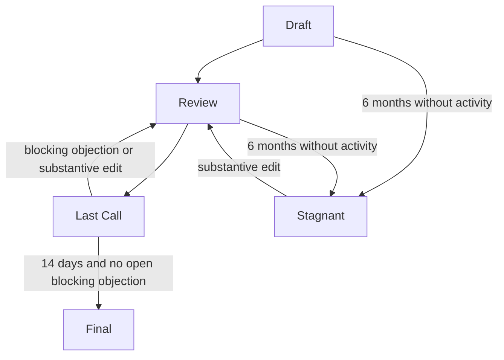

# CIPs — Comuns Improvement Proposals
Author: Comuns contributors
Status: Draft
Category: Process
Created: 2026-10-12
**Reference:** GOVERNANCE.md, MAINTAINERS.md, docs/cip/0000-template.md, docs/cip/0001-adopt-baseline-adrs.md
---

## 1 Summary

A CIP is a Comuns Improvement Proposal. It is the written record of a change to the protocol, to economics, to node behavior, to an application, or to process. Decisions of Comuns are CIPs. The governing statement of the lifecycle is GOVERNANCE.md. This file is the procedure for numbering, sections, and merges, and it matches that statement.

None are Final. The template at docs/cip/0000-template.md is not a CIP and cannot become Final.

Links by path:

- [docs/cip/0000-template.md](0000-template.md)
- [docs/cip/0001-adopt-baseline-adrs.md](0001-adopt-baseline-adrs.md)

The file docs/cip/0001-adopt-baseline-adrs.md holds CIP-0001, which is a Draft and is not Final. Linking the path does not make it Final.

## 2 Lifecycle

A CIP moves Draft → Review → Last Call → Final. Last Call lasts 14 days. Any substantive edit during Last Call returns the CIP to Review and requires a new, full 14-day Last Call starting from the edited text; GOVERNANCE.md defines substantive edits and the only permitted non-substantive edits, each of which must be listed in the CIP's change log during Last Call. A CIP in Draft or Review becomes Stagnant after 6 months without activity. One clock only applies: Draft and Review share that clock, and it is suspended during Last Call, so a CIP in Last Call cannot become Stagnant. Entering a new status does not start another 6-month clock. Substantive activity resets the same clock while it runs. Final and Stagnant are the only end states and a CIP is in at most one of them. A Stagnant CIP returns to Review only through a substantive edit; comments alone never change a status. A Final CIP does not become Stagnant.

What counts as substantive activity, what counts as a blocking objection, and how the 14 days are dated are defined in GOVERNANCE.md. A status line that says Final without a completed Last Call, or after a substantive edit during Last Call that has not gone through Review and a new, full 14-day Last Call, is void. There is no protocol token and no coin vote. ARB balances are not this project's votes.

## 3 Numbering

- Numbers are four digits, zero-padded.
- 0000 is docs/cip/0000-template.md. It is the template. It is not a proposal, and it is not Final.
- 0001 is reserved for docs/cip/0001-adopt-baseline-adrs.md. ADRs under docs/adr/ are proposed until that CIP is accepted. Accepted means Final. After acceptance, a change that contradicts an ADR needs a superseding ADR.
- The next CIP uses the lowest free number above 0001. The filename is docs/cip/NNNN-kebab-title.md. The slug is kebab-case: lowercase words separated by hyphens.
- If two authors take the same number, they resolve it in public and one author renames. Nobody has private authority to allocate numbers.

## 4 Required sections

Copy docs/cip/0000-template.md. The header fields are:

- Status: Draft, and later Review, Last Call, Final, or Stagnant, following section 2.
- Type: exactly one of protocol, economics, node, application, or process.
- Created: the date the file is opened, as YYYY-MM-DD.
- Requires: CIP numbers this proposal depends on, or None.

The body sections, in order, are Abstract, Motivation, Specification, Rationale, Backwards compatibility, Security considerations, Economic considerations, Reference implementation, Change log, and Copyright. The Change log lists every non-substantive edit (typo, formatting, or link fix) made during Last Call, with its date; it is required, and a Last Call typo, formatting, or link fix that is not listed there is not permitted. Substantive edits are not logged there, because they return the CIP to Review. The Copyright section states Apache-2.0 and points at LICENSE. Italic guidance in the template is deleted by the author before Review.

A CIP that changes price bands, deadlines, the bond, or the protocol fee says so in Specification and in Economic considerations, and states its own timelock. Those parameters change only by a Final CIP and then a timelock, executed by seated maintainers, that is the longer of 7 days and the CIP's stated timelock, counted from the date the CIP becomes Final. The protocol fee is 0, so no treasury exists. Scope is LLM inference only.

## 5 Who may file and who may merge

Anyone may file a CIP regardless of hardware class, stake or holdings. A class S operator has the same rights.

Who may merge: nobody, until maintainers are seated by a public CIP. MAINTAINERS.md says none are seated. Setting a status line to Final does not merge the file. After the bootstrap CIP is Final, only the **currently seated maintainers** may merge — the people recorded in MAINTAINERS.md as seated, and not since removed, by CIPs that became Final under GOVERNANCE.md section 6.1; a later Final CIP that seats or removes a maintainer changes that set on the day it becomes Final, and GOVERNANCE.md describes those moments. Until the first seating, nobody has private authority.

## 6 Current CIP status

None are Final. 0000 is a template. 0001 is reserved and is a Draft, not Final. No other CIP number is allocated by this file.

## 7 Risks

### R1 — A self-declared Final CIP is mistaken for a decision **[RISK] · High**

Anyone can type Final in a status line. The line is void unless Last Call has lasted 14 days with no open blocking objection. With nobody seated, the repository cannot rely on a merge bit to show the difference. Readers have to check the discussion against GOVERNANCE.md.

### R2 — Number collisions with no allocator **[RISK] · Medium**

There is no seated editor to hand out numbers. Two files can claim the same NNNN. Section 3 asks the authors to rename in public. Until they do, reviewers can comment on the wrong text.

### R3 — 0001 is linked while it is still a Draft **[RISK] · Low**

docs/cip/0001-adopt-baseline-adrs.md is linked by path while it is a Draft. A reader can treat the link as acceptance. This file says it is not Final. ADRs stay proposed until that CIP is accepted.

## 8 Open questions

- Should a public issue be able to reserve a CIP number before the file exists? This draft reserves only 0000 and 0001.
- After a CIP is Final, may the author add an editorial note, or does every change require a new CIP? This draft treats Final text as stable. A superseding CIP carries later changes. A superseding ADR carries a later change that contradicts an accepted ADR.
- Who confirms, in the file, that Last Call's 14 days have elapsed, while no maintainers are seated? This draft uses the public record described in GOVERNANCE.md.
