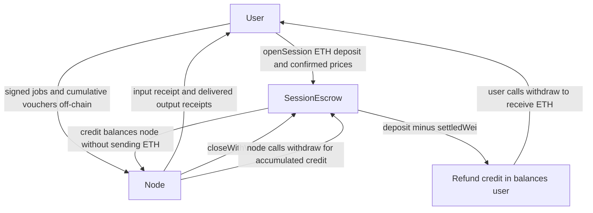

# Cost and pricing — hardware classes, bands and the session economy

Author: Comuns contributors
Status: Draft
Category: Technical Proposal
Created: 2026-10-12
**Reference:** docs/evidence-register.md, docs/protocol/contracts-and-settlement.md, docs/node/hardware-classes-and-benchmarks.md, docs/adr/0005-hardware-classes-and-price-bands.md, docs/adr/0007-no-protocol-token-in-v1.md

---

## 1 Summary

Comuns is a community proposal for open-source decentralized LLM inference. Nothing runs yet. This document proposes ETH payments for metered inference within governance-set price bands: **protocol fee 0**, no protocol token. L2 gas is not the inference payment. Sessions amortize on-chain work across prompts, while cumulative vouchers account for the work the client acknowledges.

Every (tier, class) pair has a band in the proposed complete table. Classes price but do not gate which model a node offers. For the same model tier, stronger classes charge more, even if batching makes their production cost lower. This is the project brief's democratic-access rule, not cost-plus pricing or a claim of lower prices than hosted APIs.

This document sets no normative wei values. Every numeric wei example below is **FIXTURE — not an adopted price**, illustrative and derived/UNVERIFIED. A later CIP must set all bands; mainnet is not deployable until then. The accompanying JSON and standard-library checker exercise arithmetic, not a deployed service.

## 2 Scope

The scope is input/output token accounting, operator cost worksheets, session settlement economics, class bands, and the extra sessions created by opt-in execution features. The [contracts and settlement document](../protocol/contracts-and-settlement.md) owns identifiers, the canonical voucher, legal state transitions and settlement rules. [GOVERNANCE.md](../../GOVERNANCE.md) and the [CIP procedure](../cip/README.md) own parameter adoption. Referenced hardware and ADR documents do not supply adopted prices here.

Production costs, operator asks and user spending are different quantities. An operator's worksheet may inform its decision to offer a model, but does not override a band. USD illustrations are dated comparisons, never ETH exchange-rate assumptions or Comuns offers. Evidence marks retain their meaning: [V] verified at source, [L] likely, [U] unsure. Calculations and fixture assumptions are labeled derived/UNVERIFIED, even when their source inputs have stronger marks.

## 3 Two different payments

**L2 gas** is the Arbitrum transaction fee paid to execute transactions, including `openSession`, `topUp`, `redeemVoucher`, `closeWithVoucher`, `closeSession`, `finalize` and `withdraw()` when used. Gas is additional to the user's inference deposit and does not pay for model tokens. The inference cap is not a bound on wallet gas expenditure; the disclosure sheet shows the combined inference cap and a separate, uncertain gas estimate.

**Inference payment** is ETH that `SessionEscrow` credits to the node for signed cumulative token usage. No contract pushes ETH during settlement, refund or bond release. Credits accumulate in `balances[address]`; only `withdraw()` sends ETH, paying `msg.sender` its whole balance in that contract after zeroing it. Every state-changing function follows checks-effects-interactions and has a reentrancy guard. A recipient unable to receive ETH cannot block settlement or someone else's refund; its own withdrawal may fail, preserving its credit.



## 4 Inference payment formula and metering

The normative payment rule uses integer floor division:

```text
paymentWei = (priceInPerMillion * inputTokens + priceOutPerMillion * outputTokens) / 1000000
```

`priceInPerMillion` and `priceOutPerMillion` are wei per 1,000,000 tokens. The rule is applied **once to the session's cumulative counts**, not separately to chunks or prompts. The contract recomputes the voucher's `cumulativeWei`. The canonical `Voucher` is defined only in contracts and settlement §8: its cumulative `inputTokens`, `outputTokens`, `cumulativeWei`, increasing `seq` starting at 1, `outputCommitment`, and session-closing `final` have exactly that document's meanings. Later accepted counts and amounts never decrease. A job's last-frame `endOfJob` flag is never copied into `final`.

Meter with the tokenizer pinned by the model manifest. Billed input is prompt plus granted context tokens actually processed; the honest node processes exactly the input it receipted. Before prefill, the node sends a signed input receipt `(sessionId, jobId, jobInputTokens, cumulativeInputTokensAfter)`. The client recomputes this job's count with the same tokenizer and checks `cumulativeInputTokensAfter = lastInputTokens + jobInputTokens` before signing the input voucher. There is no on-chain proof of processing: a node can redeem that voucher and never run the prompt. The user's loss is bounded by that prompt's input fee; the remedy is to stop signing and record a reputation event.

Billed output is delivered and voucher-acknowledged tokens. Each chunk, including a partial last chunk, has a node-signed receipt with cumulative counts and a chunk hash. Unacknowledged output chunks are not billed. Acknowledged output and input covered by a signed input voucher remain payable, subject to the session cap, even if a multi-node request later fails, retries elsewhere, or discards that result. Answer quality and inclusion in the final answer do not reverse a voucher.

Each job envelope is signed by `sessionSigner` over `(chainId, escrow address, sessionId, jobId, requestId, sheetVersion, hash of enc ‖ ciphertext)`; nodes reject invalid signatures. HPKE base mode alone does not authenticate the job sender. The client generates one random 32-byte `commitKey` for the session and seals it in the first job envelope; both parties keep it until settlement. The transcript hash chains from zero over every output chunk of every job: `transcriptHash = keccak256(prev ‖ chunkHash)`. The canonical commitment is `outputCommitment = keccak256(commitKey ‖ sessionId ‖ seq ‖ transcriptHash)`. It is not checked on-chain. Opening `commitKey` discloses the session's output to its recipient; this is not proof without disclosure.

All following payment examples are **derived/UNVERIFIED fixtures**, with prices in wei per million and amounts in wei:

| Input tokens | Output tokens | Input price | Output price | Floored payment | Dropped numerator remainder |
|---:|---:|---:|---:|---:|---:|
| 2,000,000 | 3,000,000 | 4 | 5 | 23 | 0 |
| 7 | 0 | 333,333 | 666,667 | 2 | 333,331 |
| 1,000 | 500 | 1,000,001 | 2,000,003 | 2,000 | 2,500 |

The remainder is in numerator units, not a fractional wei paid separately. These rows match the JSON `formula-*` fixtures.

## 5 Hardware classes and model tiers

`hardwareClass` is S, M, L or X, ordered S < M < L < X. It is self-declared and backed by a public benchmark; the acceptance bars remain for a later CIP. The model's registered parameter-count tier selects the pricing row: T0 ≤ 4B; T1 > 4B and ≤ 8B; T2 > 8B and ≤ 32B; T3 > 32B and ≤ 70B; T4 > 70B. These identifiers and boundaries come from contracts and settlement §4, not new benchmarks.

Pools are model-first: a model's pool consists of nodes offering that `modelId`. Any class may offer any model it can load, subject to the ordinary registered-model, commercial-hosting, benchmark, mode and band checks. A machine that cannot fit a model does not offer it. `maxTier` is informational, never a gate and never read by `openSession`. A class S node that loads a T4 model may offer it inside S's T4 band. An uninitialized band means pending governance, not forbidden eligibility.

Model registration and updates are governance-only through the timelock and CIPs. With nobody seated there is no mainnet registration; Sepolia models require a testnet-only CIP. A pool is an off-chain view of offers, not an account that receives payment.

## 6 Band ordering rule

For **each** tier T0–T4 and the adjacent class pairs S→M, M→L, L→X, `setBands` requires separately:

```text
floorIn(tier, c+1) > ceilingIn(tier, c)
floorOut(tier, c+1) > ceilingOut(tier, c)
```

Each floor is at most its own ceiling. Bounds are inclusive. All four classes have both directions for every tier: twenty (tier, class) pairs, forty directional band entries, each with a floor and ceiling. There is no cross-tier ordering requirement. Asks are free within the relevant band. The stronger class's floor exceeds the weaker class's ceiling for the same tier and therefore for the same offered model.

Worked **symbolic**, illustrative/UNVERIFIED table for one fixed model and tier, with arbitrary positive price units `a` for input and `b` for output; neither unit has an adopted wei value:

| Class | Input interval | Output interval | Illustrative quote for that same model |
|---|---|---|---|
| S | [a, 3a] | [2b, 4b] | (2a, 3b) |
| M | [4a, 6a] | [5b, 7b] | (5a, 6b) |
| L | [7a, 9a] | [8b, 10b] | (8a, 9b) |
| X | [10a, 12a] | [11b, 13b] | (11a, 12b) |

S's and M's quotes compare the **same model**, not different model sizes and not measured performance. The input gap is `4a > 3a`, the output gap `5b > 4b`; subsequent rows satisfy the same strict inequalities. Quoting `(2a, 3b)` as class M fails M's band even though S could offer that quote.

The JSON `bands-T1-illegal-M-quote` instantiates that arithmetic as a **derived/UNVERIFIED fixture**: S input [1,000,000, 3,000,000], output [2,000,000, 4,000,000]; M input [4,000,000, 6,000,000], output [5,000,000, 7,000,000]. Quote (2,000,000, 3,000,000) is accepted for S and rejected for M. No value is adopted.

The separate `class-S-on-T4-band` fixture uses S/T4 input [10,000,000, 20,000,000] and output [20,000,000, 40,000,000], all **illustrative/UNVERIFIED wei per million**. Quote (15,000,000, 30,000,000) is accepted. Quote (20,000,001, 30,000,000) is rejected because its input price exceeds S's ceiling, never because S offers T4. The fixture intentionally records informational `maxTier = T0`; it changes neither outcome.

## 7 Why better hardware charges more

The band ordering implements democratic access: weaker honest operators have a lower ceiling than the next class's floor for the same model. Stronger hardware charges more for the same work by policy. A cost worksheet cannot license a stronger node to undercut that floor. This does not promise profit, demand, equal latency or equal hardware efficiency.

The batching tension is real. A batched datacenter token can be far cheaper to produce than a single-stream token, yet the floor forbids undercutting weaker honest nodes. The intended economic response is specialization: high-end operators may prefer workloads that value capacity, latency or large models; a machine that cannot fit a model does not offer it, while any machine that can load the model may offer it inside its own class band. Specialization is an economic possibility, not protocol eligibility, and whether it occurs is UNVERIFIED. Some stronger operators may simply decline small-model work. There is no guarantee that a band contains a willing supplier.

## 8 Operator cost worksheet

Choose exactly one hardware accounting basis. Use a paid or available clock hour, an active fraction `u` with `0 < u ≤ 1`, and measured aggregate delivered token throughput `q` per active second for the exact workload. All worksheet equations are **derived/UNVERIFIED estimates**, not measured Comuns economics:

```text
electricity per active hour = watts / 1000 × dollars per kWh
owned amortization per clock hour = (acquisition dollars − residual dollars) / lifetime clock hours
owned cost per clock hour = u × active electricity + (1−u) × idle electricity + amortization
rented cost per paid hour = rental dollars per hour
tokens per paid/clock hour = 3600 × u × q
cost per 1M tokens = 1000000 × cost per paid/clock hour / tokens per paid/clock hour
```

For **owned hardware**, add electricity and amortization; acquisition and residual value must refer to the same asset scope. Host CPU, cooling, network, maintenance and financing need explicit extra estimates if included. For **rented hardware**, the rental invoice replaces owned-hardware electricity and amortization: do not add the lessor's power or asset cost again. Separately invoiced items need their own documented scope. These fixtures omit such extra costs.

Utilization appears once in produced tokens. In the owned numerator, `u` weights active versus idle power; it is not a second utilization penalty. Do not divide the hourly cost by `u` and then also reduce the token denominator by `u`. Amortization uses clock hours, not already utilization-adjusted productive hours. If rental is charged only while running, define `u` relative to those billed hours rather than all calendar hours.

The following calculations use the §10 source inputs and assume full utilization unless stated. **Every step and result in this paragraph is derived/UNVERIFIED.** The 4090 electricity-only fixture sets amortization and idle cost to zero to isolate power: `450 / 1000 = 0.45 kW`; `0.45 × $0.188 = $0.0846` per active hour; `128 × 3600 = 460,800` tokens per hour; `$0.0846 × 1,000,000 / 460,800 = $0.183593750000` per million tokens, approximately **$0.184**. This is not total ownership cost or a sale price; board power is not measured whole-system consumption.

**Derived/UNVERIFIED rental calculation:** `$2.69 × 1,000,000 / (144 × 3600) = $5.189043209877` per million tokens at single-stream throughput, with `518,400` tokens per paid hour. **Derived/UNVERIFIED batched calculation:** `$2.69 × 1,000,000 / (27,569 × 3600) = $0.027103711496`, with `99,248,400` tokens per paid hour. These are incompatible workload snapshots used to demonstrate sensitivity: the rental is H100 SXM, the single-stream measurement H100 PCIe with Q4_K_M, and batching uses FP8 with another engine. They do not establish the yield of that rental or a speed ratio for a matched workload. At illustrative `u = 0.5`, the single-stream fixture produces `259,200` tokens per paid hour and costs `$10.378086419753` per million, **derived/UNVERIFIED**, with the rental invoice still `$2.69/h`.

Report **TTFT**, single-stream decode throughput and aggregate batched throughput separately, together with model, quantization, context length, batch/concurrency and hardware. Aggregate tokens across concurrent requests are not one user's decode speed. These worksheet outputs describe generated tokens under the stated decode assumptions; they do not allocate prefill expense between input and output asks, and contain no TTFT measurements. Measure prefill and queueing before turning a worksheet into an operating plan.

Privacy-mode overhead belongs in the matching workload's measured TTFT, throughput and capacity. Do not invent a universal discount or multiply an overhead percentage onto a throughput that already includes it. Attested execution can affect capacity; verifiable mode is re-execution by a user-chosen second node under a **demonstrated deterministic profile**, paid as another ordinary session. Cross-node speculation is incompatible with that mode. None of this creates a separate TEE or verification fee.

## 9 Session economics

### Amortization and settlement

For small-model work at the public comparison rates in §10, settling one prompt on-chain costs more in L2 fees than the inference itself. The `session-L2-amortization-illustration` fixture assumes 1,000 input and 500 output tokens and uses the cited $0.02/$0.04 per million hosted comparison rates: the inference equivalent is `$0.00004`, **derived/UNVERIFIED**. Using the dated ETH-transfer estimate of `$0.001` per transaction as a proxy gives `$0.002` for a pair, or `50×` that inference equivalent, **derived/UNVERIFIED**. Contract calls execute more work than an ETH transfer; this proxy is not a measured escrow fee, fee floor or current quote. The source gas snapshot is 0.02 gwei and the ERC-20-transfer comparison is about $0.003 (evidence register §1 [V], Arbiscan 2026-10-13); the ETH-transfer estimate is [U].

A session of N prompts amortizes two transactions on the happy path: `openSession` and `closeWithVoucher`. With `N = 100` identical prompts, inference equivalent is `$0.004` and the same assumed pair is `$0.002 / 100 = $0.00002` per prompt, all **derived/UNVERIFIED**. Signatures between those transactions have no L2 fee. Each party's later `withdraw()` is additional gas and may collect credits across many sessions; top-ups, early redemptions and unilateral close also add transactions. Two transactions describe settlement to balances, not ETH arriving in a wallet.

`openSession` includes `expectedPriceInPerMillion` and `expectedPriceOutPerMillion` from the confirmed disclosure sheet and reverts if the offer changed. The client still re-reads the session's copied prices after inclusion; on a mismatch it signs nothing and calls `closeSession`. Existing sessions retain their copied prices when offers or bands change.

The **derived/UNVERIFIED** `session-two-prompts-partial-chunks` fixture has input/output prices 333,333/666,667 wei per million, deposit 20 wei, `maxSpendWei` 25 wei, and a fixture-only chunk size of 4 tokens, not an adopted `CHUNK_TOKENS`. Job 1 has prompt 2 + context 1 input tokens and output chunks [4, 1]; job 2 has prompt 2 + context 0 and output chunks [4, 2]. Cumulative (input, output, wei) tuples are `(3,0,0)`, `(3,4,3)`, `(3,5,4)`, `(5,5,5)`, `(5,9,7)`, `(5,11,9)`, then the separate final voucher `(5,11,9)`. An early redemption credits 3 wei and closing credits another 6 wei: settled 9 + refund 11 = deposit 20 wei. Rounding each job separately would incorrectly total 8 wei; the cumulative rule owes 9 wei.

In the **derived/UNVERIFIED** `session-over-cap` fixture the same final cumulative counts justify 9 wei, but deposit 8 and `maxSpendWei` 10 make the effective cap `min(8,10) = 8` wei. Early redemption credits 7, closing credits 1, and the refund is 0: total node credit 8 + refund 0 = deposit 8. A voucher above the cap is not rejected for that reason; it pays only up to the cap. While open, payable `topUp(newMaxSpendWei)` can increase the deposit and raise (never lower) the spending limit. The client then re-signs the same cumulative totals with a new sequence number to collect any previously capped remainder.

In general, `payout = min(cumulativeWei, min(depositWei, maxSpendWei)) − settledWei`. Redemption credits that payout and updates `settledWei`, with **no refund**. Closing with a final voucher first updates the node credit, then credits `depositWei − settledWei` to the user and marks the session settled. `finalize` credits only that remaining refund, never a node payment. For every settled session, node credits plus user refund equal the deposit exactly. Across the contract, ETH held equals all `balances[]` plus each open/closing session's `depositWei − settledWei`.

`redeemVoucher` rejects `final = true`; only `closeWithVoucher` accepts closing vouchers. Either can run while open or while closing strictly before `closeDeadline`; `finalize` requires closing at or after that deadline. Legality follows `status`, never a zero-valued deadline. A settled session accepts no further session call. Either party may call `closeSession` while open; nothing closes or refunds automatically. If the client disappears, the node redeems its highest non-final voucher while legal, calls `closeSession`, and later calls `finalize` after the deadline. Without a final voucher it never relies on `closeWithVoucher`. If the node loses its key, the user calls `closeSession` and then `finalize`; any recovered node must redeem while still legal.

### Multiple sessions and the combined cap

Multi-node features are client-side, opt-in per request, never the default. A request using **N sessions pays N inference payments and N happy-path transaction pairs**, plus their L2 gas and any withdrawals or exceptional calls. Two transactions per session is not two per request. Session reuse is keyed by distinct `(node, modelId)` and compatible session settings; multiple jobs on that pair accumulate counts at its copied prices.

Before signing, the disclosure sheet shows all planned sessions, their prices, reserved caps, the combined inference cap, separate gas estimates, and full-prompt readers by distinct node **and** distinct operator. Its reader list is a floor derived from actual payloads: executor; verifier; every answerer, reviewer and remote synthesizer; every remote assessor, planner, plan reviewer and plan synthesizer; draft and target; every shard holder; orchestrator when planning, merging or synthesizing; and merge nodes. Assume sub-task executors and reviewers receive prompt text unless the client verifies their payload contains none, and assume merge inputs quote the prompt. Extra actual readers must be disclosed too.

Let `B` be the confirmed combined inference cap. Maintain the following partition, **proposed accounting**, across the request:

```text
settled spending + outstanding signed liabilities + unspent reservations ≤ B
```

For an active session with reserved cap `b`, already credited amount `s` and highest signed cumulative amount `v`, the outstanding liability is `max(0, min(v,b) − s)` and the unspent reservation is `b − s − liability`. These categories do not double-count the signed amount or deposit. Settled spending remains in the request total even after withdrawal. An abandoned session keeps its unused reservation until settlement or refund is known; a timeout in the client does not release it. A new wave, retry or top-up that would breach the bound requires a new disclosure sheet and signature before proceeding. The combined cap is a client accounting bound, not a cross-session escrow primitive.

### Collective-answer accounting

For an illustrative collective answer, let `k` answerers each process prompt `P` and generate `A` tokens. There are `k` reviewer sessions, each running **two** cross-check jobs, one per position-swapped pass, sequential on that session; each job reads the prompt and all `k` answers, so the session's input is `2 × (P + k × A)`. Let `C` be each reviewer's **total** critique output across both passes, not output per pass. A synthesizer reads the prompt, all answers and all critiques and produces `S` tokens. Counts must include actual serialized templates and granted context under each model's pinned tokenizer; equal counts here are illustrative/UNVERIFIED assumptions across potentially different models.

Define `F_j(I,O) = floor((priceInPerMillion_j × I + priceOutPerMillion_j × O) / 1000000)` for session `j`. Then the **symbolic accounting formula**, not a measured multiplier, is:

```text
collectiveWei = sum(i=1..k, F_answer_i(P,A))
              + sum(r=1..k, F_review_r(2 × (P + k × A), C))
              + F_synthesis(P + k × A + k × C, S)
```

Each term has its own session's price pair and is floored before summing. Generation uses at least `k × A` tokens, plus the cross-check jobs and synthesis job; repeating the prompt and candidate answers also increases input charges. If more jobs reuse a session, apply its payment rule to the combined cumulative counts instead of flooring each job separately.

The JSON collective fixture sets `k=3`, `P=100`, `A=50`, `C=20`, `S=60`. Three answerers run on three distinct nodes; three other reviewer nodes and one synthesizer use separate sessions. All numbers in the following table are **derived/UNVERIFIED fixtures**; prices are wei per million and caps/payments are wei:

| Session | Input tokens | Output tokens | Input price | Output price | Floored payment | Reserved cap |
|---|---:|---:|---:|---:|---:|---:|
| answer-1 | 100 | 50 | 1,003,333 | 2,007,777 | 200 | 300 |
| answer-2 | 100 | 50 | 1,505,555 | 2,509,999 | 276 | 400 |
| answer-3 | 100 | 50 | 2,008,888 | 3,011,111 | 351 | 500 |
| review-1 | 500 | 20 | 1,003,333 | 2,007,777 | 541 | 600 |
| review-2 | 500 | 20 | 1,505,555 | 2,509,999 | 802 | 900 |
| review-3 | 500 | 20 | 2,008,888 | 3,011,111 | 1,064 | 1,200 |
| synthesis | 310 | 60 | 3,013,333 | 4,017,777 | 1,175 | 1,300 |

The totals are **derived/UNVERIFIED**: 2,110 input and 270 output tokens, 4,409 wei inference, caps summing to the combined cap of 5,200 wei, and seven happy-path transaction pairs. The single-node baseline has 100 input and 50 output tokens at answer-1's prices, costing 200 wei. The inference-only multiplier is `4409 / 200 = 22.045×`, **derived/UNVERIFIED**, excluding gas. Incorrectly flooring once across all session numerators gives 4,412 wei; the per-session rule gives 4,409. This example is accounting, not a quality result or a market prediction.

Debate has cost 2.1–3.4× the tokens of self-correction for equal or lower accuracy in the cited study, and quality can fall over rounds (evidence register §11 [V]). That comparison has a different baseline and does not predict the fixture's multiplier. Two distinct alternative methods are self-consistency, with `k` samples and majority voting only on a short checkable answer such as a number, choice or label; and Self-MoA, with `k` samples of one strong model plus a synthesizer for free text (evidence register §11 [V]). Never apply a plurality vote to free text. Neither alternative makes repeated inference free.

### Decomposition and experimental execution

A decomposed plan pays one session per distinct `(node, modelId)` used, including all planner, assessment, review and merge jobs. Such jobs reuse a compatible existing pair's session or add their own; they do not disappear from cumulative metering. One study reports up to 6.7× lower cost than sequential tool use, but planner overhead can dominate small tasks (evidence register §12 [V]); this is not a measured Comuns saving. Learned routers motivate sending an easy sub-task to a cheaper model-first pool (evidence register §13 [V]); v1 has no trained router.

Experimental cross-node speculative decoding pays the draft node for delivered, voucher-acknowledged draft tokens, **including drafts rejected by the target**, and pays the target for the drafted tokens it scores (at most `MAX_DRAFT_TOKENS` per round), acknowledged by the client's vouchers, of which the accepted output the user receives is a subset (docs/node/distributed-execution.md §8). Each also bills its own processed input, once per job. Rejected drafts are ordinary draft-session output, not a separate rejected-token meter. No WAN speed-up is promised. The networked preprint compares against co-located speculation, not ordinary single-node decoding: what it reports is [V], its result is not independently replicated [U] (evidence register §9). Verifiable re-execution is incompatible with cross-node speculation; the documented engine does not promise token-for-token equivalence and the candidate activation checker cannot detect speculative decoding (evidence register §9 [V], §5 [V]).

Experimental sharding cannot be paid under mainnet parameters because there is no activation meter. Token fixtures do not authorize sharded mainnet settlement. Any multi-node request can exceed a single hosted call; Comuns must not claim it is cheaper than hosted APIs.

## 10 Illustrations from public snapshots

This section records **2026-10-12/13 snapshots**, not live offers or Comuns measurements. Hardware benchmarks retain their original 2024 date where specified. Facts below are from [evidence register §6](../evidence-register.md); fees are from §1. Marks apply to the cited snapshots, not to cross-hardware extrapolation in §8.

| Single-stream llama.cpp Q4_K_M, 2024 | 8B decode tok/s | 70B decode tok/s |
|---|---:|---:|
| RTX 3090 | ~112 | 2×3090 ~16 |
| RTX 4090 | ~128 | 2×4090 ~19 |
| A100 | ~133–138 | ~22–24 |
| H100 PCIe (8B); H100 (70B) | ~144 | ~25 |
| M3 Max | ~51 | Not reported here |
| M2 Ultra | ~76 | ~12 |

All values in that table: evidence register §6 [V]. Additional §6 [V] snapshots: RTX 5090 32 GB, Qwen3-8B ~186, 14B ~124, 32B ~61 tok/s; 70B Q4 does not fit. M4 Max 7B Q4_0 ~83 tok/s. These are different model/quantization combinations, not matched comparisons.

Batched TensorRT-LLM FP8 throughput is ~27,569 tok/s for 8B on one H100 and ~3,191 tok/s for 70B (evidence register §6 [V]). These are aggregate batched values, separate from single-stream decode and TTFT. No TTFT value is supplied by these snapshots.

Power: RTX 4090 450 W, H100 SXM up to 700 W (evidence register §6 [V]). US residential electricity ~18.8¢/kWh (evidence register §6 [L]). The register's rounded 4090 electricity illustration is approximately $0.08/h and $0.18 per million tokens (evidence register §6 [U], derived); §8 and the fixture retain the unrounded arithmetic.

| Rental, Oct 2026 | Dollars per hour | Evidence register §6 |
|---|---:|---|
| RunPod 4090 community / secure | 0.34 / 0.74 | [V] |
| RunPod H100 SXM community / secure | 2.69 / 3.49 | [V] |
| Vast.ai median 4090 / H100 | ~0.40 / ~1.67 | [L] |
| Akash H100 | ~2.71 | [V] |

| Hosted API snapshot | Dollars per 1M input / output | Evidence register §6 |
|---|---:|---|
| OpenRouter Llama-3.1-8B | from 0.02 / 0.04 | [V] |
| OpenRouter Llama-3.3-70B | from 0.10 / 0.32 | [V] |
| OpenRouter gpt-oss-120b | from 0.03 / 0.15 | [V] |
| Groq gpt-oss-120b | 0.15 / 0.60 | [V] |
| Together Llama-3.3-70B | 1.04 / 1.04 | [V] |

L2 fee snapshot, Arbiscan 2026-10-13: gas 0.02 gwei and ERC-20 transfer approximately $0.003 (evidence register §1 [V]); ETH transfer approximately $0.001 (evidence register §1 [U], derived). None is a measured `SessionEscrow` call. Comparing electricity-only costs or unmatched batch throughput to retail input/output prices does not establish a lower Comuns price.

## 11 What v1 does not separately price

v1 has no separate price for verification, storage, bandwidth, a TEE premium, a blind relay, scheduling by an orchestrator node, activation bytes or rejected speculative drafts as a distinct meter. There is no protocol token and **protocol fee 0**. No fee revenue or treasury is assumed.

Assessment, planning, cross-check, synthesis and review calls are ordinary metered inference in ordinary sessions. A remote verifier's re-execution is another ordinary session. A draft node bills acknowledged delivered drafts using its output price regardless of target acceptance. There is no implied free compute, free storage service or activation settlement hidden in the absence of a separate meter. Operators absorb ordinary overhead into asks that stay within bands; the client includes every inference job in its disclosure and reservation accounting.

## 12 Who may change a number

Operators choose their asks within the adopted band and may remove offers. A class change revalidates all listed offers against the new class's bands; removal remains allowed. Governance alone can call `setBands(tier, bands[4])`; users and operators cannot silently change floors or ceilings. Existing sessions keep their copied prices.

Under GOVERNANCE.md and docs/cip/README.md, parameter changes require a CIP that becomes Final, followed by the longer of seven days and the CIP's specified timelock, counted from its Final date, executed by seated maintainers. Last Call lasts fourteen days. Substantive edits return it to Review and restart a full Last Call; a CIP in Last Call cannot become Stagnant. Seating and removal occur only through a Final CIP. **Nobody is seated**, no parameter CIP is Final, and draft examples confer no execution authority. The same process must resolve all forty directional band entries before mainnet is deployable.

## 13 Risks

### R1 — Bands unset **[RISK] · High**

No adopted floors or ceilings exist. A partial table would strand pairs pending governance and could be misread as a class-tier ban. Mainnet remains blocked until the full table is adopted; fixture values must never be copied into production as defaults.

### R2 — High-end operators ignore small tiers **[RISK] · High**

The democratic floor prevents a batched provider from passing through its lowest production cost on a small model. It may leave that pool. Specialization is a hypothesis, not a supply guarantee; measure participation before changing policy through a CIP.

### R3 — ETH volatility changes real cost **[RISK] · Medium**

Bands, deposits and caps are in wei while many bills are in dollars. Exchange-rate movement can alter affordability and operator viability. These fixtures contain no ETH/USD rate and make no stability promise.

### R4 — Fake hardware-class claims **[RISK] · High**

Self-declaration and public benchmarks can be gamed to enter a different band. Pricing arithmetic does not authenticate hardware. Evidence, off-chain reputation and later benchmark bars must address this; v1 has no slashing mechanism.

### R5 — Derived electricity figures mistaken for margins **[RISK] · Medium**

Board power, unmatched throughput, idle capacity and omitted capital costs can make the $0.183593750000 electricity-only result, derived/UNVERIFIED, badly understate full costs. Rented FP8 batching is not a matched comparison to Q4_K_M single-stream inference. TTFT, prefill and whole-system measurements remain missing.

### R6 — One-chunk residual and prepaid input **[RISK] · Medium**

A node that waits for acknowledgement before sending the next chunk risks at most one unpaid output chunk per active session, not one per multi-node request. That unpaid chunk is not billed. The client may already owe an input voucher even if the node never processes the prompt; the remedy is to stop signing and record reputation. A signed output voucher remains payable when its answer is discarded. `CHUNK_TOKENS` and per-session caps control different exposures.

### R7 — Multi-node multipliers surprise users **[RISK] · High**

Repeated prompts, swapped reviews, synthesis, retries and additional transaction pairs compound cost. The derived/UNVERIFIED fixture's 22.045× is an illustration, not an upper bound. Disclose every session and reserve caps without double-counting; abandoned reservations stay held until settlement or refund is known. A new wave exceeding the bound needs a new disclosure sheet and signature.

### R8 — Thin pools for rare models **[RISK] · High**

A model can have no available quote within any willing operator's band. A client must report no quote rather than silently raising a cap, crossing a band or treating the model as forbidden to that class.

### R9 — Outages outlast redemption time **[RISK] · High**

`CLOSE_WINDOW` must exceed an expected sequencer outage plus about one day of force inclusion (evidence register §1 [V] for the inclusion delay). An outage starting shortly before `closeDeadline` can still cost the node its unredeemed vouchers; there is no guarantee or automatic extension. Redeem promptly while legal, rather than relying on the last moment or on `finalize` to pay the node.

### R10 — Lost wallets, abandoned sessions and stolen signers **[RISK] · High**

Nothing closes automatically. The abandoned-client sequence is highest non-final voucher redemption, `closeSession`, then `finalize` after the deadline. If the depositing wallet is lost, its credited refund is unrecoverable: `withdraw()` pays only that address. A stolen `sessionSigner` can authorize usage up to the effective cap until settlement; `closeSession` does not stop it because vouchers remain redeemable before the deadline. Keep caps small; signer rotation/revocation is a later CIP question.

### R11 — More readers without a quality guarantee **[RISK] · High**

Each remote assessment, review, merge or synthesis may disclose the full prompt to another node and operator while adding ordinary inference charges. Derive the reader list from payloads, treat the specified list as a minimum, and never treat voting or commitments as proof of answer quality or privacy.

## 14 Open questions

- What floors and ceilings should a CIP adopt for all forty directional band entries across T0–T4 and S/M/L/X?
- What benchmark bars substantiate each hardware class without turning `maxTier` into an eligibility gate?
- What value and scope should `CHUNK_TOKENS` have, and how should it trade signature overhead against per-session unpaid exposure?
- Should a later CIP add stablecoin payments? v1 uses ETH and has no protocol token.
- What activation meter and disclosure/accounting rules would make experimental sharding payable?
- Would orchestrator nodes ever need a separate band, given that planning and merging are already ordinary inference?
- How should future cap policy handle signer rotation/revocation, idle sessions and an anyone-can-close timeout? None is available in v1.
- How should actual escrow gas, withdrawals, prefill, TTFT and privacy-mode overhead be measured before recommending session sizes?
