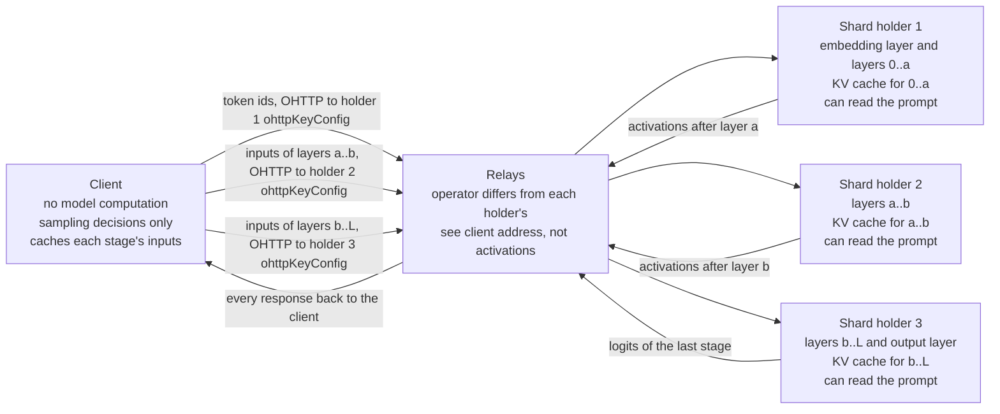

# Distributed execution — sharding one model and speculative decoding across tiers

Author: Comuns contributors
Status: Draft
Category: Technical Proposal
Created: 2026-10-12
**Reference:** docs/evidence-register.md, docs/node/node-design.md, docs/node/hardware-classes-and-benchmarks.md, docs/protocol/contracts-and-settlement.md, docs/protocol/orchestration.md, docs/security/privacy-and-contexts.md, docs/security/inference-verification.md, docs/adr/0009-opt-in-client-orchestration.md

---

> **Status: Phase 3 spike sketch with known defects — not a specification.** Sections 5 and 8 sketch the two experimental spikes so that they can be built or rejected; the mechanical defects recorded in section 13 (open question 11) are known and unresolved, nothing here is a v1 node process, and no sentence below promises performance, payment or privacy beyond what the cited evidence supports.

## 1. Summary

This document covers the two execution features that split the work of **one model** across several nodes: `model_sharding` (contiguous layer segments of one model held by different nodes) and `cross_node_speculation` (a cheaper draft node proposes tokens that a target node verifies). Both are **EXPERIMENTAL**. Both are opt-in per request through the `executionFeatures` set, both are disclosed on the disclosure sheet, and both are scheduled as **Phase 3 Verification spike** work that **may end with a published negative result**. Neither is part of what v1 promises; neither is paid under mainnet parameters in v1 — **under mainnet parameters the reference client refuses both `model_sharding` and `cross_node_speculation`**, and both run only on Arbitrum Sepolia with testnet-only, non-normative prices; nothing in the contracts, including the amendments proposed in [CIP-0002](../cip/0002-anonymous-credits-relays-and-ownerless-contexts.md), adds an **activation meter**, and a later CIP must define component-scoped metering before any paid public sharding exists. Shard holders hold no session and are never paid, in v1 or in the spike.

Both features follow the anonymous-by-default rules of docs/adr/0010-anonymous-by-default.md. **Every remote party — every shard holder, draft node and target node — is reached as an OHTTP gateway through a relay whose operator differs from that party's operator**, and the reference client has no direct path to any of them. The relay hides the client's network address from the party; **OHTTP hides nothing from the party itself**: every shard holder, draft node and target node is still a full-prompt reader. The client keeps transport, orchestration and sampling decisions and performs no model computation; in the sharding spike the embedding and output layers run on disclosed network nodes (section 5).

What the cited evidence supports, and no more:

- **Sharding across operators is slow and leaks the prompt.** In the cited settings, pipeline-sharded 70B-class models reach roughly **1–6 tokens per second**: a swarm README reports up to 6 tok/s; measured sequential steps at batch 1 are 2.29 per second at under 5 ms round-trip and 1.57 at 100 ms, and 0.34 steps per second for a 176B model at 100 ms RTT; a home-device ring reaches about 1.5 tok/s (evidence register §10, [V]). **Every shard holder can read the prompt**: activations are invertible to text at 88.4 % token accuracy on a 65B model, and a middle layer gave 86.88 token F1 with four defenses failing (evidence register §10, [V]).
- **No WAN speed-up is promised for cross-tier speculative decoding.** Speculative decoding preserves the output distribution in theory and gives 2–3× co-located (evidence register §9, [V]). Over a network, one preprint states that pipelined distributed speculative decoding matches co-located only when round-trip time is below the drafting window, and that "at WAN RTTs" it does not beat co-located speculative decoding — the quote is what the preprint says [V]; the result is not independently replicated [U] (evidence register §9). That preprint compares specific setups and reports a **multi-tenant capacity benefit, not a latency gain**, and its baseline is co-located speculative decoding, not a single node doing ordinary decoding. In this proposal drafts are routed **through the client and a relay** (section 8), which adds a second hop per round and strengthens the caveat; in the sharding spike the client likewise mediates every stage boundary through relays (section 5), so no holder needs another holder's keys and the path is longer than the cited holder-to-holder figures.
- **Three different things.** Task-level concurrency (several nodes doing different sub-tasks, docs/protocol/orchestration.md), splitting one model across nodes (section 5), and accelerating one model's decoding with a draft (section 8) are not the same mechanism, do not share a cost model and do not share a privacy profile. A negative result for either feature here does not touch collective answers or decomposition.

Nothing described here runs yet. The node code these features need **does not exist** (section 9); the spike must build it or reject it.

## 2. Scope

In scope: the two ways to shard and which one applies across operators; sharding within one operator's own machines; sharding across operators as a measured, unpaid spike, with its relay transport; the privacy of activations; why sharding cannot be paid under v1 parameters and what a later CIP would need; cross-node speculative decoding across hardware tiers, its testnet-only payment through two credit sessions, and its incompatibility with verifiable mode; the backend support matrix; the Phase 3 spike plan; what these features cannot do; risks; open questions.

Out of scope: task-level parallelism, collective answers, planning and decomposition (docs/protocol/orchestration.md, docs/protocol/collective-answers.md); verifiable mode itself (docs/security/inference-verification.md); the node program (docs/node/node-design.md); the contracts (docs/protocol/contracts-and-settlement.md), which this document does not change; relays, credits and the OHTTP gateway themselves (docs/adr/0010-anonymous-by-default.md, docs/adr/0011-anonymous-credits.md, docs/node/node-design.md).

Evidence tags: **[V]**, **[L]**, **[U]** as in docs/evidence-register.md, cited by section; the §9 networked-speculation preprints carry both marks inline ([V] for the quote, [U] because not independently replicated). Anything not cited there is UNVERIFIED.

## 3. Two ways to shard

| Method | What moves between machines | Link needed | Who it is for in this proposal |
|---|---|---|---|
| **Pipeline parallel over contiguous layer segments** (Petals-style: each server holds a contiguous block segment; the client holds embeddings and chooses a server chain by compute plus latency; servers keep the KV cache; clients replay to a replacement on failure — evidence register §10, [V]) | One activation vector per token per segment boundary, forward only | Ordinary internet links; latency adds per step | **The only candidate across operators** (section 5). Unlike the cited design, the client here holds no embeddings: the embedding and output layers run on disclosed network nodes |
| **Tensor parallel** (each machine holds a slice of every layer; mistral.rs supports NCCL tensor parallelism, layer mapping and multi-node NCCL — evidence register §10, [V]) | All-reduce traffic inside every layer | NCCL-class interconnect (a private fabric) | **One operator's own machines only** (section 4) |

A third family, topology-aware auto-parallel with claimed 1.8× on 2 devices and 3.2× on 4 for tensor parallel, gives no methodology (evidence register §10, [V]) and is not relied on. SWARM parallelism is about training, not inference (evidence register §10, [V]).

## 4. Sharding WITHIN one operator

An operator who owns several machines may split a model across them however the engine allows. **A LAN cluster behind one endpoint is invisible to the protocol: it counts as a single node with an ordinary offer** — one `NodeRegistry` entry, one `hpkePublicKey`, one `ohttpKeyConfig`, one `prices[modelId]`, one session per client. This is the recommended way for small machines to serve T3–T4 models: the cluster's whole-model self-benchmark produces its `modelBenchmarkHash`, the cluster's class comes from its class benchmark, and users see one node.

Two engine mechanisms exist and both are **private-network only**:

- **llama.cpp RPC backend.** It splits weights and KV cache across local and remote devices by memory, and its own documentation says it is at a "proof-of-concept development stage", "fragile and insecure", and: "Never run the RPC server on an open network or in a sensitive environment!" (evidence register §10, [V]). It may therefore be used only on the operator's private network, behind the single Comuns endpoint, and never exposed; the privacy document forbids it on v1 nodes outside that arrangement.
- **mistral.rs multi-node NCCL.** NCCL tensor parallelism and multi-node NCCL (evidence register §10, [V]) likewise form a private multi-node fabric for one operator; they are not a public adapter.

Privacy is unchanged: the operator who runs the cluster is one operator and reads the prompt once, exactly as in single-node standard mode. The disclosure sheet counts one node and one operator.

## 5. Sharding ACROSS operators

This section describes the **Phase 3 spike only**. Nothing in it is a v1 node process (docs/node/node-design.md §3).

**Chain assembly.** The client, or an orchestrator node acting for the client after disclosure, assembles a chain of shard holders covering the whole model with **disjoint contiguous ranges**: holder 1 runs the embedding layer and layers `0..a`, holder 2 serves `a..b`, holder 3 serves `b..L` and the output layer. Every holder is a registered node with a registered `ohttpKeyConfig`. The chain, every holder's identity and operator, the layer range each receives, and which holders run the embedding and output layers appear on the disclosure sheet (`recipients[].receives[]` = "activations of layers a–b"; every holder, including the embedding and output holders, is a full-prompt reader) before anything is sent. **Tokenizer, quantization, tensor shapes and partition compatibility must be verified** before the chain is used — the holders must run the same manifest at the same quantization with compatible engine builds — and no arbitrary set of heterogeneous nodes is assumed interoperable.

**Who is paid: nobody.** Shard holders in the spike are **volunteer operators who are MEASURED, NOT PAID through `SessionEscrow`** — and this covers **every** holder, **including the first and the last**, which run the embedding and output layers. A shard holder does not load the whole model, so it cannot honestly hold the whole-model offer `prices[modelId]` that `openSessionFromCredit` checks, and the contracts have no activation meter (section 7). **Shard holders hold no session**: the reference client never spends a credit on a shard holder, never asks one to submit `openSessionFromCredit`, and never signs a voucher for one, in v1 or in the spike; there is no "last holder is paid for the tokens it emits" path, because the last holder's offer would be for a model it did not load. The unpaid spike is the one exemption from the rule that every paid recipient has its own credit session (docs/security/privacy-and-contexts.md §8.2); it is no exemption from the relay rule. Paid cross-operator sharding needs a later CIP that adds a shard offer and a metering rule.

**Data path: the client mediates every stage boundary, through relays.** In the spike the client is the hub of the chain, as in the cited design where the client chooses the server chain (evidence register §10, [V]), with one difference: **the client performs no model computation**. The embedding layer runs on holder 1 and the output layer on the last holder, both disclosed network nodes and both readers. For every token step the client sends **holder 1 exactly its inputs** (the prompt's token ids at prefill, the sampled token id afterwards), receives holder 1's activations, forwards them to holder 2, receives holder 2's activations, forwards them to holder 3, receives the **last stage's logits**, makes the sampling decision itself under the user's sampling parameters, and feeds the chosen token id back to holder 1 on the next step. Consequently **no holder needs another holder's keys** and no holder ever talks to another holder: each holder exchanges messages only with the client.

**Transport: OHTTP to each holder's gateway, no inner job envelope.** Every message between the client and a holder is an RFC 9458 Oblivious HTTP request encapsulated to **that holder's registered `ohttpKeyConfig`** and sent through a relay chosen at random from `NodeRegistry` whose operator differs from that holder's operator (docs/security/privacy-and-contexts.md §6; evidence register §15, [V]). There is **no direct client-to-holder connection** and no path that skips the relay: when no eligible relay exists for a holder the chain is not used and the request fails closed. Because no session exists, there is no `sessionSigner` and **no inner HPKE job envelope**: the activations are the OHTTP plaintext, which the holder's gateway decapsulates, and the disclosure sheet says so. A holder accepts inputs only under a per-chain client credential carried inside the encapsulated request, which the spike must define (open question 1), and the client sends activations only to holders listed on the confirmed sheet. The relay sees the client's network address, sizes and timing, never the activations; **OHTTP hides nothing from the holder**, which decapsulates the activations and can invert them (section 6). The KV cache lives at each shard holder for its own layers; the client caches each stage's inputs for the current generation (section "Failure" below).



**Failure.** The spike's default on a lost holder is still to **restart the generation from the beginning on a new chain** whose members were all on the confirmed sheet: the client re-sends the prefill inputs to the first holder of the new chain and every holder rebuilds its KV cache. Because the client mediates every stage boundary and caches each stage's inputs, **mid-stream replay to a sheet-listed replacement for the lost layer range** — what the cited design does, where clients replay to a replacement on failure (evidence register §10, [V]) — is possible as well: the client replays the cached inputs of that stage to the replacement, which rebuilds the KV cache for its layers, and the other holders keep theirs. The spike measures both (section 10) and promises neither a time nor a success rate. The cost of this data path is stated plainly: one relayed OHTTP exchange per stage per token, each costing at least two HTTP requests (evidence register §15, [V]), and the client holding raw activations for every stage, with the storage that implies; it does not change who can read the prompt. Holders have no sessions and no vouchers, so nothing is settled or refunded on a failure. A replacement not on the confirmed sheet is a new sheet and a new confirmation (fail-closed rule, privacy doc).

**Latency.** Per generated token the latency is the **sum of each shard's compute plus one relayed client round trip per stage**, so the chain is at least as slow as its slowest holder plus its total network path, and with the client and a relay in the middle of every hop the path is longer than in the cited holder-to-holder measurements. No millisecond figure for a relay hop is published and none is claimed here (evidence register §15, [V]). The cited figures are the only numbers this document uses: 2.29 steps/s at under 5 ms RTT and 1.57 at 100 ms for a 70B model on three small GPUs; 0.139 with offloading instead; 1.05 and 0.34 steps/s for a 176B model on ten consumer GPUs at low latency and at 100 ms RTT respectively; up to 6 tok/s in a swarm README; about 674 ms per token (about 1.5 tok/s) for a 70B model on four home devices over Wi-Fi, and 26 tok/s for a 32B model with speculative decoding in the same system (evidence register §10, [V]). A step at batch 1 produces one token per sequence, so steps per second reads as tokens per second for one stream; that reading is this document's, not the source's.

## 6. Privacy of activations

**Every shard holder is listed on the disclosure sheet as able to read the prompt.** This is not a conservative convention; it is what the evidence says: text embeddings are inverted to 92 % exact recovery of 32-token inputs; a malicious participant in split inference recovers the prompt from received activations at 88.4 % token accuracy on a 65B model; a 4,112-token medical prompt was nearly fully inverted (86.88 token F1) from a middle layer and four practical defenses failed to prevent it (evidence register §10, [V]). The register's own consequence is that every shard holder must be treated as able to read the prompt. The holders that run the embedding layer (which receives token ids) and the output layer (which produces the logits the client samples from) read the prompt or the answer even more directly, and are listed the same way.

Therefore:

- **No defense is claimed.** This document proposes no noise, no projection, no split-point trick as a privacy measure, because the cited work shows such defenses failing.
- **Attested mode per shard holder changes nothing on the sheet.** A holder may run inside a TEE and present a quote, but the spike makes no attested claim for any holder: every holder is listed with `operatorReadable` true and is never presented as mode 1 (privacy doc, section 8.1; open question 11(f)).
- **Encrypted transport never equals confidentiality against a shard recipient.** OHTTP encapsulation to each holder's registered `ohttpKeyConfig`, carried through a relay, keeps the activations from the relay and from third parties on the wire, and keeps the client's network address from the holder; the holder's gateway decapsulates the activations, and the recipient of an activation is the party the evidence is about. **OHTTP hides nothing from the holder.** Neither the relay hop nor TLS hides sizes or timing.
- **Activations reach only sheet-listed holders, and only through a relay.** The client sends a stage's inputs only to the holder the confirmed sheet names for that layer range, through a relay whose operator differs from that holder's; no holder forwards anything to another holder, and no direct client-to-holder path exists.
- The sheet's `readersOfFullPrompt` counts every holder, including the embedding and output holders, by distinct node and distinct operator; `counts.activations` records how many nodes receive activations. The reader list is a floor, never a ceiling.

## 7. Payment for sharding

The v1 contracts have **no activation meter**: `paymentWei = (priceInPerMillion × inputTokens + priceOutPerMillion × outputTokens) / 1000000` counts input and output tokens only. A middle shard holder that processes activations and **emits no completion tokens** cannot be paid by that formula, and nothing in the contracts — including the credit functions proposed in [CIP-0002](../cip/0002-anonymous-credits-relays-and-ownerless-contexts.md) — meters activations (docs/protocol/contracts-and-settlement.md, §9 and §14). Consequently:

- **The reference client refuses sharded jobs under mainnet parameters.** There is no mainnet path for `model_sharding` in v1. (It refuses `cross_node_speculation` under mainnet parameters too, section 8.)
- **The Sepolia spike pays no shard holder.** Every holder, first and last included, is a measured volunteer with **no session and no voucher**; the last holder emits the output tokens but has not loaded the whole model and so cannot hold the whole-model offer that `openSessionFromCredit` checks. The spike records what a component meter would have had to count; it does not spend credits on shard holders or open sessions on them under any prices.

A concrete **proposed later-CIP path**, offered so that the spike can collect the data such a CIP would need, and binding nothing:

1. **Component-scoped offers.** A new offer kind binds `modelId`, the manifest, a **layer range**, a benchmark profile for that range, and rates **inside the full model's band for the node's class**, so that a shard of a T3 model is priced within the (T3, class) corridor like any T3 offer.
2. **One scoped credit session per component.** Each holder has its own credit session on its scoped offer, funded by its own note and reached through a relay; caps, vouchers and the `sessionSigner` rules are unchanged.
3. **Metering by token positions.** A component is metered by **input token positions processed** (prefill through its layers) and **output token positions delivered** (decode steps through its layers), with the existing formula applied per session — **never activation bytes relabeled as tokens**. The client, which observes every step, signs the cumulative voucher for each component after each step's receipt, exactly as it does for chunks today.
4. **The client shows the sum.** The disclosure sheet carries every component session's prices and cap, and `totalCapWei` is their sum; the user sees that a sharded 70B answer costs the sum of several sessions for one slow stream.

Until such a CIP is Final, no document may describe cross-operator sharding as paid.

## 8. Speculative decoding across hardware tiers

**Mechanism.** A **draft node** from a cheaper class runs a small draft model and proposes γ tokens per round; the **target node** runs the full model and verifies them with modified rejection sampling, which preserves the target distribution "within hardware numerics" (evidence register §9, [V]). Co-located, the method gives 2–3× on an 11B model and 1.92×–2.46× for a 70B target with a 4B draft, with speedup = (1 − α^(γ+1)) / ((1 − α)(γc + 1)) for acceptance rate α, draft length γ and cost ratio c (evidence register §9, [V]). **Larger draft models raise α but cost more (higher c)**, while a longer draft length γ leaves per-token α unchanged and raises the cost term; temperature 1 lowers α compared with temperature 0 (evidence register §9, [V]).

**Routing through the client and relays.** In this proposal **drafts are routed through the client**: the draft node returns each round's drafts sealed to the client, and the client re-seals them to the target node — **two hops per round**, each of them an OHTTP exchange through a relay whose operator differs from that node's operator, inside which the ordinary HPKE job envelope travels (docs/security/privacy-and-contexts.md §6). No data of either feature ever travels node to node: the sharding spike moves activations only through the client and relays (section 5), and no draft tokens travel node to node. This keeps every envelope under the client's keys and the `sessionSigner` signature of each session, and it means every round pays the client's relayed round trip to both nodes, which strengthens the no-WAN-speed-up caveat below. The relays hide the client's network address from both nodes; they hide nothing from either node about the prompt.

**Job shape: one job per session, rounds are frames.** A cross-node speculative generation is **one job** per session on each of the draft and target nodes. Rounds are frames inside that job: each round is a **request frame within the open job** (a spike-only frame kind; the v1 wire protocol's rule that a changed prompt is a new `jobId` applies to v1 jobs, and the spike's round frame must be defined in the wire document before the spike runs — open question 9) carrying the **accepted tokens and the rollback point**, the position of the last accepted token. On receiving it the **draft node rolls its KV cache back to the accepted prefix** — discarding the entries for every drafted token beyond that point — appends the accepted tokens and the target's correction token, and only then drafts again; nothing is ever conditioned on a rejected tail or on a repeated prefix. The target node likewise keeps its KV cache at the accepted prefix. **The prompt is input-billed once per job, never per round**: each node sends one input receipt for the prompt, the client signs one input voucher per session, and no round opens a new job or produces a new input receipt. How the appended tokens the draft node must re-process are metered, if at all, is a spike measurement (section 10) and an open question (section 13), not a per-round re-billing of the prompt.

**Drafts carry probabilities; probabilities are metadata, not tokens.** The verification step is a rejection sampler: for each drafted token it needs the **draft model's per-token probability distribution** to decide acceptance, and the draft distribution at the rejected position to sample the correction. **Tokens alone cannot preserve the target distribution.** Each round frame from the draft node therefore carries, for every drafted token, the draft model's probability distribution (or a stated truncation of it) as **sealed metadata** beside the tokens, sealed to the client and re-sealed to the target. Receipts and vouchers count **model tokens only**: the γ drafted tokens are the draft node's billable output for the round, the distribution bytes are **never** counted as output tokens, and the client checks the receipt's `tokenCount` with its own tokenizer over the token text alone. **Or the spike is limited to greedy decoding at temperature 0**, where the draft is deterministic, tokens suffice and verification is exact-match — with one caveat the spike must respect: temperature 0 on these engines is not byte-stable (1,000 temperature-0 runs of one model gave 80 unique outputs without batch-invariant kernels, evidence register §5, [V]), so an exact-match test against the target alone is valid **only against the spike's own measured determinism** of that target on that build, and a mismatch within the measured run-to-run variation is not a preservation failure. Which of the two the spike builds is for the spike to decide; a frame that carries tokens without distributions outside greedy mode is not distribution-preserving and must not be described as such.

**Bounded draft length.** The target's work per round is bounded by a named parameter, **`MAX_DRAFT_TOKENS`**: a round frame carries at most γ ≤ `MAX_DRAFT_TOKENS` drafted tokens, and the target refuses a longer one. The target scores every drafted token it receives with a forward pass whether it accepts it or not, so its session is **billed for the drafted tokens it scores**, not only for the tokens it accepts; the spike measures that cost (section 10). The value of `MAX_DRAFT_TOKENS` is a spike parameter with no value set here.

```mermaid
sequenceDiagram
    participant U as User
    participant C as Client (consent and encryption boundary)
    participant D as Draft node (cheaper class, draft modelId)
    participant T as Target node (target modelId)
    U->>C: opt in to cross_node_speculation (testnet only; refused under mainnet parameters); sheet lists D and T as full-prompt readers, both prices and both relays
    C->>D: via a relay: credit spend for the draft modelId, D submits openSessionFromCredit; ONE job: prompt sealed to D, signed by D's sessionSigner
    C->>T: via another relay: credit spend for the target modelId, T submits openSessionFromCredit; ONE job: prompt sealed to T, signed by T's sessionSigner
    D-->>C: input receipt (once per job); C signs input voucher for D
    T-->>C: input receipt (once per job); C signs input voucher for T
    loop one draft–verify round = frames inside the same two jobs
        D-->>C: round frame: γ ≤ MAX_DRAFT_TOKENS draft tokens + draft probability distributions as sealed metadata (or greedy-only), with receipt inside (tokens billed as draft output; metadata never counted)
        C->>C: decrypt, check tokenCount over the token text, sign cumulative voucher for D (includes drafts T may reject)
        C->>T: round frame via relay: drafts and distributions re-sealed to T (second hop), signed by T's sessionSigner
        T-->>C: round frame: accepted tokens plus one correction token, sealed to C, with receipt inside carrying α for the round and the drafted tokens scored
        C->>C: decrypt, check receipt, sign cumulative voucher for T (billed for the drafted tokens T scored)
        C->>D: round frame with the accepted tokens, the correction token and the rollback point (no new job, no new input receipt); D rolls its KV cache back to the accepted prefix
    end
    C-->>U: output stream; receipts show acceptance rate α and both sessions' spend
    C->>D: closing voucher, final = true
    C->>T: closing voucher, final = true
```

**Who reads what.** The draft node sees the prompt and its own drafts; the target node sees everything — the prompt, the drafts and the accepted output. **Both are full-prompt readers** on the sheet, by distinct node and distinct operator.

**Payment: two credit sessions, testnet only.** The draft node has an ordinary credit session on the **draft `modelId`**, funded by one note, billed on the **draft tokens it delivers, including drafts the target rejects** — the user is told so on the sheet; the probability distributions it sends beside them are metadata and cost nothing. The target node has an ordinary credit session on the target `modelId`, funded by another note with its own fresh `sessionSigner`, billed on the **drafted tokens it scores** (at most `MAX_DRAFT_TOKENS` per round), of which the accepted tokens the user receives are a subset; whether the correction token is counted on top is open question 5. The prompt is input-billed once on each session. The client shows both prices and states that **the combined price can exceed single-node execution** of the target model. The target's acceptance rate α for each round is carried in its receipts, so the user and the client can see how much draft spend, and how much scoring spend, was wasted. No contract function beyond the credit functions of [CIP-0002](../cip/0002-anonymous-credits-relays-and-ownerless-contexts.md) is needed, and no payment passes between the two nodes. Each session's cap is its note's denomination and cannot be topped up, so a long generation may need a new pair of sessions. **Under mainnet parameters the reference client refuses `cross_node_speculation`**, exactly as it refuses `model_sharding`: the two sessions exist only on Arbitrum Sepolia under testnet-only, non-normative prices and testnet-only denominations, and the feature remains an EXPERIMENTAL Phase 3 spike.

**Compatibility.** Draft and target must share a vocabulary (evidence register §9, [L]); the pair refuses otherwise. The draft model and the target model are two registered manifests with two tiers and two pools.

**Incompatible with verifiable mode.** Verifiable mode is re-execution by a user-chosen second node under a **demonstrated** deterministic profile, which needs byte-identical output. Speculative engines do not guarantee it — mistral.rs states that "token-for-token equivalence is not guaranteed" (evidence register §9, [V]) — and TOPLOC, a candidate checker, cannot detect speculative decoding (evidence register §5, [V]). A request that combines `cross_node_speculation` with mode 2 fails closed. **Speculative decoding inside one node** — a draft model loaded beside the target in the same process — is an engine detail that adds no reader and **stays off in verifiable mode** for the same reason.

**No WAN speed-up is promised.** One preprint states that pipelined distributed speculative decoding beats co-located speculative decoding only when the round-trip time is below the drafting window, and that "at WAN RTTs" it does not; its stated main benefit is multi-tenant capacity (evidence register §9, quote [V], not independently replicated [U]). Another reports that the optimal draft length grows only logarithmically with delay, with phase transitions at about 83 ms and 111 ms in one edge-plus-GPU setup (evidence register §9, quote [V], not independently replicated [U]). Those baselines are co-located speculative decoding, not a single node doing ordinary decoding; the spike measures against the single node (section 10) and claims nothing the preprints do not cover. With two relayed hops per round through the client, the delay this proposal adds is larger than the single network hop those papers model.

## 9. Backend support matrix

| Capability | llama.cpp (via Rust bindings) | mistral.rs | Comuns integration |
|---|---|---|---|
| Sharding within one operator | RPC backend, **private network only**: "proof-of-concept", "fragile and insecure", never on an open network (evidence register §10, [V]) | NCCL tensor parallelism, layer mapping, multi-node NCCL (evidence register §10, [V]) | A cluster behind one endpoint is one node with an ordinary offer (section 4) |
| Sharding across operators | Not provided; the RPC backend is explicitly unsuitable for open networks | Not provided; NCCL is a private fabric | **Needs NEW node code that does not exist**, including a holder role behind the node's OHTTP gateway that accepts activations without an inner job envelope; UNVERIFIED that either engine can be driven this way; the spike must build or reject it |
| Speculative decoding inside one node | `llama-server` supports a separate draft model (`--model-draft`, `--spec-draft-n-max`, default 3) with no measured speedups in its docs (evidence register §9, [V]) | "MTP" with specific drafter checkpoints only, configured at launch; no token-for-token equivalence guaranteed (evidence register §9, [V]) | Engine detail; adds no reader; off in verifiable mode |
| Cross-node speculative decoding | Not exposed: the draft runs in the same process as the target | Not exposed: drafters are fixed at launch inside one process | **Needs NEW node code that does not exist** — a draft role that emits sealed drafts and a target role that verifies externally supplied drafts; UNVERIFIED; the spike must build or reject it |

Both cross-node capabilities therefore depend on code that no engine provides and no Comuns node implements. The Phase 3 spike's first deliverable is that code or a written reason it cannot be built on these engines.

## 10. Spike plan

The Phase 3 Verification spike, on Arbitrum Sepolia under testnet-only non-normative prices, measures for each feature:

| Measurement | model_sharding | cross_node_speculation |
|---|---|---|
| Throughput and TTFT versus **a single node of the same class** running the same model under the same workload | Chain of volunteer holders vs. one node | Draft plus target vs. the target node alone |
| Versus co-located speculation, where available | — | Target node with a draft model in the same node vs. the cross-node pair |
| RTT sensitivity | Repeat at measured RTT buckets between the client, its relays and the holders | Repeat at measured RTT buckets between client, relays, draft and target |
| Failure and replay | Drop one holder mid-stream; measure time to restart the generation from the beginning on a new sheet-listed chain, and time to replay the cached stage inputs to a sheet-listed replacement (section 5); report the per-token latency cost of the client-mediated, relayed data path | Drop the draft node; confirm the target continues alone with no change to accepted output |
| Acceptance rate | — | α per round, as carried in receipts, across prompt types and temperatures; γ fixed at values up to `MAX_DRAFT_TOKENS` |
| Accounting | No holder is paid; record what a component meter would have needed to count per holder (input positions processed, output positions delivered) | Draft spend including rejected drafts vs. target spend for the drafted tokens it scores; combined cost vs. single-node cost; whether appended accepted tokens at the draft node need metering at all; confirmation that distribution metadata never enters a count |
| Distribution preservation | — | With draft distributions in the round frames, compare the output distribution against the target alone; or, in a greedy-only spike, exact-match against the target alone at temperature 0 — valid only after the spike has measured the target's own run-to-run determinism on that build (evidence register §5, [V]: 80 unique outputs in 1,000 temperature-0 runs without batch-invariant kernels), and judged against that measured variation |
| Compatibility | Tokenizer, quantization, tensor shape and partition checks across heterogeneous volunteer hardware | Vocabulary sharing between candidate draft and target pairs |

**Success and negative-result criteria.** The spike publishes its numbers either way. Thresholds — what tok/s or what cost ratio counts as success — are left to a CIP and not set here. A **negative result for one feature does not disable collective answers or decomposition**, which are different mechanisms with their own evidence. A negative result is written up and the feature stays experimental, or is withdrawn, by a CIP.

## 11. What these features cannot do

- **No more privacy than standard mode.** Sharding adds readers; speculation adds a reader; neither hides anything from any participant. The relays keep the client's network address from every holder, draft node and target node, and keep nothing about the prompt from them.
- **No verification.** Neither feature checks that the output is correct; cross-node speculation is incompatible with verifiable mode and sharding has no verifier in the spike.
- **No speed-up at WAN round-trip times for speculative decoding** is promised; the cited preprints state the opposite for their setups, and routing drafts through the client and relays adds a hop.
- **No guarantee that a 70B model is usable interactively over home links.** The cited figures are roughly 1–6 tok/s for 70B-class models and lower for larger ones.
- **No payment for any shard holder under v1 parameters, or in the spike.** The formula counts tokens, a middle shard emits none, the last shard cannot hold a whole-model offer, no shard holder has a session, and the client refuses sharded jobs on mainnet.
- **No mainnet use of either feature.** The reference client refuses both `model_sharding` and `cross_node_speculation` under mainnet parameters; both run only with testnet-only, non-normative prices.
- **No change to the contracts beyond CIP-0002.** Twenty-three functions once [CIP-0002](../cip/0002-anonymous-credits-relays-and-ownerless-contexts.md) is adopted, one voucher type, and still no activation meter; neither feature adds a function.

## 12. Risks

### R1 — Prompt inversion from activations **[RISK] · High**

A shard holder reconstructs the prompt from the activations it receives: 88.4 % token accuracy on a 65B model and 86.88 token F1 from a middle layer with defenses failing (evidence register §10, [V]). Mitigation: every holder is listed as a full-prompt reader; no defense is claimed; the feature is an opt-in spike.

### R2 — RPC backend insecurity **[RISK] · High**

An operator exposes llama.cpp's RPC server to the internet to "join a swarm". Its documentation says never to do so (evidence register §10, [V]). Mitigation: the reference node binds RPC servers to private networks only and refuses a public bind; cross-operator sharding uses new code behind each holder's OHTTP gateway, reached only through relays, not the RPC backend.

### R3 — Latency makes the result useless **[RISK] · High**

Per-token latency sums shard compute and every relayed hop's RTT; the cited figures are single-digit tokens per second. Mitigation: the spike measures against a single node and may publish a negative result; no document promises interactive speed.

### R4 — Paying several nodes for one slow answer **[RISK] · Medium**

Under a future component meter, or under cross-node speculation in the testnet spike, a user pays two or more sessions for one stream that may be slower than one node. Mitigation: the sheet shows the sum and the per-session prices; the client states the combined price can exceed single-node execution; both features are refused under mainnet parameters in v1.

### R5 — Draft substitution **[RISK] · Medium**

A draft node serves a different, cheaper draft model than its offer names, lowering α and raising the user's rejected-draft spend. Mitigation: α is in the target's receipts, so a low α is visible and becomes a reputation event; the draft session is capped like any session.

### R6 — Users mistake experimental for v1 **[RISK] · Medium**

Marketing or a client preset presents sharding or cross-node speculation as a product feature. Mitigation: the `executionFeatures` names are labelled EXPERIMENTAL in every client; the reference client refuses both `model_sharding` and `cross_node_speculation` under mainnet parameters; the charter lists both as Phase 3 spikes.

### R7 — Rejected-draft waste **[RISK] · Low**

The user pays the draft node for every draft token, including the rejected ones, and the target node for every drafted token it scores, accepted or not. Mitigation: the sheet states it; γ is bounded by `MAX_DRAFT_TOKENS`, so a round's scoring cost is bounded and the session cap bounds the total; α is reported per round; the client can stop the draft session when α stays low and continue on the target alone.

## 13. Open questions

1. **Client-side credential for shard chains.** The client reaches each holder only through a relay, encapsulated to the holder's registered `ohttpKeyConfig`, which authenticates the holder to the client (section 5); open is what per-chain credential the client carries inside the encapsulated request so that a holder accepts inputs from that chain's client alone, without the credential becoming a persistent identifier that links the client across chains.
2. **Component meter.** Whether the later CIP meters input and output token positions per component as proposed in section 7, and how the client signs cumulative vouchers for several components per step without a wallet prompt.
3. **Partition rules.** Which layer-range partitions the spike supports, how heterogeneous quantizations across holders are rejected, and whether the client or an orchestrator node chooses the partition.
4. **Draft continuation and its metering.** The round frame carries the accepted tokens, the correction token and the rollback point, and the draft node rolls its KV cache back to the accepted prefix (section 8); open is whether the tokens it must re-process after the rollback are metered at all, given that the prompt is input-billed once per job and never per round.
5. **Acceptance-rate reporting, draft distributions and the correction token.** The exact receipt field for α and whether it is per round or cumulative; the encoding and truncation of the draft probability distributions carried as sealed metadata, or whether the spike is limited to greedy decoding at temperature 0; whether the target's correction token is counted on top of the drafted tokens it scores; and the value of `MAX_DRAFT_TOKENS`.
6. **Thresholds.** The tok/s, TTFT and cost-ratio thresholds that make a spike result positive or negative, to be fixed by a CIP before the spike runs.
7. **Replacement timing.** How long a client waits for a dropped holder before restarting on a new chain or replaying to a sheet-listed replacement, and whether a replacement may be an attested node when the original was not (sheet change, new confirmation).
8. **In-node speculative decoding disclosure.** Whether a node's capability document should state that speculative decoding inside the node is on in standard mode, since it changes numerics without adding a reader.
9. **The round frame in the wire protocol.** The v1 wire document treats a changed prompt as a new `jobId` with a new input receipt; the spike's round frame — a request frame inside an open job carrying accepted tokens and a rollback point — is a spike-only frame kind that the wire document must define (AAD fields, ordering with `endOfJob`, idempotency by `(jobId, frameSeq)`) before the spike runs.
10. **Client-side cache for shard replay.** How much activation data the client holds per generation for the replay path of section 5, and when it is discarded.
11. **Known mechanical defects of the spike sketches**, recorded from review and left unresolved on purpose (the status line at the top of this document): the spike resolves each conservatively or publishes a negative result, and this document does not redesign them.
    - (a) **Who samples.** Section 5 has the last holder run the output layer and return the last stage's logits, and the client make the sampling decision; any residual sentence in which the last holder "emits tokens" or the client runs a model layer is superseded by section 5, and the spike must have exactly one sampler, the client. Whether returning full logits to the client is practical over relays, or whether the output holder returns a truncated distribution under the client's sampling parameters, is unmeasured.
    - (b) **Layer-range notation.** The ranges `0..a`, `a..b`, `b..L` do not state whether a bound is inclusive or half-open; the partition format (open question 3) must fix it so that two holders never both hold, or both omit, a layer.
    - (c) **Replacing a middle shard.** Replaying cached inputs to a replacement rebuilds that holder's KV cache from the cached stage inputs while the other holders keep theirs; whether the resulting mixed caches are consistent for every engine, or whether a replacement always forces a restart, is unmeasured.
    - (d) **KV-cache update after a round.** The draft node rolls back to the accepted prefix and appends the accepted tokens and the correction token (section 8); whether the target node likewise commits the correction token to its own cache, and whether either node re-appends an already-cached prefix, must be specified per engine before the spike runs.
    - (e) **Scored drafts versus delivered text.** The target is billed for the γ drafted tokens it scores while the text delivered to the user is shorter; the client's per-chunk token check (tokens over the delivered text) and the payment rule (drafted tokens scored) therefore count different things, and the receipt format of open question 5 must carry both counts so that the client can verify what it signs.
    - (f) **"Attested" shard holders.** A holder inside a TEE receives activations as OHTTP plaintext at its gateway, with no inner job HPKE envelope, and is not attested in the privacy document's sense for this spike; section 6 already says attestation does not change the sheet, and the sheet extension for non-session readers (privacy document, open question 12) must not present a holder as mode 1.
    - (g) **Low acceptance rate as evidence.** R5 treats a low α as a signal of draft substitution, but an honest cheap draft model also lowers α; a low α is at most a reputation input with the user's judgement, never evidence of fraud.
