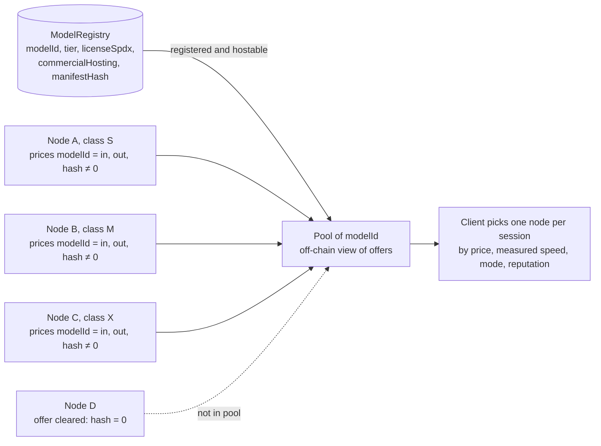

# Model registry — manifests, tiers and licenses

Author: Comuns contributors
Status: Draft
Category: Technical Proposal
Created: 2026-10-12
**Reference:** docs/protocol/contracts-and-settlement.md, docs/node/node-design.md, docs/adr/0006-apache-2-0-and-dco.md

---

## 1. Summary

`ModelRegistry` is the on-chain list of models a Comuns node may be paid to serve. A model is identified by its **manifest**: a canonical JSON file naming the weight files, their SHA-256 hashes, the tokenizer digest, the quantization, the context limit and the license file. `manifestHash` is the SHA-256 of the canonical manifest bytes and `modelId = keccak256(manifestHash)`; a different manifest is a different model. The record also carries the model's **tier** (T0–T4, a parameter-count label), the license's SPDX identifier and a `commercialHosting` flag that `openSession` and `openSessionFromCredit` check: a model whose license forbids paid hosting cannot be the subject of a paid session or an offer.

In v1 `registerModel` and `updateModel` are callable **only by the governance timelock**, acting on a CIP; with nobody seated there is no mainnet registration, and Arbitrum Sepolia models come from a testnet-only CIP; on Arbitrum Sepolia, GOVERNANCE.md §7.1 applies; mainnet unchanged. This prevents manifest squatting and false `commercialHosting` flags, at the price of making every registration a governance act.

A **model pool** is not a registry field. It is the set of nodes whose `NodeRegistry` entry carries a current offer `prices[modelId] = (priceInPerMillion, priceOutPerMillion, modelBenchmarkHash)` with a non-zero `modelBenchmarkHash` — a filtered view of `NodeRegistry`, enumerated off-chain, never a payee.

The registry **grants no license**. It records what the registrant found in the license at a given date. The operator who loads a weight file is responsible for having the right to run it and to charge for it; this document's license snapshot is a starting point for that check, not a substitute for it. Nothing described here runs yet.

## 2. Scope

In scope: the on-chain `Model` record; the manifest format and `manifestHash`; the license snapshot that informs `licenseSpdx` and `commercialHosting`; what may be paid for; how pools are formed, joined, left and enumerated; the constraint on the class benchmark model; risks and open questions.

Out of scope: contract function semantics and reverts (docs/protocol/contracts-and-settlement.md, which is normative for every identifier used here); how a node loads and benchmarks a model (docs/node/node-design.md, docs/node/hardware-classes-and-benchmarks.md); the project's own software license (Apache-2.0 with a DCO, docs/adr/0006-apache-2-0-and-dco.md).

Three distinctions this document keeps apart:

- **The registry grants no license.** Registering a model records facts about its license; it conveys no right to anyone.
- **Operators are responsible for the files they load.** A node operator must satisfy the model license (attribution, naming, user-count thresholds, use policies) in their own jurisdiction; the protocol checks only the `commercialHosting` flag.
- **Software license and model license are different things.** The Comuns software is proposed under Apache-2.0 (docs/adr/0006-apache-2-0-and-dco.md); that says nothing about any model's weights. A model's license governs the weights and their outputs on the terms it states.

Evidence tags: **[V]**, **[L]**, **[U]** as in docs/evidence-register.md, cited by section. Anything not cited there is UNVERIFIED.

## 3. On-chain record

The `Model` record, keyed by `modelId`, as defined in the contracts document (normative there; repeated here for reading convenience):

| Field | Type | Meaning |
|---|---|---|
| `modelId` | `bytes32` | `keccak256(manifestHash)`. The identity of a model is its manifest. |
| `tier` | `tier` (uint8) | A partition of the parameter count in the manifest: T0 ≤ 4B; T1 > 4B and ≤ 8B; T2 > 8B and ≤ 32B; T3 > 32B and ≤ 70B; T4 > 70B. Every count falls in exactly one tier (the example manifest in section 4, at 8,000,000,000 parameters, is T1). Set at registration, immutable. A label for price bands, never an eligibility gate, and a different thing from a node's `hardwareClass`. |
| `licenseSpdx` | `string` | SPDX identifier of the model license (`Apache-2.0`, `MIT`, or a `LicenseRef-…` identifier for a bespoke license such as the Llama, Qwen or Gemma terms). Mutable by `updateModel`. |
| `commercialHosting` | `bool` | Whether the license, as read by the registrant at the snapshot date, permits paid hosting. `openSession`, `openSessionFromCredit`, `registerNode` and `updateNode` refuse models where this is false. Mutable by `updateModel`. |
| `manifestHash` | `bytes32` | SHA-256 of the canonical JSON manifest (section 4). Immutable. |
| `metadataUri` | `string` | Where the manifest, the model card and the license file are published. Mutable. |
| `publisher` | `address` | The registrant; in v1 always the governance timelock. |

Only `registerModel(manifestHash, tier, licenseSpdx, commercialHosting, metadataUri)` and `updateModel(modelId, licenseSpdx, commercialHosting, metadataUri)` write this record, and only the timelock may call them in v1 (on Arbitrum Sepolia, GOVERNANCE.md §7.1 applies; mainnet unchanged). `tier` and `manifestHash` never change: a new quantization, a new tokenizer or a corrected file is a new manifest and a new `modelId`. Setting `commercialHosting` to false blocks new sessions and new offers but does not close open sessions.

## 4. Manifest

The manifest is the one document that says what "this model" means. It is canonical JSON: keys sorted lexicographically at every level, no insignificant whitespace, UTF-8, integers without leading zeros, lower-case hex digests. `manifestHash` is the SHA-256 of exactly those bytes; the same content serialized any other way is a different hash and a different model, which is why the canonical form is normative.

```json
{
  "contextLimit": 8192,
  "files": [
    {"path": "model-q4_k_m.gguf", "sha256": "…", "size": 0}
  ],
  "format": "gguf",
  "license": {"path": "LICENSE", "sha256": "…", "spdx": "Apache-2.0"},
  "name": "…",
  "parameters": 8000000000,
  "quantization": "Q4_K_M",
  "schema": 1,
  "tokenizer": {"path": "tokenizer.json", "sha256": "…"},
  "version": "…"
}
```

| Field | Meaning |
|---|---|
| `schema` | Manifest schema version; this document describes schema 1. |
| `name`, `version` | Human-readable; carry no authority. The **name must not imply rights the license withholds** (section 9, R3) and must follow the license's naming rule where one exists. |
| `parameters` | Total stored parameter count of the weight files, including embeddings, in decimal (B = 1,000,000,000); it decides `tier` by the partition in section 3 (8,000,000,000 is T1: more than 4B and at most 8B). A card's rounded figure, an "effective" count or a non-embedding count does not override the stored count. This is a clarification of how the existing tier rule reads, not a new rule, and it stays open for the owner to confirm (section 10, question 1). |
| `files[]` | Every weight file with its SHA-256 and size. A node loads only files whose hashes match; any mismatch is a refusal, not a warning. |
| `format`, `quantization` | The container and quantization the files are in; a node reports the same quantization in its per-model benchmark. |
| `tokenizer` | The tokenizer file and its digest — the **pinned tokenizer** that node and client both use for input receipts and token counting (privacy doc). |
| `contextLimit` | The maximum context the model supports; a node may advertise less, never more. |
| `license` | The license file shipped with the weights, its hash and SPDX identifier. The hash lets anyone check that the file the registrant read is the file in the download. |

The manifest is published at `metadataUri` together with the model card and the license file. Anyone can recompute `manifestHash` and `modelId` from it, and a node checks every file's hash before load (docs/node/node-design.md, R2). In attested mode the published measurement list binds the node build and this model manifest. Before sealing a job, the client checks the quote against that list and checks that it binds the node’s job HPKE key, registered `ohttpKeyConfig` and client nonce. A wrong manifest or measurement fails closed; see [privacy and contexts](../security/privacy-and-contexts.md).

## 5. License snapshot

Snapshot taken **2026-10-12** from docs/evidence-register.md §7. It records what the register found at that date; **the registrant must re-check the license file shipped with the exact weight file** before proposing a registration, and `commercialHosting` in the CIP is the registrant's reading of that file, not this table. Licenses change between model versions and the table names versions where the register does.

| Model family | License (as recorded) | Paid hosting | Conditions recorded | Mark |
|---|---|---|---|---|
| Llama 3.3 / Llama 4 | Llama community license (bespoke; `LicenseRef-Llama`) | Allowed | Commercial use and redistribution allowed; a party with more than 700M monthly active users needs a separate license; "Built with Llama" attribution; derived model names must start with "Llama"; a Notice file must be shipped; multimodal rights are withheld from entities in the EU in Llama 3.2 and Llama 4 | [V] |
| Mistral Large 3 | Apache-2.0 | Allowed | Standard Apache-2.0 terms | [V] |
| Mistral models under the Mistral Research License or Mistral Non-Production License | Bespoke | **Not allowed** | These licenses forbid commercial hosting; `commercialHosting` must be false | [V] |
| Qwen2.5-72B | Qwen License (bespoke; `LicenseRef-Qwen`) | Allowed with threshold | A party with more than 100M monthly active users needs a separate license | [V] |
| Qwen3 / Qwen3.5 | Reported Apache-2.0 | Allowed if confirmed | The register marks this [L/V]; the registrant confirms against the weight file's license before setting the flag | [L/V] |
| DeepSeek R1 / V3.1 | MIT | Allowed | Standard MIT terms | [V] |
| Gemma 4 | Apache-2.0 | Allowed | Standard Apache-2.0 terms | [V] |
| Gemma 3 | Gemma terms (bespoke; `LicenseRef-Gemma`) | Registrant decides | Own terms; the registrant reads them for the flag and the use restrictions | [V] |
| Phi-4 | MIT | Allowed | Standard MIT terms | [V] |
| gpt-oss | Apache-2.0 plus a usage policy | Allowed | Apache-2.0 terms plus a separate usage policy the operator must follow | [V] |

Reading the table: "Allowed" is this document's reading of the register's entry, not legal advice, and the user-count thresholds (700M, 100M) are conditions on the **operator**, not on the protocol. An operator below a threshold may host; one above it needs its own license; the protocol cannot know which applies and does not try. A mixed row ("Allowed if confirmed", "Registrant decides") means the CIP that registers the model must state what the registrant read.

Candidate T0 files, recheck 2026-10-15 (evidence register §7, recheck 2026-10-15; observations, not a selection):

| Model | Stored parameters | License (source) | Official GGUF | Within T0 by stored total | Mark |
|---|---|---|---|---|---|
| Qwen3-0.6B | 751,632,384 | Apache-2.0 (LICENSE file) | Qwen/Qwen3-0.6B-GGUF Q8_0 | yes | [V] |
| Qwen3-1.7B | 2,031,739,904 | Apache-2.0 (LICENSE) | Qwen/Qwen3-1.7B-GGUF Q8_0 | yes | [V] |
| Qwen3-4B | 4,022,468,096 (card: 4.0B) | Apache-2.0 (LICENSE) | Qwen/Qwen3-4B-GGUF Q4_K_M … Q8_0 | no, above 4,000,000,000 | [V] |
| Qwen3.5-0.8B / 2B | 873,438,784 / 2,274,069,824 | Apache-2.0 (LICENSE); multimodal | not found in the sources examined on 2026-10-15 | yes | [V] license, [U] GGUF |
| Qwen3.5-4B | 4,659,865,088 | Apache-2.0 (LICENSE); multimodal | not found in the sources examined on 2026-10-15 | no | [V]/[U] |
| Phi-4-mini-instruct | 3,836,021,760 | MIT (LICENSE) | not found in the sources examined on 2026-10-15 | yes | [V] license, [U] GGUF |
| Gemma 4 E2B | 5,123,178,051 (2.3B effective) | Apache-2.0 (card and Google license page; no LICENSE file in the repository) | google/gemma-4-E2B-it-qat-q4_0-gguf | no | [V] |

This table selects nothing and decides no `commercialHosting` flag; no added hosting restriction was found in the Qwen and Phi LICENSE files, which is a file fact, not a flag. Whether llama.cpp runs the Qwen3.5 or Gemma 4 architectures is not recorded [U]; whether Google's Prohibited Use Policy binds Gemma 4 is not stated in the sources examined on 2026-10-15 [U]. The Qwen3 / Qwen3.5 row of the snapshot table is [V] for the files named here only.

## 6. What may be paid

`openSession` and `openSessionFromCredit` revert unless the session's model has `commercialHosting == true`; `registerNode` and `updateNode` refuse an offer on a model where it is false (contracts doc, §6 and §9). A model whose license forbids paid hosting can therefore be registered — so that the registry can say so — but never offered or sold. Clearing such an offer is always allowed, so an `updateModel` that flips the flag to false strands no node: operators clear the offer on their next `updateNode`, and sessions already open settle at their copied prices.

What the flag does **not** do: it does not verify that the operator meets the license's conditions (attribution, naming, thresholds, use policies), it does not make the protocol a licensee, and it does not change when a license changes upstream until a CIP updates it. The flag is a gate against paying for a model the community has read as unhostable, not a compliance system.

## 7. Model pools

A **pool** is the set of nodes with a current offer for a `modelId`: each is a `NodeRegistry` entry whose `prices[modelId] = (priceInPerMillion, priceOutPerMillion, modelBenchmarkHash)` carries a **non-zero `modelBenchmarkHash`**. The pool is a filtered view of `NodeRegistry` — the set of node offers for that model — **not a model-record field** in `ModelRegistry`, not stored anywhere on-chain beyond the offers themselves, and **not a payee**: no function pays "a pool", and credit-session payouts split between the chosen node and its registered relay under ADR 0011.

**Joining.** An operator joins the pool of a registered model by:

1. loading the model from files whose hashes match the manifest, after the memory-fit check at the concurrency it intends to advertise (docs/node/node-design.md §5);
2. running the per-model self-benchmark with the same public synthetic method as the class benchmark (docs/node/hardware-classes-and-benchmarks.md §6), pinned to that `modelId`, manifest, backend and build, and signing the result; its hash is `modelBenchmarkHash`;
3. writing the offer through `registerNode` or `updateNode`, with both prices inside the band for (the model's tier, the node's class) and the non-zero `modelBenchmarkHash`. The contract checks `commercialHosting`, the band and the non-zero hash; a model with `commercialHosting == false` cannot be offered.

A node of any class may join any model's pool it can load; the class decides the band, not the right to join. A class M node offering a T3 model prices inside the (T3, M) band — cheaper than a class X node's (T3, X) band, as the strict band ordering requires.

**Leaving.** The operator clears the entry — by calling `updateNode` with a complete offer list that omits the model, which emits an `OfferSet` with zero prices and a zero `modelBenchmarkHash` ("cleared") — when it unloads the model, re-benchmarks, or no longer wants the work. Clearing is always allowed. `deregisterNode` clears every offer the same way. A **stale offer** — a model the node cannot currently serve — can survive the contract checks at `openSession` or `openSessionFromCredit` while the node refuses the job. The client requests admission before either opening path; the reference client uses only `openSessionFromCredit`, through a relay. If readiness becomes stale after admission, an unused credit session must close and settle before `claimChange` restores its full denomination as a fresh note. The node loses spend gas and the client loses time; indexers downrank the node. Stale offers are a **reputation risk, not slashing**.

**Enumeration.** Clients and indexers build a pool from registry state and events, exactly as the contracts document specifies (§9, §11): take the `OfferSet` events for the `modelId`, keep each operator's latest, drop those whose latest has a zero hash, drop deregistered nodes (`NodeDeregistered` without a later `NodeRegistered`), and read the current prices, class, modes and endpoint from the node record. A re-registration after `withdrawBond` starts from an empty offer list, so no pre-deregistration offer survives in an indexer that follows this rule.

**A thin pool.** When no node in the pool offers a quote the user accepts — or no node offers the model at all inside any band — the client **says so** rather than silently picking another model. The disclosure sheet binds the model the user chose; a substitution is a new sheet and a new confirmation. A selected node is a disclosed recipient; the sheet counts recipients separately from operator-readable recipients so that attested mode is not presented as standard mode. The client also shows the pool’s operator count.

**Pool metrics** (off-chain, for indexers and clients): number of distinct operators with a current offer; classes present; price range per class; modes offered; the freshness of each `modelBenchmarkHash`; the share of sessions on that model that settled with zero `settledWei` (a proxy for stale offers). None of these is stored on-chain.



## 8. Benchmark model constraint

The class benchmark of docs/node/hardware-classes-and-benchmarks.md needs one model that every node, including class S, can run. The constraint on that model:

- its license is **Apache-2.0 or MIT**, so that running it, redistributing the benchmark set and publishing results carry no attribution, naming or user-count conditions;
- it is **small enough for class S** — a T0 model at a quantization that fits CPU-only machines and 8–16 GB unified memory by the illustrative memory-fit formula;
- its manifest is registered like any other model, so that `benchmarkHash` pins a `modelId`.

The **concrete file is open** (section 10). This document does **not** mandate a Llama file: the Llama license's attribution and naming conditions are workable for an operator but needless for a benchmark artefact, and an Apache-2.0 or MIT model avoids them entirely. At the 2026-10-15 recheck the files that satisfy the license rule and the T0 stored-total rule are Qwen3-0.6B and Qwen3-1.7B (official GGUF), Qwen3.5-0.8B and 2B (multimodal, official GGUF not found in the sources examined on 2026-10-15) and Phi-4-mini-instruct (official GGUF not found in the sources examined on 2026-10-15); Qwen3-4B, Qwen3.5-4B and Gemma 4 E2B exceed 4,000,000,000 stored parameters (evidence register §7, recheck 2026-10-15, [V]/[U]). Which file, quantization and tokenizer become the benchmark model is for CIP-0004 to establish; this document selects none.

## 9. Risks

### R1 — Stale license snapshot **[RISK] · High**

Section 5 is a reading of the register at one date. A license can change in a later model version, and a registrant who copies the table instead of reading the shipped file registers a wrong flag. Mitigation: the manifest hashes the license file; the registering CIP quotes what the registrant read; `updateModel` can correct the flag through a later CIP; the table says "re-check" in its first sentence.

### R2 — Manifest not matching the bytes **[RISK] · High**

A manifest whose hashes do not match the files a node downloads, or a registrant who hashes one file and ships another. Mitigation: a node loads only files whose SHA-256 matches the manifest and refuses otherwise; anyone can recompute `manifestHash`; governance-only registration means a mismatch is a CIP defect, visible in review.

### R3 — A name implying rights the license withholds **[RISK] · Medium**

A manifest `name` like "…-commercial" or "open-…" on a model whose license forbids paid hosting, or a derived name that breaks the upstream naming rule. Mitigation: the name carries no authority; `commercialHosting` and `licenseSpdx` are the facts; CIP review checks names against the license's naming conditions.

### R4 — Thin pools **[RISK] · Medium**

A model with few operators limits price competition and provider choice. Mitigation: the client shows the operator count on the disclosure sheet and says plainly when no acceptable quote exists; it never substitutes a model silently.

### R5 — Stale offers **[RISK] · Medium**

Offers outlive the loaded model. Mitigation: the reference node clears offers on unload; the client requests admission before `openSession` or `openSessionFromCredit` (the latter is the reference-client path); indexers surface zero-`settledWei` settlements; no slashing, by design.

### R6 — Governance bottleneck **[RISK] · Medium**

Every model needs a CIP; a slow or captured governance blocks legitimate models. Mitigation: a lightweight CIP track for registrations; the testnet-only CIP for Sepolia; reopening registration is an open question in the contracts document.

## 10. Open questions

1. **The class benchmark file.** Which Apache-2.0 or MIT T0 model and quantization becomes the class benchmark model. Proposed resolution: CIP-0004 sets the Phase 1 predicate (Apache-2.0 or MIT, tier T0, and the registrant states which license text they read), and its "Model to register" item reads "Open; blocks Last Call" until CIP-0004 itself names the weight file, revision and quantization, the tokenizer and its test vector, the parameter count, the manifest and `manifestHash`, the license's SPDX identifier, and the sentence the registrant read. The deployment record does not name the file; it records the `modelId` and transaction hashes. Candidate stored totals are recorded in section 5; no benchmark file is selected. The 2026-10-15 recheck narrows the field (section 5) and selects nothing; the stored-total rule in section 4 governs the T0 boundary, and that reading of the existing tier rule stays open for the owner to confirm. CIP-0004's "Model to register" item remains Open and blocks its Last Call.
2. **Manifest schema details.** Whether the manifest should carry the chat template, stop tokens and sampling defaults, which affect token counts and reproducibility, and how schema upgrades are handled without changing `modelId` semantics.
3. **Tokenizer pinning.** Whether a tokenizer digest alone is enough for client and node to agree on `inputTokens`, or whether the manifest must also pin the tokenizer library version (privacy doc, open question 10).
4. **SPDX identifiers for bespoke licenses.** Which `LicenseRef-` identifiers the project standardizes for the Llama, Qwen and Gemma terms, so that indexers can filter consistently.
5. **Operator-side license checks.** Whether the reference node should display the license conditions (attribution, naming, thresholds, usage policy) to the operator at load time, and whether the capability document should carry an operator attestation of compliance.
6. **Pool freshness.** The renewal period after which a `modelBenchmarkHash` is shown as stale, and whether it is tied to the class benchmark's period (docs/node/hardware-classes-and-benchmarks.md, open question 3).
7. **Model deprecation.** How a model is retired — `commercialHosting` set to false by CIP, or a separate flag — and how long open sessions and offers may linger.
