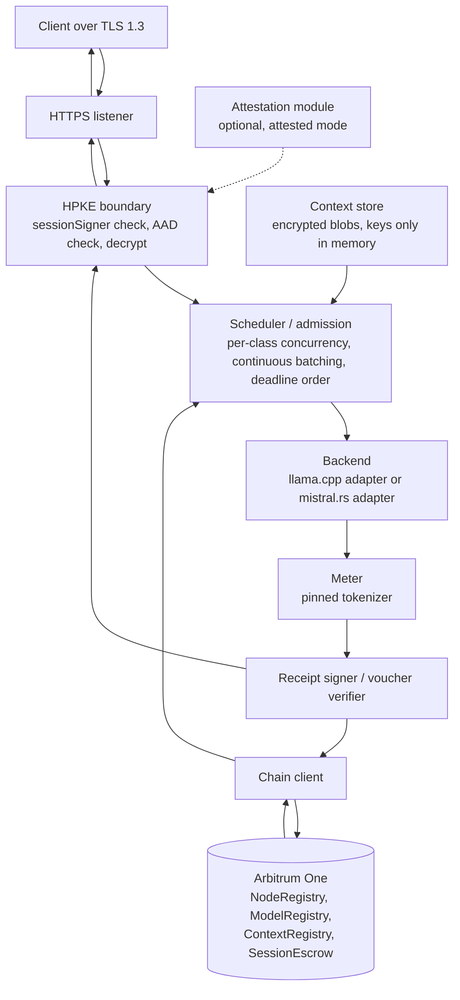

# Node — a Rust inference server

Author: Comuns contributors
Status: Draft
Category: Technical Proposal
Created: 2026-10-12
**Reference:** docs/security/privacy-and-contexts.md, docs/protocol/contracts-and-settlement.md, docs/protocol/off-chain-api.md, docs/node/hardware-classes-and-benchmarks.md, docs/node/model-registry-and-licenses.md, docs/adr/0002-off-chain-rust-inference.md

---

## 1. Summary

The Comuns node is the program an operator runs to sell inference. It is proposed as a single Rust binary that runs **off-chain**: it watches the registries and the sessions that concern its operator on Arbitrum One, accepts encrypted jobs over HTTPS, runs them through a pluggable inference backend, meters tokens with the tokenizer pinned in the model manifest, exchanges node-signed receipts for client-signed vouchers one chunk at a time, and redeems the highest voucher on-chain. Nothing described here exists yet; **this document creates no Rust project**, no crate, no build and no deployment. It fixes the shape of the program so that the other documents can refer to the same parts by the same names.

Design decisions carried in from the ADRs and the wave-1 documents (all PROPOSED, none implemented):

- **Rust, off-chain.** The node is a Rust program on the operator's machine. Inference never runs on-chain; the chain records offers, sessions and vouchers only.
- **Pluggable backends behind one trait.** Two initial adapters: **llama.cpp** through Rust bindings (first adapter, the widest hardware coverage and the small-hardware path) and **mistral.rs** (second adapter, pure Rust). llama.cpp's kernels are **C/C++** [V] and the adapter crosses an FFI boundary; the text says so wherever it matters. **Ollama** was considered and rejected as an adapter: it is Go (evidence register §3, [V]) and would add a process boundary and a second language to a Rust node for no capability the two chosen adapters lack.
- **Rust does not make inference faster.** Throughput and latency come from the kernels, memory bandwidth, batching and model support of the backend; the language of the host process decides safety, packaging and the FFI surface, not tokens per second. No document may claim otherwise.
- **Model-first pools.** A node may load many models and may offer **any registered model it can actually load** — memory fit (section 5) plus its own public self-benchmark of that model. There is no class-to-tier serving rule. The operator joins a model's pool by writing `prices[modelId] = (priceInPerMillion, priceOutPerMillion, modelBenchmarkHash)` through `registerNode` or `updateNode`, with both prices inside the band for (the model's tier, the node's class) and a non-zero `modelBenchmarkHash`, and leaves the pool by clearing the entry when it unloads the model. The hardware class still decides which band applies, so the same model is cheaper from a small node and dearer from a strong one. `maxTier` is informational only.
- **One model per session.** A session names one `modelId`; a node that cannot fit a model refuses rather than swapping into failure, and does not advertise it.
- **Single-node execution is what v1 node processes implement.** The off-chain capability document may additionally list the optional **orchestration** role (the node can act as an orchestrator node, paid as an ordinary session, holding no `sessionSigner`) and, only for the Phase 3 spikes, the experimental **shard** and **draft** roles. **v1 node processes do not implement open-internet model sharding or cross-node speculative decoding**; those are Phase 3 spike work in docs/node/distributed-execution.md. Local speculative decoding inside one node is an engine detail that adds no reader and stays off in verifiable mode.
- **Privacy boundary.** The node terminates TLS 1.3 and then an HPKE boundary; prompt, context and completion plaintext exist only in process memory, are zeroized after use and are **never logged**.

## 2. Scope

In scope: the processes inside the node binary, the backend trait and its two initial adapters, admission and memory fit, the session state the node keeps, keys and logging policy, the chain client's responsibilities, a configuration sketch, an operations outline marked as future work, a suggested module split, risks and open questions.

Out of scope, owned elsewhere: the wire format of envelopes, receipts and frames (docs/protocol/off-chain-api.md); the cryptography (docs/security/privacy-and-contexts.md); contract semantics, the canonical `Voucher` type and the payment rule (docs/protocol/contracts-and-settlement.md); classes, bands and the benchmark protocol (docs/node/hardware-classes-and-benchmarks.md); manifests and licenses (docs/node/model-registry-and-licenses.md); verifiable mode (docs/security/inference-verification.md); multi-node orchestration (docs/protocol/orchestration.md); sharding and cross-node speculation (docs/node/distributed-execution.md).

Evidence tags: **[V]**, **[L]**, **[U]** as in docs/evidence-register.md, cited by section. Anything not cited there is UNVERIFIED.

## 3. Processes

The node is one operating-system process with several cooperating tasks. The names below are used by every other document.

| Task | Responsibility |
|---|---|
| **Chain listener** | Follows `NodeRegistry`, `ModelRegistry`, `ContextRegistry` and `SessionEscrow` events that concern this operator: its own `NodeRegistered` / `NodeUpdated` / `OfferSet`, every `ModelRegistered` / `ModelUpdated` for models it offers, `SessionOpened` naming it as `node`, `SessionToppedUp`, `SessionClosing`, `SessionSettled`, `BandsSet`. Keeps a local view of open sessions (prices copied at open, `sessionSigner`, effective cap, last redeemed `seq`). |
| **HTTPS listener** | TLS 1.3 only. Accepts job envelopes and serves the capability document (which advertises, among its limits, `maxConcurrentJobsPerSession = 1` and `maxInterFrameMs`; the client marks an answer truncated and stops waiting after 2 × `maxInterFrameMs` without a frame) and the public self-benchmark results. TLS hides content, not sizes or timing; padding is an open question (section 13). |
| **HPKE boundary** | Verifies the `sessionSigner` signature on every request envelope against the signer recorded on-chain for that session before decrypting or scheduling anything, then opens the HPKE context, checks the AAD tuple, and holds plaintext only inside the runtime. `clientJobPublicKey` and every job parameter (`maxOutputTokens`, sampling settings) are read from the HPKE plaintext and are covered by the signature digest; nothing that changes a job travels in the clear. Seals every output frame to `clientJobPublicKey`; chunk receipts travel inside the sealed frame, and any hash that must appear outside encryption is keyed, `keccak256(commitKey ‖ chunk)`. |
| **Scheduler / admission** | Decides whether to accept a session request (model loaded, memory fit, mode supported, remaining cap), queues jobs with per-class concurrency limits, uses continuous batching where the backend supports it, and orders work by deadline. **One job at a time per session** (`maxConcurrentJobsPerSession = 1`): receipts and vouchers form one chain per session, so jobs that share a (node, `modelId`) session run sequentially; concurrency exists only across sessions. |
| **Backend** | Loads models, generates tokens as a stream, counts tokens, reports capabilities (section 4). |
| **Meter** | Counts input and output tokens with the tokenizer pinned in the model manifest; produces the numbers that go into receipts. |
| **Voucher verifier and receipt signer** | Signs the input receipt and every chunk receipt with the node key; verifies each incoming voucher (signature, `seq`, cumulative counts, `cumulativeWei` under the session's copied prices, `outputCommitment` recomputed from `commitKey` and the transcript hash chain) **against the prefix of chunks the client has acknowledged**, not against the chunk it may already have sent ahead (section 6). The node **starts prefill only after the input voucher** and **streams at most one chunk of `CHUNK_TOKENS` ahead of the highest voucher it holds**; that one chunk is its unpaid exposure. |
| **Context store** | Holds encrypted context blobs the owner granted; verifies each version's `contentHash` against `ContextRegistry` or its `ContextSet` history; unwraps `K_v` keys only in memory and discards them at `expiresAt` or job end, whichever is earlier. |
| **Attestation module (optional)** | In attested mode generates the node's HPKE keypair inside the TEE, commits the hash of the public key together with the client's nonce in the quote's report data, and serves the quote; the secret never leaves protected memory. |
| **Chain client** | Submits `registerNode`, `updateNode`, `redeemVoucher`, `closeWithVoucher`, `closeSession`, `finalize`, `deregisterNode`, `withdrawBond` and `withdraw` for the operator (section 8). |



Two processes are explicitly **not** node processes in v1: an open-internet shard server and a cross-node draft or target role. llama.cpp's own documentation for its RPC backend says it is at a "proof-of-concept development stage", "fragile and insecure", and: "Never run the RPC server on an open network or in a sensitive environment!" (evidence register §10, [V]). **This node must not run that RPC server on an open network.** mistral.rs's NCCL tensor parallelism and multi-node NCCL (evidence register §10, [V]) are a private multi-node fabric for one operator's own machines, not a v1 public adapter. A LAN cluster behind one endpoint — several machines of one operator joined by llama.cpp RPC on a private network or by mistral.rs NCCL — is invisible to the protocol: it counts as **a single node with an ordinary offer**, and it is the recommended way for small machines to serve T3–T4 models.

## 4. Backends

The node talks to inference engines through one trait. Per-model selection of a backend is **gated by the benchmark protocol** of docs/node/hardware-classes-and-benchmarks.md: a model is offered through a given adapter only after the operator has published a self-benchmark of that model on that adapter and build, and `modelBenchmarkHash` names that result.

| Adapter | Language of the kernels | Devices | Status in this proposal |
|---|---|---|---|
| **llama.cpp** through Rust bindings (`llama-cpp-2` with cuda/metal/vulkan/rocm features, or `llama_cpp`; evidence register §3, [V]) | **C/C++** kernels [V]; the Rust side is an FFI wrapper | CPU, CUDA, Metal, Vulkan, ROCm (HIP) [V] | **First adapter.** Widest hardware coverage; the small-hardware path; GGUF quantizations from 1.5 to 8 bits [V]. |
| **mistral.rs** (evidence register §3, [V]) | Rust | CUDA (FlashAttention), Metal, CPU [V] | **Second adapter.** PagedAttention and continuous batching [V]. Its OpenAI-compatible server (`mistralrs serve`) **may run only locally, bound to the loopback interface, after the HPKE boundary has decrypted the job — never as a public, unauthenticated prompt route.** |
| Ollama | Go [V] | — | **Rejected.** A separate Go process behind a plain HTTP API; adds a language and a process boundary without adding a device or a quantization the two adapters above lack. |
| candle, burn, ratchet | Rust | various [V] | Not adapters in v1; candle has no Vulkan/ROCm and no built-in server [V]; burn has no LLM server [V]. Candidates for a later CIP. |

A sketch of the trait. It is a sketch, not code: **this document creates no Rust project**, and the names may change in the implementation CIP.

```rust
// Sketch only. No crate, no build, no tests exist. Names are illustrative.

pub struct ModelHandle(u64);

pub struct LoadOptions {
    pub device: Device,                 // Cpu, Cuda(n), Metal, Vulkan(n), Rocm(n)
    pub quantization: String,           // as pinned in the manifest, e.g. "Q4_K_M"
    pub max_context: u32,
    pub max_concurrency: u32,           // sizes the KV cache (section 5)
    pub deterministic_profile: bool,    // temperature 0, speculative decoding off, pinned build
}

pub struct Capabilities {
    pub devices: Vec<Device>,
    pub quantizations: Vec<String>,
    pub continuous_batching: bool,
    pub local_speculative_decoding: bool,   // engine detail; adds no reader; off in verifiable mode
    pub deterministic_profile: Option<ProfileId>, // Some only when reproducibility was DEMONSTRATED
}

pub enum CommitmentError { Unsupported, Failed(String) }

pub trait Backend: Send + Sync {
    fn load(&self, manifest: &ModelManifest, opts: &LoadOptions) -> Result<ModelHandle, BackendError>;
    fn unload(&self, handle: ModelHandle) -> Result<(), BackendError>;
    /// Streaming generation: yields token chunks the meter counts and the HPKE boundary seals.
    fn generate(&self, handle: &ModelHandle, req: GenerateRequest) -> Result<TokenStream, BackendError>;
    /// Counts tokens with the tokenizer pinned in the manifest, never with a substitute.
    fn count_tokens(&self, handle: &ModelHandle, text: &str) -> Result<u64, BackendError>;
    fn capabilities(&self) -> Capabilities;
    /// Commitment hook for verifiable mode. The default returns Unsupported; an adapter overrides it
    /// only under a DEMONSTRATED deterministic profile (docs/security/inference-verification.md).
    fn commitment(&self, _handle: &ModelHandle, _run: &RunRecord) -> Result<Commitment, CommitmentError> {
        Err(CommitmentError::Unsupported)
    }
}
```

**Verifiable mode (mode 2).** A backend supports it only when it can run at temperature 0 with speculative decoding off under a pinned build **and** produce a commitment, and only after reproducibility has been **demonstrated**: repeated runs of a published test set give byte-identical outputs across the supported hardware and batching configurations. Pinned versions, temperature 0 and disabled speculative decoding are necessary but not sufficient — 1,000 temperature-0 runs of one model gave 80 unique outputs without batch-invariant kernels (evidence register §5, [V]). Otherwise `commitment` returns `Unsupported` and the node **refuses mode 2** and does not advertise it in `modes`. No document may claim that TOPLOC exists for these backends: it is integrated with vLLM and SGLang (evidence register §5, [V]), not with llama.cpp or mistral.rs, and it cannot detect speculative decoding [V].

**Why not "Rust is faster".** Both adapters spend their time in kernels; the llama.cpp adapter's kernels are C/C++ and the mistral.rs kernels are Rust with CUDA and Metal code paths. Measured differences between them come from kernels, memory bandwidth, batching and which models and quantizations each supports — which is exactly why per-model backend selection is gated by a published benchmark rather than by language.

## 5. Admission and memory fit

A node advertises a model only if it can load it, and refuses a session request for a model it cannot serve right now rather than evicting another model mid-session. Admission runs in two places: **before `registerNode`/`updateNode`** (may this model be offered at all?) and **before every session** (can it be served now, in the requested mode, with the current load?).

**Memory-fit formula.** All coefficients below are **illustrative**; the implementation CIP replaces them with measured values per backend, and nothing here is a measured minimum.

```
required_bytes =
    weights        : parameters × bytes_per_weight(quantization)
  + kv_cache       : layers × 2 × context_tokens × hidden_size × bytes_per_kv_element × concurrency
  + workspace      : backend scratch (attention buffers, logits, batching state)
  + os_reserve     : what the operating system and drivers keep
  + safety_margin  : a fraction of the total, for fragmentation and spikes

fits  ⇔  required_bytes ≤ available_device_memory (or unified memory on shared-memory machines)
```

Notes on the terms:

- `bytes_per_weight` is about 0.5 at a 4-bit quantization and 2 at 16-bit (illustrative); the manifest pins the quantization, so the node computes this from the manifest, not from a guess.
- The KV-cache term is the one operators underestimate: it scales with context length and with the number of concurrent sequences, and it depends on the backend's cache quantization. A 70B model at a 4-bit quantization does not fit a 32 GB card at all (evidence register §6, [V]); what context a fitting model can serve at what concurrency is a measured property of the build.
- A model that fits at concurrency 1 may not fit at the per-class concurrency limit the scheduler is configured for; the node advertises the model only at a concurrency it has verified.
- Small quantized models on CPU-only machines are a **validation target** for T0, not a measured minimum: the proposal has not measured any machine as "the smallest that works" and states no minimum hardware requirement as established.

**Per-session admission** checks, in order: the model is loaded (or loadable without evicting a model with open sessions); the requested mode is one the node advertises and the backend supports for this model; the client's declared `modelId` matches an offer with a non-zero `modelBenchmarkHash`; the scheduler has capacity at the class's concurrency limit; and, for a reused session, the remaining effective cap is above zero. The reference client requests admission before sending `openSession`, so a refusal costs the user no gas (contracts doc, R6).

**Scheduling.** Per-class concurrency limits are configuration; continuous batching is used where the backend reports it; jobs are ordered by deadline. Within one session jobs run **one at a time** (`maxConcurrentJobsPerSession = 1`), because the session's receipts and vouchers form a single chain; an orchestrator that needs two tasks in parallel on the same (node, `modelId`) opens a second session for the second task, and that session is on the disclosure sheet. A job whose session reaches its effective cap is paused and the client is asked to `topUp`; the node never streams more than one chunk of `CHUNK_TOKENS` beyond what the highest voucher pays.

## 6. Session handling

The node keeps, per open session: the copied prices, `sessionSigner`, the effective cap, `commitKey` (received sealed in the session's first job envelope), the transcript hash chain, the cumulative input and output token counts **as covered by the last voucher the client signed**, the highest voucher received, and the HPKE key from its keyring that the session was sealed to. This session state lives in **persistent, encrypted local storage for the life of the session, until it is settled** — `commitKey`, the transcript chain and the highest voucher included — so that a node restart can still recompute `outputCommitment` for a later job on the same session and can still redeem the highest voucher it holds. Per-job secrets (the job's HPKE contexts and unwrapped `K_v`) are separate, kept in memory only and discarded at job end. The canonical voucher is `Voucher(bytes32 sessionId,uint64 seq,uint256 cumulativeWei,uint64 inputTokens,uint64 outputTokens,bytes32 outputCommitment,bool final)` from the contracts document; the node defines no variant.

```mermaid
sequenceDiagram
    participant C as Client (holds sessionSigner)
    participant E as SessionEscrow
    participant N as Node
    participant CR as ContextRegistry
    participant B as Backend
    C->>N: admission request (modelId, mode)
    N-->>C: admitted (model loaded, memory fits, mode supported)
    C->>E: openSession(node, modelId, mode, sessionSigner, maxSpendWei, expectedPriceIn, expectedPriceOut) + deposit
    E-->>N: SessionOpened observed by the chain listener (prices copied, sessionSigner recorded)
    C->>N: job envelope: HPKE-sealed prompt + context grant + commitKey (first job), signed by sessionSigner
    N->>N: verify sessionSigner signature, check AAD, decrypt
    N->>CR: grant check: owner signature, contentHash per version (head or ContextSet history), expiresAt
    N->>N: unwrap K_v in memory, decrypt granted versions
    N->>N: tokenize prompt + context with the pinned tokenizer
    N-->>C: input receipt (sessionId, jobId, jobInputTokens, cumulativeInputTokensAfter), before prefill
    C->>N: input voucher (seq, cumulative inputTokens)
    N->>B: prefill + generate (streaming)
    loop every chunk of at most CHUNK_TOKENS
        B-->>N: tokens
        N-->>C: HPKE frame sealed to clientJobPublicKey, carrying the chunk receipt inside (cumulative counts, chunk hash)
        C->>N: cumulative voucher with the next voucher seq n; outputCommitment = keccak256(commitKey ‖ sessionId ‖ n ‖ transcriptHash), the same n
        N->>N: verify voucher (recompute the commitment with that voucher's own seq); stream at most one chunk ahead of the highest voucher
    end
    N-->>C: last frame with endOfJob (never copied into final)
    C->>N: closing voucher, final = true
    N->>E: closeWithVoucher — or redeemVoucher at any time while legal with the highest non-final voucher
    E-->>N: VoucherRedeemed, SessionSettled; node later calls withdraw()
```

Rules the node enforces:

- No prefill before the input voucher; the input receipt is sent after tokenization and before prefill, and carries `(sessionId, jobId, jobInputTokens, cumulativeInputTokensAfter)`.
- Each voucher must verify against `sessionSigner`, carry `seq` greater than the last accepted one, cumulative counts not below the **last voucher the client signed**, `cumulativeWei` equal to `(priceInPerMillion × inputTokens + priceOutPerMillion × outputTokens) / 1000000` with the copied prices, and an `outputCommitment` the node recomputes as `keccak256(commitKey ‖ sessionId ‖ seq ‖ transcriptHash)` using **that same voucher's `seq`** and its own transcript hash chain (chained from zero over every output chunk of every job in the session). A mismatch stops the stream; the node redeems its highest valid voucher.
- **Vouchers are checked against the acknowledged prefix.** A voucher — closing or not — may cover only the prefix of chunks the client has acknowledged. Because the node streams one chunk ahead, its transcript chain may already contain a chunk the client has not acknowledged; the node therefore keeps the transcript hash and the cumulative counts **at every chunk boundary of the last two chunks** and accepts a voucher whose counts and `outputCommitment` match the acknowledged prefix even when one more chunk was already sent. The unacknowledged chunk is unpaid: that is the node's one-chunk exposure, and it never blocks settlement. A client that stops after acknowledging chunk N closes on N; a closing voucher is never refused for not paying chunk N+1.
- **A resent voucher is a no-op.** A voucher whose `seq` equals the last accepted `seq` and whose content is byte-identical is ignored, never an error; the chunk in flight is covered by the next voucher. A voucher with an already-accepted `seq` and different content is rejected and the stream stops.
- **Unsigned receipts bind nobody.** The cumulative counts are "the totals covered by the last voucher the client signed". If the client never signs the input voucher for a job, that job's tokens never enter the counts: the node's next input receipt carries `cumulativeInputTokensAfter = lastSignedInputTokens + newJobInputTokens`. Counts never fall below a signed voucher, and a receipt the client did not answer is void.
- **Two counters, never confused.** Frame `seq` runs per job and per direction from 0; voucher `seq` runs per session from 1. On reconnect the node's welcome carries `lastSeq` (the highest voucher seq it holds) and `lastFrameSeq` per open job; the node retransmits output frames from the client's `lastReceivedFrameSeq + 1`; a retransmitted frame identical to one already received, in either direction, is ignored, never a fatal error; the client re-sends its latest voucher. The node's totals in the welcome are information for the client, not something the client trusts: the client resumes only from its own voucher log, and a client that has lost that log signs nothing more on the session and closes it.
- The node never streams past the effective cap `min(depositWei, maxSpendWei)`; the client never signs above it. When the cap is reached the job pauses until a `topUp` is observed, after which the client continues with the next chunk voucher.
- `final` on a voucher means only "the client closes the session"; the frame flag `endOfJob` is never copied into it. A voucher with `final == true` goes only to `closeWithVoucher`.
- **Two ways to close.** Cooperative close: the client signs a final voucher and the node calls `closeWithVoucher`. Unilateral close: the client (or the node) calls the contract's `closeSession` directly, with no voucher, and `finalize` follows after `closeDeadline`. A client that has lost its voucher log uses only the unilateral close and signs nothing; its next work needs a new session, which is a new deposit and cap and therefore a new disclosure-sheet version.
- **On-chain prices win.** The client compares the prices copied into the session on-chain (session record or `SessionOpened`) with its confirmed sheet; the prices the node reports in `welcome` are informational and never trigger a close.
- **Deduplication keys.** Job-level billing is deduplicated by `jobId` (a resent envelope is idempotent); frames and upload fragments are deduplicated by `(jobId, frameSeq)`.
- **Abandoned client or lost key:** the node redeems its highest non-final voucher with `redeemVoucher` while that is legal, then calls `closeSession`; `finalize` after `closeDeadline` credits the remainder to the user. The node never waits for a `final` voucher that is not coming.
- The node redeems promptly rather than waiting for `closeDeadline`: an outage that starts shortly before the deadline can still cost it unredeemed vouchers (contracts doc, R2), and nothing in the protocol guarantees otherwise.
- Payment is pull-based: `redeemVoucher` and `closeWithVoucher` credit `balances[node]`; the chain client calls `withdraw()` on a schedule, once for any number of settled sessions.
- Multi-job sessions: jobs run one at a time; cumulative counts never fall; the input receipt of the second job carries `cumulativeInputTokensAfter = lastSignedInputTokens + jobInputTokens`. A session reused across requests needs a new confirmed sheet version and carries forward only signed totals.
- Multi-node plans: the node sees only its own envelope and never another node's keys; intermediate results return sealed to the client. Even in the Phase 3 sharding spike no holder needs another holder's keys, because the client mediates every stage boundary (docs/node/distributed-execution.md §5); that spike is not a v1 node process.
- **Spike roles append to a job, they do not open new ones.** In the Phase 3 cross-node speculation spike (docs/node/distributed-execution.md §8), a draft or target node holds **one job per session**; each round is a request frame inside that job carrying the accepted tokens and a rollback point, the draft node rolls its KV cache back to the accepted prefix before drafting again, draft probability distributions travel as sealed metadata that is **not** counted as billable output tokens, and the prompt is input-billed once per job, never per round. A v1 node implements none of this; it is listed here only so that the receipt rules above are not read as "every round is a new job with a new input receipt".
- **Tokens, not bytes.** Receipts and vouchers count model tokens only; metadata inside a frame is never counted, and the client checks a chunk's `tokenCount` with its own tokenizer over the token text alone.

## 7. Keys, logs and crash safety

**Keys.**

| Key | Where | Use |
|---|---|---|
| Node HPKE secret (X25519) | Generated from the OS CSPRNG; **encrypted at rest** under an operator passphrase or OS keystore; in attested mode generated inside the TEE and never written out | Opening job envelopes and context grants. Rotated through `updateNode`; the node keeps a **keyring** of every key used by any session not yet settled and deletes an old key only after every session that used it is settled. |
| Node receipt-signing key | May be the HPKE identity's sibling or a separate key, decided in the implementation CIP | Signs input and chunk receipts and benchmark results. |
| Operator Ethereum key | Hardware wallet or OS keystore; the node holds it only if the operator chooses an automated chain client | Signs `registerNode`/`updateNode`, redemptions and `withdraw()`. The registration payload carries a proof of possession of the HPKE private key (contracts doc). |
| TLS certificate | Standard operator-managed certificate | Authenticates the endpoint; TLS 1.3 only. |
| Session `commitKey`, transcript hash chain, highest voucher | **Persistent, encrypted local storage** (same protection as the HPKE secret) for the life of the session | Kept until the session is settled, so that a restart can still recompute `outputCommitment` for later jobs on the session and still redeem the highest voucher; deleted at settlement. |
| Context keys `K_v`, per-job HPKE contexts | **Memory only**; never written to disk | Per-job secrets, separate from the session state above; discarded at job end or `expiresAt`, whichever is earlier. |

**Logs.** Logs may contain session id, job id, token counts, timings, backend identifiers and error codes. **Prompt text, context text and completion text are never logged**, at any log level, including debug. Request bodies are not logged; decrypted buffers are not formatted into error messages. This is an operator policy enforced by the reference software, not a protection against a malicious operator, who can modify the node to log whatever it decrypts (privacy doc, section 5).

**Crash safety.** Plaintext buffers are zeroized after use (a zeroizing allocator or explicit wipes on drop); core dumps are disabled for the node process or scrubbed before being written; the backend's own memory (device buffers, KV cache) is released on unload. Session state (`commitKey`, transcript chain, highest voucher, signed totals) is written to the encrypted session store at every voucher boundary, so a crash loses at most the one unpaid chunk in flight and never a redeemable voucher. These are policies that reduce accidental disclosure; they do not protect against an operator with root on the machine and must not be described as if they did.

**Attested mode.** The HPKE keypair is generated inside the TEE; the quote's report data commits to the hash of the HPKE public key together with the client-supplied nonce; the client refuses to seal unless that binding verifies. The secret never leaves protected memory. The measured overhead on an 8B model is −6.85 % / −8.84 % throughput with TTFT +19–21 %, and roughly 0–2.3 % on a 70B model (evidence register §4, [V]) — a note on cost, not a planning assumption, and not a defence against physical access (privacy doc, R2).

## 8. Chain client

The chain client is the only part of the node that holds an Ethereum signing path. It submits the operator's transactions and follows events for the chain listener. The **library is chosen in a later implementation CIP; no crate or version is pinned here.** Requirements the CIP must meet:

- EIP-712 typed-data hashing for the canonical `Voucher` type string, with no spaces after commas, verified against the contracts document's conformance vectors.
- Event subscription with reorg handling adequate for L2 inclusion (the contracts document defines "settled" as L2 inclusion, not L1 finality).
- Submission through the L1 delayed inbox as a fallback when the sequencer is unavailable, since force inclusion after about a day is the only path then (evidence register §1, [V]).
- Transaction policy: redeem the highest voucher promptly; `closeSession` when a client has disappeared; `finalize` after `closeDeadline`; `withdraw()` on a schedule; `updateNode` with the **complete** offer list whenever a model is loaded, unloaded, re-benchmarked or re-priced, since `updateNode` is replace-all and an omitted model is cleared.

## 9. Configuration

A sketch of the operator's configuration file. Values are illustrative; wei prices come from the governance bands in force and have no value in this proposal.

```toml
# comuns-node.toml — sketch only; no implementation exists.

[node]
endpoint        = "https://node.example.org:8443"
hardware_class  = "M"          # S, M, L or X — the price-band label earned by passing the class benchmark's per-class bars
max_tier        = "T2"         # informational only; the largest tier the operator benchmarked; a separate field, never a gate
modes           = ["standard"] # add "attested" or "verifiable" only when the module/profile exists
benchmark_hash  = "0x…"        # signed hash of the public class benchmark result

# One table per offered model. Together these are the COMPLETE offer list that updateNode writes;
# removing a table clears that offer on the next updateNode.
[[models]]
model_id            = "0x…"    # keccak256(manifestHash) from ModelRegistry
manifest            = "/var/lib/comuns/models/0x…/manifest.json"
backend             = "llama_cpp"
quantization        = "Q4_K_M" # must match the manifest
priceInPerMillion   = 0        # wei per 1,000,000 input tokens, inside the (tier, class) band
priceOutPerMillion  = 0        # wei per 1,000,000 output tokens, inside the (tier, class) band
modelBenchmarkHash  = "0x…"    # signed hash of this node's public self-benchmark of this model; non-zero to offer
max_context         = 8192
max_concurrency     = 2        # the concurrency the memory-fit check was verified at

[[models]]
model_id            = "0x…"
manifest            = "/var/lib/comuns/models/0x…/manifest.json"
backend             = "mistral_rs"
quantization        = "Q4_K_M"
priceInPerMillion   = 0
priceOutPerMillion  = 0
modelBenchmarkHash  = "0x…"
max_context         = 4096
max_concurrency     = 1

[roles]                        # optional roles listed in the off-chain capability document; all off by default.
                               # The capability document names roles with the canonical role tokens of
                               # docs/security/privacy-and-contexts.md: "orchestrator", "shard holder", "draft", "target".
orchestration = false          # role token "orchestrator": may act as an orchestrator node (ordinary session, holds no sessionSigner)
shard         = false          # role token "shard holder": Phase 3 spike only; never a v1 public role; never paid; holds no session
draft         = false          # role tokens "draft" and "target": Phase 3 spike only; never a v1 public role; testnet-only prices

[backend.llama_cpp]
device = "cuda:0"              # cpu | cuda:n | metal | vulkan:n | rocm:n
threads = 8
rpc_servers = []               # private LAN only; the protocol sees one node. Never an open network.

[backend.mistral_rs]
device = "cuda:0"
serve_bind = "127.0.0.1:0"     # loopback only; never a public prompt route

[limits]
concurrency_per_class = { S = 1, M = 2, L = 4, X = 8 }   # illustrative; concurrency across sessions
max_concurrent_jobs_per_session = 1   # maxConcurrentJobsPerSession: one job at a time per session, always 1
chunk_tokens = 0               # CHUNK_TOKENS, a protocol parameter with no value set here
max_inter_frame_ms = 0         # maxInterFrameMs, advertised in the capability document; no value set here
max_prefill_ahead = 0          # never prefill before the input voucher
stream_ahead_chunks = 1        # at most one chunk ahead of the highest voucher

[keys]
hpke_secret     = "/etc/comuns/node-hpke.key.enc"   # encrypted at rest
receipt_signer  = "/etc/comuns/node-receipt.key.enc"
operator_wallet = "keystore://operator"              # or a hardware wallet; the node need not hold it
tls_cert        = "/etc/comuns/tls/fullchain.pem"
tls_key         = "/etc/comuns/tls/privkey.pem"

[storage]
session_store   = "/var/lib/comuns/sessions.enc"    # encrypted at rest: commitKey, transcript chain, highest voucher per unsettled session
context_store   = "/var/lib/comuns/contexts/"       # encrypted blobs keyed by contentHash

[chain]
rpc_url         = "https://…"   # Arbitrum One RPC; chainId UNVERIFIED in this document
delayed_inbox   = true          # submit through L1 when the sequencer is unavailable
withdraw_every  = "24h"
```

## 10. Operations — future work

Everything in this section is **future work** for the implementation CIP; none of it is specified here.

- **Ports.** One HTTPS port; no other listener is reachable from outside; the mistral.rs server and any llama.cpp RPC server bind to loopback or a private network only.
- **Storage.** Model files under a dedicated directory, verified against the manifest hashes before load; encrypted context blobs in a separate store with the owner's `contentHash` as the key; an encrypted session store holding, per unsettled session, `commitKey`, the transcript chain, the highest voucher and the signed totals; no plaintext store exists.
- **Drivers.** CUDA, ROCm, Metal and Vulkan driver requirements per adapter, recorded with the benchmark result so that `modelBenchmarkHash` names a reproducible build.
- **Monitoring.** Metrics for queue depth, tokens per second, TTFT, memory headroom, unredeemed voucher value per session and time to `closeDeadline`; alerts when a session is `closing` and the highest voucher is unredeemed.
- **Upgrades.** A node upgrade that changes the backend build invalidates its benchmark results; the operator re-benchmarks and republishes `benchmarkHash` and every `modelBenchmarkHash` through `updateNode`.
- **Incident handling.** Key compromise: rotate through `updateNode`, keep the keyring until affected sessions settle, close sessions whose confidentiality is in doubt. Malicious weight file: unload, clear the offer, report through the model's CIP thread.

## 11. Suggested module split

A single workspace with these crates is suggested, in prose only; nothing is created here.

- **binary** — the `comuns-node` executable: configuration loading, task supervision, graceful shutdown that redeems vouchers before exit.
- **chain** — the chain listener and chain client: event following, typed-data signing, transaction policy, delayed-inbox fallback.
- **crypto** — the HPKE boundary, envelope and frame AAD, the `sessionSigner` signature check, receipt signing, the transcript hash chain and `outputCommitment`, key storage, the encrypted session store and zeroization.
- **runtime** — the `Backend` trait, the llama.cpp and mistral.rs adapters, the memory-fit calculator, the scheduler and admission logic.
- **http** — the TLS 1.3 listener, the capability document, the benchmark-result endpoint, the job and frame transport (format owned by docs/protocol/off-chain-api.md).
- **meter** — tokenizer loading from the manifest, token counting, receipt construction, voucher verification against the payment rule.
- **context** — grant verification against `ContextRegistry` and its `ContextSet` history, blob storage, in-memory key unwrapping and expiry.

## 12. Risks

### R1 — FFI memory safety at the C++ boundary **[RISK] · High**

The llama.cpp adapter crosses into C/C++ kernels; a bug there is undefined behaviour the Rust type system cannot see, and a crafted request could reach it. Mitigation: a narrow, audited binding surface; fuzzing of everything that crosses the boundary; running the backend in a separate, unprivileged process is an open question (section 13).

### R2 — Malicious weight files **[RISK] · High**

A model file is untrusted input to a C/C++ parser. Mitigation: load only files whose hashes match the manifest registered on-chain; parse in a sandboxed process where the platform allows; never load a file an operator did not place deliberately.

### R3 — Plaintext in crash dumps and swap **[RISK] · Medium**

A core dump, a swap file or a panic message can carry a prompt. Mitigation: dumps disabled or scrubbed, memory locked where the OS permits, zeroization on drop, no plaintext in error paths. These are policies and do not bind a malicious operator.

### R4 — Benchmark proxying **[RISK] · Medium**

An operator can proxy the class or per-model benchmark to a stronger machine (threat model T11). Mitigation: the benchmark is a self-published claim, never an unfakeable proof; reputation weighs verified real requests over self-reported benchmarks; spot re-benchmarks by community verifiers or the client use a private, rotating prompt set at random times — never the public self-benchmark set, which a proxying operator passes trivially — and are reputation evidence, not slashing, and still not an unfakeable proof.

### R5 — Model substitution **[RISK] · Medium**

A node offers one `modelId` and serves a cheaper model. Mitigation: verifiable mode re-executes the request on a second node, but a session's mode is public on-chain, so mode-2 checks cover only mode-2 sessions and an operator can behave honestly on those alone; the mitigation for standard-mode traffic is opt-in, unannounced client-side spot checks (the user re-runs a sampled prompt on another node, which then reads it and is disclosed); the manifest's pinned tokenizer makes a substituted tokenizer visible at the input receipt; reputation records the rest.

### R6 — Stale offers and forced refusals **[RISK] · Low**

A node that unloads a model without an `updateNode` keeps an offer it cannot serve; sessions open and are refused. Mitigation: the reference node issues `updateNode` with the complete list on every load or unload; the client requests admission before `openSession`.

## 13. Open questions

1. **Process isolation for backends.** Whether each adapter should run in a separate unprivileged process with a narrow IPC surface, trading memory and latency for containment of C/C++ faults.
2. **Receipt key.** Whether the receipt-signing key is distinct from the HPKE identity, and how both are bound in the registration's proof of possession.
3. **Chain-client library.** Which Rust library implements EIP-712, event following and the delayed-inbox path, pinned in the implementation CIP.
4. **Concurrency limits.** Whether per-class concurrency is a protocol recommendation or purely operator configuration, and how it interacts with `CHUNK_TOKENS`.
5. **Capability document.** The exact fields of the off-chain capability document (roles, supported quantizations, deterministic profile ids), owned by docs/protocol/off-chain-api.md.
6. **Deterministic profile demonstration.** What test set and how many runs demonstrate byte-identical output before a node may advertise mode 2, owned by docs/security/inference-verification.md.
7. **Tokenizer agreement.** What the node does when its tokenizer build disagrees with the client's for the same manifest (privacy doc, open question 10).
8. **Graceful shutdown.** How long the node waits for in-flight vouchers before exiting, and whether it should `closeSession` on every open session at shutdown; the encrypted session store means an unredeemed voucher survives the restart either way.
9. **Traffic-size and timing padding.** TLS hides content, not sizes or timing; whether frames and envelopes are padded, and to what, is open.
10. **Session-store protection.** Whether the session store shares the HPKE secret's passphrase or keystore, and how it is wiped at settlement.
11. **Settlement finality for the session store.** Section 7 deletes `commitKey`, the transcript chain and the highest voucher at settlement, and the contracts document defines "settled" as L2 inclusion under the single sequencer, not L1 finality; an L2 reorg that undoes the settlement after the store is wiped would leave the node without its redeemable voucher. The node should keep the session store until the settlement is final under its own confirmation policy — L1 finality, or a stated confirmation depth — and only then wipe it; the policy and its depth are open for the implementation CIP.
