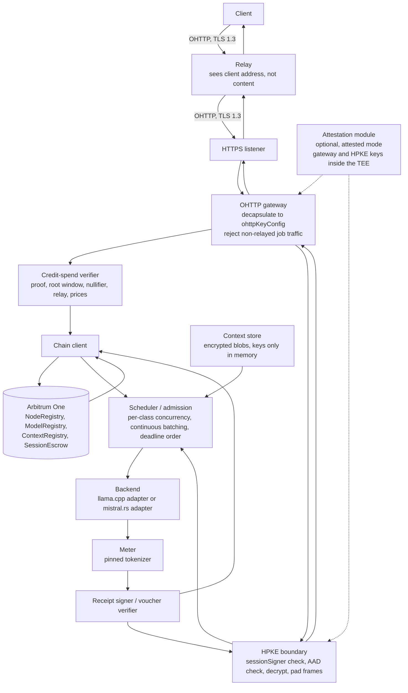

# Node — a Rust inference server

Author: Comuns contributors
Status: Draft
Category: Technical Proposal
Created: 2026-10-12
**Reference:** docs/security/privacy-and-contexts.md, docs/protocol/contracts-and-settlement.md, docs/protocol/off-chain-api.md, docs/node/hardware-classes-and-benchmarks.md, docs/node/model-registry-and-licenses.md, docs/adr/0002-off-chain-rust-inference.md, docs/adr/0010-anonymous-by-default.md, docs/adr/0011-anonymous-credits.md, docs/adr/0012-contexts-without-a-wallet-link.md

---

## 1. Summary

The Comuns node is the program an operator runs to sell inference. It is proposed as a single Rust binary that runs **off-chain**: it watches the registries and the sessions that concern its operator on Arbitrum One, acts as an **Oblivious HTTP gateway** that receives encrypted jobs only through relays, verifies anonymous credit spends and submits them on-chain, runs jobs through a pluggable inference backend, meters tokens with the tokenizer pinned in the model manifest, exchanges node-signed receipts for client-signed vouchers one chunk at a time, and redeems the highest voucher on-chain. Nothing described here exists yet; **this document creates no Rust project**, no crate, no build and no deployment. It fixes the shape of the program so that the other documents can refer to the same parts by the same names.

Design decisions carried in from the ADRs and the earlier documents (all PROPOSED, none implemented):

- **Rust, off-chain.** The node is a Rust program on the operator's machine. Inference never runs on-chain; the chain records offers, sessions and vouchers only. Inference runs only on network nodes such as this one.
- **Anonymous by default** (docs/adr/0010-anonymous-by-default.md). The node never receives a wallet address, an account, an API key, the client's network address or any persistent identifier. In standard mode the node can read the prompt, the granted context and the answer; it should not learn who sent them. In attested mode this node should not be able to read the prompt; a physical attack on the hardware can break that (evidence register §14).
- **Relays and the OHTTP gateway.** Every job, credit spend and handshake reaches the node as an RFC 9458 Oblivious HTTP request through a relay chosen by the client from `NodeRegistry`, with chunked OHTTP for streamed frames (evidence register §15, [V]). The node process is the gateway; its key configuration `ohttpKeyConfig` is registered through `registerNode`/`updateNode` and is the same for every user. The relay sees the client's network address and not the prompt; the node sees the prompt and not the client's network address.
- **Credit-funded sessions** (docs/adr/0011-anonymous-credits.md). The client hands the node a Semaphore v4 spend proof; the node verifies it against its own RPC view and submits `openSessionFromCredit`, paying the gas. The session records `user = address(0)`; the node never learns which deposit funded it.
- **Pluggable backends behind one trait.** Two initial adapters: **llama.cpp** through Rust bindings (first adapter, the widest hardware coverage and the small-hardware path) and **mistral.rs** (second adapter, pure Rust). llama.cpp's kernels are **C/C++** [V] and the adapter crosses an FFI boundary; the text says so wherever it matters. **Ollama** was considered and rejected as an adapter: it is Go (evidence register §3, [V]) and would add a process boundary and a second language to a Rust node for no capability the two chosen adapters lack.
- **Rust does not make inference faster.** Throughput and latency come from the kernels, memory bandwidth, batching and model support of the backend; the language of the host process decides safety, packaging and the FFI surface, not tokens per second. No document may claim otherwise.
- **Model-first pools.** A node may load many models and may offer **any registered model it can actually load** — memory fit (section 5) plus its own public self-benchmark of that model. There is no class-to-tier serving rule. The operator joins a model's pool by writing `prices[modelId] = (priceInPerMillion, priceOutPerMillion, modelBenchmarkHash)` through `registerNode` or `updateNode`, with both prices inside the band for (the model's tier, the node's class) and a non-zero `modelBenchmarkHash`, and leaves the pool by clearing the entry when it unloads the model. The hardware class still decides which band applies, so the same model is cheaper from a small node and dearer from a strong one. `maxTier` is informational only and is never read by `openSessionFromCredit` or `openSession`.
- **One model per session.** A session names one `modelId`; a node that cannot fit a model refuses rather than swapping into failure, and does not advertise it.
- **Single-node execution is what v1 node processes implement.** The off-chain capability document may additionally list the optional **orchestration** role (the node can act as an orchestrator node, paid as an ordinary credit session, holding no `sessionSigner`) and, only for the Phase 3 spikes, the experimental **shard** and **draft** roles. **v1 node processes do not implement open-internet model sharding or cross-node speculative decoding**; those are Phase 3 spike work in docs/node/distributed-execution.md. Speculative decoding inside one node is an engine detail that adds no reader and stays off in verifiable mode.
- **Privacy boundary.** The node terminates TLS 1.3 from the relay, then the OHTTP encapsulation, then the HPKE job boundary; prompt, context and completion plaintext exist only in process memory, are zeroized after use and are **never logged**.

## 2. Scope

In scope: the processes inside the node binary, including the OHTTP gateway and the credit-spend verifier; the backend trait and its two initial adapters; admission and memory fit; the session state the node keeps, including credit-session fields; keys and logging policy; the chain client's responsibilities; a configuration sketch; an operations outline marked as future work; a suggested module split; risks and open questions.

Out of scope, owned elsewhere: the wire format of envelopes, credit spends, receipts and frames, and the padding and batching parameters (docs/protocol/off-chain-api.md); the cryptography, relays and the disclosure sheet (docs/security/privacy-and-contexts.md); contract semantics, the canonical `Voucher` type, the payment rule, the relay split and change (docs/protocol/contracts-and-settlement.md, docs/adr/0011-anonymous-credits.md); classes, bands and the benchmark protocol (docs/node/hardware-classes-and-benchmarks.md); manifests and licenses (docs/node/model-registry-and-licenses.md); verifiable mode (docs/security/inference-verification.md); multi-node orchestration (docs/protocol/orchestration.md); sharding and cross-node speculation (docs/node/distributed-execution.md).

Evidence tags: **[V]**, **[L]**, **[U]** as in docs/evidence-register.md, cited by section. Anything not cited there is UNVERIFIED.

## 3. Processes

The node is one operating-system process with several cooperating tasks. The names below are used by every other document.

| Task | Responsibility |
|---|---|
| **Chain listener** | Follows `NodeRegistry`, `ModelRegistry`, `ContextRegistry` and `SessionEscrow` events that concern this operator: its own `NodeRegistered` / `NodeUpdated` / `OfferSet`, every `ModelRegistered` / `ModelUpdated` for models it offers, `SessionOpened` and `CreditSessionOpened` naming it as `node`, `SessionClosing`, `SessionSettled` (whose `refundWei` is the `pendingWei` recorded for a credit session), `ChangeNoted` for its sessions (whose `dustWei` is credited to its balance), `BandsSet`, `CreditParametersSet`, and the relay events `RelayRegistered` / `RelayUpdated` / `RelayDeregistered`. Keeps a local view of open sessions (prices copied at open, `sessionSigner`, effective cap, `funding`, `relay`, `relayFeeWei`, last redeemed `seq`) and of the current and recently replaced group roots and the spent nullifiers needed to check a credit spend before submitting it. |
| **HTTPS listener** | TLS 1.3 only, reached by relays. Hands every request body to the OHTTP gateway; serves nothing else that carries a job. The capability document (which advertises, among its limits, `maxConcurrentJobsPerSession = 1`, `maxInterFrameMs`, `ohttpKeyConfig`, `paddingBuckets[]` and `tokenBatch`; the client marks an answer truncated only when a frame that a sent voucher should release has not arrived within 2 × `maxInterFrameMs`, when an exchange drops mid-frame, or when the node sends an error outside the stream; a response that ends at a payment boundary is not truncation (docs/protocol/off-chain-api.md section 3)) and the public self-benchmark results are themselves served as OHTTP responses through a relay (docs/protocol/off-chain-api.md §4). TLS hides content, not sizes or timing; padding and batching (below) narrow, and do not close, what sizes and timing reveal (evidence register §16, [V]). |
| **OHTTP gateway** | Decapsulates every request encapsulated to the node's registered `ohttpKeyConfig` and encapsulates every response, using chunked OHTTP for streamed frames (evidence register §15, [V]). **Rejects non-relayed job traffic**: a job envelope, `credit_spend`, `hello` or voucher that arrives as a plain HTTP request instead of an OHTTP-encapsulated one is refused before it reaches any other task. **Independently of encapsulation, the gateway accepts job traffic only from a registered relay** (a `NodeRegistry` relay record with `unlockAt == 0` whose operator is not this node's): a client that connects directly is refused even when its request is correctly encapsulated, and the node offers no direct client-to-node job path. The mechanism by which a connecting relay proves that it is the registered relay operator is proposed in ADR 0014 (docs/adr/0014-relay-authentication-to-gateways.md: operator-key delegation plus a per-connection challenge); until a CIP adopts it the enforcement remains a requirement, not an option. `key_probe` and the capability document are served only on a relay connection the gateway has authenticated under ADR 0014; an unauthenticated connection receives nothing but the authentication challenge. The gateway uses one key configuration for every user, never a per-user one (evidence register §15, [U]); it never records the connecting relay's network address as, or joins it to, a client identity. |
| **Credit-spend verifier** | Checks every `credit_spend` before anything is submitted (section 6): the Semaphore v4 proof, the root window, the nullifier, the denomination index, the relay record and the offer prices, all **against the node's own RPC view**. On success hands the call to the chain client; on failure answers `credit_spend_rejected` and consumes nothing. |
| **HPKE boundary** | For job envelopes, verifies the `sessionSigner` signature on every request envelope against the signer recorded on-chain for that session before decrypting or scheduling anything, then opens the HPKE context, checks the AAD tuple, and holds plaintext only inside the runtime. `clientJobPublicKey` and every job parameter (`maxOutputTokens`, sampling settings) are read from the HPKE plaintext and are covered by the signature digest; nothing that changes a job travels in the clear. Discards the client's `padding` field without tokenizing it. Seals every output frame to `clientJobPublicKey`, padded to the smallest entry of `paddingBuckets[]` that fits and emitted under the `tokenBatch` rule (docs/protocol/off-chain-api.md §7); chunk receipts travel inside the sealed frame, and any hash that must appear outside encryption is keyed, `keccak256(commitKey ‖ chunk)`. The only other HPKE open is `key_probe` (docs/adr/0015-node-key-possession.md), under its own `info` and AAD. For `key_probe`, the node reconstructs the probe tuple from its own identity and keys, never from the request, and answers only when that open succeeds and yields exactly 32 bytes. |
| **Scheduler / admission** | Decides whether to accept a session request (model loaded, memory fit, mode supported, spend gas acceptable, remaining cap), queues jobs with per-class concurrency limits, uses continuous batching where the backend supports it, and orders work by deadline. **One job at a time per session** (`maxConcurrentJobsPerSession = 1`): receipts and vouchers form one chain per session, so jobs that share a (node, `modelId`) session run sequentially; concurrency exists only across sessions. |
| **Backend** | Loads models, generates tokens as a stream, counts tokens, reports capabilities (section 4). |
| **Meter** | Counts input and output tokens with the tokenizer pinned in the model manifest; produces the numbers that go into receipts. |
| **Voucher verifier and receipt signer** | Signs the input receipt and every chunk receipt with the node key; verifies each incoming voucher (signature, `seq`, cumulative counts, `cumulativeWei` under the session's copied prices, `outputCommitment` recomputed from `commitKey` and the transcript hash chain) **against the prefix of chunks the client has acknowledged**, not against the chunk it may already have sent ahead (section 6). The node **starts prefill only after the input voucher** and **streams at most one chunk of `CHUNK_TOKENS` ahead of the highest voucher it holds**; that one chunk is its unpaid exposure. |
| **Context store** | Holds encrypted context blobs a client granted; verifies `keccak256(contextPubKey) == contextId`, the context-key signature on the grant and on each head record, the hash chain back to version 1, and each version's `contentHash` against its signed head record or, for an anchored context, `ContextRegistry` or its `ContextSet` history (docs/adr/0012-contexts-without-a-wallet-link.md); unwraps `K_v` keys only in memory and discards them at `expiresAt` or job end, whichever is earlier. No wallet appears anywhere in a grant. |
| **Attestation module (optional)** | In attested mode generates both the node's job HPKE keypair and its OHTTP gateway key configuration inside the TEE, commits the hash of both public keys together with the client's nonce in the quote's report data, and serves the quote; neither secret leaves protected memory. The measured build includes the gateway and the padding and batching code, so a client that verifies the quote also pins the code that decapsulates and pads. |
| **Chain client** | Submits `registerNode`, `updateNode` (each carrying `ohttpKeyConfig`), `openSessionFromCredit`, `redeemVoucher`, `closeWithVoucher`, `closeSession`, `finalize`, `deregisterNode`, `withdrawBond` and `withdraw` for the operator (section 8). |



Two processes are explicitly **not** node processes in v1: an open-internet shard server and a cross-node draft or target role. llama.cpp's own documentation for its RPC backend says it is at a "proof-of-concept development stage", "fragile and insecure", and: "Never run the RPC server on an open network or in a sensitive environment!" (evidence register §10, [V]). **This node must not run that RPC server on an open network.** mistral.rs's NCCL tensor parallelism and multi-node NCCL (evidence register §10, [V]) are a private multi-node fabric for one operator's own machines, not a v1 public adapter. A LAN cluster behind one endpoint — several machines of one operator joined by llama.cpp RPC on a private network or by mistral.rs NCCL — is invisible to the protocol: it counts as **a single node with an ordinary offer**, one gateway and one `ohttpKeyConfig`, and it is the recommended way for small machines to serve T3–T4 models.

## 4. Backends

The node talks to inference engines through one trait. Per-model selection of a backend is **gated by the benchmark protocol** of docs/node/hardware-classes-and-benchmarks.md: a model is offered through a given adapter only after the operator has published a self-benchmark of that model on that adapter and build, and `modelBenchmarkHash` names that result.

| Adapter | Language of the kernels | Devices | Status in this proposal |
|---|---|---|---|
| **llama.cpp** through Rust bindings (`llama-cpp-2` with cuda/metal/vulkan/rocm features, or `llama_cpp`; evidence register §3, [V]) | **C/C++** kernels [V]; the Rust side is an FFI wrapper | CPU, CUDA, Metal, Vulkan, ROCm (HIP) [V] | **First adapter.** Widest hardware coverage; the small-hardware path; GGUF quantizations from 1.5 to 8 bits [V]. |
| **mistral.rs** (evidence register §3, [V]) | Rust | CUDA (FlashAttention), Metal, CPU [V] | **Second adapter.** PagedAttention and continuous batching [V]. Its OpenAI-compatible server (`mistralrs serve`) **may run only on the node machine, bound to the loopback interface, after the HPKE boundary has decrypted the job — never as a public, unauthenticated prompt route and never as a path around the gateway.** |
| Ollama | Go [V] | — | **Rejected.** A separate Go process behind a plain HTTP API; adds a language and a process boundary without adding a device or a quantization the two adapters above lack. |
| candle, burn, ratchet | Rust | various [V] | Not adapters in v1; candle has no Vulkan/ROCm and no built-in server [V]; burn has no LLM server [V]. Candidates for a later CIP. |

A sketch of the trait. It is a sketch, not code: **this document creates no Rust project**, and the names may change in the implementation CIP.

```rust
// Sketch only. No crate, no build, no tests exist. Names are illustrative.

pub struct ModelHandle(u64);

pub struct LoadOptions {
    pub device: Device,                 // Cpu, Cuda(n), Metal, Vulkan(n), Rocm(n)
    pub quantization: String,           // as pinned in the manifest, e.g. "Q4_K_M"
    pub max_context: u32,
    pub max_concurrency: u32,           // sizes the KV cache (section 5)
    pub deterministic_profile: bool,    // temperature 0, speculative decoding off, pinned build
}

pub struct Capabilities {
    pub devices: Vec<Device>,
    pub quantizations: Vec<String>,
    pub continuous_batching: bool,
    pub in_node_speculative_decoding: bool, // engine detail; adds no reader; off in verifiable mode
    pub deterministic_profile: Option<ProfileId>, // Some only when reproducibility was DEMONSTRATED
}

pub enum CommitmentError { Unsupported, Failed(String) }

pub trait Backend: Send + Sync {
    fn load(&self, manifest: &ModelManifest, opts: &LoadOptions) -> Result<ModelHandle, BackendError>;
    fn unload(&self, handle: ModelHandle) -> Result<(), BackendError>;
    /// Streaming generation: yields token chunks the meter counts and the HPKE boundary seals.
    fn generate(&self, handle: &ModelHandle, req: GenerateRequest) -> Result<TokenStream, BackendError>;
    /// Counts tokens with the tokenizer pinned in the manifest, never with a substitute.
    fn count_tokens(&self, handle: &ModelHandle, text: &str) -> Result<u64, BackendError>;
    fn capabilities(&self) -> Capabilities;
    /// Commitment hook for verifiable mode. The default returns Unsupported; an adapter overrides it
    /// only under a DEMONSTRATED deterministic profile (docs/security/inference-verification.md).
    fn commitment(&self, _handle: &ModelHandle, _run: &RunRecord) -> Result<Commitment, CommitmentError> {
        Err(CommitmentError::Unsupported)
    }
}
```

**Verifiable mode (mode 2).** A backend supports it only when it can run at temperature 0 with speculative decoding off under a pinned build **and** produce a commitment, and only after reproducibility has been **demonstrated**: repeated runs of a published test set give byte-identical outputs across the supported hardware and batching configurations. Pinned versions, temperature 0 and disabled speculative decoding are necessary but not sufficient — 1,000 temperature-0 runs of one model gave 80 unique outputs without batch-invariant kernels (evidence register §5, [V]). Otherwise `commitment` returns `Unsupported` and the node **refuses mode 2** and does not advertise it in `modes`. No document may claim that TOPLOC exists for these backends: it is integrated with vLLM and SGLang (evidence register §5, [V]), not with llama.cpp or mistral.rs, and it cannot detect speculative decoding [V]. A verifier node reaches nothing differently: it is a node like this one, reached through a relay and funded by its own credit session.

**Prefix caches across sessions.** A KV or prefix cache shared across sessions can leak through time-to-first-token: a prefix-cache leak in vLLM was measured at AUC 0.99 and fixed in 0.9.0 (evidence register §16, [L]). Whether the reference node isolates such caches per session in each adapter is open (section 13); until it is decided the node does not share a prefix cache between sessions.

**Why not "Rust is faster".** Both adapters spend their time in kernels; the llama.cpp adapter's kernels are C/C++ and the mistral.rs kernels are Rust with CUDA and Metal code paths. Measured differences between them come from kernels, memory bandwidth, batching and which models and quantizations each supports — which is exactly why per-model backend selection is gated by a published benchmark rather than by language.

## 5. Admission and memory fit

A node advertises a model only if it can load it, and refuses a session request for a model it cannot serve right now rather than evicting another model mid-session. Admission runs in two places: **before `registerNode`/`updateNode`** (may this model be offered at all?) and **before every `openSessionFromCredit`** (can it be served now, in the requested mode, with the current load?).

**Memory-fit formula.** All coefficients below are **illustrative**; the implementation CIP replaces them with measured values per backend, and nothing here is a measured minimum.

```
required_bytes =
    weights        : parameters × bytes_per_weight(quantization)
  + kv_cache       : layers × 2 × context_tokens × hidden_size × bytes_per_kv_element × concurrency
  + workspace      : backend scratch (attention buffers, logits, batching state)
  + os_reserve     : what the operating system and drivers keep
  + safety_margin  : a fraction of the total, for fragmentation and spikes

fits  ⇔  required_bytes ≤ available_device_memory (or unified memory on shared-memory machines)
```

Notes on the terms:

- `bytes_per_weight` is about 0.5 at a 4-bit quantization and 2 at 16-bit (illustrative); the manifest pins the quantization, so the node computes this from the manifest, not from a guess.
- The KV-cache term is the one operators underestimate: it scales with context length and with the number of concurrent sequences, and it depends on the backend's cache quantization. A 70B model at a 4-bit quantization does not fit a 32 GB card at all (evidence register §6, [V]); what context a fitting model can serve at what concurrency is a measured property of the build.
- A model that fits at concurrency 1 may not fit at the per-class concurrency limit the scheduler is configured for; the node advertises the model only at a concurrency it has verified.
- Small quantized models on CPU-only machines are a **validation target** for T0, not a measured minimum: the proposal has not measured any machine as "the smallest that works" and states no minimum hardware requirement as established.

**Per-session admission** checks, in order: the model is loaded (or loadable without evicting a model with open sessions); the requested mode is one the node advertises and the backend supports for this model; the client's declared `modelId` matches an offer with a non-zero `modelBenchmarkHash`; the scheduler has capacity at the class's concurrency limit; the current gas price keeps the spend submission under `credits.maxGasWei` (section 9); and, for a reused session, the remaining effective cap is above zero. Admission runs before the node submits `openSessionFromCredit`, and the reference client requests it before handing over its spend proof, so a refusal consumes no note and costs nobody gas (contracts doc, R6).

**Scheduling.** Per-class concurrency limits are configuration; continuous batching is used where the backend reports it; jobs are ordered by deadline. Within one session jobs run **one at a time** (`maxConcurrentJobsPerSession = 1`), because the session's receipts and vouchers form a single chain; an orchestrator that needs two tasks in parallel on the same (node, `modelId`) opens a second credit session for the second task, and that session is on the disclosure sheet. A credit session cannot be topped up (`topUp` reverts when `funding == credit`): a job whose session reaches its effective cap — the denomination — stops there, and the client continues on a new credit session funded by a new note under a new confirmed sheet version. The node never streams more than one chunk of `CHUNK_TOKENS` beyond what the highest voucher pays.

## 6. Session handling

The node keeps, per open session: `funding`, the copied prices, `sessionSigner`, the effective cap, `relay` and `relayFeeWei` as copied into the session at open (so that it can account for the relay's share of every settlement), `commitKey` (received sealed in the session's first job envelope), the transcript hash chain, the cumulative input and output token counts **as covered by the last voucher the client signed**, the highest voucher received, and the HPKE key from its keyring that the session was sealed to. This session state lives in **persistent, encrypted local storage for the life of the session, until it is settled** — `commitKey`, the transcript chain and the highest voucher included — so that a node restart can still recompute `outputCommitment` for a later job on the same session and can still redeem the highest voucher it holds. Per-job secrets (the job's HPKE contexts and unwrapped `K_v`) are separate, kept in memory only and discarded at job end. The canonical voucher is `Voucher(bytes32 sessionId,uint64 seq,uint256 cumulativeWei,uint64 inputTokens,uint64 outputTokens,bytes32 outputCommitment,bool isFinal)` from the contracts document; the node defines no variant.

**Credit submission.** The node is the normal submitter of `openSessionFromCredit` (docs/adr/0011-anonymous-credits.md; docs/protocol/off-chain-api.md §5). On a `credit_spend` that passed admission, the credit-spend verifier checks, against the node's **own RPC view** of `SessionEscrow` and `NodeRegistry`: the Semaphore v4 Groth16 proof for the public inputs the contract will compute — scope `keccak256(chainId, escrow, denominationIndex)` and message `keccak256(node, relay, modelId, mode, sessionSigner, expectedPriceInPerMillion, expectedPriceOutPerMillion)`, each hashed as `uint256(keccak256(abi.encodePacked(x))) >> 8` as Semaphore does (evidence register §15, [V]); `node` is this operator; `1 ≤ merkleTreeDepth ≤ 32` (evidence register §15, [V]); `merkleTreeRoot` is the group's current root or a replaced root younger than `MERKLE_TREE_DURATION`; the `nullifier` is not spent; `denominationIndex` is listed; `relay` is a registered relay with `unlockAt == 0` and is not this node; and both expected prices equal the node's current offer. Any failure is `credit_spend_rejected` with its reason and nothing is consumed, because only the contract stores nullifiers. On success the chain client submits `openSessionFromCredit(node, relay, modelId, mode, sessionSigner, expectedPriceInPerMillion, expectedPriceOutPerMillion, denominationIndex, merkleTreeDepth, merkleTreeRoot, nullifier, points)` and the node replies `session_opened`. A spend is deduplicated by its `nullifier`: the node never submits a second transaction for one nullifier.

**Spend gas.** The node pays the gas of `openSessionFromCredit` and prices it into its offer (docs/adr/0011-anonymous-credits.md). About 230–270k L2 gas is an estimate for Semaphore's own `validateProof`, not a measurement of this contract (evidence register §15, [U]); LeanIMT insertion gas is UNVERIFIED and the escrow's own figure is unmeasured. The node's books record, per session, the spend gas, the gas of its redemptions and closes, and any gas lost to a spend that reverted on-chain after passing its own checks (R7).

```mermaid
sequenceDiagram
    participant C as Client (holds sessionSigner and note secret)
    participant RL as Relay
    participant N as Node (OHTTP gateway)
    participant E as SessionEscrow
    participant B as Backend
    C->>RL: OHTTP: admission request (modelId, mode)
    RL->>N: forward (relay sees client address, not content)
    N-->>C: admitted via relay (model loaded, memory fits, mode supported, gas acceptable)
    C->>RL: OHTTP: credit_spend (proof, root, nullifier, node, relay, modelId, mode, sessionSigner, expected prices)
    RL->>N: forward
    N->>N: verify proof, root window, nullifier, relay record and prices against own RPC view
    N->>E: openSessionFromCredit(...) (node pays gas)
    E-->>N: SessionOpened (user = address(0)) then CreditSessionOpened (relay, relayFeeWei copied)
    N-->>C: session_opened via relay; client confirms on-chain through a relay
    C->>N: via relay: hello, then job envelope: HPKE-sealed and padded prompt + context grant + commitKey (first job), signed by sessionSigner
    N->>N: decapsulate OHTTP, verify sessionSigner signature, check AAD, decrypt
    N->>N: grant check: contextId = keccak256(contextPubKey), context-key signatures, hash chain, contentHash, expiresAt
    N->>N: unwrap K_v in memory, decrypt granted versions
    N->>N: tokenize prompt + context with the pinned tokenizer
    N-->>C: input receipt via relay (sessionId, jobId, jobInputTokens, cumulativeInputTokensAfter), before prefill
    C->>N: input voucher via relay (seq, cumulative inputTokens)
    N->>B: prefill + generate (streaming)
    loop every chunk of at most CHUNK_TOKENS, batched per tokenBatch
        B-->>N: tokens
        N-->>C: chunked OHTTP: HPKE frame sealed to clientJobPublicKey and padded to a bucket, chunk receipt inside
        C->>N: cumulative voucher with the next voucher seq n; outputCommitment = keccak256(commitKey ‖ sessionId ‖ n ‖ transcriptHash), the same n
        N->>N: verify voucher (recompute the commitment with that voucher's own seq); stream at most one chunk ahead of the highest voucher
    end
    N-->>C: last frame with endOfJob (never copied into isFinal)
    C->>N: closing voucher, isFinal = true
    N->>E: closeWithVoucher — or redeemVoucher at any time while legal with the highest non-final voucher
    E-->>N: VoucherRedeemed, SessionSettled (refundWei = pendingWei); relay fee first, rest to the node
    Note over C,E: the client later submits claimChange through a relay or broadcaster; ChangeNoted credits dust to the node; the node calls withdraw()
```

Rules the node enforces:

- No prefill before the input voucher; the input receipt is sent after tokenization and before prefill, and carries `(sessionId, jobId, jobInputTokens, cumulativeInputTokensAfter)`.
- Each voucher must verify against `sessionSigner`, carry `seq` greater than the last accepted one, cumulative counts not below the **last voucher the client signed**, `cumulativeWei` equal to `(priceInPerMillion × inputTokens + priceOutPerMillion × outputTokens) / 1000000` with the copied prices, and an `outputCommitment` the node recomputes as `keccak256(commitKey ‖ sessionId ‖ seq ‖ transcriptHash)` using **that same voucher's `seq`** and its own transcript hash chain (chained from zero over every output chunk of every job in the session). A mismatch stops the stream; the node redeems its highest valid voucher.
- **Vouchers are checked against the acknowledged prefix.** A voucher — closing or not — may cover only the prefix of chunks the client has acknowledged. Because the node streams one chunk ahead, its transcript chain may already contain a chunk the client has not acknowledged; the node therefore keeps the transcript hash and the cumulative counts **at every chunk boundary of the last two chunks** and accepts a voucher whose counts and `outputCommitment` match the acknowledged prefix even when one more chunk was already sent. The unacknowledged chunk is unpaid: that is the node's one-chunk exposure, and it never blocks settlement. A client that stops after acknowledging chunk N closes on N; a closing voucher is never refused for not paying chunk N+1.
- **A resent voucher is a no-op.** A voucher whose `seq` equals the last accepted `seq` and whose content is byte-identical is ignored, never an error; the chunk in flight is covered by the next voucher. A voucher with an already-accepted `seq` and different content is rejected and the stream stops.
- **Unsigned receipts bind nobody.** The cumulative counts are "the totals covered by the last voucher the client signed". If the client never signs the input voucher for a job, that job's tokens never enter the counts: the node's next input receipt carries `cumulativeInputTokensAfter = lastSignedInputTokens + newJobInputTokens`. Counts never fall below a signed voucher, and a receipt the client did not answer is void.
- **Two counters, never confused.** Frame `seq` runs per job and per direction from 0; voucher `seq` runs per session from 1. On reconnect — possibly through a different relay — the node's welcome carries `lastSeq` (the highest voucher seq it holds) and `lastFrameSeq` per open job; the node retransmits output frames from the client's `lastReceivedFrameSeq + 1`; a retransmitted frame identical to one already received, in either direction, is ignored, never a fatal error; the client re-sends its latest voucher. The node's totals in the welcome are information for the client, not something the client trusts: the client resumes only from its own voucher log, and a client that has lost that log signs no further vouchers; it signs the `closeSession` authorization and submits it through a relay or broadcaster.
- The node never streams past the effective cap `min(depositWei, maxSpendWei)`, which for a credit session is the denomination; the client never signs above it. When the cap is reached the job pauses and the session can carry no more work; `topUp` reverts on a credit session.
- `isFinal` on a voucher means only "the client closes the session"; the frame flag `endOfJob` is never copied into it. A voucher with `isFinal == true` goes only to `closeWithVoucher`.
- **Two ways to close.** Cooperative close: the client signs a final voucher and the node calls `closeWithVoucher`. Unilateral close: the node calls `closeSession(sessionId, signature)` with an empty `signature`, or any broadcaster calls it with a `sessionSigner` EIP-712 signature over `(chainId, escrow, sessionId, "close")`; `finalize` follows after `closeDeadline`. A client that has lost its voucher log signs no further vouchers; it signs the `closeSession` authorization and submits it through a relay or broadcaster. Its next work needs a new credit session and a new disclosure-sheet version.
- **On-chain prices win.** The client compares the prices copied into the session on-chain (session record or `SessionOpened`, read through a relay) with its confirmed sheet; the prices the node reports in `welcome` are informational and never trigger a close.
- **Deduplication keys.** Job-level billing is deduplicated by `jobId` (a resent envelope is idempotent); frames and upload fragments are deduplicated by `(jobId, frameSeq)`; a credit spend by its `nullifier`.
- **Abandoned client or lost key:** the node redeems its highest non-final voucher with `redeemVoucher` while that is legal, then calls `closeSession`; `finalize` after `closeDeadline` records `pendingWei = depositWei − settledWei` for the client to reclaim as change. The node never waits for a final voucher that is not coming.
- The node redeems promptly rather than waiting for `closeDeadline`: an outage that starts shortly before the deadline can still cost it unredeemed vouchers (contracts doc, R2), and nothing in the protocol guarantees otherwise.
- **Settlement and the relay's share.** Payment is pull-based. On a credit session every incremental payout of `redeemVoucher` and `closeWithVoucher` is split by the contract: `relayDelta = min(relayFeeWei, newSettled) − min(relayFeeWei, oldSettled)` goes to `balances[relay]` and the rest to `balances[node]`, so the first `relayFeeWei` of settled value is the relay's (docs/adr/0011-anonymous-credits.md). The node uses the stored `relay` and `relayFeeWei` to reconcile what it was credited against `VoucherRedeemed` (whose `payoutWei` is the whole payout). At close the node observes `SessionSettled`, whose `refundWei` is the `pendingWei` recorded, and later `ChangeNoted` for that session, whose `dustWei` is credited to its own balance; it has no part in `claimChange` beyond that. The chain client calls `withdraw()` on a schedule, once for any number of settled sessions.
- Multi-job sessions: jobs run one at a time; cumulative counts never fall; the input receipt of the second job carries `cumulativeInputTokensAfter = lastSignedInputTokens + jobInputTokens`. A session reused across requests needs a new confirmed sheet version and carries forward only signed totals.
- Multi-node plans: the node sees only its own envelope and never another node's keys; intermediate results return sealed to the client through the client's relay. Even in the Phase 3 sharding spike no holder needs another holder's keys, because the client mediates every stage boundary through relays, encapsulating each holder's activations to that holder's registered `ohttpKeyConfig` (docs/node/distributed-execution.md §5); that spike is not a v1 node process.
- **Spike roles append to a job, they do not open new ones.** In the Phase 3 cross-node speculation spike (docs/node/distributed-execution.md §8), a draft or target node holds **one job per credit session**; each round is a request frame inside that job carrying the accepted tokens and a rollback point, the draft node rolls its KV cache back to the accepted prefix before drafting again, draft probability distributions travel as sealed metadata that is **not** counted as billable output tokens, and the prompt is input-billed once per job, never per round. A v1 node implements none of this; it is listed here only so that the receipt rules above are not read as "every round is a new job with a new input receipt".
- **Tokens, not bytes.** Receipts and vouchers count model tokens only; metadata and padding inside a frame are never counted, and the client checks a chunk's `tokenCount` with its own tokenizer over the token text alone.

## 7. Keys, logs and crash safety

**Keys.**

| Key | Where | Use |
|---|---|---|
| Node OHTTP gateway key (`ohttpKeyConfig`) | Generated from the OS CSPRNG; **encrypted at rest** under an operator passphrase or OS keystore; in attested mode generated inside the TEE and never written out | Decapsulating every relayed request and encapsulating every response. **One configuration for every user**, published in `NodeRegistry` through `registerNode`/`updateNode`, so no user can be handed a unique key that singles them out (evidence register §15, [U]). Rotated through `updateNode` and rarely: rotating OHTTP or credential keys could deanonymize users (evidence register §16, [V]). The node keeps every replaced `ohttpKeyConfig` used by an unsettled session, serves traffic encapsulated to it, and deletes it only after every session that used it has settled. |
| Node job HPKE secret (X25519) | Generated from the OS CSPRNG; **encrypted at rest** under an operator passphrase or OS keystore; in attested mode generated inside the TEE and never written out | Opening job envelopes and context grants. Rotated through `updateNode`; the node keeps a **keyring** of every key used by any session not yet settled and deletes an old key only after every session that used it is settled. |
| Node receipt-signing key | A separate secp256k1 key, bound to the registered keys by the client's key probe (ADR 0015); wire details in CIP-0005 | Signs input and chunk receipts, `session_opened`, `welcome` and benchmark results. |
| Operator Ethereum key | Hardware wallet or OS keystore; the node holds it only if the operator chooses an automated chain client | Signs `registerNode`/`updateNode`, `openSessionFromCredit`, redemptions and `withdraw()`. Registration binds the public keys to this operator; possession of the HPKE and OHTTP private keys is verified by the client's key probe before the spend (ADR 0015), not by the registration. |
| TLS certificate | Standard operator-managed certificate | Authenticates the endpoint to relays; TLS 1.3 only. |
| Session `commitKey`, transcript hash chain, highest voucher | **Persistent, encrypted local storage** (same protection as the HPKE secret) for the life of the session | Kept until the session is settled, so that a restart can still recompute `outputCommitment` for later jobs on the session and still redeem the highest voucher; deleted at settlement. |
| Context keys `K_v`, per-job HPKE contexts, per-request OHTTP contexts | **Memory only**; never written to disk | Per-job and per-request secrets, separate from the session state above; discarded at job end or `expiresAt`, whichever is earlier. |

**Logs.** Logs may contain session id, job id, token counts, timings, backend identifiers, spend outcomes and error codes. **Prompt text, context text and completion text are never logged**, at any log level, including debug. Request bodies are not logged; decrypted buffers are not formatted into error messages. **The network address of a connection is a relay's, never a client's**: the node never logs it as a client identity and never writes it in the same record as a session id, job id, nullifier or `contextId`. In standard mode the node can read the plaintext after decryption — that is what standard mode means — and the reference software must not log it. This is an operator policy enforced by the reference software, not a protection against a malicious operator, who can modify the node to log whatever it decrypts (privacy doc, R1).

**Crash safety.** Plaintext buffers are zeroized after use (a zeroizing allocator or explicit wipes on drop); core dumps are disabled for the node process or scrubbed before being written; the backend's own memory (device buffers, KV cache) is released on unload. Session state (`commitKey`, transcript chain, highest voucher, signed totals, `relay`, `relayFeeWei`) is written to the encrypted session store at every voucher boundary, so a crash loses at most the one unpaid chunk in flight and never a redeemable voucher. These are policies that reduce accidental disclosure; they do not protect against an operator with root on the machine and must not be described as if they did.

**Attested mode.** Both the job HPKE keypair and the OHTTP gateway key configuration are generated inside the TEE; the quote's report data commits to the hash of both public keys together with the client-supplied nonce; the client refuses to seal unless that binding verifies. ADR 0015 proposes adding `receiptPublicKey` to the quote's report data before attested mode is enabled, so that the quote binds all three keys. Neither secret leaves protected memory, and the measured build includes the gateway, padding and batching code. This node should not be able to read your prompt. A physical attack on the hardware can break that: a DDR5 interposer under $1,000 extracts TDX and SEV-SNP keys, and TDXRay recovers prompts from tokenizer memory-access patterns (evidence register §14, [V]/[L]). Attested mode needs confidential-computing hardware (docs/node/hardware-classes-and-benchmarks.md §3). Its cost is a note, not a planning assumption: an independent H100 + TDX study measured time-to-first-token up 21.8–27.8 % and throughput down 11.5–21.1 % (evidence register §14, [V]); NVIDIA reports 1–8 % (evidence register §14, [V, vendor]); and the older snapshot of evidence register §4 (2026-10-12) recorded −6.85 % / −8.84 % throughput with TTFT +19–21 % on an 8B model and roughly 0–2.3 % on a 70B model [V]. The figures are dated snapshots from different setups and are not averaged.

## 8. Chain client

The chain client is the only part of the node that holds an Ethereum signing path. It submits the operator's transactions and follows events for the chain listener. The node's own chain reads go through the operator's RPC: the node is a public registrant, so its reads need no relay, unlike the client's. The **library and version are recorded in CIP-0005 (an open pin there until its rechecks); no crate or version is pinned here.** Requirements the CIP must meet:

- EIP-712 typed-data hashing for the canonical `Voucher` type string, with no spaces after commas, verified against the contracts document's conformance vectors.
- Off-chain verification of Semaphore v4 Groth16 proofs with the verifying keys from the Semaphore packages, and computation of scope and message exactly as the contract computes them, so that a spend that would revert is caught before gas is spent.
- Event subscription with reorg handling adequate for L2 inclusion (the contracts document defines "settled" as L2 inclusion, not L1 finality), including the group roots and the root window needed by the credit-spend verifier.
- Submission through the L1 delayed inbox as a fallback when the sequencer is unavailable, since force inclusion after about a day is the only path then (evidence register §1, [V]). A spend submitted that way may outlive its root window and revert; the client re-proves.
- Transaction policy: submit `openSessionFromCredit` only after the credit-spend verifier and admission pass and only under `credits.maxGasWei`; redeem the highest voucher promptly; `closeSession` when a client has disappeared; `finalize` after `closeDeadline`; `withdraw()` on a schedule; `updateNode` with the **complete** offer list and the current `ohttpKeyConfig` whenever a model is loaded, unloaded, re-benchmarked or re-priced, since `updateNode` is replace-all and an omitted model is cleared.

## 9. Configuration

A sketch of the operator's configuration file. Values are illustrative; wei prices come from the governance bands in force and have no value in this proposal, and no gas, padding or batch value is set.

```toml
# comuns-node.toml — sketch only; no implementation exists.

[node]
endpoint        = "https://node.example.org:8443"   # reached by relays, never by clients directly
hardware_class  = "M"          # S, M, L or X — the price-band label earned by passing the class benchmark's per-class bars
max_tier        = "T2"         # informational only; the largest tier the operator benchmarked; a separate field, never a gate
modes           = ["standard"] # add "attested" only with confidential-computing hardware and the attestation module; "verifiable" only with a demonstrated profile
benchmark_hash  = "0x…"        # signed hash of the public class benchmark result

# One table per offered model. Together these are the COMPLETE offer list that updateNode writes;
# removing a table clears that offer on the next updateNode.
[[models]]
model_id            = "0x…"    # keccak256(manifestHash) from ModelRegistry
manifest            = "/var/lib/comuns/models/0x…/manifest.json"
backend             = "llama_cpp"
quantization        = "Q4_K_M" # must match the manifest
priceInPerMillion   = 0        # wei per 1,000,000 input tokens, inside the (tier, class) band
priceOutPerMillion  = 0        # wei per 1,000,000 output tokens, inside the (tier, class) band
modelBenchmarkHash  = "0x…"    # signed hash of this node's public self-benchmark of this model; non-zero to offer
max_context         = 8192
max_concurrency     = 2        # the concurrency the memory-fit check was verified at

[[models]]
model_id            = "0x…"
manifest            = "/var/lib/comuns/models/0x…/manifest.json"
backend             = "mistral_rs"
quantization        = "Q4_K_M"
priceInPerMillion   = 0
priceOutPerMillion  = 0
modelBenchmarkHash  = "0x…"
max_context         = 4096
max_concurrency     = 1

[ohttp]
key_config          = "/etc/comuns/node-ohttp.key.enc"  # encrypted at rest; its public part is registered as ohttpKeyConfig; one for every user
require_encapsulated = true    # refuse any job, credit_spend, hello or voucher that is not OHTTP-encapsulated; always true
chunked             = true     # chunked OHTTP for streamed frames

[relay]
check_registry      = true     # every credit_spend's relay is checked against NodeRegistry: registered, unlockAt == 0, not this node; always true
require_registered_relay = true # accept job traffic only from a registered relay, even when encapsulated; always true, never configurable off

[credits]
submitSpends        = true     # the node submits openSessionFromCredit itself; false only under the operator's own broadcaster arrangement
maxGasWei           = 0        # refuse a spend whose estimated submission cost exceeds this; no value set here
denominations       = []       # denomination indexes the node accepts; read from CreditParametersSet, never a value set here

[padding]
buckets             = []       # paddingBuckets[]: envelope and frame size buckets in bytes, ascending; unset

[tokenBatch]
minTokens           = 0        # emit a frame once it holds at least this many output tokens; unset; must be ≤ chunk_tokens
maxDelayMs          = 0        # or once this long has passed since the previous frame; unset

[roles]                        # optional roles listed in the off-chain capability document; all off by default.
                               # The capability document names roles with the canonical role tokens of
                               # docs/security/privacy-and-contexts.md: "orchestrator", "shard holder", "draft", "target".
orchestration = false          # role token "orchestrator": may act as an orchestrator node (ordinary credit session, holds no sessionSigner)
shard         = false          # role token "shard holder": Phase 3 spike only; never a v1 public role; never paid; holds no session
draft         = false          # role tokens "draft" and "target": Phase 3 spike only; never a v1 public role; testnet-only prices

[backend.llama_cpp]
device = "cuda:0"              # cpu | cuda:n | metal | vulkan:n | rocm:n
threads = 8
rpc_servers = []               # private LAN only; the protocol sees one node. Never an open network.

[backend.mistral_rs]
device = "cuda:0"
serve_bind = "127.0.0.1:0"     # loopback only; never a public prompt route

[limits]
concurrency_per_class = { S = 1, M = 2, L = 4, X = 8 }   # illustrative; concurrency across sessions
max_concurrent_jobs_per_session = 1   # maxConcurrentJobsPerSession: one job at a time per session, always 1
chunk_tokens = 0               # CHUNK_TOKENS, a protocol parameter with no value set here
max_inter_frame_ms = 0         # maxInterFrameMs, advertised in the capability document; no value set here
max_prefill_ahead = 0          # never prefill before the input voucher
stream_ahead_chunks = 1        # at most one chunk ahead of the highest voucher

[keys]
hpke_secret     = "/etc/comuns/node-hpke.key.enc"   # encrypted at rest
receipt_signer  = "/etc/comuns/node-receipt.key.enc"
operator_wallet = "keystore://operator"              # or a hardware wallet; the node need not hold it
tls_cert        = "/etc/comuns/tls/fullchain.pem"
tls_key         = "/etc/comuns/tls/privkey.pem"

[storage]
session_store   = "/var/lib/comuns/sessions.enc"    # encrypted at rest: commitKey, transcript chain, highest voucher, relay, relayFeeWei per unsettled session
context_store   = "/var/lib/comuns/contexts/"       # encrypted blobs keyed by contentHash

[chain]
rpc_url         = "https://…"   # the operator's Arbitrum One RPC; chainId UNVERIFIED in this document
delayed_inbox   = true          # submit through L1 when the sequencer is unavailable
withdraw_every  = "24h"
```

In attested mode the keys under `[ohttp]` and `[keys].hpke_secret` are not files: both are generated inside the TEE at start and only their public parts leave it.

## 10. Operations — future work

Everything in this section is **future work** for the implementation CIP; none of it is specified here.

- **Ports.** One HTTPS port, reached by relays; no other listener is reachable from outside; the mistral.rs server and any llama.cpp RPC server bind to loopback or a private network only.
- **Storage.** Model files under a dedicated directory, verified against the manifest hashes before load; encrypted context blobs in a separate store with `contentHash` as the key; an encrypted session store holding, per unsettled session, `commitKey`, the transcript chain, the highest voucher, the signed totals, `relay` and `relayFeeWei`; no plaintext store exists.
- **Drivers.** CUDA, ROCm, Metal and Vulkan driver requirements per adapter, recorded with the benchmark result so that `modelBenchmarkHash` names a reproducible build.
- **Monitoring.** Metrics for queue depth, tokens per second, TTFT, memory headroom, unredeemed voucher value per session, time to `closeDeadline`, spend submissions accepted, rejected and reverted, spend gas spent, and requests arriving per registered relay; alerts when a session is `closing` and the highest voucher is unredeemed, and when spends revert or traffic stops (R7, R8). Metrics never carry a network address.
- **Upgrades.** A node upgrade that changes the backend build invalidates its benchmark results; the operator re-benchmarks and republishes `benchmarkHash` and every `modelBenchmarkHash` through `updateNode`. In attested mode a build change also changes the measurement clients verify.
- **Incident handling.** Key compromise: rotate through `updateNode`, keep the keyring until affected sessions settle, close sessions whose confidentiality is in doubt; a compromised gateway key exposes the content of captured requests to whoever holds it, so the configuration is replaced at once. Malicious weight file: unload, clear the offer, report through the model's CIP thread.

## 11. Suggested module split

A single workspace with these crates is suggested, in prose only; nothing is created here. ADR 0013 proposes this crate list plus a relay crate in one workspace.

- **binary** — the `comuns-node` executable: configuration loading, task supervision, graceful shutdown that redeems vouchers before exit.
- **chain** — the chain listener and chain client: event following, group roots and the root window, typed-data signing, credit-spend verification and submission, transaction policy, delayed-inbox fallback.
- **crypto** — the OHTTP gateway's decapsulation and encapsulation, the HPKE boundary, envelope and frame AAD, padding to buckets, the `sessionSigner` signature check, receipt signing, the transcript hash chain and `outputCommitment`, key storage, the encrypted session store and zeroization.
- **runtime** — the `Backend` trait, the llama.cpp and mistral.rs adapters, the memory-fit calculator, the scheduler and admission logic.
- **http** — the TLS 1.3 listener reached by relays, the refusal of non-encapsulated job traffic, the capability document, the benchmark-result endpoint, the job and frame transport with token batching (format owned by docs/protocol/off-chain-api.md).
- **meter** — tokenizer loading from the manifest, token counting, receipt construction, voucher verification against the payment rule.
- **context** — grant verification against the context key, the signed head records and, for anchored contexts, `ContextRegistry` and its `ContextSet` history; blob storage, in-memory key unwrapping and expiry.

## 12. Risks

### R1 — FFI memory safety at the C++ boundary **[RISK] · High**

The llama.cpp adapter crosses into C/C++ kernels; a bug there is undefined behaviour the Rust type system cannot see, and a crafted request could reach it. Mitigation: a narrow, audited binding surface; fuzzing of everything that crosses the boundary; running the backend in a separate, unprivileged process is an open question (section 13).

### R2 — Malicious weight files **[RISK] · High**

A model file is untrusted input to a C/C++ parser. Mitigation: load only files whose hashes match the manifest registered on-chain; parse in a sandboxed process where the platform allows; never load a file an operator did not place deliberately.

### R3 — Plaintext in crash dumps and swap **[RISK] · Medium**

A core dump, a swap file or a panic message can carry a prompt. Mitigation: dumps disabled or scrubbed, memory locked where the OS permits, zeroization on drop, no plaintext in error paths. These are policies and do not bind a malicious operator.

### R4 — Benchmark proxying **[RISK] · Medium**

An operator can proxy the class or per-model benchmark to a stronger machine (threat model T11). Mitigation: the benchmark is a self-published claim, never an unfakeable proof; reputation weighs verified real requests over self-reported benchmarks; spot re-benchmarks by community verifiers or the client use a private, rotating prompt set at random times, arriving through relays like any other session — never the public self-benchmark set, which a proxying operator passes trivially — and are reputation evidence, not slashing, and still not an unfakeable proof.

### R5 — Model substitution **[RISK] · Medium**

A node offers one `modelId` and serves a cheaper model. Mitigation: verifiable mode re-executes the request on a second node, but a session's mode is public on-chain, so mode-2 checks cover only mode-2 sessions and an operator can behave honestly on those alone; the mitigation for standard-mode traffic is opt-in, unannounced client-side spot checks (the user re-runs a sampled prompt on another node, which then reads it and is disclosed); the manifest's pinned tokenizer makes a substituted tokenizer visible at the input receipt; reputation records the rest.

### R6 — Stale offers and forced refusals **[RISK] · Low**

A node that unloads a model without an `updateNode` keeps an offer it cannot serve; sessions open and are refused. Mitigation: the reference node issues `updateNode` with the complete list on every load or unload; the client requests admission before handing over its spend proof, and the node runs admission again before it submits `openSessionFromCredit`.

### R7 — Spend-gas griefing **[RISK] · Medium**

The node pays the gas of `openSessionFromCredit`, and its callers are anonymous. A spend that passes the node's checks can still revert on-chain: the same note proved to two nodes at once (one wins, the other's transaction reverts on the spent nullifier), a root that leaves the window before inclusion, or an offer the operator changed in flight. A client that sends such spends repeatedly, or opens credit sessions it never uses, makes the node pay gas for nothing, and the node cannot rate-limit a person it cannot identify. Mitigation: verify everything against its own RPC view and simulate the call before submitting; refuse above `credits.maxGasWei`; reserve a nullifier in its own store while its transaction is pending; price spend gas into the offer (docs/adr/0011-anonymous-credits.md); stop serving a relay whose traffic is dominated by reverting spends, accepting that this also delays honest clients behind that relay. The residual is real: no fee or penalty for a reverted spend is proposed (docs/protocol/off-chain-api.md, open question 4).

### R8 — Relay unavailability **[RISK] · Medium**

The reference client fails closed when no relay is available and never connects directly (docs/adr/0010-anonymous-by-default.md), so a node with no working relay between it and its clients receives no work. Few relays exist at launch, relays are unpaid when `RELAY_FEE_WEI` is 0, and a relay that deregisters or goes offline removes a path for every node. The operator must not run a relay for its own node to fill the gap: the contract refuses one address in both roles, and one person behind two addresses is exactly the correlation risk the relay exists to avoid (privacy doc, R12). Mitigation: several independent relays in the registry; the node monitors relay records and per-relay traffic (section 10); open sessions that name a deregistering relay continue and still pay it (docs/adr/0011-anonymous-credits.md). The residual is that the node's availability depends on parties it does not control.

## 13. Open questions

1. **Process isolation for backends.** Whether each adapter should run in a separate unprivileged process with a narrow IPC surface, trading memory and latency for containment of C/C++ faults.
2. **Receipt key.** Whether the receipt-signing key is distinct from the HPKE identity, and how both are bound in the registration's proof of possession. Proposed resolution: ADR 0015 (separate key, bound by the client's key probe; no registration-time proof).
3. **Chain-client library.** CIP-0005 pins alloy 2.5.0 for EIP-712, whose `TypedData` hashing agrees byte for byte with viem (evidence register §15, measured 2026-10-16, [V]). Groth16 verification, event following and the delayed-inbox path stay open.
4. **Concurrency limits.** Whether per-class concurrency is a protocol recommendation or purely operator configuration, and how it interacts with `CHUNK_TOKENS`.
5. **Capability document.** The exact fields of the off-chain capability document (roles, supported quantizations, deterministic profile ids), owned by docs/protocol/off-chain-api.md.
6. **Deterministic profile demonstration.** What test set and how many runs demonstrate byte-identical output before a node may advertise mode 2, owned by docs/security/inference-verification.md.
7. **Tokenizer agreement.** What the node does when its tokenizer build disagrees with the client's for the same manifest (privacy doc, open question 10).
8. **Graceful shutdown.** How long the node waits for in-flight vouchers before exiting, and whether it should `closeSession` on every open session at shutdown; the encrypted session store means an unredeemed voucher survives the restart either way.
9. **Padding and batching values.** `padding.buckets` and `tokenBatch` are unset; choosing them needs measurements on the reference node, a stated cost in wasted bytes and added latency, and a stated residual against token-length and timing attacks (evidence register §16, [V]), owned by docs/protocol/off-chain-api.md.
10. **Session-store protection.** Whether the session store shares the HPKE secret's passphrase or keystore, and how it is wiped at settlement.
11. **Settlement finality for the session store.** Section 7 deletes `commitKey`, the transcript chain and the highest voucher at settlement, and the contracts document defines "settled" as L2 inclusion under the single sequencer, not L1 finality; an L2 reorg that undoes the settlement after the store is wiped would leave the node without its redeemable voucher. The node should keep the session store until the settlement is final under its own confirmation policy — L1 finality, or a stated confirmation depth — and only then wipe it; the policy and its depth are open for the implementation CIP.
12. **Relay authentication.** The gateway must accept job traffic only from a registered relay (section 3), but how a connecting relay proves that it is the registered relay operator is UNVERIFIED and unspecified: relay records hold an endpoint and an operator address, not a transport credential, and no mechanism is proposed here. The implementation CIP must define one before the node can enforce the rule. Proposed resolution: ADR 0014.
13. **Gateway key rotation.** How often a node may rotate `ohttpKeyConfig` without letting key timing single out users (evidence register §16, [V]). Retention is not open: a replaced configuration is kept until every session that used it has settled (section 7).
14. **Refusal reasons for gas.** Whether a spend refused because of `credits.maxGasWei` gets its own `credit_spend_rejected` reason in docs/protocol/off-chain-api.md, and whether a node that verifies a spend and then declines it should say why.
15. **Prefix-cache isolation.** Whether each adapter can share a prefix or KV cache across sessions without a time-to-first-token leak (evidence register §16, [L]), or whether caches stay per session.
