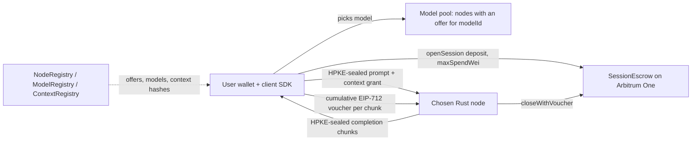

# Comuns — Project charter

Author: Comuns contributors
Status: Draft
Category: Technical Proposal
Created: 2026-10-12
**Reference:** [evidence-register.md](evidence-register.md), [requirements.md](requirements.md), [../GOVERNANCE.md](../GOVERNANCE.md), [protocol/contracts-and-settlement.md](protocol/contracts-and-settlement.md), [security/privacy-and-contexts.md](security/privacy-and-contexts.md), [protocol/orchestration.md](protocol/orchestration.md), [adr/README.md](adr/README.md)

---

## 1. Summary

Comuns is a community proposal for an open-source, decentralized network that runs inference on large language models. Its domain is comuns.ai. Nothing runs yet: this charter, and every document it lists, is a draft that the community may adopt, change or reject through Comuns Improvement Proposals (CIPs) under `docs/cip/`.

The proposed shape is simple. Independent operators run a Rust node that serves one or many open-weight models. A user picks a model; the nodes that currently offer that model form its **pool**; the user's app chooses a node from the pool by price, measured speed, reputation, privacy mode and hardware class. The prompt travels encrypted to that node with HPKE and the answer comes back encrypted chunk by chunk. The user pays the node in ETH through a session escrow contract on Arbitrum One, signing a cumulative voucher for each delivered chunk. Each wallet can keep many encrypted, versioned contexts and grant a chosen node access to one.

**One node runs a request by default (single-node execution).** Multi-node execution — collective answers, parallel planning, task decomposition, and the experimental model sharding and cross-node speculation — is opt-in per request and disclosed on a disclosure sheet before the user signs anything.

The charter is honest about the limits. In the default privacy mode the chosen node sees the prompt in plaintext. Every multi-node feature adds readers. Inference payments are not L2 gas, and Comuns does not claim to be cheaper than hosted APIs. No mainnet date exists.

## 2. Scope and non-goals

**In scope (proposed):**

- LLM inference on open-weight models served by independent nodes.
- On-chain registries for nodes, models and contexts, and an ETH session escrow, on Arbitrum One.
- An off-chain Rust node with pluggable inference backends.
- Encrypted prompts, contexts and completions between client and node.
- A client SDK and reference dapp, including an open-source client-side orchestrator for opt-in multi-node execution.
- Hardware classes, model tiers and governance-set price bands.
- Community governance through CIPs and working groups.

**Non-goals:**

- Training, fine-tuning and federated learning are non-goals; Comuns does not do them and does not plan to.
- A protocol token, staking rewards or emissions (not in v1).
- Slashing in v1.
- Running a model inside a smart contract.
- A claim that Rust alone makes inference faster.
- A claim of confidentiality against the chosen executing node in standard mode.

## 3. Why community and open source

- **Shared infrastructure.** LLM inference is becoming basic infrastructure. A network whose code, specifications and economics are public can be inspected, improved and reused by anyone, instead of being rented from one provider on its terms.
- **No single operator.** Nodes are run by independent operators; the client, not a central matcher, picks a node from a model's pool. No company is required to keep the network alive, and no orchestrator node is a mandatory trusted party.
- **Forkable.** Code and documents are Apache-2.0. If the community disagrees with a direction, it can fork the specifications, the contracts and the node, and the patent grant travels with the code (evidence register §8, [L]).
- **Equal proposal rights.** Anyone can write a CIP. Decisions follow the CIP process and rough consensus in working groups, not coin votes; ARB balances are not this project's votes (see [../GOVERNANCE.md](../GOVERNANCE.md)).

## 4. Binding positions

Every position below is **PROPOSED**. Each is community-adoptable through docs/cip/0001-adopt-baseline-adrs.md and binds every other Comuns document until a CIP changes it. Where a later position in this list (4.13–4.18) conflicts with an earlier sentence, the later position wins.

### 4.1 Inference only — PROPOSED

Scope is LLM inference only. Training, fine-tuning and federated learning are non-goals and appear only as non-goals.

### 4.2 Settlement on Arbitrum One with Solidity/EVM — PROPOSED

Settlement runs on Arbitrum One with Solidity/EVM contracts **NodeRegistry**, **ModelRegistry**, **ContextRegistry** and **SessionEscrow**. Stylus is not the v1 target: new Stylus activations are paused on One and Nova since 2026-10-02 with no reopening date (evidence register §1, [V]), and a model cannot run inside a contract anyway. A dedicated Arbitrum chain is a later option, not a v1 plan.

### 4.3 Off-chain Rust node with pluggable backends — PROPOSED

Inference runs off-chain in a Rust node with pluggable backends:

1. **llama.cpp** through Rust bindings (C/C++ kernels; CPU, CUDA, Metal, Vulkan, ROCm) — the widest hardware coverage and the first adapter (evidence register §3, [V]).
2. **mistral.rs** (Rust; CUDA, Metal, CPU) — the second adapter (evidence register §3, [V]).

A node serves many models and refuses work that does not fit. Rust alone is not claimed to make inference faster; the kernels do the work.

### 4.4 Model-first pools — PROPOSED

A node may offer **any** registered model it can actually load, as memory fit and a per-model self-benchmark permit. There is no protocol rule restricting hardware classes to model tiers.

An offer is the node's NodeRegistry entry `prices[modelId] = (priceInPerMillion, priceOutPerMillion, modelBenchmarkHash)` with a non-zero `modelBenchmarkHash`, written through `registerNode` or `updateNode`. The `modelBenchmarkHash` is the hash of the node's signed per-model self-benchmark — a self-published claim like `benchmarkHash`, not an unfakeable proof. Memory fit and that benchmark are the node's own admission decision. `updateNode` takes the complete offer list (replace-all): it emits `OfferSet` for every model added or changed and a cleared `OfferSet` (zero prices, zero `modelBenchmarkHash`) for every model removed; clearing is always allowed whatever the band or `commercialHosting` state; a hardware-class change revalidates every listed offer against the new bands and reverts if any is outside its band. `deregisterNode` emits a cleared `OfferSet` for every offer it removes.

**Model registration is governance-only in v1.** `registerModel` and `updateModel` are callable only by the governance timelock, controlled through CIPs. With nobody seated there is no mainnet registration; Sepolia models come from a testnet-only CIP. This prevents manifest squatting and false `commercialHosting` flags.

The user picks a model. The set of nodes with a current offer for that `modelId` is the model's **pool**, enumerated off-chain by clients and indexers. The client (or an orchestrator) picks node(s) from the pool by price, measured speed, reputation, privacy mode and class. The chain stores offers and sessions — never pool lists, plans or sub-task assignments. A thin pool may hold no quote inside a band; the client says so rather than silently picking another model.

### 4.5 Contexts — PROPOSED

Each wallet owns many contexts: versioned, content-addressed blobs encrypted under **per-version keys**. Each context version `v` has its own random 256-bit key `K_v` from the client CSPRNG; ciphertext = ChaCha20-Poly1305(`K_v`, nonce = 12 random bytes stored in the blob header, AAD = owner ‖ contextId ‖ v ‖ prevContentHash). `contentHash` = keccak256 of the complete stored blob (header ‖ ciphertext ‖ tag) — the one canonical definition. "Shared between the nodes" means the owner wraps exactly the `K_v` of the granted versions to a node's HPKE key, so a narrow grant restricts decryption; nodes never exchange plaintext. A grant's expiry is `expiresAt`, unix time in seconds (uint64), never a block number. Every `K_v` is also wrapped to the client's long-lived identity HPKE key (mandatory) and stored as a key-wrap record beside the ciphertext. **Backup:** the backup export contains the identity key and every key-wrap record (every `K_v` wrapped to the identity key). It restores the keys, not the blobs: ciphertext that existed only on a lost device is gone even with the backup, so the client recommends at least one context host or a second device for the ciphertext. No document claims that the backup alone restores every context.

The chain (ContextRegistry) stores owner, contextId and the latest (version, contentHash) per context, and emits `ContextSet` for every version; nodes verify an older version's hash from the `ContextSet` event history. A `setContext` race is not merged: the losing transaction reverts, and the client keeps its local edit, rebases on the new head and publishes the next version. The cryptography is owned by [security/privacy-and-contexts.md](security/privacy-and-contexts.md).

### 4.6 Two-way encryption — PROPOSED

Two-way encryption is RFC 9180 HPKE base mode (X25519, HKDF-SHA256, ChaCha20-Poly1305): client to node for the prompt and the context grant, node to client for each completion chunk. Client encryption keys are app-managed and generated from the OS CSPRNG, never derived from the wallet key. Sign-to-derive is a rejected default. `eth_getEncryptionPublicKey` and `eth_decrypt` are forbidden (deprecated since 2022, evidence register §4, [V]).

HPKE base mode does not authenticate the sender, so every job is a **sessionSigner-signed envelope**: the session's `sessionSigner` signs (chainId, escrow address, sessionId, jobId, requestId, sheetVersion, hash of enc ‖ ciphertext), and the node rejects any envelope whose signature does not verify against the `sessionSigner` recorded for that session. The signature is what stops third parties injecting jobs into someone else's session.

A node keeps a keyring of every HPKE key used by any session not yet settled; `updateNode` publishes the new key, and old keys are deleted only after every session that used them is settled.

### 4.7 Privacy modes — PROPOSED

- **standard (0):** the chosen executing node sees plaintext; the client discloses this before the user signs.
- **attested (1):** the client checks a TEE quote; this is not a defense against physical access (evidence register §4, TEE.fail, [L]); it fails closed when required and no eligible node exists.
- **verifiable (2):** opt-in; it is **re-execution by a user-chosen second node under a demonstrated deterministic profile**, and it discloses the prompt to that verifier; v1 nodes refuse it unless they can run a deterministic profile. Re-execution is the required check; an activation checker such as TOPLOC is at most a candidate addition and never a substitute for it (TOPLOC cannot detect speculative decoding, evidence register §5, [V]).

Local execution is the only owner-only option.

### 4.8 Payments: ETH session escrow — PROPOSED

- The user calls `openSession` on SessionEscrow with an ETH deposit and a `maxSpendWei` cap. A session carries many prompts. The **effective cap** is min(depositWei, maxSpendWei). `topUp(newMaxSpendWei)` is payable and may raise `maxSpendWei` (never lower it) together with the deposit.
- **Price binding at `openSession`:** the disclosure sheet binds the prices the user confirmed. `openSession` takes `expectedPriceInPerMillion` and `expectedPriceOutPerMillion` and reverts if the node's current offer for that model differs, so an offer change — even by one wei, even when `updateNode` is ordered just ahead of `openSession` — can never lock a deposit. As defence in depth the client still reads the prices copied into the session after inclusion and, if they differ from the confirmed sheet, signs nothing and calls `closeSession`.
- **Input receipt before the input voucher.** After tokenizing the prompt and the granted context with the model manifest's pinned tokenizer, and before prefill, the node sends a node-signed **input receipt** (sessionId, jobId, jobInputTokens, cumulativeInputTokensAfter). The client checks `jobInputTokens` against its own tokenization of this job's prompt and granted context with the pinned tokenizer, checks `cumulativeInputTokensAfter` = lastInputTokens + `jobInputTokens`, and signs the **input voucher** — which carries the cumulative total — only if both checks pass; this is how the second and every later job in a session is accounted. Then each output chunk arrives with a node-signed receipt (cumulative counts the same way, chunk hash), and the client signs the next client-signed **cumulative EIP-712 voucher**, one per delivered chunk of at most `CHUNK_TOKENS` output tokens. Residual risk, stated plainly: a node can redeem the input voucher and never run the prompt; the user's loss is bounded by that prompt's input fee; the remedy is to stop signing and record a reputation event.
- **One canonical voucher type**, defined only in [protocol/contracts-and-settlement.md](protocol/contracts-and-settlement.md) and referenced by every other document: `Voucher(bytes32 sessionId,uint64 seq,uint256 cumulativeWei,uint64 inputTokens,uint64 outputTokens,bytes32 outputCommitment,bool final)` — the EIP-712 type string has no spaces after commas, and every document uses exactly this string. `inputTokens` and `outputTokens` are cumulative for the session; `cumulativeWei` is recomputed on-chain from them; `seq` starts at 1 and strictly increases; the contract also requires `inputTokens`, `outputTokens` and `cumulativeWei` to be at least the values of the last accepted voucher, so a later voucher can never lower what is owed. `final` means only "the client closes the session"; a job's last frame uses a different flag, `endOfJob`, which is never copied into `final`.
- `outputCommitment` = keccak256(commitKey ‖ sessionId ‖ seq ‖ transcriptHash). `commitKey` is a random 32-byte **session** key the client generates and sends sealed inside the session's first job envelope (HPKE); client and node keep it until the session is settled, so it is one key for every job of the session, not a per-job exporter secret. `transcriptHash` = keccak256(prev ‖ chunkHash), chained from zero over every output chunk of every job in the session. It is not checked on-chain; it binds a voucher to delivered output without letting chain observers guess low-entropy answers. Opening `commitKey` discloses the session's output to whoever receives it — it is not a proof without disclosure.
- The node redeems the highest voucher (`redeemVoucher` at any time while legal; it rejects any voucher with `final == true`). **`redeemVoucher` never credits a refund**; only `closeWithVoucher` and `finalize` do. A voucher above the effective cap is paid only up to the cap; after a `topUp` the client re-signs the same cumulative totals under a new `seq` so the node can collect the rest.
- **Settlement accounting** (normative in the contracts document): `redeemVoucher`: payout = min(cumulativeWei, effective cap) − settledWei; settledWei += payout; balances[node] += payout; no refund. `closeWithVoucher`: the same payout and settledWei update, then refund = depositWei − settledWei; balances[user] += refund; status = settled. `finalize`: refund = depositWei − settledWei; balances[user] += refund; status = settled. Invariant, stated and tested: for every settled session the total credited to node and user equals depositWei exactly, and the contract's ETH balance always equals the sum of all `balances[]` plus all open and closing deposits minus their settledWei.
- **Pull payments.** No contract ever pushes ETH during settlement, bond release or refund. NodeRegistry and SessionEscrow credit an internal `balances[address]` mapping; the only ETH-sending function is `withdraw()`, which pays `msg.sender` its whole balance (checks-effects-interactions: zero the balance, then send; nonReentrant). Every state-changing function follows checks-effects-interactions and carries a reentrancy guard. A contract wallet that cannot receive ETH can therefore never lock a refund, a payment or a bond. The closed list is **fifteen** state-changing functions: `registerNode`, `updateNode`, `deregisterNode`, `withdrawBond`, `registerModel`, `updateModel`, `setContext`, `openSession`, `topUp`, `redeemVoucher`, `closeWithVoucher`, `closeSession`, `finalize`, `setBands` and `withdraw`.
- Happy path: two transactions — `openSession`, then the node's `closeWithVoucher` on the client's final voucher, which credits the node and credits the refund depositWei − settledWei to the user in the same call. Otherwise `closeSession`, then `finalize` after `closeDeadline`. Legality is decided by `status`, never by a zero `closeDeadline`: `redeemVoucher` and `closeWithVoucher` are allowed when status == open, or status == closing and block.timestamp < closeDeadline; `finalize` requires status == closing and block.timestamp ≥ closeDeadline; a settled session accepts no call; `closeDeadline` is set only by `closeSession`.
- There is no finalize-at-posted-usage. A user who disappears pays only what they signed. A signed voucher is not reversed. **Abandoned client or lost key:** a node never relies on `closeWithVoucher` without a final voucher. When a client disappears, or a key is lost, the node redeems its highest non-final voucher with `redeemVoucher` while that is legal, then calls `closeSession`; `finalize` after `closeDeadline` credits the remainder to the user. If a node loses its key nothing refunds automatically: the user calls `closeSession` and then `finalize` after `closeDeadline`.
- **Open deposits.** Either the user or the node may call `closeSession` at any time; nothing closes a session automatically. If the user's wallet is lost, its credited balance is unrecoverable, because pull payments go to the user's address (R14). An anyone-can-close idle timeout is an open question, not v1.
- A stolen `sessionSigner` can sign vouchers up to the effective cap until the session is settled; `closeSession` does not stop it (vouchers stay redeemable until `closeDeadline`). Mitigation: small per-session caps; signer rotation or revocation is an open question for a later CIP.
- `paymentWei = (priceInPerMillion * inputTokens + priceOutPerMillion * outputTokens) / 1000000` with integer floor division; prices are in wei per 1,000,000 tokens.
- **protocol fee 0.** Inference payment is not L2 gas; L2 gas is paid separately to the chain.
- No protocol token.
- There is **no slashing** in v1: a withdrawable registration bond only; disputes are reputation events; the user's remedy is to stop signing vouchers.

### 4.9 Hardware classes, model tiers and price bands — PROPOSED

- **Hardware classes** S < M < L < X are assigned by a public self-benchmark, which is not an unfakeable proof.
- **Model tiers** are labels that partition the manifest parameter count: T0 ≤ 4B; T1 > 4B and ≤ 8B; T2 > 8B and ≤ 32B; T3 > 32B and ≤ 70B; T4 > 70B (an 8,000,000,000-parameter model is T1).
- A hardware class is decided by passing per-class benchmark bars on the public class benchmark and selects the price band; a class is not a tier and is never defined as "the highest tier passed". A node may offer any registered model it can load. `maxTier` is a separate field recording the largest tier the operator benchmarked (per-model self-benchmarks); it is informational only and never an `openSession` gate.
- **Withdrawn rule:** the earlier serving rule — that class S serves T0 only (S serves T0), M only through T1, L only through T2, and X only through maxTier — is WITHDRAWN and superseded by the user's model-first decision (4.4, ADR 0008).
- Hardware class selects the price band only. Governance-set price bands exist for every (tier, class) pair over all four classes, input and output separately, with floor(class c+1) strictly above ceiling(class c). Stronger hardware charges more for the same model and weaker hardware charges less.
- The batching tension is stated openly: a batched datacenter token is far cheaper to produce (evidence register §6, ~27,569 tok/s for an 8B model on 1xH100, [V]) than a single-stream token on a home GPU.
- No wei value is presented as adopted anywhere; illustrative fixtures are labeled non-normative. The bands are set by a later CIP, so mainnet is not deployable until then.

### 4.10 Governance — PROPOSED

Apache-2.0 for code and docs; DCO, not a CLA. CIPs move Draft → Review → Last Call (14 days) → Final, and become Stagnant after 6 months without activity. Working groups: Protocol, Node, Cryptography, Contracts, Applications, Documentation. No maintainers are seated. ADRs stay proposed until docs/cip/0001-adopt-baseline-adrs.md is accepted. No coin vote; ARB balances are not this project's votes.

### 4.11 Phases — PROPOSED

Relative order only; there are no dates.

| Phase | Name | Content |
|---|---|---|
| 0 | Documentation baseline | This document set. |
| 1 | Sepolia slice | A single-node paid testnet session. |
| 2 | Contexts and classes | Contexts, hardware classes, per-model offers and pools, the disclosure sheet, and the client-side orchestrator with task_decomposition, collective_answer and parallel_planning on Arbitrum Sepolia. |
| 3 | Verification spike | Verification experiments, plus the model_sharding and cross_node_speculation spikes under testnet-only non-normative prices, each measured against a single node of the same class; each may end with a published negative result. |
| 4 | External review | Independent review, ending in a go/no-go CIP deciding whether to proceed. |

sessionSigner delegation to orchestrator nodes and activation metering are later CIPs.

### 4.12 Honesty constraints — PROPOSED

No document claims a mainnet date, an audit, a grant award, a partnership, existing users, or a price lower than hosted APIs.

### 4.13 (A) Model-first pools supersede the serving gate — PROPOSED

Classes S<M<L<X still price work through bands for every (tier, class) pair but never gate which model a node may offer. Memory fit and the per-model self-benchmark (its signed hash is `modelBenchmarkHash`, a self-published claim, not an unfakeable proof) are the node's own admission decision. A thin pool may hold no quote inside a band, and the client says so rather than picking another model silently. This position replaces the withdrawn serving rule named in 4.9; it was the user's decision.

### 4.14 (B) Execution features — PROPOSED

`executionFeatures` is a per-request, client-side set (never stored on-chain) drawn from `collective_answer`, `parallel_planning`, `task_decomposition`, `model_sharding` and `cross_node_speculation`. The **empty set is single-node execution** — the default and exactly today's behaviour. Features are orthogonal to the privacy modes standard (0), attested (1) and verifiable (2), which every participating node keeps individually.

- **collective_answer:** k ≥ 2 nodes, possibly running different models chosen from the pools of models the user picked, each receive the same prompt sealed separately and answer independently (no answerer sees another answer while generating). Then a blind cross-check round: reviewers receive the prompt plus the anonymized answers in randomized order and are asked twice with positions swapped (evidence register §11, position bias, [V]), producing a structured critique per answer. With k = 2 the blind cross-check is optional; with k ≥ 3 it is on by default. A user-chosen synthesizer (which may be the user's local model) returns the merged answer, a "splits" list of claims the answers disagree on, and an agreement level. The client labels the result "contested" when the splits list is non-empty or the agreement level is low, and offers every original answer and critique on request. It is a quality mechanism costing at least k times the single-node tokens plus cross-check and synthesis — not verification — and never has a payment consequence. When one strong model is in a pool, the client suggests one of two cheaper variants, which are different methods: (a) **self-consistency** — k samples of one strong model and a majority vote over a short extracted answer, only for tasks with a short checkable answer (a number, a choice, a label) (evidence register §11, self-consistency, [V]); (b) **Self-MoA** — k samples of one strong model combined by a synthesizer, for free text (evidence register §11, Self-MoA, [V]). A plurality vote is never applied to free text.
- **task_decomposition:** a planner produces an off-chain plan — a DAG of sub-tasks grouped in waves (topological levels). Tasks in one wave have disjoint outputs and no dependency on each other and run concurrently on nodes from different pools: easy tasks on cheaper models, hard tasks on the strongest model the user confirmed (evidence register §13 is motivation only; v1 has no trained router). Later waves wait. A merge job on a merge node joins the outputs. Each sub-task result may be reviewed by a node running a different model family than its producer. A final verify job checks the integrated result (structural completeness plus optional verifiable mode — not a proof). The planner and the merge stay sequential and the slowest task sets a wave's pace (evidence register §12, [V]). Math, coding, Fermi and tight writing are not decomposed unless the user overrides (evidence register §12, [V]).
- **parallel_planning:** the collective_answer mechanism applied to plans. Several planners propose plans independently, reviewers cross-check blind, the synthesizer keeps the converged and evidence-backed parts and lists the open splits as questions for the user. An objection round shows the merged plan to the planners (not blind; the disclosure sheet says so). The user confirms the splits before any execution session opens, and a judge's rank is never executed automatically.
- **model_sharding:** contiguous layer segments of one model on several nodes. EXPERIMENTAL, Phase 3 Verification spike. Every shard holder is treated as able to read the prompt (evidence register §10, [V]); it is slow over the internet (evidence register §10 figures); it is not paid under mainnet parameters in v1 because the contracts have no activation meter (a later CIP); llama.cpp's RPC backend is never used on an open network (evidence register §10, [V]).
- **cross_node_speculation:** a draft node of a cheaper class drafts tokens and a target node verifies them. EXPERIMENTAL, Phase 3 spike. No WAN speed-up is promised: one preprint states that at WAN round-trip times pipelined distributed speculative decoding does not beat co-located speculative decoding (evidence register §9, the quote is [V]; the result is not independently replicated, [U]). Both the draft node and the target node are full-prompt readers, and the target also sees the drafts. It is incompatible with verifiable mode because the deterministic profile needs byte-identical output that speculative engines do not guarantee (mistral.rs states no token-for-token equivalence, evidence register §9, [V]) — and TOPLOC, a candidate checker, cannot detect speculative decoding either (evidence register §5, [V]). Local speculative decoding inside one node stays an engine detail that adds no reader and stays off in verifiable mode.

### 4.15 (C) Orchestrator placement — PROPOSED

The pattern — assess, plan with parallelism, decompose into waves, execute a wave in parallel, review with a different model family, verify — is open-source code in the **client SDK** by default. Assessment starts with local heuristics that never leave the device. An optional remote assessment or planning call runs on a planner model on a node the user chose from that model's pool, paid as an ordinary session, only after the disclosure sheet says that node will see the full prompt. Planner output and every intermediate text are untrusted data that can never authorize new recipients, spending, tools or external actions.

Optional **orchestrator nodes** serve thin clients. They run the same open-source orchestrator, advertise the role in their off-chain capability document, and are paid only through an ordinary session on their planner model for the tokens they generate (assessment, plan, merge, synthesis). An orchestrator node is a full-prompt reader whenever it plans, merges or synthesizes — merge inputs and answers are assumed to quote the prompt — and the disclosure sheet counts it as one; it sees the plan when the user delegates planning. They take no cut and receive no pass-through, hold no sessionSigner and custody no other session in v1: the thin client still opens sessions, seals data and signs vouchers. Delegation for clients that cannot sign per chunk is an open question for a later CIP. Orchestrator nodes are never mandatory — there is no new mandatory trusted party.

### 4.16 (D) Opt-in and disclosed — PROPOSED

Every non-empty `executionFeatures` set is opt-in per request. Consent from an earlier request or an already funded session is not consent; a later request that reuses an open session still shows its own disclosure sheet and needs the user's explicit confirmation before any job is sent.

Before the user signs any `openSession` for the request, the client shows the **disclosure sheet** (normative name): for every node, its role — one of the canonical role tokens owned by security/privacy-and-contexts.md §6: executor, planner (an assessor is a planner session), answerer, reviewer, synthesizer, merge, orchestrator, shard holder, draft, target, verifier — what it receives (full prompt; a sub-task, which may quote the prompt; the plan; all answers and critiques; activations of layers a–b; prompt plus draft tokens), its privacy mode, its two prices and its cap — plus the counts, by distinct node and by distinct operator, of those that will see the full prompt, a sub-task, other nodes' answers, activations and draft tokens. The **full-prompt readers** counted are at least all of: the executor; in verifiable mode the verifier; in collective_answer every answerer, every reviewer (reviewers receive the prompt) and a remote synthesizer; in parallel_planning every planner, every plan reviewer and the plan synthesizer; in cross_node_speculation both the draft node and the target node; every shard holder; an orchestrator node whenever it plans, merges or synthesizes; a merge node (its inputs are assumed to quote the prompt); any remote assessor or planner in any feature, including task_decomposition; and any sub-task executor or sub-task reviewer whose payload contains prompt text (assumed to unless the client verifies the sub-task text contains none). **This list is a floor, never a ceiling:** the sheet derives `readersOfFullPrompt` from the actual payloads each node will receive, so any node whose payload contains the prompt is counted whatever its role.

The sheet is shown again before the execution sessions when a planner session ran first, and whenever the plan adds a node, widens what a node receives or raises a cap. A required mode missing on any node, or a pool that cannot fill the confirmed set, fails closed for the whole request — never a silent downgrade to fewer nodes or to single-node. The client never switches a request to a multi-node feature or adds a node silently; a fallback node is allowed only if it was on the confirmed sheet.

### 4.17 (E) Payment unchanged — PROPOSED

One SessionEscrow session per distinct (node, modelId) a request uses, many jobs per session. The input voucher and cumulative vouchers per `CHUNK_TOKENS` stay per session, two transactions per session on the happy path — so a request using N sessions needs N `openSession`/`closeWithVoucher` pairs plus L2 gas. This is said openly and never claimed cheaper than hosted APIs. No multi-party session, no pool payee, no pass-through between nodes, and no contract or function beyond the fifteen of 4.8; protocol fee 0.

The client sums the caps on the disclosure sheet (the aggregate request cap) and keeps settled spend plus unpaid signed liabilities plus unspent reservations within that sum. Signed vouchers stand even when a synthesis discards a node's answer or a sub-task is retried on another confirmed node with a new session. The unpaid exposure is one chunk per active session. Disagreement has no payment consequence and is not a dispute.

### 4.18 (F) Phases with multi-node work — PROPOSED

Phase names are unchanged. Phase 1 Sepolia slice stays a single-node paid testnet session. Phase 2 Contexts and classes also delivers per-model offers and pools, the disclosure sheet and the client-side orchestrator with task_decomposition, collective_answer and parallel_planning on Arbitrum Sepolia. Phase 3 Verification spike also runs the model_sharding and cross_node_speculation spikes under testnet-only non-normative prices, each measured against a single node of the same class and each allowed to end in a published negative result. sessionSigner delegation to orchestrator nodes and activation metering are later CIPs.

ADR 0008 (docs/adr/0008-model-first-pools.md) and ADR 0009 (docs/adr/0009-opt-in-client-orchestration.md) record 4.13–4.18; docs/protocol/orchestration.md, docs/protocol/collective-answers.md and docs/node/distributed-execution.md own the details. Nothing in 4.13–4.18 weakens 4.2–4.11.

## 5. Document map

| Path | Purpose |
|---|---|
| README.md | Entry point for the repository. |
| LICENSE | Apache-2.0 license text. |
| GOVERNANCE.md | CIP process, working groups, decision rules. |
| CONTRIBUTING.md | How to contribute; DCO sign-off. |
| CODE_OF_CONDUCT.md | Community conduct rules. |
| SECURITY.md | How to report vulnerabilities. |
| MAINTAINERS.md | Maintainer roles (none seated). |
| docs/README.md | Index of the documentation. |
| docs/project-charter.md | This charter. |
| docs/evidence-register.md | External facts with marks [V]/[L]/[U]. |
| docs/requirements.md | Requirements traceability. |
| docs/project-plan.md | Phases 0–4 and their exit criteria. |
| docs/risk-register.md | Consolidated risks. |
| docs/glossary.md | Terms. |
| docs/faq.md | Frequently asked questions. |
| docs/landscape.md | Comparison with other networks. |
| docs/review-report.md | Review of the document set. |
| docs/architecture/system-architecture.md | Components and flows. |
| docs/architecture/deployment-and-decentralization.md | Deployment and decentralization limits. |
| docs/protocol/contracts-and-settlement.md | Contracts, sessions, vouchers. |
| docs/protocol/off-chain-api.md | Client–node API. |
| docs/protocol/orchestration.md | Client-side orchestrator, plans, waves, disclosure sheet. |
| docs/protocol/collective-answers.md | collective_answer and parallel_planning. |
| docs/security/privacy-and-contexts.md | Privacy modes, HPKE, contexts. |
| docs/security/threat-model.md | Threats and mitigations. |
| docs/security/inference-verification.md | Verification options. |
| docs/economics/cost-and-pricing.md | Classes, tiers, bands. |
| docs/economics/pricing-examples.json | Non-normative pricing fixtures. |
| docs/node/node-design.md | Rust node design. |
| docs/node/hardware-classes-and-benchmarks.md | Classes and self-benchmarks. |
| docs/node/model-registry-and-licenses.md | ModelRegistry and model licenses. |
| docs/node/distributed-execution.md | model_sharding and cross_node_speculation. |
| docs/product/dapp-and-sdk.md | Reference dapp and client SDK. |
| docs/adr/README.md | ADR index. |
| docs/adr/0001-settle-on-arbitrum-one-evm-not-stylus.md | ADR 0001. |
| docs/adr/0002-off-chain-rust-inference.md | ADR 0002. |
| docs/adr/0003-hpke-and-the-executor-plaintext-limit.md | ADR 0003. |
| docs/adr/0004-sessions-vouchers-and-no-slashing.md | ADR 0004. |
| docs/adr/0005-hardware-classes-and-price-bands.md | ADR 0005. |
| docs/adr/0006-apache-2-0-and-dco.md | ADR 0006. |
| docs/adr/0007-no-protocol-token-in-v1.md | ADR 0007. |
| docs/adr/0008-model-first-pools.md | ADR 0008. |
| docs/adr/0009-opt-in-client-orchestration.md | ADR 0009. |
| docs/cip/README.md | CIP process. |
| docs/cip/0000-template.md | CIP template. |
| docs/cip/0001-adopt-baseline-adrs.md | CIP adopting the baseline ADRs. |
| pitch/pitch-deck.md | Pitch deck source. |
| pitch/pitch-deck.html | Rendered pitch deck. |
| scripts/check-pricing.py | Checks the pricing fixtures. |
| scripts/check-docs.py | Checks document conventions. |
| scripts/check-deck.py | Checks the pitch deck. |

## 6. Risks

### R1 — The executing node reads the prompt in standard mode **[RISK] · High**

In standard (0) mode the chosen node sees plaintext (evidence register §4, [L]). Mitigation: the client discloses this before signing; attested mode and local execution are alternatives; the requirements mark prompt confidentiality as Conditional.

### R2 — Stylus activations are paused **[RISK] · Medium**

New Stylus activations are paused since 2026-10-02 with no reopening date (evidence register §1, [V]). Mitigation: v1 uses Solidity/EVM only; Stylus is not on the critical path.

### R3 — Single sequencer **[RISK] · Medium**

Arbitrum One has a single sequencer, with L1 force inclusion after ~1 day and no sequencer-decentralization date (evidence register §1, [V]/[U]). Sessions and refunds inherit its liveness and ordering. Mitigation: nodes redeem promptly (`redeemVoucher` at any time while legal); `CLOSE_WINDOW` must exceed an expected sequencer outage plus about one day of force inclusion; disclose the dependency. Residual risk: an outage that starts shortly before `closeDeadline` can still cost the node its unredeemed vouchers; no guarantee is promised.

### R4 — Price bands unset, so mainnet is not deployable **[RISK] · High**

No wei value is adopted. Forty band entries (five tiers, four classes, input and output) must be set by a CIP before mainnet. Mitigation: Phase 4 go/no-go CIP; fixtures stay non-normative.

### R5 — Nobody contributes **[RISK] · High**

A community proposal with no seated maintainers and no funding claims may attract no operators or developers. Mitigation: small Phase 1 slice, open CIPs, honest documents; a negative outcome is acceptable and is recorded.

### R6 — Multi-node execution features widen who can read a prompt **[RISK] · High**

Every answerer, reviewer, remote synthesizer, planner, plan reviewer, plan synthesizer, merge node, shard holder, draft node, target node, verifier, remote assessor or planner in any feature, sub-task executor or reviewer whose payload contains prompt text, and orchestrator node that plans, merges or synthesizes is a full-prompt reader (4.16), and that list is a floor derived from the actual payloads. Mitigation: opt-in per request, the disclosure sheet with reader counts by node and by operator, fail-closed behaviour, single-node default.

### R7 — A collective answer costs several sessions and can be worse than one strong model **[RISK] · Medium**

Mixing models often lowers average quality, debate can flip correct answers, and debate costs 2.1–3.4× the tokens of self-correction (evidence register §11, [V]). Mitigation: suggest the cheaper single-model variant when a strong model is in a pool — self-consistency for short checkable answers, Self-MoA for free text, never a plurality vote on free text; label results "contested"; show the cost on the disclosure sheet.

### R8 — Activations reveal prompts, so sharding over the internet never adds privacy **[RISK] · High**

Prompt inversion from activations reaches 88.4% token accuracy and 86.88 token F1 (evidence register §10, [V]). Mitigation: every shard holder counts as a full-prompt reader; model_sharding stays an experimental Phase 3 spike.

### R9 — An orchestrator node that plans can read the prompt **[RISK] · Medium**

A delegated planner sees the full prompt and the plan. Mitigation: planning runs locally by default; orchestrator nodes are optional, disclosed, paid as ordinary sessions, and hold no sessionSigner in v1.

### R10 — Forty band entries must be set before mainnet **[RISK] · Medium**

Five tiers × four classes × input and output = 40 entries, each with ordered floors and ceilings. Getting any wrong distorts the market. Mitigation: a dedicated CIP with public data and a checker script.

### R11 — Thin pools for rare models **[RISK] · Medium**

A rarely offered model may have one node, or no quote inside a band. Mitigation: the client says so and never silently substitutes another model; a multi-node request that cannot be filled fails closed.

### R12 — A node can redeem the input voucher without running the prompt **[RISK] · Medium**

The input voucher is signed before prefill, so a node holding it can redeem it and skip inference; a signed voucher is not reversed. The loss per prompt is bounded by that prompt's input fee, and the input receipt (4.8) makes the amount checkable before signing. Mitigation: stop signing, record a reputation event, keep per-session caps small.

### R13 — A stolen sessionSigner can spend up to the effective cap **[RISK] · Medium**

Until the session is settled a stolen `sessionSigner` can sign vouchers up to min(depositWei, maxSpendWei); `closeSession` does not stop it before `closeDeadline`. Mitigation: small per-session caps; signer rotation or revocation is an open question for a later CIP.

### R14 — A lost user wallet cannot recover its refund **[RISK] · Medium**

Pull payments credit the refund to the user's address, so if the user's wallet is lost the credited balance is unrecoverable, and an `open` session whose user has disappeared stays open until the node calls `closeSession` (4.8); nothing closes a session automatically. Mitigation: small per-session deposits; the node redeems and closes abandoned sessions; an anyone-can-close idle timeout is an open question, not v1.

## 7. Open questions

1. What `CHUNK_TOKENS` value balances unpaid exposure against signing overhead?
2. Which band-setting method (cost-plus from §6 figures, observed offers, or both) should the bands CIP use?
3. How should thin clients that cannot sign per chunk delegate signing without making orchestrator nodes custodians (a later CIP)?
4. How can a model_sharding session be metered and paid without an activation meter (a later CIP)?
5. What reputation signals, kept off-chain, are robust against a node publishing a false self-benchmark?
6. Which TEE quote verifiers can the client run locally for attested mode, and how is a quote's freshness checked?
7. Is a dedicated Arbitrum chain ever worth its operating cost compared with Arbitrum One?
8. Who seats the first maintainers, and by what process, once contributors exist?
9. How should a `sessionSigner` be rotated or revoked mid-session without a new function beyond the fifteen (a later CIP)?
10. What `CLOSE_WINDOW` value covers an expected sequencer outage plus force inclusion without locking deposits for too long?
11. Should a later CIP add an anyone-can-close idle timeout for `open` sessions that neither the user nor the node closes (4.8, R14), given that it would be a sixteenth function?
