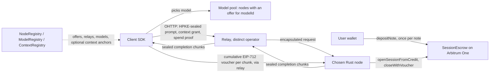

# Comuns — Project charter

Author: Comuns contributors
Status: Draft
Category: Technical Proposal
Created: 2026-10-12
**Reference:** [evidence-register.md](evidence-register.md), [requirements.md](requirements.md), [../GOVERNANCE.md](../GOVERNANCE.md), [protocol/contracts-and-settlement.md](protocol/contracts-and-settlement.md), [security/privacy-and-contexts.md](security/privacy-and-contexts.md), [protocol/orchestration.md](protocol/orchestration.md), [adr/README.md](adr/README.md), [adr/0010-anonymous-by-default.md](adr/0010-anonymous-by-default.md), [adr/0011-anonymous-credits.md](adr/0011-anonymous-credits.md), [adr/0012-contexts-without-a-wallet-link.md](adr/0012-contexts-without-a-wallet-link.md), [cip/0002-anonymous-credits-relays-and-ownerless-contexts.md](cip/0002-anonymous-credits-relays-and-ownerless-contexts.md)

---

## 1. Summary

Comuns is a community proposal for an open-source, decentralized network that runs inference on large language models. Its domain is comuns.ai. No protocol implementation runs yet; the repository includes documentation checker scripts. This charter is a draft that the community may adopt, change or reject through Comuns Improvement Proposals (CIPs) under `docs/cip/`.

The proposed shape is simple. Independent operators run a Rust node that serves one or many open-weight models. A user picks a model; the nodes that currently offer that model form its **pool**; the user's app chooses a node from the pool by price, measured speed, reputation, privacy mode and hardware class. The prompt travels sealed to that node with HPKE, through an Oblivious HTTP relay run by a different operator, and the answer comes back sealed chunk by chunk the same way. **Sessions are anonymous by default:** the user deposits ETH once into a credit pool inside the session escrow contract on Arbitrum One, and each session is then funded by an unlinkable credit, so neither the node nor a chain observer learns which wallet asked. The user still signs a cumulative voucher for each delivered chunk, with a fresh per-session key. Each wallet can keep many encrypted, versioned contexts and grant a chosen node access to one, with no wallet link on-chain or at the node.

**One node runs a request by default (single-node execution).** Multi-node execution — collective answers, parallel planning, task decomposition, and the experimental model sharding and cross-node speculation — is opt-in per request and disclosed on a disclosure sheet before the client spends any credit.

The charter is honest about the limits. In the default privacy mode (standard) the chosen node reads the prompt and the answer; what it should not learn is who asked. In the opt-in attested mode the node should not be able to read the prompt either, barring a physical attack on the hardware (evidence register §14). Every multi-node feature adds readers. Inference payments are not L2 gas, and Comuns does not claim to be cheaper than hosted APIs. No mainnet date exists.

## 2. Scope and non-goals

**In scope (proposed):**

- LLM inference on open-weight models served by independent nodes.
- On-chain registries for nodes, relays, models and contexts, and an ETH session escrow with anonymous credits, on Arbitrum One.
- An off-chain Rust node with pluggable inference backends.
- Encrypted prompts, contexts and completions between client and node, carried through an Oblivious HTTP relay.
- Sender anonymity by default: nodes and chain observers should not learn who asked.
- A client SDK and reference dapp, including an open-source client-side orchestrator for opt-in multi-node execution.
- Hardware classes, model tiers and governance-set price bands.
- Community governance through CIPs and working groups.

**Non-goals:**

- Training, fine-tuning and federated learning are non-goals; Comuns does not do them and does not plan to.
- A protocol token, staking rewards or emissions (not in v1).
- Slashing in v1.
- Running a model inside a smart contract.
- A claim that Rust alone makes inference faster.
- A claim that standard mode hides prompt content from the chosen node (it hides who asked, not what was asked).
- Local execution as a product option: inference runs only on network nodes, and the client performs no model computation.
- Cryptographic private inference: MPC and FHE run at minutes per token for GPT-2-class models over the internet (evidence register §14), so they are not part of this proposal and no work on them is planned.

## 3. Why community and open source

- **Shared infrastructure.** LLM inference is becoming basic infrastructure. A network whose code, specifications and economics are public can be inspected, improved and reused by anyone, instead of being rented from one provider on its terms.
- **No single operator.** Nodes are run by independent operators; the client, not a central matcher, picks a node from a model's pool. No company is required to keep the network alive, and no orchestrator node is a mandatory trusted party.
- **Forkable.** Code and documents are Apache-2.0. If the community disagrees with a direction, it can fork the specifications, the contracts and the node, and the patent grant travels with the code (evidence register §8, [L]).
- **Equal proposal rights.** Anyone can write a CIP. Decisions follow the CIP process and rough consensus in working groups, not coin votes; ARB balances are not this project's votes (see [../GOVERNANCE.md](../GOVERNANCE.md)).

## 4. Binding positions

Every position below is **PROPOSED**. Each is community-adoptable through docs/cip/0001-adopt-baseline-adrs.md and binds every other Comuns document until a CIP changes it. Where a later position in this list (4.13–4.20) conflicts with an earlier sentence, the later position wins.

In the default path the wallet appears only at `depositNote` (and again only if the user later exits through the public `ragequit`). Every other step is taken by the client under a fresh per-session key, through a relay, or by the node.

### 4.1 Inference only — PROPOSED

Scope is LLM inference only. Training, fine-tuning and federated learning are non-goals and appear only as non-goals.

### 4.2 Settlement on Arbitrum One with Solidity/EVM — PROPOSED

Settlement runs on Arbitrum One with Solidity/EVM contracts **NodeRegistry**, **ModelRegistry**, **ContextRegistry** and **SessionEscrow**. Stylus is not the v1 target: new Stylus activations are paused on One and Nova since 2026-10-02 with no reopening date (evidence register §1, [V]), and a model cannot run inside a contract anyway. A dedicated Arbitrum chain is a later option, not a v1 plan.

### 4.3 Off-chain Rust node with pluggable backends — PROPOSED

Inference runs off-chain in a Rust node with pluggable backends:

1. **llama.cpp** through Rust bindings (C/C++ kernels; CPU, CUDA, Metal, Vulkan, ROCm) — the widest hardware coverage and the first adapter (evidence register §3, [V]).
2. **mistral.rs** (Rust; CUDA, Metal, CPU) — the second adapter (evidence register §3, [V]).

A node serves many models and refuses work that does not fit. Rust alone is not claimed to make inference faster; the kernels do the work.

### 4.4 Model-first pools — PROPOSED

A node may offer **any** registered model it can actually load, as memory fit and a per-model self-benchmark permit. There is no protocol rule restricting hardware classes to model tiers.

An offer is the node's NodeRegistry entry `prices[modelId] = (priceInPerMillion, priceOutPerMillion, modelBenchmarkHash)` with a non-zero `modelBenchmarkHash`, written through `registerNode` or `updateNode`. The `modelBenchmarkHash` is the hash of the node's signed per-model self-benchmark — a self-published claim like `benchmarkHash`, not an unfakeable proof. Memory fit and that benchmark are the node's own admission decision. `updateNode` takes the complete offer list (replace-all): it emits `OfferSet` for every model added or changed and a cleared `OfferSet` (zero prices, zero `modelBenchmarkHash`) for every model removed; clearing is always allowed whatever the band or `commercialHosting` state; a hardware-class change revalidates every listed offer against the new bands and reverts if any is outside its band. `deregisterNode` emits a cleared `OfferSet` for every offer it removes.

**Model registration is governance-only in v1.** `registerModel` and `updateModel` are callable only by the governance timelock, controlled through CIPs. On Arbitrum Sepolia, GOVERNANCE.md §7.1 applies; mainnet unchanged. With nobody seated there is no mainnet registration; CIP-0004 (Draft) proposes the testnet-only, non-normative model registration. This prevents manifest squatting and false `commercialHosting` flags.

The user picks a model. The set of nodes with a current offer for that `modelId` is the model's **pool**, enumerated off-chain by clients and indexers. The client (or an orchestrator) picks node(s) from the pool by price, measured speed, reputation, privacy mode and class. The chain stores offers and sessions — never pool lists, plans or sub-task assignments. A thin pool may hold no quote inside a band; the client says so rather than silently picking another model.

### 4.5 Contexts — PROPOSED

One wallet owns one-to-many contexts, and a context can be shared with more than one node; neither nodes nor chain observers should be able to link a context to the wallet (ADR 0012). The list of a wallet's contexts lives only in the client's **local vault**, encrypted under the client's identity key, and in the identity-key backup. It is never sent to a node and never written on-chain.

- **Context key.** Each context has its own random signing key from the client CSPRNG, never the wallet key and never derived from it. `contextId = keccak256(contextPubKey)`, so a `contextId` is a pseudonym, not an owner. A node checks that hash before it accepts anything about the context.
- **Versions and per-version keys.** Contexts are versioned, content-addressed blobs encrypted under **per-version keys**. Each version `v` has its own random 256-bit key `K_v` from the client CSPRNG; ciphertext = ChaCha20-Poly1305(`K_v`, nonce = 12 random bytes stored in the blob header, AAD = contextId ‖ v ‖ prevContentHash). The owner field is removed from the AAD. `contentHash` = keccak256 of the complete stored blob (header ‖ ciphertext ‖ tag) — the one canonical definition. Each version has a head record `(contextId, version, contentHash, prevContentHash)` signed by the context key, chained back to version 1 whose `prevContentHash` is zero.
- **Sharing by re-wrap.** "Shared between the nodes" means the client wraps exactly the `K_v` of the granted versions to a node's HPKE key, separately for each node, so a narrow grant restricts decryption; nodes never exchange plaintext or keys. A grant carries `contextPubKey` and a context-key signature, not a wallet address or a wallet signature, and travels inside the job's HPKE envelope. A grant's expiry is `expiresAt`, unix time in seconds (uint64), never a block number.
- **Backup.** Every `K_v` is also wrapped to the client's long-lived identity HPKE key (mandatory) and stored as a key-wrap record beside the ciphertext. The backup export contains the identity key, every key-wrap record, the context keys and the accepted head checkpoints. It restores the keys, not the blobs: ciphertext that existed only on a lost device is gone even with the backup, so the client recommends at least one context host or a second device for the ciphertext. No document claims that the backup alone restores every context.
- **No owner on-chain.** By default the integrity path is off-chain: a context host stores the blobs and the signed head records and accepts a new version only by compare-and-swap on `version == head + 1`; a client that loses the race keeps its local edit, rebases on the new head and publishes the next version, never a silent merge. The context host is therefore trusted for sequencing as well as availability; clients persist every accepted head checkpoint in the vault and the backup and reject any head behind one. `ContextRegistry` keys a context by `contextId` alone and stores the latest (version, contentHash); `setContext` is callable by any address and checks the context key's signature, and in the reference client a broadcaster or a node submits it, never the user's wallet. That registry is an optional public anchor, required whenever a globally consistent multi-device head is promised. Equivocation between devices that have never synced and acceptance of a stale head after a backup restore are documented limits of an unanchored context.
- **Linkability.** Sessions that grant the same `contextId` are linkable by the nodes that receive them, and turns within one conversation are linkable by design (evidence register §16, [V]). A client may fork a context under a new key to break the chain, at the cost of a new pseudonym with no history.

The cryptography is owned by [security/privacy-and-contexts.md](security/privacy-and-contexts.md).

### 4.6 Two-way encryption and the relay hop — PROPOSED

Two-way encryption is RFC 9180 HPKE base mode (X25519, HKDF-SHA256, ChaCha20-Poly1305): client to node for the prompt and the context grant, node to client for each completion chunk. Client encryption keys are app-managed and generated from the OS CSPRNG, never derived from the wallet key. Sign-to-derive is a rejected default. `eth_getEncryptionPublicKey` and `eth_decrypt` are forbidden (deprecated since 2022, evidence register §4, [V]).

HPKE base mode does not authenticate the sender, so every job is a **sessionSigner-signed envelope**: the session's `sessionSigner` signs (chainId, escrow address, sessionId, jobId, requestId, sheetVersion, hash of enc ‖ ciphertext), and the node rejects any envelope whose signature does not verify against the `sessionSigner` recorded for that session. The signature is what stops third parties injecting jobs into someone else's session. `sessionSigner` is a fresh key per session and is never reused across sessions; the client never presents a wallet address, an account, an API key or any persistent identifier to a node.

**The relay hop.** Client-to-node traffic uses RFC 9458 Oblivious HTTP, with chunked OHTTP (draft-ietf-ohai-chunked-ohttp, draft -08) for streamed completions (evidence register §15, [V]). The node process is the OHTTP gateway, and its gateway key configuration `ohttpKeyConfig` is registered in NodeRegistry through `registerNode` and `updateNode`; a node publishes one configuration for every user, so no user can be handed a key that singles them out. The inner HPKE job envelope and its `sessionSigner` signature travel unchanged inside the OHTTP hop. The relay sees the client's network address, request and response sizes, timing and the target gateway, never the envelope; the gateway sees the envelope and the relay's address, never the client's network address. This holds only if relay and gateway are run by different entities (evidence register §15, [V]). The relay banner (normative), shown with every disclosure sheet: "The relay sees your network address and not your prompt. The node sees your prompt and not your network address." Every session-specific chain read the reference client makes — session lookup, settlement and change monitoring, Merkle witness and root queries — goes through a relay too; an indexer is a backend behind that transport, not an alternative to it. Envelopes and streamed frames are padded to size buckets and output tokens are batched per frame (sizes unset); this reduces, and does not remove, what sizes and timing reveal (evidence register §16, [V]).

**The registry relay role.** Relays are a registered role in NodeRegistry: `registerRelay` with a bond of at least `MIN_RELAY_BOND_WEI` (named, unset), `updateRelay`, `deregisterRelay`, and the bond is released by `withdrawBond` after the same `BOND_UNLOCK_DELAY` as a node. Relays are never slashed. The contract refuses to register one address as both a relay and a node, and `openSessionFromCredit` reverts when `relay == node`; one person running a relay and a node under two addresses is a stated residual risk, not a checked property (R16). Relays hold no OHTTP key; only nodes register `ohttpKeyConfig`. The client picks a relay at random from the registry. A relay is paid `relayFeeWei` (the global `RELAY_FEE_WEI`, unset and allowed to be 0, copied onto the session at open) out of the node's settled value, never by a user transaction (4.8). The reference client has no direct client-to-node path: when no relay is available the request fails closed.

A node keeps a keyring of every HPKE key used by any session not yet settled; `updateNode` publishes the new key, and old keys are deleted only after every session that used them is settled.

### 4.7 Privacy modes — PROPOSED

Every mode is anonymous: no mode presents a wallet, account or network address to the node, and no mode names a payer on-chain. The modes keep their names and numbers and differ only in who can read the content (ADR 0010). The two promises are stated apart.

- **standard (0):** the default. **Promise: the node should not learn who asked. It can read the prompt, the granted context and the answer.** Relays, nodes not selected, and chain observers see ciphertext only. Banner (normative): "This node can read your prompt and your answer. It should not learn who you are."
- **attested (1):** opt-in. **Promise: the node should not learn who asked, and in addition its operator should not be able to read the content, barring a physical attack on the hardware.** The client verifies the TEE quote before sealing anything; both the node's job HPKE key and its OHTTP gateway key are generated inside the TEE and the quote binds both. This is not a defense against physical access: TEE.fail extracts TDX and SEV-SNP keys with a DDR5 interposer costing under $1,000 (evidence register §14, [V]), and TDXRay recovers prompts from tokenizer memory-access patterns (evidence register §14, [L]). It fails closed when required and no eligible node exists; there is no silent downgrade to standard mode. Banner (normative): "This node should not be able to read your prompt. A physical attack on the hardware can break that."
- **verifiable (2):** opt-in; it is **re-execution by a user-chosen second node under a demonstrated deterministic profile**. The verifier is reached through a relay and funded by its own credit; it is a second content reader and the prompt is disclosed to it, so verifiable mode is not a privacy upgrade and is not combined with attested mode in v1. v1 nodes refuse it unless they can run a deterministic profile. Re-execution is the required check; an activation checker such as TOPLOC is at most a candidate addition and never a substitute for it (TOPLOC cannot detect speculative decoding, evidence register §5, [V]). Banner (normative): "This node and the verifier you chose can read your prompt. They should not learn who you are."

### 4.8 Payments: anonymous credits and the ETH session escrow — PROPOSED

**Client path (the only path the reference client uses).**

- **Deposit once.** The user's wallet calls `depositNote(identityCommitment, denominationIndex)` on SessionEscrow, paying exactly one denomination in ETH. This is the one public, wallet-linked step. Every note — from a deposit or from change — carries a fresh Semaphore identity generated by the client, which stores the note secret durably before the commitment is published; `depositNote` and `claimChange` revert on any commitment already seen (ADR 0011). Denominations and `RELAY_FEE_WEI` are set only by the governance-timelocked `setCreditParameters`; no normative/mainnet value is set. CIP-0004 (Draft) proposes testnet-only, non-normative values; on Arbitrum Sepolia, GOVERNANCE.md §7.1 applies; mainnet unchanged.
- **One credit per session.** For each session the client hands a Semaphore v4 spend proof, through a relay, to the chosen node, which (or any broadcaster) submits `openSessionFromCredit`. The contract computes the proof's scope (`keccak256(chainId, escrow, denominationIndex)`) and message (`keccak256(node, relay, modelId, mode, sessionSigner, expectedPriceInPerMillion, expectedPriceOutPerMillion)`) itself, so a submitter cannot redirect the spend. The session records `user = address(0)`, `funding = credit`, `depositWei = maxSpendWei =` the denomination, `relay`, `relayFeeWei` and `pendingWei = 0`. Every price, mode, band and `commercialHosting` check of `openSession` applies; `relay` must be a registered relay that is not deregistering, and `relay ≠ node`. A session carries many prompts. The **effective cap** is min(depositWei, maxSpendWei), which for a credit session is the denomination. **`topUp` does not apply to credit sessions** (it reverts); when the cap is exhausted the client opens a new credit session with a new note.
- **Price binding at open:** the disclosure sheet binds the prices the user confirmed. The spend message includes `expectedPriceInPerMillion` and `expectedPriceOutPerMillion`, and `openSessionFromCredit` reverts if the node's current offer for that model differs, so an offer change — even by one wei, even when `updateNode` is ordered just ahead of the spend — can never lock a note; a reverted spend consumes no nullifier. As defence in depth the client still reads, through a relay, the prices copied into the session after inclusion and, if they differ from the confirmed sheet, signs nothing, submits `closeSession` with a `sessionSigner` signature through a relay or broadcaster, and recovers the denomination as change.
- **Input receipt before the input voucher.** After tokenizing the prompt and the granted context with the model manifest's pinned tokenizer, and before prefill, the node sends a node-signed **input receipt** (sessionId, jobId, jobInputTokens, cumulativeInputTokensAfter). The client checks `jobInputTokens` against its own tokenization of this job's prompt and granted context with the pinned tokenizer, checks `cumulativeInputTokensAfter` = lastInputTokens + `jobInputTokens`, and signs the **input voucher** — which carries the cumulative total — only if both checks pass; this is how the second and every later job in a session is accounted. Then each output chunk arrives with a node-signed receipt (cumulative counts the same way, chunk hash), and the client signs the next client-signed **cumulative EIP-712 voucher**, one per delivered chunk of at most `CHUNK_TOKENS` output tokens. Residual risk, stated plainly: a node can redeem the input voucher and never run the prompt; the user's loss is bounded by that prompt's input fee; the remedy is to stop signing and record a reputation event.
- **One canonical voucher type, unchanged**, defined only in [protocol/contracts-and-settlement.md](protocol/contracts-and-settlement.md) and referenced by every other document: `Voucher(bytes32 sessionId,uint64 seq,uint256 cumulativeWei,uint64 inputTokens,uint64 outputTokens,bytes32 outputCommitment,bool final)` — the EIP-712 type string has no spaces after commas, and every document uses exactly this string. `inputTokens` and `outputTokens` are cumulative for the session; `cumulativeWei` is recomputed on-chain from them; `seq` starts at 1 and strictly increases; the contract also requires `inputTokens`, `outputTokens` and `cumulativeWei` to be at least the values of the last accepted voucher, so a later voucher can never lower what is owed. `final` means only "the client closes the session"; a job's last frame uses a different flag, `endOfJob`, which is never copied into `final`.
- `outputCommitment` = keccak256(commitKey ‖ sessionId ‖ seq ‖ transcriptHash). `commitKey` is a random 32-byte **session** key the client generates and sends sealed inside the session's first job envelope (HPKE); client and node keep it until the session is settled, so it is one key for every job of the session, not a per-job exporter secret. `transcriptHash` = keccak256(prev ‖ chunkHash), chained from zero over every output chunk of every job in the session. It is not checked on-chain; it binds a voucher to delivered output without letting chain observers guess low-entropy answers. Opening `commitKey` discloses the session's output to whoever receives it — it is not a proof without disclosure.
- The node redeems the highest voucher (`redeemVoucher` at any time while legal; it rejects any voucher with `final == true`). **`redeemVoucher` never credits a refund or change**; only settlement does. A voucher above the effective cap is paid only up to the cap.
- **Settlement accounting** (normative in the contracts document). `redeemVoucher`: payout = min(cumulativeWei, effective cap) − settledWei; settledWei += payout. For a credit session every payout splits as `relayDelta = min(relayFeeWei, newSettled) − min(relayFeeWei, oldSettled)` to `balances[relay]` and `nodeDelta = payout − relayDelta` to `balances[node]`, so the **relay fee comes from the first wei of the node's settled value**. `closeWithVoucher`: the same payout and split, then `pendingWei = depositWei − settledWei`, status = settled. `finalize`: `pendingWei = depositWei − settledWei`, status = settled. A credit session credits nothing to any user. **Change:** `claimChange(sessionId, changeCommitments[], denominationIndexes[], signature)`, authorised by a `sessionSigner` signature and callable by anyone with no deadline while `pendingWei > 0`, mints at most `MAX_CHANGE_NOTES` fresh notes whose denominations sum to at most `pendingWei`; the dust, `pendingWei` minus that sum, goes to `balances[node]`. The client decomposes greedily, so dust stays below the smallest denomination. Invariants, stated and tested: per credit session at all times, `nodeCredited + relayCredited + remainingLockedWei + pendingWei + mintedChangeValue = depositWei`; pool-wide, the contract's ETH balance equals the sum of all `balances[]`, plus all open and closing deposits minus their settledWei, plus all `pendingWei`, plus the face value of all unspent notes.
- **Ragequit.** `ragequit` pays `balances[msg.sender]` one denomination for one note of that group the caller proves, only while the caller's net deposits into that group cover it. It is public and linkable by design and cannot tell deposit notes from change notes.
- Happy path per session: the wallet has already deposited once; then the node submits `openSessionFromCredit` and, on the client's final voucher, `closeWithVoucher` — two node-submitted transactions per session — and the client has `claimChange` submitted through a relay or broadcaster when `pendingWei > 0`. Otherwise `closeSession`, then `finalize` after `closeDeadline`. Legality is decided by `status`, never by a zero `closeDeadline`: `redeemVoucher` and `closeWithVoucher` are allowed when status == open, or status == closing and block.timestamp < closeDeadline; `finalize` requires status == closing and block.timestamp ≥ closeDeadline and is callable by anyone; a settled session accepts no call except `claimChange` while `pendingWei > 0`; `closeDeadline` is set only by `closeSession`.
- There is no finalize-at-posted-usage. A user who disappears pays only what they signed. A signed voucher is not reversed. **Abandoned client or lost key:** a node never relies on `closeWithVoucher` without a final voucher. When a client disappears, or its key is lost, the node redeems its highest non-final voucher with `redeemVoucher` while that is legal, then calls `closeSession`; `finalize` after `closeDeadline` records the remainder as `pendingWei`. If a node loses its key, the client submits `closeSession` with a `sessionSigner` signature through a relay or broadcaster, then `finalize`, then `claimChange`. `closeSession` on a credit session is callable by the node or with that signature; it is not permissionless. If both the node and the `sessionSigner` key are gone, the session stays open.
- A stolen `sessionSigner` can sign vouchers up to the effective cap until the session is settled, close the session, and redirect its change into notes the thief controls; `closeSession` does not stop it (vouchers stay redeemable until `closeDeadline`). Exposure is one denomination per session. Mitigation: claim change promptly and delete the signer; signer rotation or revocation is an open question for a later CIP.
- `paymentWei = (priceInPerMillion * inputTokens + priceOutPerMillion * outputTokens) / 1000000` with integer floor division; prices are in wei per 1,000,000 tokens.

**Wallet path (specified, not the client path).** `openSession` with an ETH deposit and a `maxSpendWei` cap, `topUp(newMaxSpendWei)`, and refunds of depositWei − settledWei to `balances[user]` remain specified for a direct caller, with the accounting of the contracts document. A wallet-funded `openSession` publishes the payer on-chain, so the reference client has no call site for it and no document offers it as a privacy mode.

**Common rules.**

- **Pull payments.** No contract ever pushes ETH during settlement, bond release, change or refund. NodeRegistry and SessionEscrow credit an internal `balances[address]` mapping; the only ETH-sending function is `withdraw()`, which pays `msg.sender` its whole balance (checks-effects-interactions: zero the balance, then send; nonReentrant). Every state-changing function follows checks-effects-interactions and carries a reentrancy guard. A contract wallet that cannot receive ETH can therefore never lock a payment or a bond.
- **Closed list: 23 state-changing functions in four contracts** (NodeRegistry, ModelRegistry, ContextRegistry, SessionEscrow), as amended by [CIP-0002](cip/0002-anonymous-credits-relays-and-ownerless-contexts.md) and [ADR 0011](adr/0011-anonymous-credits.md): the original fifteen — `registerNode`, `updateNode`, `deregisterNode`, `withdrawBond`, `withdraw`, `registerModel`, `updateModel`, `setContext`, `openSession`, `topUp`, `redeemVoucher`, `closeWithVoucher`, `closeSession`, `finalize` and `setBands` — plus eight new names and no others: `depositNote`, `openSessionFromCredit`, `claimChange`, `ragequit`, `setCreditParameters`, `registerRelay`, `updateRelay` and `deregisterRelay`. The credit-holding SessionEscrow is non-upgradeable.
- **protocol fee 0.** Inference payment is not L2 gas; L2 gas is paid separately to the chain. The relay fee is paid out of the node's settled value, not by the user and not to the protocol. Nodes bear the spend gas of `openSessionFromCredit` and price it into their offers.
- No protocol token.
- There is **no slashing** in v1: withdrawable registration bonds for nodes and relays only; disputes are reputation events; the user's remedy is to stop signing vouchers.

### 4.9 Hardware classes, model tiers and price bands — PROPOSED

- **Hardware classes** S < M < L < X are assigned by a public self-benchmark, which is not an unfakeable proof.
- **Model tiers** are labels that partition the manifest parameter count: T0 ≤ 4B; T1 > 4B and ≤ 8B; T2 > 8B and ≤ 32B; T3 > 32B and ≤ 70B; T4 > 70B (an 8,000,000,000-parameter model is T1).
- A hardware class is decided by passing per-class benchmark bars on the public class benchmark and selects the price band; a class is not a tier and is never defined as "the highest tier passed". A node may offer any registered model it can load. `maxTier` is a separate field recording the largest tier the operator benchmarked (per-model self-benchmarks); it is informational only and never an `openSession` or `openSessionFromCredit` gate.
- **Withdrawn rule:** the earlier serving rule — that class S serves T0 only (S serves T0), M only through T1, L only through T2, and X only through maxTier — is WITHDRAWN and superseded by the user's model-first decision (4.4, ADR 0008).
- Hardware class selects the price band only. Governance-set price bands exist for every (tier, class) pair over all four classes, input and output separately, with floor(class c+1) strictly above ceiling(class c). Stronger hardware charges more for the same model and weaker hardware charges less.
- The batching tension is stated openly: a batched datacenter token is far cheaper to produce (evidence register §6, ~27,569 tok/s for an 8B model on 1xH100, [V]) than a single-stream token on a home GPU.
- No wei value is presented as adopted anywhere; illustrative fixtures are labeled non-normative. The bands are set by a later CIP, so mainnet is not deployable until then.

### 4.10 Governance — PROPOSED

Apache-2.0 for code and docs; DCO, not a CLA. CIPs move Draft → Review → Last Call (14 days) → Final, and become Stagnant after 6 months without activity. Working groups: Protocol, Node, Cryptography, Contracts, Applications, Documentation. No maintainers are seated. ADRs stay proposed until docs/cip/0001-adopt-baseline-adrs.md is accepted (ADRs 0001–0009) or docs/cip/0002-anonymous-credits-relays-and-ownerless-contexts.md is accepted (ADRs 0010–0012) or docs/cip/0005-phase-one-implementation.md is accepted (ADRs 0013–0015). No coin vote; ARB balances are not this project's votes.

### 4.11 Phases — PROPOSED

Relative order only; there are no dates.

| Phase | Name | Content |
|---|---|---|
| 0 | Documentation baseline | This documentation and a Final bootstrap CIP (CIP-0003, Draft) naming the first maintainer, the enforcement contact and the monitored private security channel. |
| 1 | Sepolia slice | One single-node, standard-mode, credit-funded session on Arbitrum Sepolia through one relay whose operator is distinct from the node's: a testnet-only ladder of at least two denominations (testnet values unset in this charter; the testnet-only, non-normative table is proposed in [CIP-0004](cip/0004-sepolia-testnet-configuration.md), Draft), `depositNote`, `openSessionFromCredit`, vouchers, close, `claimChange` and `ragequit`. The exit demonstrates a partial spend with `claimChange` into at least one smaller note plus dust, a zero-use session claimed back in full, and a `ragequit`. No contexts, no attested mode, no verifiable mode, no multi-node feature and no wallet `openSession` demo. |
| 2 | Contexts and classes | Ownerless contexts (ADR 0012), hardware classes, per-model offers and pools, the disclosure sheet with its anonymity fields, and the client-side orchestrator with task_decomposition, collective_answer and parallel_planning on Arbitrum Sepolia. |
| 3 | Verification spike | Attested nodes (the quote path and the published TEE measurement list), verification experiments, plus the model_sharding and cross_node_speculation spikes under testnet-only non-normative prices, each measured against a single node of the same class; each may end with a published negative result. |
| 4 | External review | Independent review of the Semaphore integration and the escrow accounting, relay–node collusion, TEE physical attacks, and the legal facts of evidence register §16 (facts, not legal advice), ending in a go/no-go CIP deciding whether to proceed. Mainnet stays blocked while the mainnet price bands, the denominations or `RELAY_FEE_WEI` are unset. |

sessionSigner delegation to orchestrator nodes and activation metering are later CIPs.

### 4.12 Honesty constraints — PROPOSED

No document claims a mainnet date, an audit, a grant award, a partnership, existing users, or a price lower than hosted APIs.

### 4.13 (A) Model-first pools supersede the serving gate — PROPOSED

Classes S<M<L<X still price work through bands for every (tier, class) pair but never gate which model a node may offer. Memory fit and the per-model self-benchmark (its signed hash is `modelBenchmarkHash`, a self-published claim, not an unfakeable proof) are the node's own admission decision. A thin pool may hold no quote inside a band, and the client says so rather than picking another model silently. This position replaces the withdrawn serving rule named in 4.9; it was the user's decision.

### 4.14 (B) Execution features — PROPOSED

`executionFeatures` is a per-request, client-side set (never stored on-chain) drawn from `collective_answer`, `parallel_planning`, `task_decomposition`, `model_sharding` and `cross_node_speculation`. The **empty set is single-node execution** — the default and exactly today's behaviour. Features are orthogonal to the privacy modes standard (0), attested (1) and verifiable (2), which every participating node keeps individually.

- **collective_answer:** k ≥ 2 nodes, possibly running different models chosen from the pools of models the user picked, each receive the same prompt sealed separately and answer independently (no answerer sees another answer while generating). Then a blind cross-check round: reviewers receive the prompt plus the anonymized answers in randomized order and are asked twice with positions swapped (evidence register §11, position bias, [V]), producing a structured critique per answer. With k = 2 the blind cross-check is optional; with k ≥ 3 it is on by default. A user-chosen synthesizer — always a network node reached through a relay, and always a full-prompt reader — returns the merged answer, a "splits" list of claims the answers disagree on, and an agreement level. The client labels the result "contested" when the splits list is non-empty or the agreement level is low, and offers every original answer and critique on request. It is a quality mechanism costing at least k times the single-node tokens plus cross-check and synthesis — not verification — and never has a payment consequence. When one strong model is in a pool, the client suggests one of two cheaper variants, which are different methods: (a) **self-consistency** — k samples of one strong model and a majority vote over a short extracted answer, only for tasks with a short checkable answer (a number, a choice, a label) (evidence register §11, self-consistency, [V]); (b) **Self-MoA** — k samples of one strong model combined by a synthesizer, for free text (evidence register §11, Self-MoA, [V]). A plurality vote is never applied to free text.
- **task_decomposition:** a planner produces an off-chain plan — a DAG of sub-tasks grouped in waves (topological levels). Tasks in one wave have disjoint outputs and no dependency on each other and run concurrently on nodes from different pools: easy tasks on cheaper models, hard tasks on the strongest model the user confirmed (evidence register §13 is motivation only; v1 has no trained router). Later waves wait. A merge job on a merge node joins the outputs. Each sub-task result may be reviewed by a node running a different model family than its producer. A final verify job checks the integrated result (structural completeness plus optional verifiable mode — not a proof). The planner and the merge stay sequential and the slowest task sets a wave's pace (evidence register §12, [V]). Math, coding, Fermi and tight writing are not decomposed unless the user overrides (evidence register §12, [V]).
- **parallel_planning:** the collective_answer mechanism applied to plans. Several planners propose plans independently, reviewers cross-check blind, the synthesizer keeps the converged and evidence-backed parts and lists the open splits as questions for the user. An objection round shows the merged plan to the planners (not blind; the disclosure sheet says so). The user confirms the splits before any execution session opens, and a judge's rank is never executed automatically.
- **model_sharding:** contiguous layer segments of one model on several nodes. EXPERIMENTAL, Phase 3 Verification spike. The embedding and output-layer computation also runs on disclosed network nodes, never on the client; the client keeps transport, orchestration and sampling decisions only. Activations travel to each shard holder through a relay, OHTTP-encapsulated to the holder's registered `ohttpKeyConfig`; no direct client-to-holder connection skips the relay. Every shard holder is treated as able to read the prompt (evidence register §10, [V]); shard holders are unpaid volunteers, and this unpaid spike is the one exemption from the rule that every paid recipient has its own credit session; it is slow over the internet (evidence register §10 figures); it is not paid under mainnet parameters in v1 because the contracts have no activation meter (a later CIP); llama.cpp's RPC backend is never used on an open network (evidence register §10, [V]).
- **cross_node_speculation:** a draft node of a cheaper class drafts tokens and a target node verifies them. EXPERIMENTAL, Phase 3 spike. No WAN speed-up is promised: one preprint states that at WAN round-trip times pipelined distributed speculative decoding does not beat co-located speculative decoding (evidence register §9, the quote is [V]; the result is not independently replicated, [U]). Both the draft node and the target node are full-prompt readers, and the target also sees the drafts. It is incompatible with verifiable mode because the deterministic profile needs byte-identical output that speculative engines do not guarantee (mistral.rs states no token-for-token equivalence, evidence register §9, [V]) — and TOPLOC, a candidate checker, cannot detect speculative decoding either (evidence register §5, [V]). On-node speculative decoding inside one node stays only an engine detail that adds no reader and stays off in verifiable mode.

### 4.15 (C) Orchestrator placement — PROPOSED

The pattern — assess, plan with parallelism, decompose into waves, execute a wave in parallel, review with a different model family, verify — is open-source code in the **client SDK** by default. Assessment starts with local heuristics that run no model and never leave the device; the client performs no model computation. An optional remote assessment or planning call runs on a planner model on a node the user chose from that model's pool, paid as an ordinary credit session through a relay, only after the disclosure sheet says that node will see the full prompt. Planner output and every intermediate text are untrusted data that can never authorize new recipients, spending, tools or external actions.

Optional **orchestrator nodes** serve thin clients. They run the same open-source orchestrator, advertise the role in their off-chain capability document, and are paid only through an ordinary session on their planner model for the tokens they generate (assessment, plan, merge, synthesis). An orchestrator node is a full-prompt reader whenever it plans, merges or synthesizes — merge inputs and answers are assumed to quote the prompt — and the disclosure sheet counts it as one; it sees the plan when the user delegates planning. They take no cut and receive no pass-through, hold no sessionSigner and custody no other session in v1: the thin client still spends its own credits, seals data and signs vouchers. Delegation for clients that cannot sign per chunk is an open question for a later CIP. Orchestrator nodes are never mandatory — there is no new mandatory trusted party.

### 4.16 (D) Opt-in and disclosed — PROPOSED

Every non-empty `executionFeatures` set is opt-in per request. Consent from an earlier request or an already funded session is not consent; a later request that reuses an open session still shows its own disclosure sheet and needs the user's explicit confirmation before any job is sent.

**The sheet comes before a credit spend.** Before the client hands a spend proof to any node for `openSessionFromCredit` for the request, the client shows the **disclosure sheet** (normative name; field list owned by security/privacy-and-contexts.md): for every node, its role — one of the canonical role tokens owned by security/privacy-and-contexts.md §6: executor, planner (an assessor is a planner session), answerer, reviewer, synthesizer, merge, orchestrator, shard holder, draft, target, verifier — what it receives (full prompt; a sub-task, which may quote the prompt; the plan; all answers and critiques; activations of layers a–b; prompt plus draft tokens), its privacy mode, whether its operator can read what it receives (`operatorReadable`, false only for an attested recipient whose quote the client verified), its two prices and its cap — plus the counts, by distinct node and by distinct operator, of those that will see the full prompt, a sub-task, other nodes' answers, activations and draft tokens, and `counts.operatorReadable` and `counts.attestedRecipients`. The sheet also carries the **anonymity fields** `anonymity.transport`, `anonymity.relay`, `anonymity.funding` and `anonymity.contextLinkage`: that every hop goes through a relay, which relay each session uses and the size of the relay set, which denomination group each session spends from and its observed size (with a Phase 1 warning reporting the observed group size, without a numeric threshold; RR-39 remains open), and whether a granted `contextId` is linkable. The headline banner is computed from `counts.operatorReadable`, and the relay banner is shown with every sheet. The **full-prompt readers** counted are at least all of: the executor; in verifiable mode the verifier; in collective_answer every answerer, every reviewer (reviewers receive the prompt) and the synthesizer; in parallel_planning every planner, every plan reviewer and the plan synthesizer; in cross_node_speculation both the draft node and the target node; every shard holder; an orchestrator node whenever it plans, merges or synthesizes; a merge node (its inputs are assumed to quote the prompt); any remote assessor or planner in any feature, including task_decomposition; and any sub-task executor or sub-task reviewer whose payload contains prompt text (assumed to unless the client verifies the sub-task text contains none). **This list is a floor, never a ceiling:** the sheet derives `readersOfFullPrompt` from the actual payloads each node will receive, so any node whose payload contains the prompt is counted whatever its role. `readersOfFullPrompt` never shrinks because a recipient is attested.

The sheet is shown again before the execution sessions when a planner session ran first, and whenever the plan adds a node, widens what a node receives or raises a cap. A required mode missing on any node, no available relay, or a pool that cannot fill the confirmed set, fails closed for the whole request — never a silent downgrade to fewer nodes, to single-node, to standard mode or to a direct connection. **Attested fails closed:** a request that requires attested mode fails unless every recipient that receives plaintext is attested with a verified quote. The client never switches a request to a multi-node feature or adds a node silently; a fallback node is allowed only if it was on the confirmed sheet.

### 4.17 (E) Payment per session, funded by credits — PROPOSED

One SessionEscrow credit session per distinct (node, modelId) a request uses, many jobs per session. The input voucher and cumulative vouchers per `CHUNK_TOKENS` stay per session, and the voucher type is unchanged. The wallet deposits once with `depositNote`; after that, each session costs two node-submitted transactions on the happy path, `openSessionFromCredit` and `closeWithVoucher`, plus a `claimChange` whenever change remains — so a request using N sessions, one per (node, modelId) pair, needs N spends and N closes plus L2 gas, and one note per session. This is said openly and never claimed cheaper than hosted APIs. The wallet-funded `openSession` is not the client path, and `topUp` does not apply to credit sessions. The relay fee is paid from the node's settled value. No multi-party session, no pool payee, no pass-through between nodes, and no contract or function beyond the 23 of 4.8; protocol fee 0.

The client sums the caps on the disclosure sheet (the aggregate request cap) and keeps settled spend plus unpaid signed liabilities plus unspent reservations within that sum. Signed vouchers stand even when a synthesis discards a node's answer or a sub-task is retried on another confirmed node with a new session. The unpaid exposure is one chunk per active session. Disagreement has no payment consequence and is not a dispute.

### 4.18 (F) Phases with multi-node and anonymity work — PROPOSED

Phase names are unchanged, and 4.11 is the phase table. Phase 0 Documentation baseline is this documentation and a Final bootstrap CIP (CIP-0003, Draft) naming the first maintainer, the enforcement contact and the monitored private security channel. Phase 1 Sepolia slice is one single-node, standard-mode credit session through one relay with a distinct operator, with at least two testnet-only denominations, `depositNote`, `openSessionFromCredit`, vouchers, close, `claimChange` and `ragequit`; it includes no contexts, no attested or verifiable mode, no multi-node feature and no wallet `openSession` demo. Phase 2 Contexts and classes delivers ownerless contexts, per-model offers and pools with classes, the disclosure sheet with its anonymity fields, and the client-side orchestrator with task_decomposition, collective_answer and parallel_planning on Arbitrum Sepolia. Phase 3 Verification spike adds attested nodes (the quote path and the TEE measurement list) and keeps the verifiable-mode experiments and the model_sharding and cross_node_speculation spikes under testnet-only non-normative prices, each measured against a single node of the same class and each allowed to end in a published negative result. Phase 4 External review covers the Semaphore integration, relay–node collusion, TEE physical attacks and the legal facts of evidence register §16 (facts, not legal advice), then a go/no-go CIP; mainnet stays blocked while the mainnet price bands, the denominations or `RELAY_FEE_WEI` are unset. sessionSigner delegation to orchestrator nodes and activation metering are later CIPs.

ADR 0008 (docs/adr/0008-model-first-pools.md) and ADR 0009 (docs/adr/0009-opt-in-client-orchestration.md) record 4.13–4.18; docs/protocol/orchestration.md, docs/protocol/collective-answers.md and docs/node/distributed-execution.md own the details. Nothing in 4.13–4.18 weakens 4.2–4.11 except where 4.19 and 4.20 amend them.

### 4.19 Anonymous by default — PROPOSED

Summarizes [ADR 0010](adr/0010-anonymous-by-default.md). The owner's first requirement — that only the client could read the question and the answer — is not supported at interactive speeds by the remote cryptographic inference results in the evidence register: cryptographic private inference runs at minutes per token even for GPT-2-class models over the internet, and every network that ships private LLM inference uses TEEs (evidence register §14, [V]/[L]). The requirement is therefore reframed into two properties kept apart:

- **Sender anonymity, in every mode, by default.** The executing node and chain observers should not learn who asked. The client presents no wallet, account, API key or persistent identifier to a node; `sessionSigner` is fresh per session; jobs and session-specific chain reads go through a registered OHTTP relay run by a different operator (4.6); sessions are funded by anonymous credits (4.20); contexts carry no wallet link (4.5). No relay available means the request fails closed.
- **Content privacy against the operator, only in attested mode.** "This node should not be able to read your prompt. A physical attack on the hardware can break that." Standard mode does not hide content: the node reads the prompt, the granted context and the answer.

Local execution is withdrawn as a product option, as a fallback and as an owner-only option; inference runs only on network nodes and the client performs no model computation. Residual risks are stated, not closed: identifying text and writing style in the prompt (evidence register §16, [L]/[V]), relay–node collusion and timing (R16), small anonymity sets (R15), sizes and timing narrowed but not removed by padding and batching (evidence register §16, [V]), and physical attacks on TEEs (evidence register §14, [V]).

### 4.20 Anonymous credits — PROPOSED

Summarizes [ADR 0011](adr/0011-anonymous-credits.md) and, for contexts, [ADR 0012](adr/0012-contexts-without-a-wallet-link.md); [CIP-0002](cip/0002-anonymous-credits-relays-and-ownerless-contexts.md) proposes adopting all three.

- SessionEscrow holds one Semaphore v4 group per denomination index, with its own LeanIMT trees, its own nullifier set and its own root window (`MERKLE_TREE_DURATION`, unset); it calls only the stateless Semaphore v4 Groth16 verifier and never a shared deployment's `validateProof`, which has no access modifier (evidence register §15, [V]).
- A deposit (`depositNote`) is the one public, wallet-linked step. A spend (`openSessionFromCredit`) proves membership in its denomination group without revealing which deposit funded it; deposit-to-spend timing and small groups can still link them (R15). Change returns as fresh fixed-denomination notes through `claimChange`, with dust below the smallest denomination going to the node, because a variable refund amount is a re-linking channel (evidence register §15, [V]). `ragequit` is a public, linkable exit bounded by the caller's own net deposits into that group.
- Semaphore v4.0.0 was audited by PSE and v3 by Veridise; its trusted setup had more than 400 participants and finished 13 July 2024 (evidence register §15, [V]). No audit claim transfers to the Comuns wrapper, and none has been performed. Phone proving is 143–2,146 ms [V] (Semaphore-32) (evidence register §15); a spend is estimated at about 230–270k L2 gas, an estimate for Semaphore's own `validateProof`, not a measurement (evidence register §15, [U]).
- No normative/mainnet denomination, relay fee, relay bond, root-window or change-note limit value is set. [CIP-0004](cip/0004-sepolia-testnet-configuration.md) (Draft) proposes testnet-only, non-normative values. No authoritative minimum anonymity-set size was found (evidence register §15, [U]); the Phase 1 client shows a warning reporting the observed group size without a numeric threshold; the warning threshold remains open under RR-39.
- The credit-holding SessionEscrow is non-upgradeable; governance parameters (`setBands`, `setCreditParameters`) stay timelocked on mainnet. On Arbitrum Sepolia, GOVERNANCE.md §7.1 applies; mainnet unchanged.
- There is no dedicated anonymous withdrawal entry point. A credit holder who operates a node can open a session to it, sign vouchers and withdraw that node's balance, because the contract does not verify that inference happened. Regulatory classification is UNVERIFIED and is a Phase 4 review item (facts in evidence register §16, not legal advice).

Where 4.19 or 4.20 conflicts with an earlier sentence of this charter, 4.19 and 4.20 win, and ADR 0010–0012 own the details.

## 5. Document map

| Path | Purpose |
|---|---|
| README.md | Entry point for the repository. |
| LICENSE | Apache-2.0 license text. |
| GOVERNANCE.md | CIP process, working groups, decision rules. |
| CONTRIBUTING.md | How to contribute; DCO sign-off. |
| CODE_OF_CONDUCT.md | Community conduct rules. |
| SECURITY.md | How to report vulnerabilities. |
| MAINTAINERS.md | Maintainer roles (none seated). |
| docs/README.md | Index of the documentation. |
| docs/project-charter.md | This charter. |
| docs/evidence-register.md | External facts with marks [V]/[L]/[U]. |
| docs/requirements.md | Requirements traceability. |
| docs/project-plan.md | Phases 0–4 and their exit criteria. |
| docs/risk-register.md | Consolidated risks. |
| docs/glossary.md | Terms. |
| docs/faq.md | Frequently asked questions. |
| docs/landscape.md | Comparison with other networks. |
| docs/review-report.md | Review of the document set. |
| docs/architecture/system-architecture.md | Components and flows. |
| docs/architecture/deployment-and-decentralization.md | Deployment and decentralization limits. |
| docs/deployments/arbitrum-sepolia.md | Unfilled record for deployment observations after CIP-0004 is Final; no deployment claimed. |
| docs/protocol/contracts-and-settlement.md | Contracts, sessions, vouchers. |
| docs/protocol/off-chain-api.md | Client–node API. |
| docs/protocol/orchestration.md | Client-side orchestrator, plans, waves, disclosure sheet. |
| docs/protocol/collective-answers.md | collective_answer and parallel_planning. |
| docs/security/privacy-and-contexts.md | Privacy modes, HPKE, contexts. |
| docs/security/threat-model.md | Threats and mitigations. |
| docs/security/inference-verification.md | Verification options. |
| docs/economics/cost-and-pricing.md | Classes, tiers, bands. |
| docs/economics/pricing-examples.json | Non-normative pricing fixtures. |
| docs/node/node-design.md | Rust node design. |
| docs/node/hardware-classes-and-benchmarks.md | Classes and self-benchmarks. |
| docs/node/model-registry-and-licenses.md | ModelRegistry and model licenses. |
| docs/node/distributed-execution.md | model_sharding and cross_node_speculation. |
| docs/product/dapp-and-sdk.md | Reference dapp and client SDK. |
| docs/adr/README.md | ADR index. |
| docs/adr/0001-settle-on-arbitrum-one-evm-not-stylus.md | ADR 0001. |
| docs/adr/0002-off-chain-rust-inference.md | ADR 0002. |
| docs/adr/0003-hpke-and-the-executor-plaintext-limit.md | ADR 0003. |
| docs/adr/0004-sessions-vouchers-and-no-slashing.md | ADR 0004. |
| docs/adr/0005-hardware-classes-and-price-bands.md | ADR 0005. |
| docs/adr/0006-apache-2-0-and-dco.md | ADR 0006. |
| docs/adr/0007-no-protocol-token-in-v1.md | ADR 0007. |
| docs/adr/0008-model-first-pools.md | ADR 0008. |
| docs/adr/0009-opt-in-client-orchestration.md | ADR 0009. |
| docs/adr/0010-anonymous-by-default.md | ADR 0010: anonymous by default, relays, two content tiers. |
| docs/adr/0011-anonymous-credits.md | ADR 0011: anonymous credits and the 23-function list. |
| docs/adr/0012-contexts-without-a-wallet-link.md | ADR 0012: contexts without a wallet link. |
| docs/adr/0013-repositories-toolchains-ci-and-releases.md | Proposed repository layout, toolchains, CI, DCO, style and testnet release gates; adoption proposed in CIP-0005. |
| docs/adr/0014-relay-authentication-to-gateways.md | Proposed relay authentication per connection without a contract change; adoption proposed in CIP-0005. |
| docs/adr/0015-node-key-possession.md | Proposed client key-possession probe before spending, without a contract change; adoption proposed in CIP-0005. |
| docs/cip/README.md | CIP process. |
| docs/cip/0000-template.md | CIP template. |
| docs/cip/0001-adopt-baseline-adrs.md | Draft CIP proposing adoption of the baseline ADRs. |
| docs/cip/0002-anonymous-credits-relays-and-ownerless-contexts.md | Draft CIP proposing adoption of ADR 0010–0012 and amendment of the closed function list. |
| docs/cip/0003-bootstrap-first-maintainer-and-channels.md | Draft bootstrap CIP; proposes seating the first maintainer and naming the private channels; seats nobody today. |
| docs/cip/0004-sepolia-testnet-configuration.md | Draft CIP proposing testnet-only, non-normative configuration and model registration; mainnet unchanged. |
| docs/cip/0005-phase-one-implementation.md | Draft implementation CIP proposing ADRs 0013–0015, completion gates and pre-code rechecks. |
| pitch/pitch-deck.md | Pitch deck source. |
| pitch/pitch-deck.html | Rendered pitch deck. |
| scripts/check-pricing.py | Checks the pricing fixtures. |
| scripts/check-docs.py | Checks document conventions. |
| scripts/check-deck.py | Checks the pitch deck. |
| scripts/check-dco.py | Checks DCO trailers on every commit in a pull-request range, including merges. |

## 6. Risks

### R1 — The executing node reads content in standard mode **[RISK] · High**

In standard (0) mode the chosen node reads the prompt, the granted context and the answer; anonymity hides who asked, not what was asked, and identifying text in the prompt can still reveal the author (evidence register §16, [L]/[V]). Mitigation: the standard banner — "This node can read your prompt and your answer. It should not learn who you are." — on the disclosure sheet before any credit spend, plus opt-in attested mode, in which the node should not be able to read the prompt either, barring a physical attack (evidence register §14); the requirements mark content privacy against the operator as Conditional.

### R2 — Stylus activations are paused **[RISK] · Medium**

New Stylus activations are paused since 2026-10-02 with no reopening date (evidence register §1, [V]). Mitigation: v1 uses Solidity/EVM only; Stylus is not on the critical path.

### R3 — Single sequencer **[RISK] · Medium**

Arbitrum One has a single sequencer, with L1 force inclusion after ~1 day and no sequencer-decentralization date (evidence register §1, [V]/[U]). Sessions, change and refunds inherit its liveness and ordering. Mitigation: nodes redeem promptly (`redeemVoucher` at any time while legal); `CLOSE_WINDOW` must exceed an expected sequencer outage plus about one day of force inclusion; disclose the dependency. Residual risk: an outage that starts shortly before `closeDeadline` can still cost the node its unredeemed vouchers; no guarantee is promised.

### R4 — Price bands and denominations unset, so mainnet is not deployable **[RISK] · High**

No wei value is adopted. Forty band entries (five tiers, four classes, input and output) must be set by a CIP before mainnet, and so must the denomination ladder and `RELAY_FEE_WEI`; until then no credit session can open on mainnet. Mitigation: Phase 4 go/no-go CIP; fixtures stay non-normative.

### R5 — Nobody contributes **[RISK] · High**

A community proposal with no seated maintainers and no funding claims may attract no operators or developers. Mitigation: small Phase 1 slice, open CIPs, honest documents; a negative outcome is acceptable and is recorded.

### R6 — Multi-node execution features widen who can read a prompt **[RISK] · High**

Every answerer, reviewer, synthesizer, planner, plan reviewer, plan synthesizer, merge node, shard holder, draft node, target node, verifier, remote assessor or planner in any feature, sub-task executor or reviewer whose payload contains prompt text, and orchestrator node that plans, merges or synthesizes is a full-prompt reader (4.16), and that list is a floor derived from the actual payloads. Mitigation: opt-in per request, the disclosure sheet with reader counts by node and by operator, fail-closed behaviour, single-node default.

### R7 — A collective answer costs several sessions and can be worse than one strong model **[RISK] · Medium**

Mixing models often lowers average quality, debate can flip correct answers, and debate costs 2.1–3.4× the tokens of self-correction (evidence register §11, [V]). Mitigation: suggest the cheaper single-model variant when a strong model is in a pool — self-consistency for short checkable answers, Self-MoA for free text, never a plurality vote on free text; label results "contested"; show the cost on the disclosure sheet.

### R8 — Activations reveal prompts, so sharding over the internet never adds privacy **[RISK] · High**

Prompt inversion from activations reaches 88.4% token accuracy and 86.88 token F1 (evidence register §10, [V]). Mitigation: every shard holder counts as a full-prompt reader; model_sharding stays an experimental Phase 3 spike.

### R9 — An orchestrator node that plans can read the prompt **[RISK] · Medium**

A delegated planner sees the full prompt and the plan. Mitigation: assessment starts as local heuristics that run no model, and remote planning is opt-in and disclosed; orchestrator nodes are optional, disclosed, paid as ordinary credit sessions, and hold no sessionSigner in v1.

### R10 — Forty band entries must be set before mainnet **[RISK] · Medium**

Five tiers × four classes × input and output = 40 entries, each with ordered floors and ceilings. Getting any wrong distorts the market. Mitigation: a dedicated CIP with public data and a checker script.

### R11 — Thin pools for rare models **[RISK] · Medium**

A rarely offered model may have one node, or no quote inside a band. Mitigation: the client says so and never silently substitutes another model; a multi-node request that cannot be filled fails closed.

### R12 — A node can redeem the input voucher without running the prompt **[RISK] · Medium**

The input voucher is signed before prefill, so a node holding it can redeem it and skip inference; a signed voucher is not reversed. The loss per prompt is bounded by that prompt's input fee, and the input receipt (4.8) makes the amount checkable before signing. Mitigation: stop signing, record a reputation event, keep per-session caps small.

### R13 — A stolen sessionSigner can spend up to the effective cap **[RISK] · Medium**

Until the session is settled a stolen `sessionSigner` can sign vouchers up to the effective cap — the denomination for a credit session — and `closeSession` does not stop it before `closeDeadline`; after settlement it can also redirect the session's change through `claimChange`. Mitigation: one denomination per session bounds the loss; the client claims change promptly and deletes the signer; signer rotation or revocation is an open question for a later CIP.

### R14 — A lost note secret, signer key or deposit wallet loses value **[RISK] · Medium**

A note whose secret is lost is gone: there is no recovery and no admin key over notes. A credit session whose node and `sessionSigner` key are both gone stays open, and nothing closes a session automatically. On the wallet path, pull payments credit the refund to the user's address, so a lost wallet loses its credited balance; on the credit path a lost deposit wallet loses only the public `ragequit` exit. Mitigation: the client stores each note secret durably before publishing its commitment and includes note secrets in the identity-key backup; small denominations; the node redeems and closes abandoned sessions; an anyone-can-close idle timeout is an open question, not v1.

### R15 — Small anonymity sets **[RISK] · High**

A session's anonymity set is the group of its denomination, and the relay set is the registered relays; both are small at launch. No authoritative minimum anonymity-set size was found (evidence register §15, [U]); mixer anonymity sets shrink 27.34% on average on Ethereum and 46.02% on BSC, and in one Tornado Cash study address reuse and fund-flow links traced 5.1–12.6% of withdrawals with FIFO timing adding 15–22 percentage points (v3 of that paper was withdrawn over reference errors) (evidence register §15, [V]). Mitigation: the disclosure sheet shows the observed group and relay-set sizes; the Phase 1 warning reports the observed group size without a numeric threshold (RR-39 remains open); client-side deposit-to-spend and change-spend delays (unset). No minimum is claimed.

### R16 — Relay–node collusion **[RISK] · High**

A relay and a node that collude, or one operator holding both roles under two addresses, see the client's network address on one side and the session — and in standard mode the content — on the other, and can correlate them by sizes and timing. Chunked OHTTP lets either party measure round-trip time (evidence register §15, [V]), and timing side channels were found in a shipping IP-blinding relay (evidence register §16, [V]). The contract refuses one address in both roles and `relay == node`, but Sybil operators are not detected on-chain. Mitigation: random relay choice from the registry, padding and batching, the `anonymity.relay` field; Phase 4 reviews it. The residual is stated, not closed.

### R17 — Trusted setup **[RISK] · Medium**

Every spend and ragequit is a Groth16 proof under Semaphore's trusted setup of more than 400 participants finished 13 July 2024; a second Phase-2 ceremony after a circuit fix has an unconfirmed date and participant count (evidence register §15, [V]/[L]). A compromised setup would allow forged membership proofs and could drain the pool. Mitigation: a widely used ceremony rather than a Comuns-run one; a forged spend is indistinguishable on-chain from an honest one, and the accounting invariant does not provide a forgery detector.

### R18 — Legal and regulatory facts **[RISK] · High**

Fixed-denomination pools carry a sanctions and prosecution history, and EU AMLR Article 79(1) bars credit institutions, financial institutions and crypto-asset service providers from anonymous crypto-asset accounts from 10 July 2027 (evidence register §16, [V] for the text, [L] for the date); the other facts — the OFAC listing and delisting, *Van Loon v. Treasury*, the Storm case and the DOJ policy of 21 August 2025 — are recorded in evidence register §16. There is no dedicated anonymous withdrawal entry point, but a credit holder who operates a node can open a session to it, sign vouchers and withdraw that node's balance, because the contract does not verify that inference happened. Regulatory classification is UNVERIFIED. Mitigation: a Phase 4 review item (facts in evidence register §16, not legal advice), before any go/no-go CIP.

## 7. Open questions

1. What `CHUNK_TOKENS` value balances unpaid exposure against signing overhead?
2. Which band-setting method (cost-plus from §6 figures, observed offers, or both) should the bands CIP use?
3. How should thin clients that cannot sign per chunk delegate signing without making orchestrator nodes custodians (a later CIP)?
4. How can a model_sharding session be metered and paid without an activation meter (a later CIP)?
5. What reputation signals, kept off-chain, are robust against a node publishing a false self-benchmark?
6. Which TEE quote verifiers can the client run locally for attested mode, and how is a quote's freshness checked?
7. Is a dedicated Arbitrum chain ever worth its operating cost compared with Arbitrum One?
8. Who seats the first maintainers, and by what process, once contributors exist? proposed: CIP-0003, not in force until Final.
9. How should a `sessionSigner` be rotated or revoked mid-session without a new function beyond the 23 (a later CIP)?
10. What `CLOSE_WINDOW` value covers an expected sequencer outage plus force inclusion without locking deposits for too long?
11. Should a later CIP add an anyone-can-close idle timeout for `open` sessions that neither the client nor the node closes (4.8, R14), given that it would be a 24th function?
12. What testnet and mainnet denomination ladders, `RELAY_FEE_WEI`, `MIN_RELAY_BOND_WEI`, `MERKLE_TREE_DURATION` and `MAX_CHANGE_NOTES` should the parameter CIPs set, and below what group size should the client warn (4.20, R15)? testnet-only proposal: CIP-0004; mainnet numbers and the warning threshold stay open.
13. What deposit-to-spend and change-spend delays should the client apply, and should it randomize them (R15)?
