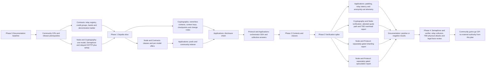

# Project plan — build Comuns in the open
Author: Comuns contributors
Status: Draft
Category: Technical Proposal
Created: 2026-10-12
**Reference:** [docs/project-charter.md](project-charter.md), [docs/architecture/system-architecture.md](architecture/system-architecture.md), [docs/architecture/deployment-and-decentralization.md](architecture/deployment-and-decentralization.md), [GOVERNANCE.md](../GOVERNANCE.md), [docs/adr/README.md](adr/README.md), [docs/cip/0001-adopt-baseline-adrs.md](cip/0001-adopt-baseline-adrs.md), [docs/risk-register.md](risk-register.md)

---

## 1 Summary

Comuns is a community proposal for open-source decentralized LLM inference with settlement on Arbitrum One. No protocol implementation runs yet; the repository includes documentation checker scripts. This plan orders future work by evidence and exit gates; it does not report completed implementation or authorize deployment, spending or mainnet operation. Each phase may stop at its gate. An experiment that publishes a negative result has done useful work; unsupported success claims cannot pass.

The community first reconciles the documents, then demonstrates anonymous credits and a single-node session through an independently operated relay on Arbitrum Sepolia, adds ownerless contexts and model-first client features there, investigates attested and verifiable modes and distributed execution separately, and requests external review before a go/no-go CIP. There is no delivery schedule or financial allocation. Comuns never claims to be cheaper than hosted APIs.

## 2 Scope

Scope is **inference only**: off-chain inference nodes, encrypted requests and responses, model and context registries, ETH settlement, model-first discovery, a reference dapp and SDK, and the community process for changing them. Arbitrum One Solidity/EVM is the proposed settlement target; Arbitrum Sepolia is the disposable test environment.

Training, fine-tuning and federated learning are non-goals. Other non-goals are inference inside contracts, a protocol token, v1 slashing, a mandatory orchestrator, an on-chain plan or pool registry, and authority for model outputs to take external actions. Stylus is not v1. Cross-operator sharding and cross-node speculative decoding are experimental Phase 3 spikes, not baseline delivery promises. The chain stores offers and sessions, never plans, pool lists or task assignments; context registry entries contain hashes and version metadata, never context content.

## 3 How the community builds this

Decisions land as CIPs under [GOVERNANCE.md](../GOVERNANCE.md) and [docs/cip/README.md](cip/README.md). ADRs remain proposed until their adopting CIP is Final: CIP-0001 for ADRs 0001–0009, CIP-0002 for ADRs 0010–0012 and CIP-0005 for ADRs 0013–0015; a later contradictory decision requires a superseding ADR. The lifecycle is Draft → Review → **14-day Last Call** → Final. Substantive edits during Last Call return a CIP to Review and require a fresh full Last Call; a CIP in Last Call cannot become Stagnant. The governing documents own the inactivity rules. Seating and removal occur only through a Final CIP. No maintainers are seated and no private authority is implied by assigning work here. ADRs 0016–0018 are proposed with no adopting CIP yet.

Issues and CIP comments on the Comuns-ai/documentation repository are the community channel. No private channel is created by this plan. Rough consensus is written down: specific objections, their disposition and the reason for accepting or deferring a change remain in the CIP. Review policy follows CONTRIBUTING.md. Working groups recommend and review; they cannot replace a CIP decision.

| Working group | Contribution paths |
|---|---|
| Protocol | Session and wire semantics, interoperability examples, failure cases and orchestration conformance. |
| Node | Rust node software, backend boundaries, model admission, small-machine setup and reproducible benchmarking. |
| Cryptography | Semaphore integration and OHTTP vectors, HPKE and context-key review, key lifecycle, disclosure boundaries and security analysis. |
| Contracts | Credit conservation, nullifier replay, relay separation, pull payments, registry events and settlement review. |
| Applications | Deposit screen, relay choice, privacy banners, SDK and dapp implementation, accessibility, recovery and client-side orchestration. |
| Documentation | Evidence, tutorials, newcomer issues, traceability, CIP records and clear privacy and cost language. |

The reference client is not the protocol. Other community clients are valid when they meet the accepted specification and its disclosure obligations. Code and documents use Apache-2.0, DCO sign-off and no CLA. Proposal rights never depend on hardware, stake or tokens; a class S operator and a high-performance provider have equal proposal rights, as does someone with no node.

A newcomer can read the charter and CONTRIBUTING.md, choose a requirement or failure case, describe a documentation flaw in an issue, join a working group publicly, and submit a focused contribution with its acceptance evidence. Documentation, UX and security review need no hardware purchase. Never put prompts, keys or seed phrases in issues, CIPs or reports. SECURITY.md owns vulnerability handling: until a monitored private channel exists, a public holding notice names only the component and the existence of a withheld report, without exploit details. Its private-channel gate applies before any software release, including a testnet software release; Phase 4 rechecks it rather than postponing it.

## 4 Principles

### Execution and prices

The node is Rust **off-chain**, initially using llama.cpp through bindings to **C/C++ kernels** (evidence register §3 [V]); Rust alone is no throughput claim. Any node may offer any registered model it can load. Classes price work; they do not gate models. Hardware classes S < M < L < X come from per-class benchmark bars; `maxTier` is separately informational, recording the largest tier benchmarked. Tiers partition manifest parameter counts: T0 ≤ 4B; T1 > 4B and ≤ 8B; T2 > 8B and ≤ 32B; T3 > 32B and ≤ 70B; T4 > 70B.

For every tier, input and output bands independently require the next class's floor to exceed the preceding class's ceiling. All forty directional band entries need adoption before mainnet, and so do the denomination ladder and RELAY_FEE_WEI; mainnet stays blocked while the price bands, the denomination ladder or RELAY_FEE_WEI are unset. This plan sets no wei values. Model registration and updates are governance-only through the timelock and CIPs; nobody seated means no mainnet registration. CIP-0004 (Draft) proposes testnet-only, non-normative Sepolia models and bands. On Arbitrum Sepolia, GOVERNANCE.md §7.1 applies; mainnet unchanged. Community measurements, not claims about language or equipment, must support useful participation.

### Confidentiality and consent

Anonymity and content privacy are separate promises. **Standard mode:** This node can read your prompt and your answer. It should not learn who you are. **Attested mode:** This node should not be able to read your prompt. A physical attack on the hardware can break that. Attested mode is optional and depends on the Phase 3 quote and measurement gate (evidence register §14 [V]/[L]). Inference runs only on network nodes; the client keeps transport, orchestration and sampling decisions, with no model computation. MPC/FHE remain future work outside this plan (evidence register §14 [V]/[U]).

Every job travels through a registered relay to the node's OHTTP gateway, with the inner HPKE envelope protecting ordinary jobs both ways. The reference client randomly selects a registered relay and displays that choice. Relay and node operators must be distinct; an address inequality cannot prove that they are independent entities. Session lookup, settlement and change monitoring, and witness/root queries use RPC or indexer backends tunnelled through a relay; an indexer never replaces that transport. No available relay means fail closed. Identifying content, size and the sourced timing attacks remain risks (evidence register §16 [V]/[L]), and stylometry remains a risk that the register lists as a researcher takeaway (evidence register §15 [U]); that chunked OHTTP lets the relay or gateway measure round-trip time is evidence register §15 [V]. Padding and batching reduce leakage without eliminating it.

Single-node execution is the default. Every multi-node feature — `collective_answer`, `parallel_planning`, `task_decomposition`, `model_sharding`, `cross_node_speculation` — and an optional orchestrator node require opt-in **per request**, recorded on a disclosure sheet before transmission or signatures. The sheet JSON is normative; displayed tables and banners are generated from it. Pick models and relay → see the sheet → confirm → authorize a credit spend → node submits `openSessionFromCredit`. Any change of node, model, data scope, price, cap or reader set, and every new session, requires a new sheet version and confirmation. Reusing a session for another request still needs that request's confirmed sheet.

The full-prompt reader list is a **floor derived from actual payloads**: executor; disclosed verifier; every collective answerer, reviewer and remote synthesizer; every planner, plan reviewer and remote plan synthesizer; both speculative draft and target; every shard holder; an orchestrator whenever it plans, merges or synthesizes; every merge node; any remote assessor or planner in any feature; and sub-task executors or reviewers unless the client verifies their payload contains no prompt text. Assume merge inputs quote the prompt. Count distinct nodes and distinct operators, without double-counting roles. `counts.fullPrompt` counts nodes literally sent the full prompt; `readersOfFullPrompt` conservatively includes recipients in every mode and is at least that count. The sheet also records `recipients[].operatorReadable`, `counts.operatorReadable`, `counts.attestedRecipients` and `anonymity` (transport, relay, funding and context linkage). Banners use `counts.operatorReadable`; an attested request fails closed unless every plaintext recipient is attested. A verifier added later is a new reader requiring new confirmation.

Conforming single-node flows deliver content only to the client and chosen node; opted-in multi-node flows disclose to exactly the nodes on the confirmed sheet, including shard holders treated as full-prompt readers. This describes authorized delivery, not an ability to stop a selected operator copying plaintext. Missing modes or unavailable confirmed recipients fail closed. Plans and intermediate answers are data, never authority over recipients, caps or actions. `sessionSigner` stays on the user's client in v1.

### Payment and recovery

Anonymous credits fund ETH session escrow, which uses chunked cumulative vouchers under the **one canonical EIP-712 Voucher type** in docs/protocol/contracts-and-settlement.md, including `outputCommitment`; this plan defines no variant. Protocol fee 0 is distinct from L2 gas. There is no token, no v1 slashing and no reversal of a signed voucher. Collective answers, scores and disagreement never affect payment.

Before prefill, the node signs an input receipt with `sessionId`, `jobId`, `jobInputTokens` and `cumulativeInputTokensAfter`. The client checks its pinned tokenizer and adds this job's input to the last **signed** cumulative count before signing. Unsigned receipts bind nobody and never enter later counts. Output receipts are sealed in response frames and count model-token text only. One job runs at a time per session; frame counters and session voucher counters stay separate. Identical frame or voucher retransmissions have no second effect. Closing vouchers cover only the acknowledged prefix, even if one further chunk was sent: that chunk is unpaid. `endOfJob` never means voucher `final`.

`commitKey` is a random session key generated by the client and sealed in the first job envelope, retained until settlement. The output transcript chains all jobs from zero; `outputCommitment = keccak256(commitKey ‖ sessionId ‖ seq ‖ transcriptHash)` uses that voucher's own `seq`. It is not checked on-chain, and opening the key discloses the session's output to its recipient. The node persists the key, transcript chain and highest voucher encrypted until settlement; per-job secrets have a separate lifecycle. Every job envelope is authenticated by the session's `sessionSigner`, including its encrypted response key and parameters; its signature binds chain, escrow, session, job, request, sheet version and encapsulation/ciphertext hash. Nothing that changes the job travels unauthenticated in the clear.

The four contracts have 23 state-changing function names, with signatures owned by [ADR 0011](adr/0011-anonymous-credits.md). The credit-holding `SessionEscrow` is non-upgradeable; governance parameters stay timelocked on mainnet. On Arbitrum Sepolia, GOVERNANCE.md §7.1 applies; mainnet unchanged. The wallet calls `depositNote` as a public deposit, then the client authorizes a spend with a fresh `sessionSigner` and the node submits `openSessionFromCredit`. Every deposit or change note uses a fresh Semaphore identity whose secret is stored durably before publication; `noteSeen` prevents commitment reuse across groups. SessionEscrow owns its per-denomination trees, nullifiers and root window and calls only the stateless Groth16 verifier, never the shared Semaphore `validateProof`.

On each credit-session redemption or cooperative close, `relayDelta = min(relayFeeWei, newSettled) − min(relayFeeWei, oldSettled)` credits `balances[relay]`, and `nodeDelta = payout − relayDelta` credits `balances[node]`. The normative/mainnet relay fee is unset and distinct from protocol fee 0; CIP-0004 (Draft) proposes its testnet-only, non-normative value. `closeWithVoucher` or `finalize` records `pendingWei = depositWei − settledWei`, including the full denomination for zero use; neither inserts a leaf. Anyone may submit a `sessionSigner`-authorized `claimChange` after settlement, without a deadline while `pendingWei > 0`. It mints fresh notes up to `MAX_CHANGE_NOTES` and credits residual dust to the node, then zeroes `pendingWei`. Greedy decomposition and the denomination-append compatibility check keep dust below the smallest denomination. Empty arrays are the dust-only branch. `claimChange` is the exception to a settled session accepting no further call. Redemption and cooperative close are legal while open or closing before `closeDeadline`; `finalize` is legal only while closing at or after it.

Per credit session, `nodeCredited + relayCredited + remainingLockedWei + pendingWei + mintedChangeValue = depositWei`; locked value is `depositWei − settledWei` while open or closing and zero after settlement, and node credits include dust exactly once. Pool-wide, `address(this).balance == Σ balances + Σ open/closing (depositWei − settledWei) + Σ pendingWei + Σ unspent note face value`. Only `withdraw()` sends ETH, after zeroing the caller's credited balance, with checks-effects-interactions and a reentrancy guard. A rejecting recipient cannot block settlement or other withdrawals.

The effective cap is `min(depositWei, maxSpendWei)`, equal to the denomination at credit-session opening. The client subtracts the highest **signed** cumulative amount, redeemed or not. Credit sessions reject `topUp`; an exhausted cap requires a fresh note and session with new confirmation. Request accounting includes settled spend, unpaid signed liabilities and unspent reservations within the combined confirmed cap; L2 gas is separate. The reference client has no wallet-funded `openSession` or `topUp` call site.

If a client disappears, the node redeems its highest non-final voucher while legal, calls `closeSession`, then anyone may `finalize` after `closeDeadline`. If the node is unavailable, a relay or broadcaster submits `closeSession` with the sessionSigner's EIP-712 close signature; the deposit wallet never submits that client recovery path. If both the node and signer key are gone, the session stays open. A lost voucher log means sign nothing further and close; a stolen signer can sign vouchers until settlement and, while pendingWei > 0, can still authorize claimChange. A lost note secret cannot be recovered by an administrator. `ragequit` consumes an unspent note proof and credits the caller only within that address's net deposits in the denomination group; it is public and linkable, and cannot distinguish deposit notes from change notes. An input voucher can be redeemed without inference running; the remedy is to stop signing and record a reputation event, with loss bounded by that prompt's input fee.

## 5 Document map

This map reproduces every path in the charter's section 5. A link records a destination, not a claim that its contents are accepted or complete. In particular, architecture, ADR and adoption-CIP destinations remain proposed; the model-first and opt-in decisions used here come from the protocol documents.

| Path | Purpose |
|---|---|
| [README.md](../README.md) | Entry point for the repository. |
| [LICENSE](../LICENSE) | Apache-2.0 license text. |
| [GOVERNANCE.md](../GOVERNANCE.md) | CIP process, working groups, decision rules. |
| [CONTRIBUTING.md](../CONTRIBUTING.md) | How to contribute; DCO sign-off. |
| [CODE_OF_CONDUCT.md](../CODE_OF_CONDUCT.md) | Community conduct rules. |
| [SECURITY.md](../SECURITY.md) | How to report vulnerabilities. |
| [MAINTAINERS.md](../MAINTAINERS.md) | Maintainer roles (none seated). |
| [docs/README.md](README.md) | Index of the documentation. |
| [docs/project-charter.md](project-charter.md) | This charter. |
| [docs/evidence-register.md](evidence-register.md) | External facts with marks [V]/[L]/[U]. |
| [docs/requirements.md](requirements.md) | Requirements traceability. |
| [docs/project-plan.md](project-plan.md) | Phases 0–4 and their exit criteria. |
| [docs/risk-register.md](risk-register.md) | Consolidated risks. |
| [docs/glossary.md](glossary.md) | Terms. |
| [docs/faq.md](faq.md) | Frequently asked questions. |
| [docs/landscape.md](landscape.md) | Comparison with other networks. |
| [docs/review-report.md](review-report.md) | Review of the document set. |
| [docs/architecture/system-architecture.md](architecture/system-architecture.md) | Components and flows. |
| [docs/architecture/deployment-and-decentralization.md](architecture/deployment-and-decentralization.md) | Deployment and decentralization limits. |
| [docs/deployments/arbitrum-sepolia.md](deployments/arbitrum-sepolia.md) | Unfilled record for deployment observations after CIP-0004 is Final; no deployment claimed. |
| [docs/protocol/contracts-and-settlement.md](protocol/contracts-and-settlement.md) | Contracts, sessions, vouchers. |
| [docs/protocol/off-chain-api.md](protocol/off-chain-api.md) | Client–node API. |
| [docs/protocol/orchestration.md](protocol/orchestration.md) | Client-side orchestrator, plans, waves, disclosure sheet. |
| [docs/protocol/collective-answers.md](protocol/collective-answers.md) | collective_answer and parallel_planning. |
| [docs/security/privacy-and-contexts.md](security/privacy-and-contexts.md) | Privacy modes, HPKE, contexts. |
| [docs/security/threat-model.md](security/threat-model.md) | Threats and mitigations. |
| [docs/security/inference-verification.md](security/inference-verification.md) | Verification options. |
| [docs/economics/cost-and-pricing.md](economics/cost-and-pricing.md) | Classes, tiers, bands. |
| [docs/economics/pricing-examples.json](economics/pricing-examples.json) | Non-normative pricing fixtures. |
| [docs/node/node-design.md](node/node-design.md) | Rust node design. |
| [docs/node/hardware-classes-and-benchmarks.md](node/hardware-classes-and-benchmarks.md) | Classes and self-benchmarks. |
| [docs/node/model-registry-and-licenses.md](node/model-registry-and-licenses.md) | ModelRegistry and model licenses. |
| [docs/node/distributed-execution.md](node/distributed-execution.md) | model_sharding and cross_node_speculation. |
| [docs/product/dapp-and-sdk.md](product/dapp-and-sdk.md) | Reference dapp and client SDK. |
| [docs/adr/README.md](adr/README.md) | ADR index. |
| [docs/adr/0001-settle-on-arbitrum-one-evm-not-stylus.md](adr/0001-settle-on-arbitrum-one-evm-not-stylus.md) | ADR 0001. |
| [docs/adr/0002-off-chain-rust-inference.md](adr/0002-off-chain-rust-inference.md) | ADR 0002. |
| [docs/adr/0003-hpke-and-the-executor-plaintext-limit.md](adr/0003-hpke-and-the-executor-plaintext-limit.md) | ADR 0003. |
| [docs/adr/0004-sessions-vouchers-and-no-slashing.md](adr/0004-sessions-vouchers-and-no-slashing.md) | ADR 0004. |
| [docs/adr/0005-hardware-classes-and-price-bands.md](adr/0005-hardware-classes-and-price-bands.md) | ADR 0005. |
| [docs/adr/0006-apache-2-0-and-dco.md](adr/0006-apache-2-0-and-dco.md) | ADR 0006. |
| [docs/adr/0007-no-protocol-token-in-v1.md](adr/0007-no-protocol-token-in-v1.md) | ADR 0007. |
| [docs/adr/0008-model-first-pools.md](adr/0008-model-first-pools.md) | ADR 0008. |
| [docs/adr/0009-opt-in-client-orchestration.md](adr/0009-opt-in-client-orchestration.md) | ADR 0009. |
| [docs/adr/0010-anonymous-by-default.md](adr/0010-anonymous-by-default.md) | ADR 0010: anonymous by default, relays, two content tiers. |
| [docs/adr/0011-anonymous-credits.md](adr/0011-anonymous-credits.md) | ADR 0011: anonymous credits and the 23-function list. |
| [docs/adr/0012-contexts-without-a-wallet-link.md](adr/0012-contexts-without-a-wallet-link.md) | ADR 0012: contexts without a wallet link. |
| [docs/adr/0013-repositories-toolchains-ci-and-releases.md](adr/0013-repositories-toolchains-ci-and-releases.md) | Proposed repository layout, toolchains, CI, DCO, style and testnet release gates; adoption proposed in CIP-0005. |
| [docs/adr/0014-relay-authentication-to-gateways.md](adr/0014-relay-authentication-to-gateways.md) | Proposed relay authentication per connection without a contract change; adoption proposed in CIP-0005. |
| [docs/adr/0015-node-key-possession.md](adr/0015-node-key-possession.md) | Proposed client key-possession probe before spending, without a contract change; adoption proposed in CIP-0005. |
| [docs/adr/0016-funding-edge-and-deposit-key.md](adr/0016-funding-edge-and-deposit-key.md) | Proposed ETH-only escrow with funding at the edge from the user's own account and a deposit key that can only call depositNote; no adopting CIP yet. |
| [docs/adr/0017-accounts-and-decentralized-access.md](adr/0017-accounts-and-decentralized-access.md) | Proposed core path with no hosted service, optional embedded wallets and social login, an independent note vault and an isolated funding surface; no adopting CIP yet. |
| [docs/adr/0018-one-client-stack.md](adr/0018-one-client-stack.md) | Proposed one TypeScript-over-Rust client stack for web, desktop and mobile; prover and store facts recorded, nothing selected; no adopting CIP yet. |
| [docs/cip/README.md](cip/README.md) | CIP process. |
| [docs/cip/0000-template.md](cip/0000-template.md) | CIP template. |
| [docs/cip/0001-adopt-baseline-adrs.md](cip/0001-adopt-baseline-adrs.md) | Draft CIP proposing adoption of the baseline ADRs. |
| [docs/cip/0002-anonymous-credits-relays-and-ownerless-contexts.md](cip/0002-anonymous-credits-relays-and-ownerless-contexts.md) | Draft CIP proposing adoption of ADR 0010–0012 and amendment of the closed function list. |
| [docs/cip/0003-bootstrap-first-maintainer-and-channels.md](cip/0003-bootstrap-first-maintainer-and-channels.md) | Draft bootstrap CIP; proposes seating the first maintainer and naming the private channels; seats nobody today. |
| [docs/cip/0004-sepolia-testnet-configuration.md](cip/0004-sepolia-testnet-configuration.md) | Draft CIP proposing testnet-only, non-normative configuration and model registration; mainnet unchanged. |
| [docs/cip/0005-phase-one-implementation.md](cip/0005-phase-one-implementation.md) | Draft implementation CIP proposing ADRs 0013–0015, completion gates and pre-code rechecks. |
| [pitch/pitch-deck.md](../pitch/pitch-deck.md) | Pitch deck source. |
| [pitch/pitch-deck.html](../pitch/pitch-deck.html) | Rendered pitch deck. |
| [scripts/check-pricing.py](../scripts/check-pricing.py) | Checks the pricing fixtures. |
| [scripts/check-docs.py](../scripts/check-docs.py) | Checks document conventions. |
| [scripts/check-deck.py](../scripts/check-deck.py) | Checks the pitch deck. |
| [scripts/check-dco.py](../scripts/check-dco.py) | Checks DCO trailers on every commit in a pull-request range, including merges. |

## 6 Phases in relative order

Entry and exit evidence belongs in public, secret-free issue or CIP records. Work packages describe future work, not actions authorized by this document. Software publication is subject to SECURITY.md and governance seating in every phase. A dependent phase cannot bypass an unmet exit gate by relabeling it complete.

### Phase 0 Documentation baseline

**Entry:** the charter, requirements, evidence and source specifications are available for community review.

| Working group | Work package |
|---|---|
| Protocol | Reconcile identifiers, phase boundaries and requirement traceability; record unresolved wire semantics. |
| Node | Review backend, class and model-offer boundaries; identify the small-model measurement target. |
| Cryptography | Review anonymity versus content privacy, Semaphore integration, OHTTP vectors, context keys and the reader floor. |
| Contracts | Review pull payments, cumulative accounting, governance-only registration and unset bands. |
| Applications | Map model choice, single-node consent and later multi-node disclosure to client acceptance cases. |
| Documentation | Establish the full map, consolidate this plan and register, prepare CIP-0001 as Draft and newcomer issue paths. |

**Exit:** the document map exists, CIP-0001 is **Draft**, and the public **bootstrap CIP [CIP-0003](cip/0003-bootstrap-first-maintainer-and-channels.md)** (Draft) naming the first maintainer, the enforcement contact and the monitored private security channel has reached Final under GOVERNANCE.md §6 — the only path to seating, and required before any merge or software release in any later phase, because GOVERNANCE.md §6 forbids merging or releasing before seating and SECURITY.md §3 makes the monitored private channel a release gate. Neither these assignments nor the map seats anyone: only that Final CIP does, and nobody is seated today. This exit accepts no ADR and authorizes no mainnet. CIP-0003 acknowledges PRs #1–#3 and this PR as pre-authority acts; it grants no retroactive merge authority. Its Draft seats nobody, and the repository owner’s administrator rights are not governance authority.

### Phase 1 Sepolia slice

**Entry:** Phase 0 exit evidence exists; the community has recorded the implementation decision and governance authority needed for its actions. The **Sepolia CIP [CIP-0004](cip/0004-sepolia-testnet-configuration.md)** (Draft; Requires: 0002, 0003, 0005) proposes the disposable testnet configuration, governance-only model registration and **testnet-only bands and a testnet-only ladder of at least two denominations**, all explicitly non-normative and with values unset here. The ladder must pass the `MAX_CHANGE_NOTES` compatibility check; relevant bands and credit parameters must be initialized before `openSessionFromCredit` is tested. No production values are inferred. Proposed [ADR 0013](adr/0013-repositories-toolchains-ci-and-releases.md) and Draft [CIP-0005](cip/0005-phase-one-implementation.md) own the release order in ADR 0013 (6): CIP-0003 Final and MAINTAINERS.md updated; private vulnerability reporting switched on and its date recorded (this plan does not claim it is on); CIP-0002 Final; CIP-0005 Final with the pre-code rechecks written up; code built and tested; CIP-0004 Final; deployment and setters immediately afterward; the deployment record filled; a `v0.y.z` testnet pre-release tagged; an independent person runs the Phase 1 walkthrough. The deployment observations belong in [the Sepolia record](deployments/arbitrum-sepolia.md).

The slice is **single-node**, one Rust node and **one Apache-2.0 or MIT model small enough for class S**, anonymous standard mode through a relay with a distinct operator, anonymous credits, chunked vouchers and change. It includes four contracts with 23 function names, relays registered in NodeRegistry and Semaphore groups inside SessionEscrow. It has **no contexts, no attested mode, no verifiable mode, no multi-node feature and no wallet `openSession` demo**. Minimal single-node disclosure, relay choice and the standard-mode banner are required before authorizing the spend.

| Working group | Work package |
|---|---|
| Protocol | Specify and exercise one authenticated job stream, input receipt, chunk receipts, counters, reconnect and both close paths. |
| Node | Implement the Rust adapter to llama.cpp kernels, one-model admission, metering and encrypted persistent session records. |
| Cryptography | Check Semaphore integration and OHTTP vectors, fresh note identities, root-window and proof binding, two-way HPKE, sessionSigner envelope authentication, sealed response keys and no plaintext logging. |
| Contracts | Implement the registries and non-upgradeable SessionEscrow; test the credit invariant, nullifier replay, commitment reuse, `relay == node` revert, price binding, ordered bands, cap arithmetic, monotonic vouchers, relay split, change/dust, zero-use return, ragequit bounds, relay bond release and pull withdrawals. |
| Applications | Provide the deposit screen with durable note backup, relay choice, an anonymity-set warning reporting the observed group size without a numeric threshold (RR-39 remains open), and privacy banners; add local tokenizer checks, Stop, signed-total cap tracking, relayed reads, close and `claimChange`. |
| Documentation | Write a repeatable testnet walkthrough, distinguish credits from ETH withdrawal, record failures and invite an independent reproduction. |

**Exit:** someone other than the author completes **one Sepolia standard-mode paid session through a relay with a distinct operator**: `depositNote`, node-submitted `openSessionFromCredit`, checked input and chunk receipts, cumulative vouchers, `closeWithVoucher`, node `withdraw()` and `claimChange` of the remainder into at least one smaller note plus dust. The same independent walkthrough also demonstrates a zero-use session settled and claimed back in full with a fresh note identity, and `ragequit` of an unused note within the caller’s net deposits in its group. Record the receipt/voucher sequence and accounting evidence without prompts or secrets. State-machine, replay, credit conservation, reentrancy, band, EIP-712 conformance, recovery and withdrawal checks pass, including abandoned-client recovery and a simulated delayed-inbox submission; no second content reader or unsupported feature is needed.

### Phase 2 Contexts and classes

**Entry:** Phase 1 passes; context, class-benchmark and client-feature proposals are reviewed. A testnet CIP revises the non-normative bands from measurements, preserving all class ordering and model eligibility rules.

All work stays on Sepolia. Add ownerless contexts with independent context signing keys and key re-wrap, the full change-note vault and recovery UX beyond Phase 1’s required change demonstrations, the class benchmark, the reference dapp matching docs/product/dapp-and-sdk.md, a community indexer, **per-model offers and pools**, the full **disclosure sheet**, and the **client-side orchestrator** with `task_decomposition`, `collective_answer` and `parallel_planning` as specified in docs/protocol/orchestration.md.

| Working group | Work package |
|---|---|
| Protocol | Freeze interoperable request/sheet and DAG validation cases, unique task output names, serial jobs within a session, concurrent work across sessions and fail-closed replanning. |
| Node | Run class and per-model benchmarks; publish `prices[modelId]` with `modelBenchmarkHash`; exercise the same model on different classes and replace-all offer clearing. |
| Cryptography | Exercise random per-version context keys, exact-range re-wrap, context-key-signed grants, ciphertext backup availability, accepted-head checkpoints, rotation keyrings, actual-payload reader counting and sealed intermediate results. |
| Contracts | Exercise broadcaster-submitted ownerless `setContext`, ContextSet history, version-race reverts, change-note reuse prevention, revised bands, offer replacement/removal and expected-price reverts; keep plans and pool lists off-chain. |
| Applications | Build the reference dapp, optional community-indexer integration, model-first pool enumeration without a class-to-tier gate, sheet JSON rendering and orchestrator SDK; implement all three opt-in features, caps, session-pair indexing and recovery. |
| Documentation | Publish class results and newcomer instructions; review the plaintext banner, the table generated from the disclosure sheet, the collective disagreement view and consent records with independent users. |

Context gates follow [ADR 0012](adr/0012-contexts-without-a-wallet-link.md): `contextId = keccak256(contextPubKey)`, an independent context signing key, fresh random encryption keys per version, signed head chains, grants wrapping only requested versions and `expiresAt` in unix seconds. One wallet’s one-to-many context-key list stays in its encrypted vault and backup, without a wallet link in grants or registry records. The default host is trusted for sequencing as well as availability; compare-and-swap conflicts require explicit rebase. Persist accepted-head checkpoints in the vault and backups and reject rollback behind them. An unanchored host can equivocate between unsynced devices, and a stale backup cannot detect a newer head until synchronization. A globally consistent multi-device head requires a broadcaster-submitted anonymous public `setContext` anchor and its event history. Backups contain context keys, checkpoints and wraps, not blobs; demonstrate restore with available ciphertext from a host or second device. A node retains every HPKE key used by an unsettled session. Context uploads default to inline ciphertext; optional URL fetching must satisfy the off-chain API's public-address, redirect, size and timeout restrictions after authentication.

The SDK keeps `sessionSigner` locally. Every paid inference recipient has its own credit-funded session, reached through a relay. One session is keyed by `(node, modelId)`; parallel tasks on the same pair need separately disclosed sessions. New sessions, changed readers and new requests require new sheet confirmation. Wire roles use exactly the privacy document's canonical tokens: `executor`, `planner`, `answerer`, `reviewer`, `synthesizer`, `merge`, `orchestrator`, `shard holder`, `draft`, `target`, `verifier`. An assessor uses `planner`; `planId`, `taskId` and `role` are AAD-bound, while `wave` is advisory and nodes must not rely on it. A collective answer uses stable anonymous answer IDs across position-swapped reviews, shows splits and originals, and leaves signed vouchers standing. Different review-pass scores do not mean incomplete synthesis; only missing or malformed required fields do, and an empty splits list is valid. Parallel planning includes its disclosed non-blind objection round and user confirmation before execution.

**Exit:** **two independent operators in two classes**, with **one model offered by nodes of two different classes**. Someone other than the author completes **one collective answer and one decomposed plan on testnet**, each preceded by a confirmed disclosure sheet, with signed vouchers standing. Also demonstrate parallel planning's confirmation gate, ownerless context re-wrap, checkpoint rollback rejection, anchored multi-device consistency and restore with available ciphertext, change-note recovery, pool clearing, no-quote handling, aggregate cap enforcement and sheet-to-envelope conformance. No distributed-execution spike is a prerequisite.

### Phase 3 Verification spike

**Entry:** Phase 2 passes. Separate spike proposals state supported backends, measurements, disclosure boundaries and acceptance thresholds before experimental runs. Each distributed-execution spike must resolve its own wire and authentication gaps first; entry to one does not establish readiness for another. Testnet-only, non-normative prices remain mandatory.

| Working group | Work package |
|---|---|
| Protocol | Specify deterministic re-execution cases; separately gate sharding compatibility/recovery and speculative round frames, without expanding v1 contracts. |
| Node | Measure verifiable-mode and attested-mode candidates; independently implement or reject the `model_sharding` and `cross_node_speculation` adapters. Measure each spike against a single node of the same class running the same model: sharding against that one node, cross-node speculation against the target node alone. A comparison with co-located speculation is reported as an extra, never as the speed-up baseline. |
| Cryptography | Check disclosed-verifier privacy, the attested quote path and binding of both gateway and job keys; assess activation inversion, relayed OHTTP holder authentication and speculative envelope isolation. |
| Contracts | Confirm token-metered credit settlement and the relay split; no sessions or vouchers for any shard holder; inspect speculative testnet accounting and refuse any activation-meter assumption. |
| Applications | Expose testnet-only experimental opt-in, full reader sheets, client-mediated stage/round transport and measured cap handling; refuse both experimental features under mainnet parameters. |
| Documentation | Publish TEE overhead, padding/batching effects, relay latency and opt-in anonymity-set telemetry, configurations, uncertainty and negative results separately for each spike; make no WAN or quality promise. |

Verifiable mode is **re-execution by a user-chosen second node under a demonstrated deterministic profile**. Temperature zero alone is insufficient (evidence register §5 [V]). The verifier reads the prompt and must be disclosed before signing. Candidate activation commitments may go through the client to that disclosed verifier only; they do not replace re-execution. The on-chain mode is public, so mode-2 checks cover only mode-2 sessions. Opt-in, unannounced client-side spot checks of standard-mode sessions add a disclosed reader. Cross-node speculation is incompatible with verifiable mode (evidence register §9 [V], §5 [V]). Attested mode belongs in Phase 3: the client checks quote freshness, accepted measurements and binding to both the OHTTP gateway key and job HPKE key before sealing. Measure TEE time-to-first-token and throughput overhead against the same configuration without confidential computing; evidence register §14 [V] reports independent overhead measurements, while its vendor figures are [V, vendor], neither a Comuns result. Record padding and batching costs, relay latency and opt-in aggregate anonymity-set telemetry without exposing note-to-session links. Include the physical-attack limit; no failed mode is advertised.

For **model_sharding across operators**, every holder, including embedding and output-layer nodes, is an unpaid volunteer full-prompt reader with **no session, no voucher and no payment**, exempt from the paid-recipient credit-session rule. The sheet must list non-session readers (node, operator, layer range and received activations) before the spike can run. Embedding and output-layer computation runs on disclosed network nodes; the client keeps transport, orchestration and sampling decisions only. Activations to each holder travel through a relay, OHTTP-encapsulated to that holder's registered `ohttpKeyConfig`, with no inner job HPKE envelope and no direct client-to-holder path. Partition compatibility and replay semantics must be resolved before the spike. Default failure recovery restarts generation on a new confirmed chain; measure replay to a disclosed replacement using cached stage inputs, with its latency, storage and privacy costs. Never expose llama.cpp RPC on an open network (evidence register §10 [V]).

For **cross_node_speculation**, one job per session on each draft/target node spans all rounds. Request frames carry accepted tokens and a rollback point; the draft rolls its cache back before drafting again. The prompt is input-billed once per job, never each round. Draft probability distributions travel as sealed metadata, never billable output tokens; alternatively narrow the spike to greedy decoding with its own measured determinism. The greedy-decoding exact-match check counts a mismatch as a preservation failure only outside the measured run-to-run variation of that target build (evidence register §5, [V]: 80 unique outputs in 1,000 temperature-0 runs without batch-invariant kernels); a byte-identical claim is never accepted without that measurement. Tokens alone outside that narrowed case do not establish distribution preservation. Bound each round by `MAX_DRAFT_TOKENS`; measure draft tokens including rejected drafts and target billing for drafted tokens scored. Receipt details, correction-token accounting and round-frame semantics must be resolved before paid testnet measurements, without inventing an activation meter. No WAN speed-up is promised: cross-node speculation is measured against the target node alone (a single node of the same class running the target model), a co-located draft comparison is only an extra report, and the networked preprint's co-located baseline is not the baseline the spike uses (evidence register §9, report [V], result not independently replicated [U]).

Delegating `sessionSigner` to an orchestrator node and activation metering require dedicated later CIPs; neither is authorized by entering or completing Phase 3. A positive spike alone cannot enable mainnet use of either distributed feature.

**Exit:** publish a demonstrated check or a negative result separately for attested and verifiable mode; each remains disabled unless its own gate passes, and standard mode remains available if both fail. Publish the TEE overhead, padding/batching, relay-latency and anonymity-set reports, or explain which measurements could not run. Each distributed spike independently produces its measured result or a documented reason it could not be built or run. A negative result for sharding or speculation does not disable collective answers or decomposition. A false success is not allowed.

### Phase 4 External review

**Entry:** preceding exit records, including negative results, are available; the intended release surface is explicit; blocking rows in docs/risk-register.md have closure evidence or an enforced feature exclusion. Governance and SECURITY.md publication prerequisites already apply.

| Working group | Work package |
|---|---|
| Protocol | Assemble conformance and failure evidence for reviewers who did not write the protocol components under review. |
| Node | Reproduce admission, class, recovery and engine-boundary results; identify experimental code excluded from release. |
| Cryptography | Arrange independent Semaphore-integration and Groth16-verifier review, relay-collusion review and TEE physical-attack review; resolve findings and state remaining anonymity and content-privacy limits (evidence register §14–§16 [V]/[L]/[U]). |
| Contracts | Arrange review by people who did not write the contracts; reproduce credit conservation, nullifier/root-window handling, pull-payment and outage handling; confirm immutable SessionEscrow and resolve the other contracts’ upgrade authority and mainnet parameter prerequisites, including the bands CIP with all forty directional entries, the denomination ladder and RELAY_FEE_WEI, and the mainnet models CIP; mainnet stays blocked while the price bands, the denomination ladder or RELAY_FEE_WEI are unset. |
| Applications | Reproduce dapp consent, accessibility, signed-liability accounting, lost-log close and fail-closed behavior using the reviewed release surface. |
| Documentation | Coordinate model-license review, confirm LICENSE unchanged from canonical Apache-2.0 text, recheck the monitored private security channel, arrange a legal-facts review using evidence register §16 [V]/[L]/[U] (not legal advice; regulatory classification UNVERIFIED), and prepare the public go/no-go record. |

**Exit:** Semaphore integration and verifier, relay collusion, TEE physical attacks and legal facts have explicit review records; external findings and responses are published without secrets; model licenses and canonical LICENSE are confirmed; a monitored private security channel exists under seated governance; and a **go/no-go CIP for Arbitrum One** reaches Final under GOVERNANCE.md, recording remaining risks and prerequisites. A no-go is a legitimate outcome. **This plan authorizes no mainnet**: a future Final CIP and its governing execution safeguards would be separate authority, never inferred from a milestone or testnet demonstration.

## 7 What v1 means

V1 means anonymous single-node standard-mode inference by default, a Rust off-chain node, relayed OHTTP with two-way inner HPKE, and anonymous-credit-funded ETH session escrow with enforced ordered bands for every `(tier, class)` pair, chunked vouchers, pull payments, protocol fee 0, no token and no slashing. At least one tier must be demonstrated runnable on modest hardware; this is a release condition, not an established minimum today. Code and docs are Apache-2.0 with DCO and no CLA.

Model-first pools allow any node to offer any registered model it can load, with a per-model benchmark; neither class nor `maxTier` gates model eligibility. The chain records offers and sessions, never plans or pool lists. The client-side orchestrator supports opt-in, disclosed `collective_answer`, `task_decomposition` and `parallel_planning`; optional orchestrator nodes take ordinary planner-model sessions, no cut and no client signer. All reader and payment rules of section 4 apply. Standard-mode content is readable by the chosen node, which should not learn who asked; multi-node authorized recipients are exactly those on the sheet, with shard holders treated as full-prompt readers and recipient copying remaining a stated limit.

Collective answers are not verification and never affect payment. When a strong model is available, suggest self-consistency for short checkable answers or Self-MoA for free text first; the user may still choose a collective answer. Never apply plurality voting to free text (evidence register §11 [V]). Decomposition stays optional and is not the default recommendation for math, coding, Fermi or tight writing tasks (evidence register §12 [V]).

`model_sharding` and `cross_node_speculation` are explicitly excluded unless Phase 3 succeeds, and success is **necessary, not sufficient** for any later inclusion: v1 mainnet parameters still cause the reference client to refuse both. Shard holders never receive sessions or payments under this plan. Any later change requires its own CIP, including metering where needed. Optional attested or verifiable modes exist only for configurations that pass their separate gates; failed spikes leave standard mode available without pretending to meet stronger confidentiality or integrity requirements.

## 8 Dependency graph

Arrows mean required evidence or work-package dependencies, not elapsed time. Each branch returns a report even when its result is negative.

## 9 Milestone table

Each milestone is proposed and uncompleted. The owning group coordinates evidence; ownership is not private decision authority.

| Milestone | Deliverable | Owning working group | Exit criteria | Spec path from the document map |
|---|---|---|---|---|
| Documentation baseline | Map, traceability, Draft CIP-0001 and a Final bootstrap seating CIP (CIP-0003, Draft) | Documentation | Every charter path mapped; adoption still Draft; CIP-0003 naming the maintainer, enforcement contact and private security channel is Final before any authorized merge or software release; prior acts grant no authority | docs/project-charter.md; docs/cip/0001-adopt-baseline-adrs.md; docs/cip/0003-bootstrap-first-maintainer-and-channels.md; GOVERNANCE.md; SECURITY.md |
| Sepolia payment slice | Four contracts, 23 functions, relays, credit groups, testnet bands and at least two denominations | Contracts | Independent standard-mode relay session: deposit, node-submitted credit open, vouchers, close, node withdrawal, smaller change note plus dust; zero-use full return, ragequit and credit invariant pass | docs/protocol/contracts-and-settlement.md |
| Single-node runtime | Rust node and one small permissive model | Node | Authenticated standard-mode job through a distinct relay operator, checked receipts and recovery | docs/node/node-design.md; docs/protocol/off-chain-api.md |
| Context portability and change vault | Ownerless contexts, context keys, per-version encryption, checkpoints, re-wrap, change notes and backup | Cryptography | Context-key grants, rollback rejection, anchored multi-device consistency and restore with available ciphertext pass | docs/security/privacy-and-contexts.md |
| Classes | Class benchmark and per-model results | Node | Independent operators in two classes; same model served across classes | docs/node/hardware-classes-and-benchmarks.md; docs/economics/cost-and-pricing.md |
| Pools | Model-first offers, enumeration and community indexer | Protocol | No class-to-tier gate; clear events remove offers; thin/stale pools visible | docs/protocol/contracts-and-settlement.md; docs/node/model-registry-and-licenses.md; docs/adr/0008-model-first-pools.md |
| Disclosure sheet | Normative sheet JSON and generated consent UI | Applications | Actual recipients/readers and signed prices match; changes require reconfirmation | docs/security/privacy-and-contexts.md; docs/product/dapp-and-sdk.md |
| Orchestrator SDK | Client-side assess, DAG, waves, review and merge | Applications | Independent disclosed decomposed plan; session-pair and cap checks; signer remains local | docs/protocol/orchestration.md; docs/adr/0009-opt-in-client-orchestration.md |
| Collective answers | Independent answers, blind reviews and disagreement view | Applications | Independent testnet collective answer; stable IDs; signed vouchers stand | docs/protocol/collective-answers.md |
| Parallel planning | Plans, critiques, synthesis and objection round | Protocol | User confirms before execution; no rank dispatches automatically | docs/protocol/collective-answers.md; docs/protocol/orchestration.md |
| Verification and attestation | Separate backend and attested quote/TEE overhead reports, padding, relay latency and anonymity-set telemetry | Cryptography | Quote binding to both keys, measured overhead and physical-risk disclosure; demonstrated check or published negative result | docs/security/inference-verification.md |
| Sharding spike | Relayed volunteer layer chain with network embedding/output nodes | Node | Measured against a single node of the same class running the same model, or a negative result; all holders disclosed and unpaid | docs/node/distributed-execution.md |
| Cross-node speculative-decoding spike | Testnet draft/target round and accounting report | Node | Measured against the target node alone (a single node of the same class running the target model); a co-located draft comparison is an extra report, not the baseline; or a negative result; no WAN promise; no mainnet path | docs/node/distributed-execution.md |
| External review and decision | Findings, license confirmation, channel readiness and go/no-go CIP | Documentation | Independent Semaphore integration/verifier, relay-collusion, TEE physical-attack and legal-facts reviews; release blockers addressed; no authority inferred | SECURITY.md; GOVERNANCE.md; LICENSE; docs/risk-register.md |

## 10 Participation measures

The community reports reproducible attempts and failures, not an assumed supply of operators. Small-model operators and high-performance providers are both tested on the public class benchmark and, where loadable, the same registered model. Publish class bars separately from model tiers; record memory fit, context length, backend/build, tokenizer and quantization. Measure time to first token, single-stream decode and aggregate batched throughput separately. No result changes proposal rights.

For the modest-hardware path, demonstrate at least one useful small-model session and its settlement/recovery on class S before calling that path usable. For higher-performance providers, measure batching, capacity, operating-cost assumptions and willingness to keep an offer inside the ordered band. Floors may prevent an efficient provider quoting a lower price; report withdrawn offers and empty pools as evidence for a CIP, not as a reason to break a band. Neither path promises competitiveness with hosted APIs (evidence register §6 supplies separately marked [V], [L] and [U] snapshots, not Comuns measurements).

Phase 2 records independent operators, classes present, a shared model across classes, offer freshness, admission failures, no-quote cases and independent client completion. Optional spot re-benchmarks use a private, rotating prompt set at random times, never the public self-benchmark prompts; these remain fallible measurements, not unfakeable hardware proof. A standard-mode spot check that re-runs a user's prompt elsewhere requires opt-in and disclosure of that reader. Community participation also includes successful newcomer documentation/UX contributions and publicly resolved review objections; no attendance or equipment threshold is imposed.

## 11 Time-sensitive assumptions to re-check before implementation

Dated research rechecks are now recorded in Draft [CIP-0005](cip/0005-phase-one-implementation.md) with their residuals, and are distinct from the implementation and release checks that remain pending. Proposed [ADR 0013](adr/0013-repositories-toolchains-ci-and-releases.md) assigns the engineering and release gates; CIP-0005 owns the recorded rechecks and exact version pins. Its five pre-code rechecks cover Stylus/EVM, chunked OHTTP, Semaphore artifacts, model/dependency licenses, and the RFC 7748, 9180 and 9458 readings used by ADRs 0014 and 0015. Those records were written into CIP-0005 on 2026-10-15 with their residuals (evidence register §1, §4, §7, §8 and §15, recheck blocks); the residuals must be accepted by review, and CIP-0005's other open rows including the exact pins must close, before CIP-0005 is Final and before protocol code starts; the Phase 4 legal-facts checks remain later gates.

| Assumption | Recorded basis | Required re-check |
|---|---|---|
| Stylus pause | New activations paused since **2026-10-02**, no reopening recorded; evidence register §1 [V] | Rechecked 2026-10-15: still paused, no reopening date, One on ArbOS 61 (evidence register §1, recheck 2026-10-15, [V]); solc evmVersion guidance was not found in the sources examined on 2026-10-15 [U]; no evmVersion is set; a reopening does not change the EVM v1 decision without a CIP. |
| Fee snapshot | **Arbiscan, 2026-10-13**; evidence register §1 [V] for the recorded fees, [U] for the derived transfer estimate | Measure actual escrow, withdrawal, failed-open and multi-session costs; no current fee is inferred from a transfer snapshot. |
| Crate and backend versions | Engine/binding snapshots in evidence register §3 [V]; HPKE crate snapshot in §4 [V] | Recheck maintained releases, supported kernels, cipher-suite behavior and reproducibility; pin versions only in CIP-0005 after its rechecks. Observed versions of 2026-10-15 are recheck inputs, not pins. |
| Chunked OHTTP draft | Streaming draft -08 at the IESG in the 2026-10-13 snapshot; evidence register §15 [V] | Rechecked 2026-10-15: draft -08 approved, in the RFC Editor queue, blocked on references, no RFC number [V] (evidence register §15, recheck 2026-10-15); the off-chain API now uses non-interactive per-message exchanges with streamed responses (its section 3); independent interop is a release gate. Do not label the draft a final RFC. |
| Semaphore second ceremony | The production artifacts come from the 2025 Binary Merkle Root Fix ceremony [V]; its participant count, close date and final beacon were not found in the sources examined on 2026-10-15 [U]; per-file artifact hashes were not found in the sources examined on 2026-10-15 [U]; the artifact repository is archived [V] (evidence register §15, recheck 2026-10-15) | Deployment vendors the artifact files, computes and records its own hashes and key-point comparison (CIP-0004 Verifier item); RR-41 and RR-50 record the residuals. |
| Standards readings for relay authentication and node-key possession | RFC 7748, RFC 9180 and RFC 9458 readings in ADRs 0014 and 0015; confirmed in evidence register §4 (recheck 2026-10-15) | Confirmed 2026-10-15 from the primary standards: X25519 is Diffie–Hellman with no signature scheme [V]; RFC 9180 export on both contexts in base mode [V]; RFC 9458 response key by Export then Extract with salt concat(enc, response_nonce) [V], the combined client-and-gateway conclusion [L]; recorded in CIP-0005 and ADR 0015; conformance vectors remain release gates. |
| AMLR applicability | Application from **10 July 2027**, evidence register §16 [L]; Article 79(1) text [V] | Recheck the recorded legal facts for Phase 4; classification remains UNVERIFIED, not legal advice. |
| Storm proceedings | Retrial set for **26 April 2027** in evidence register §16 [V] | Recheck the docket and motion/retrial status for the Phase 4 legal-facts review; no legal conclusion is inferred. |
| Model and dependency licenses | Model snapshots in evidence register §7 with their original marks; project licensing context in §8 [V/L] | Rechecked 2026-10-15: dependency licenses and candidate T0 files recorded (evidence register §7 and §8, recheck 2026-10-15); no model selected; GPL-3.0 tooling is review item RR-50, no legal conclusion; the exact manifest file is CIP-0004's open item; LICENSE comparison against canonical Apache-2.0 stays a Phase 4 check. |

## 12 Risks

### R1 — Nobody contributes **[RISK] · High**

Community capacity is UNVERIFIED. Keep entry issues small, publish reproducible failure cases and permit the work to stop visibly at a gate. Documentation owns participation evidence; no capacity is assumed (RR-15).

### R2 — The first slice is too large **[RISK] · High**

A broad client or registry implementation can overwhelm the single-session proof. Protocol keeps Phase 1 to the named disposable path and required safety invariants; wider UX and orchestration remain Phase 2. Publish a blocked gate rather than dropping authentication or accounting checks (RR-05, RR-34).

### R3 — Public privacy overclaim **[RISK] · High**

Anonymity can be mistaken for content privacy or a guarantee against identifying prompt text. Standard-mode nodes can read content but should not learn who asked; attested nodes should not be able to read the prompt either, barring a physical attack (evidence register §14 [V]/[L]). Cryptography and Applications disclose relay collusion, timing and content identification, recipient copying and the extra reader added by verification (evidence register §16 [V]/[L]; RR-01–RR-03, RR-19).

### R4 — Floors deter high-end operators **[RISK] · High**

Ordered floors may make a batched provider's small-model offer unattractive. Node measures actual participation and empty pools; Contracts changes no adopted band without a CIP. Economic viability remains UNVERIFIED (RR-13, RR-23).

### R5 — Stylus confusion **[RISK] · Medium**

Rust can be mistaken for on-chain execution. Documentation repeats off-chain Rust, C/C++ kernels and Arbitrum One EVM; pause re-checks do not silently change v1 (RR-16). The pause was rechecked on 2026-10-15 (RR-16).

### R6 — No seated maintainers **[RISK] · High**

No one has merge, release or timelock authority today. Documentation coordinates a public bootstrap CIP; a Final decision and monitored private security channel are prerequisites for software publication, not presumed resources (RR-14, RR-15).

### R7 — Orchestration creeps into Phase 1 **[RISK] · High**

Applications keeps Phase 1 single-node with one model and standard mode. Phase 2 owns pools, the full disclosure sheet and orchestration acceptance; a first-slice demonstration cannot depend on fan-out (RR-25, RR-37).

### R8 — Experiments become v1 promises **[RISK] · High**

Protocol keeps sharding and speculation as separate testnet spikes with mainnet refusal and published-negative-result exits. A positive result alone is not a feature-adoption CIP (RR-21, RR-22, RR-36).

### R9 — Activation inversion **[RISK] · High**

Activations can reveal prompts (evidence register §10 [V]). Every shard holder is a reader, including holders never sent prompt text. Cryptography requires explicit disclosure and measures the client-mediated path without claiming a privacy defense (RR-21).

### R10 — k-times cost expands further **[RISK] · High**

Repeated answers, review, synthesis, retries and session transactions amplify cost; k answer generations are only part of the bill. Applications shows actual aggregate caps, signed liabilities and separate gas. Evidence register §11 [V] records cases of increased cost with reduced quality, not a universal multiplier (RR-07, RR-20, RR-26).

### R11 — An orchestrator node sees the prompt **[RISK] · High**

Remote planning, merging or synthesis adds a reader and influence over the plan. Applications keeps it optional, disclosed and paid only for its ordinary inference session, holding no `sessionSigner`. The client validates outputs as data (RR-27, RR-37).

### R12 — Forty unset band entries **[RISK] · High**

Five tiers × four classes × input/output leave forty directional bands without adopted values; the denomination ladder and RELAY_FEE_WEI are also unset, and mainnet stays blocked while any of them is unset. Contracts requires a complete ordered table before mainnet and a separate non-normative Sepolia configuration for the slice. An unset pair means pending governance, never a class-to-tier prohibition (RR-28).

### R13 — Small or correlated anonymity sets **[RISK] · High**

A denomination group can be small, and timing, change amounts or common operators can reduce the effective anonymity set. No authoritative minimum is established (evidence register §15 [U]). Applications shows observed group sizes and warnings without equating a leaf count to independent users; Phase 3 measures aggregate telemetry and Phase 4 reviews relay collusion (evidence register §15–§16 [V]/[L]/[U]).

### R14 — Trusted setup and verifier integration **[RISK] · High**

Groth16 depends on the setup and the exact circuit/key artifacts (evidence register §15 [V]); the production artifacts come from the 2025 Binary Merkle Root Fix ceremony [V]; its participant count, close date and final beacon were not found in the sources examined on 2026-10-15 [U] (evidence register §15, recheck 2026-10-15). A wrong binding, root window or nullifier integration can break credits despite a sound primitive. Contracts keeps trees and nullifiers inside SessionEscrow and uses only the stateless verifier; Phase 4 requires independent integration and verifier review. No upstream audit claim transfers to the Comuns wrapper.

## 13 Open questions

- Which implementation and bootstrap CIPs establish executable authority while keeping CIP-0001's documentation-baseline exit at Draft? proposed: CIP-0003 seats process authority; CIP-0005 is the implementation CIP; neither marks CIP-0001 Final.
- Which exact permissively licensed small model and pinned tokenizer support the class benchmark, and what measured bars distinguish classes without becoming tier gates?
- What full ordered band table supports both modest-hardware participation and willing high-performance providers?
- Which deterministic profiles and attestation configurations, if any, merit availability after Phase 3? What constitutes a sufficient published negative result?
- What shard-chain partition format, replay-cache policy and compatible backend interface can the relayed OHTTP spike demonstrate?
- Which conformance cases establish that the sheet lists every unpaid shard reader, including embedding and output-layer nodes, before relayed activations are sent? The spike stays blocked until that evidence is available.
- What speculative round-frame format, draft distribution encoding, correction-token accounting and continuation metering can be resolved without pretending the existing v1 wire format already implements them?
- How should later CIPs address signer rotation/revocation, delegation, activation metering, an anyone-can-close idle timeout and the close-deadline outage residual? None is enabled here.
- Which context backup format and ciphertext-host recovery checks are sufficient before the portability gate can pass?
- What evidence lets external reviewers recommend go or no-go without interpreting testnet success as mainnet authorization?
