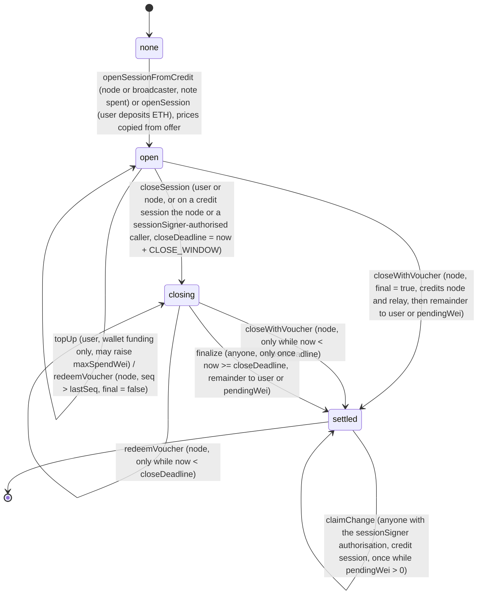

# Contracts and settlement — sessions, vouchers and registries on Arbitrum One

Author: Comuns contributors
Status: Draft
Category: Technical Proposal
Created: 2026-10-12
**Reference:** docs/evidence-register.md, docs/economics/cost-and-pricing.md, docs/security/privacy-and-contexts.md, docs/protocol/off-chain-api.md, docs/node/model-registry-and-licenses.md, docs/adr/0001-settle-on-arbitrum-one-evm-not-stylus.md, docs/adr/0004-sessions-vouchers-and-no-slashing.md, docs/adr/0005-hardware-classes-and-price-bands.md, docs/adr/0010-anonymous-by-default.md, docs/adr/0011-anonymous-credits.md, docs/adr/0012-contexts-without-a-wallet-link.md, docs/cip/0002-anonymous-credits-relays-and-ownerless-contexts.md

---

## 1. Summary

Comuns is a community proposal for open-source, decentralized LLM inference. Nothing described here runs yet: there is no deployment, no token, no treasury and no seated maintainers. This document specifies the on-chain part of the protocol as proposed for v1 — four Solidity contracts on Arbitrum One that record who can serve which model at what price, which relays carry traffic, which contexts exist, and how a user pays a node for a session of inference without naming themselves to the node or to the chain.

The design in one paragraph. A user deposits ETH once into `SessionEscrow` as a fixed-denomination **credit note** (`depositNote`, the one public, wallet-linked step) and later spends that note on a **session** with one node for one model: the node, or any broadcaster acting for it, submits `openSessionFromCredit` with a Semaphore v4 membership proof and a nullifier, so the session is funded on-chain without naming the depositor, and the session's `user` is `address(0)`. Inference runs off-chain, reached through an Oblivious HTTP relay registered in `NodeRegistry`. After each delivered chunk of output the user's client signs an off-chain, cumulative **voucher** (EIP-712 typed data, signed by an app-generated `sessionSigner` key that is fresh for every session, so no wallet and no persistent key is ever shown to the node). The node redeems its highest voucher on-chain whenever it likes (never the closing voucher, which only `closeWithVoucher` accepts); in the happy path it redeems the client's closing voucher once, which settles the session and records the unspent remainder as `pendingWei` — **the client path is `depositNote` once, then `openSessionFromCredit` (submitted by the node) and `closeWithVoucher` per session**. The remainder returns as fresh change notes through `claimChange`, authorised by a `sessionSigner` signature and submitted by anyone; dust below the smallest denomination is credited to the node. If either party disappears, the node first redeems its highest non-final voucher with `redeemVoucher`, then `closeSession` (the node, or any broadcaster carrying a `sessionSigner` signature; never automatic) starts a deadline and `finalize` records as `pendingWei` whatever was not paid by a signed voucher after it. A wallet-funded `openSession` is retained and specified in full; it reveals the payer to the node and to every chain observer, and the reference client has no call site for it. No contract ever pushes ETH during settlement, bond release, change or ragequit: every payment, released bond and ragequit is credited to an internal `balances[address]` entry, and the only function that sends ETH is `withdraw()`, which pays the caller its whole balance across every session at once (**pull payments**). Payment is bounded above by `min(depositWei, maxSpendWei)`, a signed voucher is never reversed, and there is **no slashing**, no protocol fee (protocol fee 0) and no dispute contract.

Three registries hold the facts the escrow checks: `NodeRegistry` (operators, hardware class, bond, the OHTTP gateway key configuration, per-model **offers**, and the bonded **relays**), `ModelRegistry` (models, tier, license, manifest hash — written only by governance in v1) and `ContextRegistry` (versioned content hashes of contexts keyed by a context key, with no owner address; ciphertext never touches the chain). Governance-set **price bands** per (model tier, hardware class) keep offers inside a corridor in which stronger hardware charges more for the same model and weaker hardware charges less. There is no rule that ties a hardware class to a model tier: any node may serve any model it can load, and whether a model fits is the node's own admission decision.

The identifiers in this file — contract names, enum values, record fields, function names, event names, parameter names, and the one canonical `Voucher` type — are **normative for every other Comuns document**. Where another document uses a different name for the same thing, this file wins.

## 2. Scope

In scope:

- The four v1 contracts: `NodeRegistry`, `ModelRegistry`, `ContextRegistry`, `SessionEscrow`.
- The closed list of 23 state-changing functions: the original fifteen, in order, `registerNode`, `updateNode`, `deregisterNode`, `withdrawBond`, `withdraw`, `registerModel`, `updateModel`, `setContext`, `openSession`, `topUp`, `redeemVoucher`, `closeWithVoucher`, `closeSession`, `finalize`, `setBands`; then the eight added by `docs/adr/0011-anonymous-credits.md`: `depositNote`, `openSessionFromCredit`, `claimChange`, `ragequit`, `setCreditParameters`, `registerRelay`, `updateRelay`, `deregisterRelay`. [CIP-0002](../cip/0002-anonymous-credits-relays-and-ownerless-contexts.md) is the Draft amendment that proposes the eight new names and the amended signatures; ADR 0011 carries every signature and this document transcribes them.
- The credit notes: per-denomination Semaphore v4 groups inside `SessionEscrow`, the spend proof, change and ragequit.
- The relay role: registration, bond and fee.
- The off-chain voucher format and the payment rule.
- The session state machine, deadlines, and what happens under sequencer outage.
- The events an indexer needs.
- Interface sketches, a testing plan, risks and open questions.

Out of scope (specified elsewhere or deliberately absent, see §14):

- The off-chain API between client and node (`docs/protocol/off-chain-api.md`), including the job envelope, receipts and frames; this document names them only where a voucher depends on them.
- Context encryption, HPKE key handling, the OHTTP transport, the cryptography of `outputCommitment` and privacy guarantees (`docs/security/privacy-and-contexts.md`, `docs/adr/0010-anonymous-by-default.md`).
- The Semaphore v4 circuit, its trusted setup and its verifier: the escrow uses them as published and defines no circuit of its own (`docs/adr/0011-anonymous-credits.md`).
- Model licensing policy and the manifest format (`docs/node/model-registry-and-licenses.md`).
- Price discovery, cost modelling and the numeric values of bands (`docs/economics/cost-and-pricing.md`); this document sets **no wei value and no duration**, except the two fixed safeguards named in §15 and §16 (the ≥7-day upgrade timelock, a proposal, and the cited ~1-day force-inclusion fact).
- Off-chain reputation, pool discovery UX, plans and multi-node orchestration — the chain stores offers and sessions, never pool lists, plans or sub-task assignments.

Binding design decisions carried in from the ADRs (all PROPOSED, none implemented):

| Decision | Value |
|---|---|
| Execution environment | Solidity/EVM on Arbitrum One for v1; Stylus is not v1 (new Stylus activations have been paused since 2026-10-02 with no reopening date [V]) |
| Unit of payment | ETH only; no token; inference payment is **not** L2 gas |
| Protocol fee | 0 |
| Penalties | No slashing function; the registration bond is withdrawable after an unlock delay |
| Contracts | Exactly four; no Treasury, no DisputeManager |
| Payments | Pull payments: contracts credit `balances[address]`; only `withdraw()` sends ETH |
| Funding | Anonymous credits by default: fixed-denomination notes in Semaphore v4 groups inside `SessionEscrow`, spent by `openSessionFromCredit` with `user = address(0)` (ADR 0011). Wallet-funded `openSession` is retained with no reference-client call site |
| Transport | Oblivious HTTP through a bonded relay registered in `NodeRegistry`; `relay ≠ node` is checked at open; one person holding both roles under two addresses is a stated residual, not a checked property (ADR 0010) |
| Contexts | Keyed by `contextId = keccak256(contextPubKey)`, no owner address, `setContext` by any caller with the context key's signature; the registry is an optional anchor (ADR 0012) |
| Upgrades | `SessionEscrow`, which holds the notes, is non-upgradeable: no proxy and no upgrade path. The three registries are non-upgradeable in v1, or behind a timelock of at least 7 days controlled by seated maintainers. Governance parameters (`setBands`, `setCreditParameters`) are timelocked |

Evidence tags used below: **[V]** verified in `docs/evidence-register.md`; **[L]** likely, as the register marks it; **[U]** derived or unverified. Anything not tagged [V] is unverified. Gas and proving figures cite evidence register §15 or are UNVERIFIED; no denomination, relay fee or other wei value is set in this document.

## 3. Why sessions (the gas-versus-fee arithmetic)

The decision to pay per **session** rather than per prompt follows from two cited numbers.

Arbitrum One fee snapshot, 2026-10-13 [V]: gas price 0.02 gwei; an ERC-20 transfer costs roughly $0.003 in L2 fees. An ETH transfer, which uses less gas, is derived at roughly $0.001 [U].

Hosted inference price for Llama-3.1-8B [V]: from $0.02 per 1M input tokens and $0.04 per 1M output tokens.

Put them together for one typical prompt [U]: 1,000 input tokens cost $0.00002 and 500 output tokens cost $0.00002, so the inference is worth about $0.00004. Settling that single prompt on-chain needs at least two transactions (a deposit and a payout), each at least as expensive as a plain ETH transfer and in practice more because they execute contract logic — call it $0.002 or more in L2 fees. **The L2 fees for a single-prompt on-chain job would exceed the inference by a factor on the order of fifty.** Per-prompt settlement is therefore not viable for small models at market prices, even on a cheap L2.

A session amortizes the same two transactions over many prompts. Over a session that delivers 1M output tokens at the cited price, the inference is worth about $0.04 and the two transactions still cost about $0.002 — a few percent, falling further as sessions grow [U]. Inside the session, every chunk is paid by an off-chain signature that costs nothing on-chain. This is the whole reason for vouchers: the chain sees one deposit and one settlement, not one payment per chunk. The `withdraw()` that moves credited ETH to a wallet is a third transaction, but it is sent once for any number of settled sessions, so its cost per session falls toward zero for an active node or user [U].

Credits do not change the arithmetic; they move it. `depositNote` is one transaction per note, and a note may be larger than one session, so its cost is amortized over the sessions and change notes it funds. `openSessionFromCredit` carries a Groth16 verification, estimated at about 230–270k L2 gas (evidence register §15, [U]: the researcher's estimate for Semaphore's own `validateProof`, not a measurement of this contract), and is paid by the node that submits it, which prices it into its offer; the group insertion in `depositNote` and `claimChange` costs LeanIMT insertion gas, which is UNVERIFIED. `claimChange` is a third transaction per session that has change. Per-prompt settlement is therefore further from viable under credits, not closer, and the session remains the unit.

Two consequences shape the rest of the design:

1. Nothing per-chunk may require a transaction — so vouchers are cumulative and only the highest one is ever redeemed.
2. Multi-node execution (§9) is priced as *N sessions for N nodes*, so a request that fans out to many nodes pays the two-transaction cost N times. That is accepted for v1 and listed as an open question for batching.

## 4. Identifiers and enums

All enums are `uint8` on-chain. The numeric values are normative.

**hardwareClass** — a self-declared class backed by a public self-benchmark (`benchmarkHash`). The classes order strictly S < M < L < X.

| Value | Name |
|---|---|
| 0 | S |
| 1 | M |
| 2 | L |
| 3 | X |

**tier** — a parameter-count label attached to a model at registration. Tiers are labels for pricing bands, never eligibility gates.

| Value | Name | Parameter count |
|---|---|---|
| 0 | T0 | ≤ 4B |
| 1 | T1 | > 4B and ≤ 8B |
| 2 | T2 | > 8B and ≤ 32B |
| 3 | T3 | > 32B and ≤ 70B |
| 4 | T4 | > 70B |

The five tiers partition the parameter-count axis: every count falls in exactly one tier (an 8,000,000,000-parameter model is T1).

**mode** — how the node executes the session. The meaning of each mode and what a client may verify is specified in `docs/protocol/off-chain-api.md` and `docs/adr/0010-anonymous-by-default.md`; the contracts only check that the node advertises the mode. Credit funding, the default, carries no user address and reaches the node through a relay. Wallet funding records `user` and `relay = address(0)` and reveals the payer. Verifiable mode is re-execution by a user-chosen second node under a demonstrated deterministic profile; the contracts know nothing of that second node beyond its own ordinary session.

| Value | Name | One-line meaning |
|---|---|---|
| 0 | standard | The node reads the content and should not learn the identity of the person asking. |
| 1 | attested | The operator should not be able to read the content either, barring a physical attack on the hardware (evidence register §14). |
| 2 | verifiable | Re-execution by a second reader, a user-chosen second node under a demonstrated deterministic profile; it adds a content reader and is not a privacy upgrade. |

A node's `modes` field is a bitmask: bit `i` set means mode `i` is advertised.

**funding** — how a session was paid for.

| Value | Name | Meaning |
|---|---|---|
| 0 | wallet | Opened by `openSession` from a wallet that deposits ETH and is recorded as `user`. Identity-revealing; retained and specified in full; the reference client has no call site for it. |
| 1 | credit | Opened by `openSessionFromCredit` against a note in a denomination group; `user = address(0)`; the remainder returns as change notes. The client path. |

**sessionStatus**

| Value | Name |
|---|---|
| 0 | none |
| 1 | open |
| 2 | closing |
| 3 | settled |

Legality of every session call is decided by `status` alone (and, in `closing`, by the clock against `closeDeadline`), never by whether a field such as `closeDeadline` is zero.

Other identifiers:

- **nodeId** — in v1 a node is identified by its operator address; one node per address. `Session.node` holds that address.
- **modelId** — `bytes32`, equal to `keccak256(manifestHash)` of the model's canonical manifest. The identity of a model is its manifest; a different manifest is a different model.
- **contextId** — `bytes32`, equal to `keccak256(contextPubKey)`, where `contextPubKey` is the public key of a random per-context signing key the client generates from the operating-system CSPRNG, never the wallet key and never derived from it (ADR 0012). The registry keys contexts by `contextId` alone; there is no owner.
- **relayId** — in v1 a relay is identified by its operator address; one relay per address, and an address is never both a node and a relay. `Session.relay` holds that address, or `address(0)` on a wallet-funded session.
- **denominationIndex** — `uint8`, the position of a denomination in the append-only list set by `setCreditParameters`; each index names one Semaphore v4 group inside `SessionEscrow`.
- **identityCommitment / commitment** — `uint256`, a Semaphore v4 identity commitment; one per note, deposit and change notes alike, each from a fresh identity generated by the client. The same commitment is never accepted twice in any group (`noteSeen`).
- **nullifier** — `uint256`, Semaphore's per-scope nullifier. Because the scope of a group is fixed, each note has exactly one nullifier and can be spent once.
- **sessionId** — `bytes32` assigned by `SessionEscrow` at `openSession` or `openSessionFromCredit` as `keccak256(abi.encode(block.chainid, address(this), counter))` over a strictly increasing per-contract counter, so that an id is unique across deployments and chains as well as within one escrow (the derivation is recorded as an open question, §16).
- **Named parameters** (no values set in this document): `CHUNK_TOKENS` (maximum output tokens per voucher step), `CLOSE_WINDOW` (the duration added to the clock at `closeSession` to produce `closeDeadline`), `BOND_UNLOCK_DELAY` (the delay between `deregisterNode` or `deregisterRelay` and `withdrawBond`), `MIN_BOND_WEI`, `MIN_RELAY_BOND_WEI`, `MIN_DEPOSIT_WEI` (which every denomination must meet, so a credit session satisfies the deposit floor by construction), `RELAY_FEE_WEI` (set by `setCreditParameters`, copied onto each credit session at open, may be 0), `MERKLE_TREE_DURATION` (how long a replaced group root stays acceptable; Semaphore's own default is 1 hour, evidence register §15, [V]; no function changes it), `MAX_CHANGE_NOTES` (the most notes one `claimChange` may mint, small), `UPGRADE_TIMELOCK` (≥ 7 days). The **denomination list** is a further set of unset values: it starts empty and grows only by `setCreditParameters`.

## 5. Records

**Node** (in `NodeRegistry`, keyed by operator address)

| Field | Type | Meaning |
|---|---|---|
| `operator` | `address` | The node's identity and payee for all its sessions. |
| `hpkePublicKey` | `bytes` | HPKE public key clients encrypt context to (see privacy doc). Replaced by `updateNode`; the node keeps a keyring of every key used by a session not yet settled (§9). |
| `ohttpKeyConfig` | `bytes` | The node's Oblivious HTTP gateway key configuration (RFC 9458). One configuration for every user, so no user can be handed a unique key that would single them out (ADR 0010). Replaced by `updateNode`. |
| `endpoint` | `string` | Off-chain API endpoint, reached through a relay. |
| `hardwareClass` | `hardwareClass` | Self-declared class, backed by `benchmarkHash`. |
| `maxTier` | `tier` | The largest tier the operator benchmarked — the highest tier among the models it has published a per-model self-benchmark for. A separate field from `hardwareClass`, which is decided by the per-class bars of the class benchmark; a class is not a tier. **Informational only, never a gate.** Never read by `openSession`. |
| `bondWei` | `uint256` | Registration bond, released to the operator's balance after the unlock delay; never slashed. |
| `benchmarkHash` | `bytes32` | Signed hash of the node's public self-benchmark on the class benchmark. A self-published claim, not an unfakeable proof. |
| `modes` | `uint8` | Bitmask of advertised modes. |
| `prices[modelId]` | `(priceInPerMillion, priceOutPerMillion, modelBenchmarkHash)` | One entry per model the node offers; both prices in **wei per 1,000,000 tokens**. |
| `unlockAt` | `uint64` | Zero while registered; set by `deregisterNode`. |

A `prices[modelId]` entry whose `modelBenchmarkHash` is non-zero is that node's current **offer** for the model. `modelBenchmarkHash` is the signed hash of the node's public self-benchmark of that exact model and manifest — a self-published claim with the same honesty as `benchmarkHash`, not an unfakeable proof. A missing entry or a zero hash means the node has no offer for the model and is not in its pool (§9).

**Relay** (in `NodeRegistry`, keyed by operator address; an address is never both a node and a relay)

| Field | Type | Meaning |
|---|---|---|
| `operator` | `address` | The relay's identity and payee of its relay fees. |
| `endpoint` | `string` | The Oblivious HTTP relay endpoint clients send to. Relays hold no OHTTP key: the gateway key is the node's `ohttpKeyConfig`. |
| `bondWei` | `uint256` | Registration bond, released to the operator's balance after the unlock delay; never slashed. |
| `unlockAt` | `uint64` | Zero while registered; set by `deregisterRelay`. |

**Balances** (in `NodeRegistry` and in `SessionEscrow`, each its own mapping)

| Field | Type | Meaning |
|---|---|---|
| `balances[address]` | `uint256` | ETH credited to that address by `withdrawBond` (in `NodeRegistry`, for a node or a relay) or by `redeemVoucher`, `closeWithVoucher`, `finalize`, `claimChange` (dust to the node) and `ragequit` (in `SessionEscrow`), not yet withdrawn. The only way out is `withdraw()`, called by the credited address. |

**Model** (in `ModelRegistry`, keyed by `modelId`)

| Field | Type | Meaning |
|---|---|---|
| `modelId` | `bytes32` | `keccak256(manifestHash)`. |
| `tier` | `tier` | Parameter-count label, set at registration, immutable. |
| `licenseSpdx` | `string` | SPDX identifier of the model license. |
| `commercialHosting` | `bool` | Whether the license permits paid hosting. `openSession` refuses models where this is false. |
| `manifestHash` | `bytes32` | SHA-256 of a canonical JSON manifest listing files, hashes and tokenizer. Immutable. |
| `metadataUri` | `string` | Where the manifest and model card are published. |
| `publisher` | `address` | The registrant. In v1 this is always the governance timelock (§6); the field is kept so that a later CIP can delegate `updateModel` without changing the record. |

**Context** (in `ContextRegistry`, keyed by `contextId`; there is no owner field and no address in the record)

| Field | Type | Meaning |
|---|---|---|
| `contextId` | `bytes32` | `keccak256(contextPubKey)`; the context key's public key is passed on every `setContext` and checked against it, never stored. |
| `version` | `uint64` | Starts at 1; every `setContext` must pass `previous + 1`. |
| `contentHash` | `bytes32` | `keccak256` of the complete stored blob of that version (header ‖ ciphertext ‖ tag) — the one canonical definition, specified in the privacy doc. Never the content, never ciphertext. |

**Session** (in `SessionEscrow`, keyed by `sessionId`)

| Field | Type | Meaning |
|---|---|---|
| `user` | `address` | Wallet funding: depositor and refund recipient (credited, never pushed). Credit funding: `address(0)`, always; no refund is ever credited to a user on a credit session. |
| `funding` | `funding` | `wallet` (0) or `credit` (1); fixed at open. |
| `node` | `address` | Operator address; payee of vouchers (credited, never pushed). |
| `relay` | `address` | The relay the client named at `openSessionFromCredit`, checked registered, not deregistering and `≠ node`; `address(0)` on a wallet-funded session. |
| `relayFeeWei` | `uint256` | `RELAY_FEE_WEI` copied at `openSessionFromCredit`; the first `relayFeeWei` of settled value goes to `balances[relay]`. 0 on a wallet-funded session. |
| `pendingWei` | `uint256` | Credit funding only: `depositWei − settledWei` recorded at settlement, the value `claimChange` may still turn into change notes and dust; zeroed by `claimChange`. Always 0 on a wallet-funded session. |
| `modelId` | `bytes32` | The one model this session pays for. |
| `mode` | `mode` | Execution mode agreed at open. |
| `sessionSigner` | `address` | App-generated key that signs vouchers, job envelopes, the credit-session `closeSession` authorisation and the `claimChange` authorisation for this session. Fixed for the session's life in v1; fresh per session and never reused. |
| `depositWei` | `uint256` | ETH held in escrow for this session; raised by `topUp` on a wallet-funded session only. On a credit session it equals the denomination and never changes. |
| `priceInPerMillion` | `uint256` | Copied from the node's offer at `openSession`; a later `updateNode` cannot change it. |
| `priceOutPerMillion` | `uint256` | Copied likewise. |
| `maxSpendWei` | `uint256` | Hard cap; on a wallet-funded session user-set and raisable by `topUp`, never lowered; on a credit session equal to the denomination. The effective cap is `min(depositWei, maxSpendWei)`. |
| `openedAt` | `uint64` | Block timestamp at open. |
| `closeDeadline` | `uint64` | Set only by `closeSession`, to `block.timestamp + CLOSE_WINDOW`. Read only while `status == closing`; its value decides nothing in any other state. |
| `lastSeq` | `uint64` | Highest voucher `seq` accepted so far; 0 before any redemption. |
| `lastInputTokens` | `uint64` | `inputTokens` of the last accepted voucher; 0 before any redemption. |
| `lastOutputTokens` | `uint64` | `outputTokens` of the last accepted voucher; 0 before any redemption. |
| `lastCumulativeWei` | `uint256` | `cumulativeWei` of the last accepted voucher; 0 before any redemption. May exceed `settledWei` when the cap truncated a payout. |
| `settledWei` | `uint256` | Total paid out of the session so far: on a credit session the node's and the relay's credits together. |
| `status` | `sessionStatus` | none / open / closing / settled. |

**Credit state** (in `SessionEscrow`; the escrow keeps its own trees, nullifiers and root window and never relies on a shared Semaphore deployment's `validateProof`, which has no access modifier and would let any holder of a proof consume the nullifier outside the escrow — evidence register §15, [V])

| Field | Type | Meaning |
|---|---|---|
| `denominations[]` | `uint256[]` | Append-only list of denomination values in wei, indexed by `denominationIndex`; empty until `setCreditParameters`. An index's value never changes. |
| `groups[denominationIndex]` | LeanIMT | One Semaphore v4 group per denomination index (the zk-kit LeanIMT that Semaphore uses, Poseidon leaves). Commitments are inserted by `depositNote` and `claimChange`; never at close or finalize. |
| root window | per group | The current root, plus a replaced root until `MERKLE_TREE_DURATION` has passed since it was replaced; a proof is accepted against either. |
| `nullifierSeen[nullifier]` | `bool` | Stored by `openSessionFromCredit` and `ragequit`; a seen nullifier reverts. |
| `noteSeen[commitment]` | `bool` | Every commitment ever inserted into any group; `depositNote` and `claimChange` revert on a seen commitment. Independent of LeanIMT's duplicate-leaf behaviour, which stays UNVERIFIED. |
| `depositedWei[address][denominationIndex]` | `uint256` | Total an address deposited into a group through `depositNote`. Public by design. |
| `ragequitWei[address][denominationIndex]` | `uint256` | Total an address took back from a group through `ragequit`; bounded by `depositedWei`. |
| `RELAY_FEE_WEI` | `uint256` | The current relay fee, set by `setCreditParameters`, copied onto each credit session at open. |
| `verifier` | `address`, immutable | The stateless Semaphore v4 Groth16 verifier, deployed from the Semaphore packages as immutable bytecode owned by nobody; the only external contract the escrow calls besides its read-only checks against `NodeRegistry` and `ModelRegistry` (§6). Set at construction, never changed. |

**Band** (in `NodeRegistry`, keyed by `(tier, hardwareClass)`)

| Field | Type | Meaning |
|---|---|---|
| `floorIn`, `ceilingIn` | `uint256` | Inclusive bounds on `priceInPerMillion`. |
| `floorOut`, `ceilingOut` | `uint256` | Inclusive bounds on `priceOutPerMillion`. |
| `initialized` | `bool` | False until `setBands` has set this tier. |

**Voucher** (off-chain; see §8 for the full typed-data definition — the one canonical EIP-712 type, defined only here and referenced by every other document)

`Voucher(bytes32 sessionId,uint64 seq,uint256 cumulativeWei,uint64 inputTokens,uint64 outputTokens,bytes32 outputCommitment,bool final)`, signed by `sessionSigner` under the EIP-712 domain of `SessionEscrow`.

## 6. Functions and reverts

The 23 functions below are the **complete** set of state-changing functions in v1: `registerNode`, `updateNode`, `deregisterNode`, `withdrawBond`, `withdraw`, `registerModel`, `updateModel`, `setContext`, `openSession`, `topUp`, `redeemVoucher`, `closeWithVoucher`, `closeSession`, `finalize`, `setBands`, `depositNote`, `openSessionFromCredit`, `claimChange`, `ragequit`, `setCreditParameters`, `registerRelay`, `updateRelay`, `deregisterRelay`. The last eight, and the amended signatures of `registerNode`, `updateNode`, `setContext` and `closeSession`, are defined in `docs/adr/0011-anonymous-credits.md` and proposed by [CIP-0002](../cip/0002-anonymous-credits-relays-and-ownerless-contexts.md); this table transcribes them. No other function name may be introduced by any Comuns document without a CIP that amends this one. How state is read (public storage variables, events) is an implementation detail and adds nothing to this list.

Governance means the seated maintainers acting through the ≥7-day timelock (§15). Because nobody is seated, nothing governance-gated can happen on mainnet until a CIP seats maintainers; bands cannot be set and no model can be registered, so no paid session can be opened, so mainnet deployment is impossible before that CIP.

Two rules apply to every function in the table:

- **Checks-effects-interactions and a reentrancy guard.** Every state-changing function validates, then writes all of its state, and only then interacts with another address; every one carries a `nonReentrant` guard. Only `withdraw()` sends ETH. Proof verification (the Semaphore v4 verifier) and registry checks (`SessionEscrow` reading `NodeRegistry` and `ModelRegistry`) require read-only external calls; these calls must be included in the interaction and reentrancy review.
- **Pull payments.** No function other than `withdraw()` sends ETH. `withdrawBond`, `redeemVoucher`, `closeWithVoucher`, `finalize`, `claimChange` (dust to the node) and `ragequit` credit `balances[address]`; the credited address collects with `withdraw()` whenever it likes. A contract wallet that cannot receive ETH can therefore never lock a refund, a payment or a bond — the credit is recorded regardless, and only that wallet's own `withdraw()` would fail, leaving every other balance and session untouched.

| Function | Contract | Caller | Preconditions (revert otherwise) | Effects | Events |
|---|---|---|---|---|---|
| `registerNode(hpkePublicKey, ohttpKeyConfig, endpoint, hardwareClass, maxTier, benchmarkHash, modes, modelIds[], offers[])` | NodeRegistry | Any address, payable | Caller not already registered as a node, and **not a registered relay** (an address is never both); `msg.value ≥ MIN_BOND_WEI`; `benchmarkHash ≠ 0`; `modes ≠ 0`; `modelIds` has no duplicate; for every offer: model registered, `commercialHosting == true`, `modelBenchmarkHash ≠ 0`, band for (model tier, caller's class) initialized, both prices inside that band | Creates Node with `operator = msg.sender`, `bondWei = msg.value`, writes each offer | `NodeRegistered`, one `OfferSet` per offer |
| `updateNode(hpkePublicKey, ohttpKeyConfig, endpoint, hardwareClass, maxTier, benchmarkHash, modes, modelIds[], offers[])` | NodeRegistry | The node's operator | Node registered and not deregistering (`unlockAt == 0`); `benchmarkHash ≠ 0`; `modes ≠ 0`; `modelIds` has no duplicate; `modelIds[]`/`offers[]` is the **complete** offer list (replace-all): every listed offer passes the same per-offer checks as `registerNode` — evaluated against the band for (model tier, the class given in this call), so a hardware-class change revalidates every listed offer against the new bands and reverts if any is outside its band | Overwrites the fields given, including `hpkePublicKey` (key rotation, §9) and `ohttpKeyConfig`; writes every listed offer; **clears** every previously stored offer whose `modelId` is not in the list. Clearing is always allowed, whatever the band or `commercialHosting` state. Open sessions are untouched (their prices were copied at open) | `NodeUpdated`; one `OfferSet` per offer added or changed; one `OfferSet` with zero prices and a zero `modelBenchmarkHash` ("cleared") per offer removed |
| `deregisterNode()` | NodeRegistry | The node's operator | Node registered; `unlockAt == 0` | Clears all offers; sets `unlockAt = block.timestamp + BOND_UNLOCK_DELAY`. Open sessions continue and may still be settled to `operator` | `NodeDeregistered`; one cleared `OfferSet` per offer removed |
| `withdrawBond()` | NodeRegistry | The node's operator, or the relay's operator | On the caller's Node record, or else on the caller's Relay record: `unlockAt ≠ 0` and `block.timestamp ≥ unlockAt`; `bondWei > 0` | Node branch, as before: `balances[operator] += bondWei`; zeroes `bondWei`; deletes the Node record. Relay branch (extended by ADR 0011): after `deregisterRelay` set `unlockAt`, credits the relay's `bondWei` to `balances[operator]` and deletes the Relay record; this branch requires and deletes no Node record. Sends no ETH | `BondWithdrawn` |
| `withdraw()` | NodeRegistry and SessionEscrow (each has its own) | Any address with a balance | `balances[msg.sender] > 0` | Reads `amount = balances[msg.sender]`, sets `balances[msg.sender] = 0`, **then** sends `amount` to `msg.sender` (checks-effects-interactions; `nonReentrant`). If the send fails the whole call reverts, which restores the balance; nothing else is affected | `Withdrawn` |
| `registerModel(manifestHash, tier, licenseSpdx, commercialHosting, metadataUri)` | ModelRegistry | **Governance only** (the timelock, acting on a CIP) | `modelId = keccak256(manifestHash)` not yet registered; `manifestHash ≠ 0` | Creates Model with `publisher = msg.sender` (the timelock) | `ModelRegistered` |
| `updateModel(modelId, licenseSpdx, commercialHosting, metadataUri)` | ModelRegistry | **Governance only** (the timelock, acting on a CIP) | Model registered | Updates the three mutable fields. `tier` and `manifestHash` are immutable. Setting `commercialHosting` to false blocks new sessions and new offers; it does not close open sessions | `ModelUpdated` |
| `setContext(contextId, version, contentHash, contextPubKey, signature)` | ContextRegistry | **Any address**: in the reference client a broadcaster or a node, never the user's wallet. There is no owner | `keccak256(contextPubKey) == contextId`; `version == previous + 1` (previous is 0 for a new context); `contentHash ≠ 0`; `signature` is the context key's EIP-712 signature over `(chainId, registry, contextId, version, contentHash)` | Stores `(contextId, version, contentHash)` — the latest version only; earlier versions live in the event history. The registry is an optional public anchor that the default client does not need (§10, ADR 0012) | `ContextSet` |
| `openSession(node, modelId, mode, sessionSigner, maxSpendWei, expectedPriceInPerMillion, expectedPriceOutPerMillion)` | SessionEscrow | Any address (becomes `user`), payable | Node registered and `unlockAt == 0`; model registered with `commercialHosting == true`; node has an offer for `modelId` with `modelBenchmarkHash ≠ 0`; **the offer's current `priceInPerMillion == expectedPriceInPerMillion` and `priceOutPerMillion == expectedPriceOutPerMillion`** (price binding: an offer changed in flight reverts the open instead of locking a deposit at a price the user never confirmed); band for (model tier, node class) initialized; both offer prices inside that band; `mode` set in node's `modes`; `sessionSigner ≠ 0`; `msg.value ≥ MIN_DEPOSIT_WEI`; `msg.value ≤ maxSpendWei`. **There is no check of hardware class against model tier, and `maxTier` is not read.** Unchanged for wallet funding: this call publishes the payer and the reference client has no call site for it | Creates Session: `status = open`, `funding = wallet`, `user = msg.sender`, `relay = address(0)`, `relayFeeWei = 0`, `pendingWei = 0`, `depositWei = msg.value`, prices copied from the offer (equal to the expected prices by the check above), `closeDeadline = 0`, `lastSeq = 0`, `lastInputTokens = 0`, `lastOutputTokens = 0`, `lastCumulativeWei = 0`, `settledWei = 0`; returns `sessionId` | `SessionOpened` |
| `topUp(sessionId, newMaxSpendWei)` | SessionEscrow | The session's `user`, payable | `status == open`; **`funding == wallet` (reverts when `funding == credit`: a credit session's cap is its note, and an exhausted cap is answered by a new credit session with a new note)**; `newMaxSpendWei ≥ maxSpendWei` (the cap may be raised, never lowered); `depositWei + msg.value ≤ newMaxSpendWei` | `maxSpendWei = newMaxSpendWei`; `depositWei += msg.value` | `SessionToppedUp` |
| `redeemVoucher(sessionId, voucher, signature)` | SessionEscrow | The session's `node` | `status == open`, or `status == closing` and `block.timestamp < closeDeadline`; signature valid for `sessionSigner` under the EIP-712 domain; `voucher.sessionId == sessionId`; **`voucher.final == false`** (a closing voucher can only go through `closeWithVoucher`); `voucher.seq > lastSeq` (so `seq ≤ lastSeq` reverts, including a conflicting voucher with the same `seq`); `voucher.inputTokens ≥ lastInputTokens`, `voucher.outputTokens ≥ lastOutputTokens` and `voucher.cumulativeWei ≥ lastCumulativeWei` (a later voucher can never lower what is owed); `voucher.cumulativeWei` equals the payment rule applied to the voucher's cumulative token counts with the session's prices | `payout = min(cumulativeWei, min(depositWei, maxSpendWei)) − settledWei`; `oldSettled = settledWei`; `settledWei += payout`; **wallet funding:** `balances[node] += payout`; **credit funding (the relay split):** `relayDelta = min(relayFeeWei, settledWei) − min(relayFeeWei, oldSettled)` to `balances[relay]` and `nodeDelta = payout − relayDelta` to `balances[node]`, so the first `relayFeeWei` of settled value goes to the relay and the rest to the node; `lastSeq = seq`; `lastInputTokens`, `lastOutputTokens`, `lastCumulativeWei` updated from the voucher. **No refund**: nothing is credited to the user, and the session stays in its current status. `payout` may be zero | `VoucherRedeemed` |
| `closeWithVoucher(sessionId, voucher, signature)` | SessionEscrow | The session's `node` | All preconditions of `redeemVoucher` except the `final` check, which is inverted: **`voucher.final == true`** | In this order: `payout = min(cumulativeWei, min(depositWei, maxSpendWei)) − settledWei`; `settledWei += payout`; the payout credited as in `redeemVoucher` (to the node, or split between relay and node on a credit session); the last-accepted fields updated as in `redeemVoucher`; **then**, with the already-updated `settledWei`: **wallet funding:** `refund = depositWei − settledWei`; `balances[user] += refund`; **credit funding:** `pendingWei = depositWei − settledWei` (the full denomination when `settledWei == 0`), nothing credited to any user, no leaf inserted; `status = settled`. Node credit plus relay credit plus the refund or `pendingWei` equals `depositWei` exactly | `VoucherRedeemed`, `SessionSettled` |
| `closeSession(sessionId, signature)` | SessionEscrow | Wallet session: the session's `user` or `node`, `signature` ignored. Credit session: the `node`, or **any caller whose `signature` is a `sessionSigner` EIP-712 signature over `(chainId, escrow, sessionId, "close")`**; in the reference client that caller is a relay or broadcaster, never the deposit wallet. Not permissionless. At any time while `open` | `status == open`; on a credit session, `msg.sender == node` or the signature verifies for `sessionSigner` | `status = closing`; `closeDeadline = block.timestamp + CLOSE_WINDOW`. Nothing closes a session automatically; only this call starts the clock. If both the node and the `sessionSigner` key are gone, the session stays open: the same residual as today | `SessionClosing` |
| `finalize(sessionId)` | SessionEscrow | Anyone | `status == closing`; `block.timestamp ≥ closeDeadline` | **Wallet funding:** `refund = depositWei − settledWei`; `balances[user] += refund`. **Credit funding:** `pendingWei = depositWei − settledWei`, nothing credited to a user, no leaf inserted. `status = settled`. Credits nothing to the node | `SessionSettled` |
| `setBands(tier, bands[4])` | NodeRegistry | Governance only | For the four classes in order S, M, L, X: `floorIn ≤ ceilingIn` and `floorOut ≤ ceilingOut` for each class; and for each `c` in {S, M, L}: `floorIn(c+1) > ceilingIn(c)` and `floorOut(c+1) > ceilingOut(c)` | Writes all four bands of the tier and marks them initialized | `BandsSet` |
| `setCreditParameters(denominationWei, relayFeeWei)` | SessionEscrow | **Governance only** (the timelock, acting on a CIP) | If `denominationWei ≠ 0`: `denominationWei ≥ MIN_DEPOSIT_WEI`, and, with the new denomination included, every remainder below the largest listed denomination decomposes greedily into at most `MAX_CHANGE_NOTES` notes with dust below the smallest denomination (the compatibility check that makes the dust guarantee of `claimChange` hold). `denominationWei == 0` appends nothing and only sets the fee | If `denominationWei ≠ 0`: appends one denomination index with that value — the list is **append-only** and an index's value never changes. Always sets `RELAY_FEE_WEI = relayFeeWei`, which may be 0. No value is set in any document | `CreditParametersSet` |
| `depositNote(identityCommitment, denominationIndex)` | SessionEscrow | Any address, payable | `denominationIndex` listed; `msg.value ==` that denomination exactly; `noteSeen[identityCommitment] == false` (a commitment already seen in any group reverts; a fresh Semaphore identity per note is the client's rule) | Inserts `identityCommitment` into the group of `denominationIndex`; `noteSeen[identityCommitment] = true`; `depositedWei[msg.sender][denominationIndex] += msg.value`. The one public, wallet-linked step | `NoteDeposited` |
| `openSessionFromCredit(node, relay, modelId, mode, sessionSigner, expectedPriceInPerMillion, expectedPriceOutPerMillion, denominationIndex, merkleTreeDepth, merkleTreeRoot, nullifier, points)` | SessionEscrow | Any address: the `node`, or a broadcaster acting for it. Never required from the user's wallet | Every `openSession` precondition except the `msg.value` checks: node registered and `unlockAt == 0`; model registered with `commercialHosting == true`; offer with `modelBenchmarkHash ≠ 0`; price binding on both expected prices; band initialized and both prices inside it; `mode` set in the node's `modes`; `sessionSigner ≠ 0`. **No payer check: a credit session has no user address.** `maxTier` is never read. In addition: `relay` is a registered relay with `unlockAt == 0`; **`relay ≠ node`**; `denominationIndex` listed; `1 ≤ merkleTreeDepth ≤ 32` (Semaphore's range, evidence register §15, [V]); `merkleTreeRoot` is that group's current root or a replaced root younger than `MERKLE_TREE_DURATION`; `nullifier` not seen; the Groth16 proof `points` verifies for the public inputs `(merkleTreeRoot, nullifier, hash(message), hash(scope))`, where the contract computes **`scope = keccak256(chainId, escrow, denominationIndex)`** and **`message = keccak256(node, relay, modelId, mode, sessionSigner, expectedPriceInPerMillion, expectedPriceOutPerMillion)`** itself, never from caller-supplied values, and hashes each as `uint256(keccak256(abi.encodePacked(x))) >> 8`, as Semaphore does (evidence register §15, [V]). The fixed scope gives each note one nullifier; the message stops a submitter redirecting the spend | Stores the nullifier; creates Session with `status = open`, `user = address(0)`, `funding = credit`, `depositWei = maxSpendWei =` the denomination, prices copied from the offer, `relay = relay`, `relayFeeWei = RELAY_FEE_WEI` at that moment, `pendingWei = 0`, and the counters zero as in `openSession`; returns `sessionId`. The node bears the spend gas and prices it into its offer | `SessionOpened` (with `user = address(0)`), `CreditSessionOpened` |
| `claimChange(sessionId, changeCommitments[], denominationIndexes[], signature)` | SessionEscrow | **Anyone**, with no deadline | `funding == credit`; `pendingWei > 0` (the session is therefore `settled`: this is the one call a settled session accepts); `signature` is a `sessionSigner` EIP-712 signature over `(chainId, escrow, sessionId, keccak256(changeCommitments), keccak256(denominationIndexes))`; the two arrays have equal length, at most `MAX_CHANGE_NOTES`; every listed index exists; the listed denominations sum to at most `pendingWei`; every commitment is fresh under `noteSeen` and no commitment repeats within the call | Inserts each commitment into the group of its index and marks it seen; `dust = pendingWei − sum`; `balances[node] += dust`; `pendingWei = 0`. An empty array is the dust-only branch, in which the whole `pendingWei` goes to the node. The client decomposes greedily from the largest listed denomination, so dust stays below the smallest denomination | `ChangeNoted` |
| `ragequit(denominationIndex, merkleTreeDepth, merkleTreeRoot, nullifier, points)` | SessionEscrow | Any address, for one note of that group it can prove | `denominationIndex` listed; **`depositedWei[msg.sender][denominationIndex] − ragequitWei[msg.sender][denominationIndex] ≥ denomination`** (an address never exits more than it deposited into that group); depth, root window and unseen nullifier as in `openSessionFromCredit`; the proof verifies under the group scope with **`message = keccak256("ragequit", msg.sender)`**; the group scope and that message are passed to the verifier hashed as in `openSessionFromCredit`, `uint256(keccak256(abi.encodePacked(x))) >> 8` | Stores the nullifier; `ragequitWei[msg.sender][denominationIndex] += denomination`; `balances[msg.sender] += denomination`. Public and linkable by design. A Semaphore proof hides which leaf is spent, so the contract cannot tell a deposit note from a change note; the net-deposit bound is the whole rule. The credited balance leaves through `withdraw()`; there is no dedicated anonymous withdrawal entry point | `NoteRagequit` |
| `registerRelay(endpoint)` | NodeRegistry | Any address, payable | Caller is **not a registered node and not a registered relay**; `msg.value ≥ MIN_RELAY_BOND_WEI` | Creates Relay `(operator = msg.sender, endpoint, bondWei = msg.value, unlockAt = 0)`. Relays hold no OHTTP key | `RelayRegistered` |
| `updateRelay(endpoint)` | NodeRegistry | The relay's operator | Relay registered and `unlockAt == 0` | Replaces `endpoint`. Open sessions that name the relay are untouched | `RelayUpdated` |
| `deregisterRelay()` | NodeRegistry | The relay's operator | Relay registered; `unlockAt == 0` | Sets `unlockAt = block.timestamp + BOND_UNLOCK_DELAY`. Open sessions that name the relay continue and still pay it; `openSessionFromCredit` refuses the relay from now on | `RelayDeregistered` |

Notes on the table:

- A session in `settled` accepts no call, with exactly one exception: `claimChange` on a credit session while `pendingWei > 0`. Every other function that takes a `sessionId` reverts on a settled session. Legality is decided by `status`, never by `closeDeadline == 0`. In `open`, `redeemVoucher`, `closeWithVoucher`, `topUp` (wallet funding only) and `closeSession` are legal; in `closing`, `redeemVoucher` and `closeWithVoucher` are legal only while `block.timestamp < closeDeadline`, and `finalize` only once `block.timestamp ≥ closeDeadline`. A voucher payment and a refund (or a `pendingWei` record) can therefore never race: before the deadline only vouchers move value, at or after it only `finalize` does.
- A credit session is settled exactly like a wallet session, with two differences: the payout of every voucher is split between relay and node, and the remainder is recorded as `pendingWei` instead of being credited to a user. No leaf is inserted at close or finalize, so settlement can never be blocked by the commitment check; the change notes are minted afterwards by `claimChange`, which anyone may submit with the `sessionSigner` authorisation. A client that never claims leaves `pendingWei` in the escrow indefinitely; nothing sweeps it.
- The user's unilateral close is `openSession` → `closeSession` → `finalize`, plus any `redeemVoucher` the node sends in between; on a credit session it is `openSessionFromCredit` → `closeSession` (through a relay or broadcaster, with the `sessionSigner` authorisation) → `finalize` → `claimChange`. The node's unilateral close — the **abandoned-client procedure**, used whenever a client disappears or a key is lost — is: `redeemVoucher` with its highest non-`final` voucher while that is legal, then `closeSession`, then `finalize` after `closeDeadline`, which credits `depositWei − settledWei` to `balances[user]` on a wallet session and records `pendingWei = depositWei − settledWei` on a credit session (no user credit, no leaf). A node never relies on `closeWithVoucher` unless it holds a `final` voucher, because `closeWithVoucher` rejects every other voucher and `finalize` pays the node nothing: a node that skips `redeemVoucher` forfeits its acknowledged earnings. A node that has lost its key: nothing refunds automatically; on a wallet session the user calls `closeSession`; on a credit session the node, or any caller carrying the `sessionSigner` signature, calls it; then `finalize` after `closeDeadline` (or the node, having recovered before the deadline, runs the same abandoned-client procedure, or `closeWithVoucher` if it holds a `final` voucher).
- Either the user or the node may call `closeSession` at any time while a wallet session is `open`; on a credit session the node, or any caller with the `sessionSigner` signature, may. Nothing closes a session automatically, and no unauthorised third address can start the clock in v1 (an anyone-can-close idle timeout is an open question, §16). A wallet refund is credited to `balances[user]`, the depositing address: if the user's wallet is lost, that credit is unrecoverable, because `withdraw()` pays only `msg.sender` (R5). A credit remainder is recorded as `pendingWei` and is lost only if the `sessionSigner` key is lost before `claimChange`.
- A relay is paid only out of settled value: `relayFeeWei` is copied at open and the relay's share comes from the first settled wei, never from a user transaction. A session that settles with `settledWei == 0` pays the relay nothing. A relay that deregisters keeps earning on the sessions that already name it.
- Because `redeemVoucher` rejects `final == true`, the closing voucher cannot be consumed by the wrong function: a node that submits it through `redeemVoucher` gets a revert, not a settled-at-zero-refund session, and resubmits through `closeWithVoucher`.
- After `setBands` narrows a band, offers now outside it cannot be opened against until the operator calls `updateNode` with prices inside the new band. The stale offer is a reputation matter for indexers to surface, never a slash.
- A node whose offer prices are inside the band at `registerNode` time but outside it after a later `setBands` keeps its open sessions at the copied prices; only new sessions are blocked.
- Model registration is governance-only in v1 so that nobody can register a public manifest first, set `commercialHosting = false` and become its sole publisher (manifest squatting), and nobody can set a false `commercialHosting` flag. With nobody seated there is no mainnet registration; models for Arbitrum Sepolia come from a testnet-only CIP.

### 6.1 Interface sketches

These are sketches, not a project: no build, no tests, no deployment, and nothing here is audited. They exist so that every other document can reference the same names. They list only the closed set of 23 functions and at least one event per function. Every event is defined once, in §11, with its exact field order; the sketches match it field for field.

#### NodeRegistry

```solidity
// SPDX-License-Identifier: MIT
pragma solidity ^0.8.0;

/// Sketch only. Hosts nodes, relays, per-model offers, the governance-set price bands,
/// and the pull-payment balances for released bonds. An address is never both a node and a relay.
/// Every state-changing function: checks-effects-interactions, nonReentrant.
interface INodeRegistry {
    enum HardwareClass { S, M, L, X }       // 0, 1, 2, 3
    enum Tier { T0, T1, T2, T3, T4 }        // 0..4, parameter-count labels, never a gate

    /// prices[modelId] = (priceInPerMillion, priceOutPerMillion, modelBenchmarkHash)
    struct Offer {
        uint256 priceInPerMillion;          // wei per 1,000,000 input tokens
        uint256 priceOutPerMillion;         // wei per 1,000,000 output tokens
        bytes32 modelBenchmarkHash;         // zero = no offer for this model
    }

    struct Node {
        address operator;
        bytes hpkePublicKey;
        bytes ohttpKeyConfig;               // OHTTP gateway key configuration; one per node, for every user
        string endpoint;
        HardwareClass hardwareClass;
        Tier maxTier;                       // informational only, never read by openSession
        uint256 bondWei;
        bytes32 benchmarkHash;
        uint8 modes;                        // bitmask over Mode
        uint64 unlockAt;                    // zero while registered
        // mapping(bytes32 modelId => Offer) prices;   // storage-only; one entry per offered model
    }

    struct Relay {
        address operator;
        string endpoint;                    // the OHTTP relay endpoint; relays hold no OHTTP key
        uint256 bondWei;
        uint64 unlockAt;                    // zero while registered; set by deregisterRelay
    }

    struct Band {
        uint256 floorIn;
        uint256 ceilingIn;
        uint256 floorOut;
        uint256 ceilingOut;
        bool initialized;
    }

    // mapping(address => uint256) balances;   // storage-only; released bonds awaiting withdraw()

    event NodeRegistered(address indexed operator, HardwareClass hardwareClass, Tier maxTier, uint256 bondWei, bytes32 benchmarkHash, uint8 modes, bytes hpkePublicKey, string endpoint, bytes ohttpKeyConfig);
    event NodeUpdated(address indexed operator, HardwareClass hardwareClass, Tier maxTier, bytes32 benchmarkHash, uint8 modes, bytes hpkePublicKey, string endpoint, bytes ohttpKeyConfig);
    event OfferSet(address indexed operator, bytes32 indexed modelId, uint256 priceInPerMillion, uint256 priceOutPerMillion, bytes32 modelBenchmarkHash);
    event NodeDeregistered(address indexed operator, uint64 unlockAt);
    event BondWithdrawn(address indexed operator, uint256 bondWei);
    event Withdrawn(address indexed account, uint256 amountWei);
    event BandsSet(Tier indexed tier, Band s, Band m, Band l, Band x);
    event RelayRegistered(address indexed operator, string endpoint, uint256 bondWei);
    event RelayUpdated(address indexed operator, string endpoint);
    event RelayDeregistered(address indexed operator, uint64 unlockAt);

    /// Reverts if the caller is a registered relay.
    function registerNode(
        bytes calldata hpkePublicKey,
        bytes calldata ohttpKeyConfig,
        string calldata endpoint,
        HardwareClass hardwareClass,
        Tier maxTier,
        bytes32 benchmarkHash,
        uint8 modes,
        bytes32[] calldata modelIds,
        Offer[] calldata offers
    ) external payable;

    /// Replace-all: modelIds/offers is the node's complete offer list. Offers for models not
    /// listed are cleared (OfferSet with zero prices and zero modelBenchmarkHash). Every listed
    /// offer is validated against the band for (model tier, hardwareClass given here).
    function updateNode(
        bytes calldata hpkePublicKey,
        bytes calldata ohttpKeyConfig,
        string calldata endpoint,
        HardwareClass hardwareClass,
        Tier maxTier,
        bytes32 benchmarkHash,
        uint8 modes,
        bytes32[] calldata modelIds,
        Offer[] calldata offers
    ) external;

    /// Clears every offer (one cleared OfferSet each) and starts the bond unlock delay.
    function deregisterNode() external;

    /// Payable, msg.value >= MIN_RELAY_BOND_WEI. Reverts if the caller is a registered node or relay.
    function registerRelay(string calldata endpoint) external payable;

    /// The relay's operator, while unlockAt == 0. Open sessions that name the relay are untouched.
    function updateRelay(string calldata endpoint) external;

    /// The relay's operator. Sets unlockAt = now + BOND_UNLOCK_DELAY; open sessions continue and still pay it.
    function deregisterRelay() external;

    /// After unlockAt: credits bondWei to balances[operator] and deletes the caller's Node record, or else
    /// the caller's Relay record (the relay branch requires and deletes no Node record). Sends no ETH.
    function withdrawBond() external;

    /// Pays msg.sender its whole balance. Zeroes the balance, then sends. nonReentrant.
    function withdraw() external;

    /// Governance only. bands[0..3] are the classes S, M, L, X of this tier.
    /// Reverts unless floorIn(c+1) > ceilingIn(c) and floorOut(c+1) > ceilingOut(c) for c in {S, M, L}.
    function setBands(Tier tier, Band[4] calldata bands) external;
}
```

#### ModelRegistry

```solidity
// SPDX-License-Identifier: MIT
pragma solidity ^0.8.0;

/// Sketch only. Models are identified by their manifest. Both functions are governance-only
/// in v1 (callable by the timelock, acting on a CIP).
interface IModelRegistry {
    enum Tier { T0, T1, T2, T3, T4 }

    struct Model {
        bytes32 modelId;                    // keccak256(manifestHash)
        Tier tier;                          // immutable
        string licenseSpdx;
        bool commercialHosting;             // false blocks offers and openSession
        bytes32 manifestHash;               // SHA-256 of the canonical JSON manifest; immutable
        string metadataUri;
        address publisher;                  // the timelock in v1
    }

    event ModelRegistered(bytes32 indexed modelId, address indexed publisher, Tier tier, string licenseSpdx, bool commercialHosting, bytes32 manifestHash, string metadataUri);
    event ModelUpdated(bytes32 indexed modelId, string licenseSpdx, bool commercialHosting, string metadataUri);

    /// Governance only.
    function registerModel(
        bytes32 manifestHash,
        Tier tier,
        string calldata licenseSpdx,
        bool commercialHosting,
        string calldata metadataUri
    ) external returns (bytes32 modelId);

    /// Governance only. tier and manifestHash cannot change; a new manifest is a new model.
    function updateModel(
        bytes32 modelId,
        string calldata licenseSpdx,
        bool commercialHosting,
        string calldata metadataUri
    ) external;
}
```

#### ContextRegistry

```solidity
// SPDX-License-Identifier: MIT
pragma solidity ^0.8.0;

/// Sketch only. Stores the latest versioned content hash per context; never content, never
/// ciphertext, never an owner address. Earlier versions are recoverable from ContextSet events.
/// An optional public anchor: the default client's integrity path is the off-chain hash chain (§10).
interface IContextRegistry {
    struct Context {
        bytes32 contextId;                  // keccak256(contextPubKey); no owner
        uint64 version;                     // starts at 1, strictly +1 per setContext
        bytes32 contentHash;                // keccak256(header || ciphertext || tag) of the stored blob
    }

    event ContextSet(bytes32 indexed contextId, uint64 version, bytes32 contentHash);

    /// Any caller (a broadcaster or a node in the reference client, never the user's wallet).
    /// Reverts unless keccak256(contextPubKey) == contextId, version == previous + 1, contentHash != 0,
    /// and signature is the context key's EIP-712 signature over
    /// (chainId, registry, contextId, version, contentHash).
    function setContext(
        bytes32 contextId,
        uint64 version,
        bytes32 contentHash,
        bytes calldata contextPubKey,
        bytes calldata signature
    ) external;
}
```

#### SessionEscrow

```solidity
// SPDX-License-Identifier: MIT
pragma solidity ^0.8.0;

/// Sketch only. Holds ETH per session and the credit notes; credits nodes and relays only against
/// EIP-712 vouchers signed by sessionSigner; credits wallet refunds to users and records credit
/// remainders as pendingWei; sends ETH only in withdraw(). Non-upgradeable: no proxy, no upgrade path.
/// Keeps its own LeanIMT groups, nullifier set and root window and calls only the stateless
/// Semaphore v4 Groth16 verifier (an immutable address set at construction).
/// Every state-changing function: checks-effects-interactions, nonReentrant.
interface ISessionEscrow {
    enum Mode { Standard, Attested, Verifiable }          // 0, 1, 2
    enum Funding { Wallet, Credit }                       // 0, 1
    enum SessionStatus { None, Open, Closing, Settled }   // 0, 1, 2, 3

    struct Session {
        address user;                       // address(0) when funding == Credit
        address node;                       // operator address, payee
        bytes32 modelId;
        Mode mode;
        address sessionSigner;
        uint256 depositWei;                 // the denomination when funding == Credit
        uint256 priceInPerMillion;          // copied from the offer at open
        uint256 priceOutPerMillion;         // copied from the offer at open
        uint256 maxSpendWei;                // raised by topUp (wallet only), never lowered
        uint64 openedAt;
        uint64 closeDeadline;               // set only by closeSession; read only while Closing
        uint64 lastSeq;
        uint64 lastInputTokens;             // from the last accepted voucher
        uint64 lastOutputTokens;            // from the last accepted voucher
        uint256 lastCumulativeWei;          // from the last accepted voucher
        uint256 settledWei;                 // node and relay credits together
        SessionStatus status;
        Funding funding;
        address relay;                      // address(0) when funding == Wallet
        uint256 relayFeeWei;                // RELAY_FEE_WEI copied at openSessionFromCredit
        uint256 pendingWei;                 // credit remainder recorded at settlement; zeroed by claimChange
    }

    // mapping(address => uint256) balances;   // storage-only; payouts, refunds, dust and ragequits awaiting withdraw()
    // uint256[] denominations;                              // storage-only; append-only, set by setCreditParameters
    // LeanIMT per denominationIndex, with its root window;   // storage-only; Semaphore v4 groups
    // mapping(uint256 => bool) nullifierSeen;                // storage-only
    // mapping(uint256 => bool) noteSeen;                     // storage-only; every commitment ever inserted
    // mapping(address => mapping(uint8 => uint256)) depositedWei, ragequitWei;   // storage-only
    // uint256 RELAY_FEE_WEI;                                 // storage-only; set by setCreditParameters
    // address immutable verifier;                            // the Semaphore v4 Groth16 verifier

    /// EIP-712 typed data. Domain: name "Comuns SessionEscrow", version "1",
    /// chainId = Arbitrum One (commonly published as 42161 — UNVERIFIED), verifyingContract = this.
    /// Voucher(bytes32 sessionId,uint64 seq,uint256 cumulativeWei,uint64 inputTokens,uint64 outputTokens,bytes32 outputCommitment,bool final)
    struct Voucher {
        bytes32 sessionId;
        uint64 seq;                         // strictly increasing per session, starting at 1
        uint256 cumulativeWei;              // == (priceIn * inputTokens + priceOut * outputTokens) / 1000000
        uint64 inputTokens;                 // cumulative, includes granted context
        uint64 outputTokens;                // cumulative
        bytes32 outputCommitment;           // see privacy doc; not checked on-chain
        bool final;                         // true only on the client's closing voucher ("the client closes the session")
    }

    event SessionOpened(bytes32 indexed sessionId, address indexed user, address indexed node, bytes32 modelId, Mode mode, address sessionSigner, uint256 depositWei, uint256 priceInPerMillion, uint256 priceOutPerMillion, uint256 maxSpendWei);
    event SessionToppedUp(bytes32 indexed sessionId, uint256 amountWei, uint256 depositWei, uint256 maxSpendWei);
    event VoucherRedeemed(bytes32 indexed sessionId, uint64 seq, uint64 inputTokens, uint64 outputTokens, uint256 cumulativeWei, uint256 payoutWei, uint256 settledWei, bytes32 outputCommitment);
    event SessionClosing(bytes32 indexed sessionId, address closedBy, uint64 closeDeadline);
    event SessionSettled(bytes32 indexed sessionId, uint256 settledWei, uint256 refundWei, bool viaFinalize);
    event Withdrawn(address indexed account, uint256 amountWei);
    event CreditParametersSet(uint8 denominationIndex, uint256 denominationWei, uint256 relayFeeWei);
    event NoteDeposited(uint256 indexed commitment, uint8 denominationIndex, address indexed depositor);
    event CreditSessionOpened(bytes32 indexed sessionId, address indexed node, address indexed relay, bytes32 modelId, Mode mode, address sessionSigner, uint8 denominationIndex, uint256 nullifier);
    event ChangeNoted(bytes32 indexed sessionId, uint256[] changeCommitments, uint8[] denominationIndexes, uint256 dustWei);
    event NoteRagequit(uint256 nullifier, address indexed caller, uint8 denominationIndex);

    /// Payable. Wallet funding; identity-revealing; the reference client has no call site for it.
    /// Reverts if the band for (model tier, node class) is uninitialized, the node has no
    /// offer for modelId or its modelBenchmarkHash is zero, the offer's current prices differ from
    /// expectedPriceInPerMillion / expectedPriceOutPerMillion (price binding: an offer changed in
    /// flight can never lock a deposit), the offer's prices are outside the band, commercialHosting
    /// is false, mode is not advertised, or msg.value is below MIN_DEPOSIT_WEI.
    /// Never compares hardware class to model tier; never reads maxTier.
    function openSession(
        address node,
        bytes32 modelId,
        Mode mode,
        address sessionSigner,
        uint256 maxSpendWei,
        uint256 expectedPriceInPerMillion,
        uint256 expectedPriceOutPerMillion
    ) external payable returns (bytes32 sessionId);

    /// Governance only. denominationWei != 0 appends one denomination (>= MIN_DEPOSIT_WEI, and the
    /// MAX_CHANGE_NOTES greedy-decomposition compatibility check must hold); 0 appends nothing.
    /// Always sets RELAY_FEE_WEI = relayFeeWei, which may be 0.
    function setCreditParameters(uint256 denominationWei, uint256 relayFeeWei) external;

    /// Payable; msg.value == denominations[denominationIndex]. Reverts on a commitment seen in any group.
    /// Inserts the commitment into that group; depositedWei[msg.sender][denominationIndex] += msg.value.
    /// The one public, wallet-linked step.
    function depositNote(uint256 identityCommitment, uint8 denominationIndex) external payable;

    /// Any caller (the node or a broadcaster). Every openSession check except msg.value; no payer
    /// check; never reads maxTier. relay registered, not deregistering, and relay != node.
    /// The contract computes scope = keccak256(chainId, escrow, denominationIndex) and
    /// message = keccak256(node, relay, modelId, mode, sessionSigner, expectedPriceInPerMillion,
    /// expectedPriceOutPerMillion), hashes each as uint256(keccak256(abi.encodePacked(x))) >> 8,
    /// accepts merkleTreeRoot from the group's root window, rejects a seen nullifier, verifies points
    /// with the Semaphore v4 verifier, stores the nullifier and opens the session with user = address(0),
    /// funding = Credit, depositWei = maxSpendWei = the denomination, relayFeeWei = RELAY_FEE_WEI.
    function openSessionFromCredit(
        address node,
        address relay,
        bytes32 modelId,
        Mode mode,
        address sessionSigner,
        uint256 expectedPriceInPerMillion,
        uint256 expectedPriceOutPerMillion,
        uint8 denominationIndex,
        uint256 merkleTreeDepth,
        uint256 merkleTreeRoot,
        uint256 nullifier,
        uint256[8] calldata points
    ) external returns (bytes32 sessionId);

    /// User only, while open, wallet funding only (reverts when funding == Credit).
    /// newMaxSpendWei >= maxSpendWei; depositWei + msg.value <= newMaxSpendWei.
    function topUp(bytes32 sessionId, uint256 newMaxSpendWei) external payable;

    /// Node only; while open, or while closing before closeDeadline. Rejects final == true.
    /// seq <= lastSeq reverts; counts and cumulativeWei must not fall below the last accepted voucher.
    /// payout = min(cumulativeWei, min(depositWei, maxSpendWei)) - settledWei; settledWei += payout.
    /// Wallet: balances[node] += payout. Credit: relayDelta = min(relayFeeWei, newSettled) -
    /// min(relayFeeWei, oldSettled) to balances[relay], payout - relayDelta to balances[node].
    /// NO refund; status unchanged.
    function redeemVoucher(bytes32 sessionId, Voucher calldata voucher, bytes calldata signature) external;

    /// Node only; same window as redeemVoucher; requires voucher.final == true. In this order:
    /// payout = min(cumulativeWei, min(depositWei, maxSpendWei)) - settledWei;
    /// settledWei += payout; the payout credited as in redeemVoucher;
    /// wallet: refund = depositWei - settledWei (with the updated settledWei); balances[user] += refund;
    /// credit: pendingWei = depositWei - settledWei; nothing credited to a user; no leaf inserted;
    /// status = Settled. payout + refund (or pendingWei) == depositWei - (settledWei before this call).
    function closeWithVoucher(bytes32 sessionId, Voucher calldata voucher, bytes calldata signature) external;

    /// Wallet session: user or node, signature ignored. Credit session: the node, or any caller whose
    /// signature is a sessionSigner EIP-712 signature over (chainId, escrow, sessionId, "close").
    /// At any time while open. Moves to closing and sets closeDeadline = now + CLOSE_WINDOW.
    /// Nothing closes a session automatically.
    function closeSession(bytes32 sessionId, bytes calldata signature) external;

    /// Anyone; requires status closing and block.timestamp >= closeDeadline.
    /// Wallet: refund = depositWei - settledWei; balances[user] += refund.
    /// Credit: pendingWei = depositWei - settledWei; nothing credited to a user.
    /// status = Settled. Credits nothing to the node.
    function finalize(bytes32 sessionId) external;

    /// Anyone, no deadline, credit session with pendingWei > 0 (the one call a settled session accepts).
    /// signature: sessionSigner EIP-712 over (chainId, escrow, sessionId, keccak256(changeCommitments),
    /// keccak256(denominationIndexes)). At most MAX_CHANGE_NOTES entries; sum of the listed
    /// denominations <= pendingWei; every commitment fresh under noteSeen. Inserts each note into its
    /// group; dust = pendingWei - sum to balances[node]; pendingWei = 0. Empty arrays: dust only.
    function claimChange(
        bytes32 sessionId,
        uint256[] calldata changeCommitments,
        uint8[] calldata denominationIndexes,
        bytes calldata signature
    ) external;

    /// Any address, for one note of that group it can prove, under the group scope with
    /// message = keccak256("ragequit", msg.sender). Requires
    /// depositedWei[msg.sender][denominationIndex] - ragequitWei[msg.sender][denominationIndex] >= denomination.
    /// Stores the nullifier; ragequitWei += denomination; balances[msg.sender] += denomination.
    /// Public and linkable by design; cannot tell a deposit note from a change note.
    function ragequit(
        uint8 denominationIndex,
        uint256 merkleTreeDepth,
        uint256 merkleTreeRoot,
        uint256 nullifier,
        uint256[8] calldata points
    ) external;

    /// Pays msg.sender its whole balance. Zeroes the balance, then sends. nonReentrant.
    function withdraw() external;
}
```

## 7. Session state machine



The machine is the same for both fundings: `openSessionFromCredit` takes the `none → open` edge exactly as `openSession` does, with the deposit being the note's denomination. Legality in each state is decided by `status`: `open` admits `topUp` (wallet funding only), `redeemVoucher`, `closeWithVoucher` and `closeSession`; `closing` admits `redeemVoucher` and `closeWithVoucher` while `block.timestamp < closeDeadline` and `finalize` once `block.timestamp ≥ closeDeadline`; `settled` admits nothing, with the one exception that a credit session in `settled` admits `claimChange` while `pendingWei > 0` (ADR 0011). `closeDeadline` is set only by `closeSession` and is never used to infer the state. `withdraw()`, `depositNote` and `ragequit` are not session calls: they act on balances and notes in any state and at any time.

Invariants that hold in every state:

- `settledWei ≤ min(depositWei, maxSpendWei)`.
- `depositWei ≤ maxSpendWei`; `maxSpendWei` never decreases. On a credit session both equal the denomination and never change.
- `lastSeq`, `lastInputTokens`, `lastOutputTokens` and `lastCumulativeWei` are non-decreasing and change only in `redeemVoucher` / `closeWithVoucher`; `settledWei ≤ lastCumulativeWei`.
- **Conservation per wallet session.** For every `settled` wallet-funded session, the total credited to the node (the sum of every `payout` over its `redeemVoucher` and `closeWithVoucher` calls, which equals its final `settledWei`) plus the refund credited to the user equals `depositWei` exactly — never more, never less. This holds because the refund is always computed as `depositWei − settledWei` after `settledWei` has been raised by the same call's payout.
- **Conservation per credit session.** At all times, `nodeCredited + relayCredited + remainingLockedWei + pendingWei + mintedChangeValue = depositWei`, where `remainingLockedWei = depositWei − settledWei` while the session is `open` or `closing` and 0 after settlement, `mintedChangeValue` is the sum of the denominations of the change notes `claimChange` inserted, and `nodeCredited` includes the dust exactly once, after `claimChange`. Before `claimChange`, `pendingWei` holds the whole remainder; after it, `pendingWei = 0` and the remainder is change notes plus dust.
- **Conservation of the contract.** The contract's ETH balance always equals the sum of all `balances[address]` plus, over every `open` and `closing` session, `depositWei − settledWei`, plus the sum of `pendingWei` over every settled credit session, plus the face value of every unspent note (deposited or minted as change, with no nullifier stored).
- Once `settled`, no function touches a wallet session again; a settled credit session accepts `claimChange` once while `pendingWei > 0` and nothing else, and after `claimChange` every call on it reverts.
- Every path out of `open` ends in `settled` with exactly one remainder: a refund credit of `depositWei − settledWei` to `balances[user]` on a wallet session, or a `pendingWei` record of the same amount on a credit session, either inside `closeWithVoucher` or inside `finalize`; `redeemVoucher` never credits a refund or records `pendingWei`. No remainder path is missing and none can happen twice. A session that was never closed by anyone stays `open` and keeps its deposit until an authorised party calls `closeSession`; nothing closes it automatically.
- A nullifier is stored at most once, and a commitment is inserted at most once; a note can therefore be spent once, by `openSessionFromCredit` or by `ragequit`, never both.
- ETH leaves a contract only in `withdraw()`, only to `msg.sender`, and only after that address's balance has been zeroed.

Timing. `CLOSE_WINDOW` is a named parameter with no value set here. It must exceed an expected sequencer outage plus about one day of force inclusion [V]: Arbitrum One has a single sequencer, and a user whose transaction the sequencer ignores can force-include it via L1 after roughly one day. That sizing makes a voucher survivable when the outage begins early in the window; it is not a guarantee. An outage that starts shortly before `closeDeadline` leaves less time than force inclusion needs, and the node's unredeemed vouchers then expire with the deadline (R2) — which is why nodes should redeem promptly rather than wait for the deadline. Vouchers are redeemable only before `closeDeadline` and `finalize` only at or after it; there is no grace window between the two. "Settled" in this document means **L2 inclusion under the single sequencer, not L1 finality**; a client that needs L1 finality waits for it off-chain.

## 8. Vouchers

A voucher is EIP-712 typed data signed off-chain by the session's `sessionSigner`. Nothing in this section changes with credits: the `Voucher` type, the payment rule, the monotonicity rules and the signing cadence are identical for wallet-funded and credit-funded sessions. The client generates `sessionSigner` as a fresh app-local key for every session, never reused, registers its address at open (`openSessionFromCredit`, submitted by the node; or `openSession` on the wallet path), and signs vouchers with it automatically. On the credit path the user's wallet signs nothing per session: it signed `depositNote` once, earlier, and the session's own transactions are submitted by the node or a broadcaster. On the wallet path the wallet signs only `openSession` (and `topUp` / `closeSession` / `withdraw` if used). The wallet is never prompted per chunk. The same `sessionSigner` also signs every job envelope the client sends to the node, over `(chainId, escrow address, sessionId, jobId, requestId, sheetVersion, hash of enc ‖ ciphertext)`; the node rejects any envelope whose signature does not verify against the `sessionSigner` recorded for that session, which is what stops a third party injecting jobs into someone else's session (HPKE stays base mode; the envelope is specified in the privacy doc and the off-chain API).

The `Voucher` type below is the one canonical definition. Every other Comuns document references it and defines no variant.

**Domain**

| Field | Value |
|---|---|
| `name` | `"Comuns SessionEscrow"` |
| `version` | `"1"` |
| `chainId` | The EIP-155 chain id of Arbitrum One, commonly published as 42161 — **UNVERIFIED** here; confirm at implementation |
| `verifyingContract` | The deployed `SessionEscrow` address |

**Message** (`Voucher`)

`Voucher(bytes32 sessionId,uint64 seq,uint256 cumulativeWei,uint64 inputTokens,uint64 outputTokens,bytes32 outputCommitment,bool final)`

This is the exact EIP-712 type string: no spaces after the commas, as `encodeType` requires. A contract that hashes any other spelling computes a different type hash and rejects every voucher signed by a standard typed-data library. The interface sketch in §6.1 and every other document use exactly this string.

| Field | Type | Meaning |
|---|---|---|
| `sessionId` | `bytes32` | Binds the voucher to one session, hence to one node, model, mode and price pair. |
| `seq` | `uint64` | Strictly increasing per session, starting at 1. |
| `cumulativeWei` | `uint256` | Total owed for the session so far — the payment rule applied once to the cumulative counts below. |
| `inputTokens` | `uint64` | **Cumulative** input tokens for the session, including granted context tokens. |
| `outputTokens` | `uint64` | **Cumulative** output tokens delivered to the client so far. |
| `outputCommitment` | `bytes32` | `keccak256(commitKey ‖ sessionId ‖ seq ‖ transcriptHash)`. `commitKey` is a random 32-byte key the client generates once per session and sends sealed (HPKE) inside the session's first job envelope; client and node keep it until the session is settled, so it is one key for every job of the session, not a per-job value. `transcriptHash = keccak256(prev ‖ chunkHash)`, chained from zero over every output chunk of every job in the session so far. The cryptography is specified in the privacy doc. **Not checked on-chain.** It binds a voucher to delivered output without letting chain observers guess low-entropy answers; opening `commitKey` discloses the whole session's output to whoever receives it — it is not a proof without disclosure. Recorded for off-chain reputation. |
| `final` | `bool` | True only on the client's closing voucher. It means exactly "the client closes the session" and nothing else; the last frame of a job is marked by a different flag, `endOfJob`, in the off-chain API, which is never copied into `final`. |

**Payment rule** (normative, integer floor division):

```
paymentWei = (priceInPerMillion * inputTokens + priceOutPerMillion * outputTokens) / 1000000
```

with the session's copied prices and the voucher's cumulative counts. `SessionEscrow` recomputes this and reverts if `cumulativeWei` differs, so a voucher cannot carry a number its own token counts do not justify.

**Monotonicity.** Besides `seq > lastSeq`, the contract requires `inputTokens ≥ lastInputTokens`, `outputTokens ≥ lastOutputTokens` and `cumulativeWei ≥ lastCumulativeWei`, the values of the last accepted voucher stored in the session. A later voucher can therefore never lower what is owed; in particular a closing voucher with zeroed counts, which would otherwise settle the session at zero and erase the node's earlier vouchers, reverts. Together with "redeeming the highest voucher pays the same as redeeming every earlier one", this makes the highest voucher always the best voucher for the node.

**Signing cadence**

1. The client sends the job envelope (prompt and granted context, sealed to the node's HPKE key and signed by `sessionSigner`; the session's first envelope also carries the sealed `commitKey`). The node tokenizes the prompt and the granted context with the model manifest's pinned tokenizer and, **before prefill**, sends a node-signed **input receipt** `(sessionId, jobId, jobInputTokens, cumulativeInputTokensAfter)`. The client checks `jobInputTokens` against its own tokenization of this job's prompt and granted context with the same tokenizer, and checks `cumulativeInputTokensAfter = lastInputTokens + jobInputTokens`, where `lastInputTokens` is the `inputTokens` of the last voucher it signed (0 before the first job). Only if both checks pass does it sign the **input voucher**, whose `inputTokens` is the cumulative total `cumulativeInputTokensAfter`, with `outputTokens` unchanged from the previous voucher. Because the voucher carries the session total, the second and every later job of a session satisfies the contract's monotonicity rule; a receipt that carried only the job's own count would not.
2. The node streams output. Each output chunk of at most `CHUNK_TOKENS` output tokens arrives with a node-signed receipt carrying the cumulative counts for the session (the same way as the input receipt) and the chunk hash; the client checks it, extends `transcriptHash`, and signs the next cumulative voucher with the increased `outputTokens`, the new `outputCommitment` and `cumulativeWei`.
3. When the client is done it signs one more voucher with `final = true`; the node submits it in `closeWithVoucher`. `redeemVoucher` rejects it.

The node's unpaid exposure is therefore at most one output chunk of `CHUNK_TOKENS` tokens (plus any prefill it chose to start before receiving the input voucher, which the reference node does not do).

**Residual risk of the input voucher, stated plainly.** A node can redeem the input voucher and never run the prompt. The user's loss is bounded by that prompt's input fee; the remedy is to stop signing and record a reputation event. No contract function detects or refunds it.

**What automatic signing checks.** The client's signing logic verifies token counts against the receipts and what it received, and that the node declared the session's `modelId`; it does **not** judge answer quality. The user pays for delivered output until the user, or the client's own checks, stop signing. After that the user's loss is bounded by one chunk, and over the whole session by the effective cap `min(depositWei, maxSpendWei)`.

**Replay domains.** The domain separator binds a voucher to one chain and one `SessionEscrow` deployment; `sessionId` binds it to one session; `seq` orders vouchers inside the session. A voucher from another chain, another deployment, another session or with a `seq` at or below `lastSeq` reverts. Because amounts are cumulative and monotone, redeeming vouchers 3 and 7 pays the same total as redeeming only 7; the node has no reason to redeem more than its highest.

**Cap and top-up.** The effective cap is `min(depositWei, maxSpendWei)`. The contract credits `min(cumulativeWei, cap) − settledWei`. A voucher whose `cumulativeWei` exceeds the cap is valid and pays only up to the cap; the session then records that voucher's counts and `cumulativeWei` as the last accepted values. `topUp(newMaxSpendWei)` is payable and may raise `maxSpendWei` (never lower it) together with the deposit. After a `topUp`, the client re-signs the same cumulative totals under a new `seq`; because the counts did not fall, the contract accepts that voucher and credits the part above the old cap, so the node can collect the rest. The reference node stops serving when the cumulative total reaches the cap and asks the client to `topUp`. On a credit session `topUp` reverts: the cap is the note, and when it is exhausted the client opens a new credit session with a new note and a new `sessionSigner`.

**Key compromise.** A stolen `sessionSigner` key can sign vouchers up to the effective cap until the session is settled and, on a credit session, can authorise `claimChange` into commitments the thief controls after settlement (R13). `closeSession` does **not** stop it: vouchers stay redeemable until `closeDeadline`. v1 has no signer rotation or revocation and no delegation of `sessionSigner` to an orchestrator node; both are open questions for a later CIP (§16). The mitigation available in v1 is small per-session caps — size `maxSpendWei` and `depositWei` to the task — so that what a thief can sign is bounded by what the user was prepared to spend on that session anyway.

**Not reversible.** A signed voucher is not reversed by anyone: not by the user, not by governance, not by a dispute. A user who disappears pays only what they signed. There is no 'finalize at posted usage': `finalize` never pays the node from a usage figure the node posts; it only refunds.

## 9. Bands, offers, pools and licenses at openSession

**Bands.** `setBands(tier, bands[4])` writes, in one call, the floor and ceiling for input and for output for each of the four classes of one tier. The invariant enforced in `setBands` is: for each tier T0–T4, over all four classes S < M < L < X, `floorIn(c+1) > ceilingIn(c)` and `floorOut(c+1) > ceilingOut(c)` — stronger hardware charges more for the same model and weaker hardware charges less, and the corridors of adjacent classes never overlap, for input and for output separately. Once a tier is set, **every (tier, class) pair has a band** for that tier; across the five tiers that is forty entries (five tiers × four classes × input and output), all of which must be set before the first mainnet session. An uninitialized band blocks paid sessions for that pair pending a CIP; it never denotes class-based ineligibility. There is no ineligible pair and no class-to-tier serving gate: the band table exists to shape prices, not to decide who may serve what.

**No payer check.** Neither open function checks who pays. `openSession` records whoever sent the deposit as `user`; `openSessionFromCredit` has no user address at all: a credit session's `user` is `address(0)`, the proof shows only that some note of the denomination's group is being spent, and nothing in the registries or the escrow ties the session to a wallet. Neither function reads `maxTier`, and `openSessionFromCredit` never reads it either.

**Offers.** A node advertises "any model it can load" by writing one offer per registered `modelId` it has loaded and benchmarked, through `registerNode` or `updateNode`. `registerNode` and `updateNode` apply the same offer checks as `openSession` and `openSessionFromCredit` to every offer they write: the model's `commercialHosting` is true, both prices are inside the band for (the model's tier, the node's class), and `modelBenchmarkHash` is non-zero. `updateNode` takes the **complete** offer list and replaces the stored one: a model present in the list is added or changed, and a model absent from it is **cleared** — the contract emits an `OfferSet` with zero prices and a zero `modelBenchmarkHash` for it. Clearing is always allowed, whatever the band or `commercialHosting` state, so a node can always leave a pool it no longer wants to serve. A hardware-class change in `updateNode` revalidates every listed offer against the new class's bands and reverts if any is outside its band, so a node never carries an offer priced for a class it no longer declares. `deregisterNode` clears every offer the same way, with one cleared `OfferSet` each. Clearing an offer does not close sessions already open on it; they settle at the prices copied at `openSession`. Whether a model fits in the node's memory is the node's own admission decision, made off-chain when it accepts or refuses a session request; the chain never compares class to tier.

**Node key rotation.** `updateNode` is also how a node publishes a new `hpkePublicKey`. Sessions already open were sealed to the old key, so the node keeps a keyring of every HPKE key used by any session not yet settled and deletes an old key only after every session that used it is settled (privacy doc). Clients take the key for a new session from the latest `NodeUpdated` or `NodeRegistered` event.

**Pools.** The pool of a `modelId` is the set of nodes with a current offer for it. It is enumerated **off-chain** by clients and indexers from registry state and events: start from `OfferSet` events for the model, keep each operator's latest `OfferSet`, drop those whose latest has a zero hash (cleared — including every offer `deregisterNode` cleared, since it emits the same event), drop deregistered nodes, and read the current prices. Because a re-registration after `withdrawBond` starts from an empty offer list and its own `OfferSet` events, no pre-deregistration offer can survive in an indexer that follows this rule. The chain stores offers and sessions, never pool lists, plans or sub-task assignments. Pools are a filtered view of offers, not payees: no function pays "a pool", and no record names one. The chain stores no pool list because a list would be a second copy of the offers that could drift from them, cost gas to maintain, and invite a matcher contract that v1 does not want.

**Client flow at open.** The client picks a relay at random from the registry and a node from the pool (by price, reputation, mode, latency — all off-chain), reads the offer and the group size of its chosen denomination through the relay, shows the user a disclosure sheet that binds the prices the user confirms, and builds a Semaphore proof for one of its notes with the contract's scope and the message over the node, the relay, the model, the mode, its fresh `sessionSigner` and the two confirmed prices. It sends the session request, with the proof, to the node through the relay; the node submits `openSessionFromCredit`. If the operator calls `updateNode` between the client's read and the transaction's inclusion and the offer's prices change by as little as one wei, the open reverts: no session opens, no note is consumed, and the client shows the new offer for a fresh confirmation. Because the message binds the node, the relay and the prices, a submitter cannot redirect the spend to another node or price. As defence in depth, after the open is included the client still reads the prices copied into the session (from `SessionOpened`, through the relay) and, if they differ from the confirmed sheet, signs nothing and has `closeSession` submitted with its `sessionSigner` authorisation. Every session-specific chain read the client makes — the session record, settlement and change monitoring, Merkle witnesses and roots — goes through the same anonymity-preserving transport as the jobs: RPC or indexer queries tunnelled through a relay; an indexer is a backend behind that transport, not an alternative to it (ADR 0010). The wallet path is the same flow with `openSession` sent from the wallet, and the reference client does not implement it. Whether a single offer-hash argument should replace the two prices is an open question (§16).

**Licenses.** `openSession` and `openSessionFromCredit` refuse any model whose `commercialHosting` is false, and `registerNode` / `updateNode` refuse offers on such models. In v1 `registerModel` and `updateModel` are callable only by the governance timelock, so `licenseSpdx` and `commercialHosting` are set and corrected through CIPs; how the community reviews a model before its CIP is specified in `docs/node/model-registry-and-licenses.md` and is off-chain. The `publisher` field records the timelock and exists so a later CIP can delegate `updateModel` without changing the record.

**Multi-node execution needs no new contract.** Collective answers, decomposed plans, parallel planning, model sharding and speculative decoding are all off-chain patterns on top of ordinary sessions:

- One session per distinct `(node, modelId)` that a request uses; many jobs may run inside one session.
- Caps are per session; there is no multi-party session, no pool payee, and no pass-through of payment between nodes.
- A request that uses N sessions needs N notes and N `openSessionFromCredit` / `closeWithVoucher` pairs plus the L2 gas for them, and up to N `claimChange` calls afterwards.
- A plan — which node does which part — is off-chain and adds no contract. There is no `PlanRegistry` and no `OrchestratorRegistry`.
- `sessionSigner` stays an app-generated key on the user's client in v1 and is never handed to an orchestrator node; an orchestrating node that wants to pay other nodes opens its own sessions with its own notes or funds.
- Disagreement between nodes, a discarded answer or a rejected draft never reverses a signed voucher and is not slashing; it is an off-chain reputation event.
- The contracts have **no activation meter**: `paymentWei` counts input and output tokens only. A middle shard that holds part of a model and emits no completion tokens therefore cannot be paid by `paymentWei`. Paid sharding needs a later CIP that defines what to meter, and the reference client refuses sharded jobs under mainnet parameters.
- Verifiable mode (re-execution by a user-chosen second node under a demonstrated deterministic profile) is an ordinary second session on the verifier node; cross-node speculative decoding is incompatible with it because the deterministic profile needs byte-identical output that speculative engines do not guarantee (off-chain API and privacy doc).

**Phase 3 verification spikes.** The cross-node spikes of the Phase 3 verification spike (model sharding, cross-node speculative decoding) may use ordinary sessions only for nodes that hold a whole-model offer and emit voucher-measurable tokens — the draft node on its draft model, and the target node. Shard holders — including the first and the last — are measured volunteers that **hold no session** and are never paid, in v1 or in the spike: the reference client never opens a session (`openSession` or `openSessionFromCredit`) for a shard holder and never signs a voucher for one, so the payment rule (which pays input tokens even when `outputTokens` is 0) can never pay a holder through an input voucher. These spikes run under testnet-only prices labeled non-normative. A draft node's session is an ordinary session on the draft `modelId`, billed on the draft tokens it delivers, including drafts the target rejects; the target node's session is billed for the drafted tokens it scores (at most `MAX_DRAFT_TOKENS` per round, a spike parameter with no value set here), of which the accepted output the user receives is a subset; the spike measures that cost (docs/node/distributed-execution.md §8).

## 10. Contexts on-chain

A context is a user-owned body of content (documents, memory, instructions) that a session may be granted. Under `docs/adr/0012-contexts-without-a-wallet-link.md` a context's identity is a key, not a wallet: the client generates a random per-context signing key from the operating-system CSPRNG, never the wallet key and never derived from it, and `contextId = keccak256(contextPubKey)`. One wallet still owns one-to-many contexts and shares each with more than one node, but the list of a wallet's context keys lives only in the local vault and the identity-key backup; it is never sent to a node and never written on-chain. `ContextRegistry` keys a context by `contextId` alone and stores only `(contextId, version, contentHash)` for the **latest** version, emitting `ContextSet` for every version; there is no owner field and no address anywhere in the record or the event. The content and its ciphertext are never on-chain; encryption, key handling and what the node may retain are specified in `docs/security/privacy-and-contexts.md`. In summary of that document, as far as the registry is concerned: each context version `v` is encrypted under its own random key `K_v` (per-version keys), and `contentHash` is `keccak256` of the complete stored blob of that version (header ‖ ciphertext ‖ tag) — the one canonical definition. A grant carries `contextPubKey` and a `contextSignature` instead of an owner and an owner signature, travels inside the job plaintext under the job's HPKE envelope, and wraps exactly the `K_v` of the granted versions, so a narrow grant restricts decryption; every `K_v` is also wrapped to the client's long-lived identity HPKE key, and the mandatory backup export contains that identity key and every such key-wrap record — but not the ciphertext, so a context whose ciphertext existed only on a lost device is gone even with the backup (the privacy doc says so and recommends a context host or a second device). A grant's expiry is `expiresAt`, unix time in seconds (`uint64`), never a block number; grants are off-chain and the registry never sees them.

**The registry is an optional anchor.** `setContext(contextId, version, contentHash, contextPubKey, signature)` is callable by any address: the contract checks `keccak256(contextPubKey) == contextId`, `version == previous + 1` (0 for a new context), `contentHash ≠ 0`, and that `signature` is the context key's EIP-712 signature over `(chainId, registry, contextId, version, contentHash)`. In the reference client the transaction is submitted by a broadcaster or a node, never by the user's wallet, so the chain sees a context key and a submitter, not a payer. The strict increment means a client that reads version `v` and a node that received content hashing to `contentHash(v)` can agree, with no further round trip, on exactly which content was granted; a stale or skipped version reverts rather than silently overwriting. A node asked to use an older version than the anchored head verifies that version's hash from the `ContextSet` event history.

**The default integrity path is off-chain.** Each version has a head record `(contextId, version, contentHash, prevContentHash)` signed as EIP-712 typed data by the context key; a node verifies the signature and the hash chain — the record's `prevContentHash` equals the previous version's `contentHash`, back to version 1 whose `prevContentHash` is zero — before it accepts anything about the context. A context host stores the blobs and the signed head records and accepts a new version only by compare-and-swap on `version == head + 1`; a client that loses the race keeps its local edit, rebases on the new head and publishes the next version — there is no silent merge. With the chain no longer the default anchor, the context host is trusted for sequencing as well as for availability. Clients persist every accepted head checkpoint in the vault and in the identity-key backup and reject any head behind a checkpoint they hold; a host can still equivocate between two devices that have never compared checkpoints, and a device restored from a stale backup accepts a head that a newer device would reject until the two devices sync. Those are the documented limits of an unanchored context. Whenever a globally consistent multi-device head is promised, the anchor is required: `setContext` submitted by a broadcaster.

**Residual linkage.** A `contextId` is a pseudonym. A node that receives grants can link every session that reuses the same `contextId`, whatever the funding; a public anchor links that context's versions on-chain, though it does not itself publish which sessions grant the context. A client may fork a context under a new key to break the chain, at the cost of a new pseudonym with no history; shared plaintext and timing can still link a fork to its parent. Turns within one conversation are inherently linkable, as the shipping precedent accepts (evidence register §16, [V]). The disclosure sheet's `anonymity.contextLinkage` field states which of these apply to a request.

Context tokens are input tokens. When a session is granted a context, the tokens the node must read from it count toward `inputTokens`, appear in the node's input receipt, and are covered by the input voucher the client signs before prefill (§8). `ContextRegistry` is not consulted by `SessionEscrow`; the binding between a session and a context version is carried in the off-chain API and, optionally, in the client's own records.

## 11. Events for indexers

Every state-changing function emits at least one event. The set below is normative and is the **single definition** of every event: the field order given here is exact, and the interface sketches in §6.1 match it field for field. An indexer that follows these events can reconstruct every registry and session without reading storage.

| Event | Emitted by | Fields, in order (indexed fields marked `*`) |
|---|---|---|
| `NodeRegistered` | `registerNode` | `operator*`, `hardwareClass`, `maxTier`, `bondWei`, `benchmarkHash`, `modes`, `hpkePublicKey`, `endpoint`, `ohttpKeyConfig` (the original eight fields keep their order; `ohttpKeyConfig` is appended) |
| `NodeUpdated` | `updateNode` | `operator*`, `hardwareClass`, `maxTier`, `benchmarkHash`, `modes`, `hpkePublicKey`, `endpoint`, `ohttpKeyConfig` — **no `bondWei`**; otherwise the same layout as `NodeRegistered` |
| `OfferSet` | `registerNode`, `updateNode`, `deregisterNode` | `operator*`, `modelId*`, `priceInPerMillion`, `priceOutPerMillion`, `modelBenchmarkHash` (zero prices and zero hash = cleared) |
| `NodeDeregistered` | `deregisterNode` | `operator*`, `unlockAt` |
| `RelayRegistered` | `registerRelay` | `operator*`, `endpoint`, `bondWei` |
| `RelayUpdated` | `updateRelay` | `operator*`, `endpoint` |
| `RelayDeregistered` | `deregisterRelay` | `operator*`, `unlockAt` |
| `BondWithdrawn` | `withdrawBond` | `operator*`, `bondWei` (credited to the operator's balance, not sent). The same event for a node and for a relay; an indexer tells them apart by the preceding `NodeDeregistered` or `RelayDeregistered`, since an address is never both |
| `Withdrawn` | `withdraw` (in `NodeRegistry` and in `SessionEscrow`) | `account*`, `amountWei` |
| `ModelRegistered` | `registerModel` | `modelId*`, `publisher*`, `tier`, `licenseSpdx`, `commercialHosting`, `manifestHash`, `metadataUri` |
| `ModelUpdated` | `updateModel` | `modelId*`, `licenseSpdx`, `commercialHosting`, `metadataUri` |
| `ContextSet` | `setContext` | `contextId*`, `version`, `contentHash` — redefined by ADR 0012; the old `(owner*, contextId*, version, contentHash)` layout is not reused and no event carries an owner |
| `SessionOpened` | `openSession`, `openSessionFromCredit` | `sessionId*`, `user*`, `node*`, `modelId`, `mode`, `sessionSigner`, `depositWei`, `priceInPerMillion`, `priceOutPerMillion`, `maxSpendWei` — field order unchanged. For a credit session `user` is `address(0)` and `depositWei == maxSpendWei ==` the denomination |
| `CreditSessionOpened` | `openSessionFromCredit` | `sessionId*`, `node*`, `relay*`, `modelId`, `mode`, `sessionSigner`, `denominationIndex`, `nullifier` — emitted after `SessionOpened` in the same call |
| `SessionToppedUp` | `topUp` | `sessionId*`, `amountWei`, `depositWei`, `maxSpendWei` (wallet sessions only; `topUp` reverts on a credit session) |
| `VoucherRedeemed` | `redeemVoucher`, `closeWithVoucher` | `sessionId*`, `seq`, `inputTokens`, `outputTokens`, `cumulativeWei`, `payoutWei`, `settledWei`, `outputCommitment`. `payoutWei` is the whole incremental payout; on a credit session the relay's share of it is `min(relayFeeWei, settledWei) − min(relayFeeWei, settledWei − payoutWei)` and the node's is the rest |
| `SessionClosing` | `closeSession` | `sessionId*`, `closedBy`, `closeDeadline` (`closedBy` is `msg.sender`: on a credit session the node or the broadcaster that carried the `sessionSigner` authorisation) |
| `SessionSettled` | `closeWithVoucher`, `finalize` | `sessionId*`, `settledWei`, `refundWei`, `viaFinalize`. Wallet session: `refundWei` is credited to the user's balance, not sent. Credit session: `refundWei` is the `pendingWei` recorded, which `claimChange` later turns into change notes and dust |
| `ChangeNoted` | `claimChange` | `sessionId*`, `changeCommitments`, `denominationIndexes`, `dustWei` (`dustWei` credited to the node's balance; empty arrays mean dust only) |
| `NoteDeposited` | `depositNote` | `commitment*`, `denominationIndex`, `depositor*` (the depositor is public by design: the deposit is the one wallet-linked step) |
| `NoteRagequit` | `ragequit` | `nullifier`, `caller*`, `denominationIndex` (the proof hides which commitment was spent, so no commitment is emitted) |
| `CreditParametersSet` | `setCreditParameters` | `denominationIndex`, `denominationWei`, `relayFeeWei`. When a denomination was appended, `denominationIndex` is its index and `denominationWei` its value; when `denominationWei == 0` nothing was appended and `denominationIndex` is the unchanged list length |
| `BandsSet` | `setBands` | `tier*`, then the four `Band` values `s`, `m`, `l`, `x` in class order, each with the same layout as the `Band` struct: `(floorIn, ceilingIn, floorOut, ceilingOut, initialized)` |

Pool enumeration (§9) needs only `OfferSet`, `NodeDeregistered` and `BondWithdrawn`. Relay enumeration needs `RelayRegistered`, `RelayUpdated`, `RelayDeregistered` and `BondWithdrawn`. Node keys for new sessions, both `hpkePublicKey` and `ohttpKeyConfig`, come from the latest `NodeRegistered` / `NodeUpdated` per operator. Group membership, witnesses and group sizes are rebuilt from `NoteDeposited` and `ChangeNoted` in order, and the spent set from `CreditSessionOpened` and `NoteRagequit`; a client reads them only through a relay (§9). Reputation systems need `VoucherRedeemed` (for `outputCommitment` and volume) and `SessionSettled` (for how sessions ended). Price-band and denomination monitoring needs `BandsSet`, `OfferSet` and `CreditParametersSet`. Balance reconciliation needs `BondWithdrawn`, `VoucherRedeemed`, `SessionSettled`, `ChangeNoted`, `NoteRagequit` and `Withdrawn`.

## 12. Worked walkthroughs

**Credit path — the client path.** Deposit once, then per session: a node-submitted open, vouchers, `closeWithVoucher`, `claimChange`, and a later spend of the change.

```mermaid
sequenceDiagram
    participant W as Deposit wallet
    participant C as Client (holds note secrets and sessionSigner)
    participant R as Relay
    participant E as SessionEscrow
    participant N as Node
    C->>C: generate a fresh Semaphore identity; store the note secret durably
    W->>E: depositNote(identityCommitment, denominationIndex) + exactly one denomination (public, wallet-linked, once)
    E-->>C: NoteDeposited; the commitment is now a leaf of that denomination's group
    Note over C,E: later, after a client-side delay (unset)
    C->>C: generate a fresh sessionSigner; pick a relay at random; read the offer and the group size through the relay
    C->>C: prove membership of the note under scope (chainId, escrow, denominationIndex) and message (node, relay, modelId, mode, sessionSigner, prices)
    C->>R: session request with the proof, through OHTTP
    R->>N: forwarded; the node admits
    N->>E: openSessionFromCredit(node, relay, modelId, mode, sessionSigner, expectedPriceIn, expectedPriceOut, denominationIndex, depth, root, nullifier, points)
    E->>E: recompute scope and message; check relay registered and relay ≠ node; verify the proof; store the nullifier
    E->>E: user = address(0), funding = credit, depositWei = maxSpendWei = denomination, relayFeeWei copied
    E-->>C: SessionOpened (user zero) and CreditSessionOpened, read through the relay
    C->>N: job envelopes, receipts and cumulative vouchers exactly as in the wallet path, all through the relay
    C->>N: voucher seq k, final = true
    N->>E: closeWithVoucher(sessionId, voucher k, signature)
    E->>E: payout split: relayDelta to balances[relay], the rest to balances[node]; pendingWei = depositWei − settledWei; status = settled
    E-->>C: SessionSettled (refundWei = pendingWei), read through the relay
    C->>C: decompose pendingWei greedily into change notes, a fresh identity each; sign the claimChange authorisation with sessionSigner
    C->>R: claimChange payload to any broadcaster
    R->>E: claimChange(sessionId, changeCommitments, denominationIndexes, signature)
    E->>E: insert each change note into its group; dust = pendingWei − sum to balances[node]; pendingWei = 0
    Note over C,N: later, after a delay (unset): a change note funds the next openSessionFromCredit under a new sessionSigner
```

The wallet signs one transaction, `depositNote`, and never again for that note or its change. The node pays the gas of `openSessionFromCredit` and `closeWithVoucher` and prices it into its offer; `claimChange` is submitted by whichever broadcaster the client hands it to. No session event names the depositor. `depositedWei` and `NoteDeposited` stay public, and nothing ties that deposit to `CreditSessionOpened` except timing and the denomination (R12). A zero-use session (`settledWei == 0`) settles with `pendingWei` equal to the full denomination and is claimed back in full as one change note of the same denomination. The node's unilateral close and the abandoned-client procedure below apply unchanged, with `closeSession` carrying the `sessionSigner` authorisation when the client, not the node, needs it.

**Wallet-funded happy path — two transactions.** Specified in full and retained; **not the client path**: `openSession` names the payer to the node and to every chain observer, and the reference client has no call site for it. The walkthroughs after this one are written for the wallet path; each applies to a credit session with `balances[user]` read as `pendingWei` and the user's `closeSession` read as a broadcaster's call with the `sessionSigner` authorisation.

```mermaid
sequenceDiagram
    participant W as User wallet
    participant C as Client (holds sessionSigner)
    participant E as SessionEscrow
    participant N as Node
    C->>C: generate sessionSigner key
    C->>N: request session (modelId, mode); node admits
    W->>E: openSession(node, modelId, mode, sessionSigner, maxSpendWei, expectedPriceIn, expectedPriceOut) + deposit
    E->>E: revert unless the offer's current prices equal the expected prices
    E-->>C: SessionOpened(sessionId), prices copied from offer
    C->>C: compare copied prices with the confirmed disclosure sheet (defence in depth)
    C->>N: first job envelope (prompt + context + commitKey, sealed, signed by sessionSigner)
    N->>C: input receipt (sessionId, jobId, jobInputTokens, cumulativeInputTokensAfter), before prefill
    C->>N: input voucher (seq 1, inputTokens = cumulativeInputTokensAfter, outputTokens 0) if both checks pass
    N->>C: output chunk (≤ CHUNK_TOKENS) + receipt
    C->>N: voucher seq 2 (cumulative)
    N->>C: output chunk + receipt
    C->>N: voucher seq 3 (cumulative)
    Note over C,N: ... more prompts and chunks, all paid by off-chain signatures ...
    C->>N: voucher seq k, final = true
    N->>E: closeWithVoucher(sessionId, voucher k, signature)
    E->>E: payout = min(cumulativeWei, cap) − settledWei, then settledWei += payout, balances[node] += payout
    E->>E: refund = depositWei − settledWei (updated), balances[user] += refund, status = settled
    E-->>C: SessionSettled (payout + refund == depositWei)
    Note over W,N: later, each at its own pace: withdraw() — one call covers every settled session
```

Two on-chain transactions: `openSession` by the user and `closeWithVoucher` by the node. Every chunk in between is paid by a signature. Each party later calls `withdraw()` once for as many sessions as it likes; no ETH moves inside `closeWithVoucher`.

**User abandons mid-stream (the abandoned-client procedure).** The user closes the laptop after voucher `seq 5`, which has `final = false`. The node stops streaming after at most one unpaid chunk. It first calls `redeemVoucher` with voucher 5 while the session is `open`, which credits the amount voucher 5 justifies and raises `settledWei`; it then calls `closeSession` (moving the session to `closing`, `closeDeadline` set). It does not try `closeWithVoucher`: that function rejects a non-`final` voucher, and `finalize` pays the node nothing, so a node that only closed and waited would forfeit voucher 5. After `closeDeadline`, anyone — typically the node, or the user later — calls `finalize`, which credits `depositWei − settledWei` to the user's balance. The user paid exactly what they signed; the node lost at most one chunk. If the node holds no voucher at all it still calls `closeSession` so the user's funds are not locked longer than `CLOSE_WINDOW`. The same sequence — redeem the highest non-`final` voucher while legal, then `closeSession`, then `finalize` after the deadline — is the procedure for every lost-key and vanished-client case; redeeming after `closeSession` but before `closeDeadline` also works, but redeeming first leaves the sequencer-outage residual (R2) the least room.

**Node goes offline, or loses its key.** The node stops responding after voucher `seq 5`. The client calls `closeSession`. If the node comes back before `closeDeadline` it runs the abandoned-client procedure's redemption step — `redeemVoucher` with voucher 5 — or `closeWithVoucher` only if the client had already signed a `final` voucher. After `closeDeadline`, `finalize` credits `depositWei − settledWei` to `balances[user]` on a wallet session and records it as `pendingWei` on a credit session. Nothing refunds automatically; on a wallet session the user must send `closeSession`, on a credit session a broadcaster carrying the `sessionSigner` signature sends it, and anyone may send `finalize` later. The node can never be paid for more than voucher 5, and the user can never lose more than what they signed.

**User's wallet is lost.** The depositing wallet is lost after voucher `seq 5`. The node redeems voucher 5 and calls `closeSession`; after `closeDeadline` anyone calls `finalize`, which credits `depositWei − settledWei` to `balances[user]` — the lost address. `withdraw()` pays only `msg.sender`, so that credit is unrecoverable; no function can redirect it in v1 (§16, `withdraw()` recipient). The node is paid in full for what was signed; the loss is the user's unspent remainder, which is why deposits are sized to the task.

**Sequencer down for a day.** The sequencer stops including transactions while a session is in `closing`. The node submits `redeemVoucher` through the L1 delayed inbox; after about one day [V] it can force inclusion. If the outage began with more than an outage plus about one day left before `closeDeadline` — the sizing rule for `CLOSE_WINDOW` (§7) — the voucher lands before the deadline, is credited, and `finalize` afterwards credits only the true remainder. If the outage began shortly before `closeDeadline`, force inclusion cannot land in time, `redeemVoucher` reverts at the deadline and `finalize` credits the unpaid amount back to the user: the node loses its unredeemed vouchers. This is a residual risk (R2), not a guaranteed-safe case; the only protection is to redeem promptly while the session is `open` or early in `closing`, which `redeemVoucher` permits at any time it is legal.

**Replayed voucher.** The node redeems voucher `seq 4`, then tries to redeem it again, or tries a different voucher with `seq 4`. `lastSeq` is now 4; `seq ≤ lastSeq` reverts. The node tries voucher 4 against another session: `sessionId` mismatches, reverts. Against a `SessionEscrow` deployed on a testnet with the same session numbering: the domain separator's `chainId` and `verifyingContract` differ, signature recovery yields a different address, reverts.

**Closing voucher through the wrong function.** The node submits the `final = true` voucher to `redeemVoucher`. It reverts (`final` must be false there), so the voucher is not consumed and the user's immediate refund is not lost; the node resubmits it to `closeWithVoucher`, which credits the node and the user in one call. A `final` voucher with counts below the last accepted voucher reverts in both functions.

**Over-cap voucher and top-up.** `depositWei` and `maxSpendWei` are equal and the client, by a bug or because the node kept streaming, signs a voucher whose `cumulativeWei` exceeds them. `redeemVoucher` accepts it (the token counts and prices justify the number), credits `min(cumulativeWei, cap) − settledWei`, which is at most the remainder of the cap, and records `lastSeq` and the voucher's counts. Nothing beyond the cap leaves the escrow. The reference node stops serving when the cumulative total reaches the cap and asks the client to `topUp`. The user calls `topUp(sessionId, newMaxSpendWei)` with a higher cap and the matching deposit; the client then re-signs the same cumulative totals under a new `seq`, the counts have not fallen, and `redeemVoucher` credits the part above the old cap. Without that re-signature the headroom pays nothing, because the earlier `seq` has already been consumed.

**Stolen `sessionSigner`.** A thief obtains the client's `sessionSigner` and signs a voucher for the full effective cap. The node (or the thief, if it is the node) redeems it; the contract cannot tell a stolen signature from an honest one. The user calls `closeSession`, which does not revoke anything — the voucher stays redeemable until `closeDeadline` — and after the deadline `finalize` credits whatever the cap left. The loss is bounded by `min(depositWei, maxSpendWei)`, which is why the reference client keeps per-session caps small; rotation or revocation of `sessionSigner` is an open question for a later CIP (§16).

## 13. Testing and review plan

No audit has been performed and no code exists. The following phases are proposed, in order; each is a future phase and none is scheduled to a date.

1. **Foundry unit tests** for every function in §6: each precondition has a reverting test; each effect and event has an asserting test; the payment rule is tested at the floor-division boundaries (counts below 1,000,000, exact multiples, and the product overflow boundary with `uint256`); `redeemVoucher` rejects `final == true` and any voucher whose counts or `cumulativeWei` fall below the last accepted voucher, and never credits `balances[user]`; `closeWithVoucher` credits the node's payout and raises `settledWei` before computing the refund, so that on a session with no earlier redemption `payout + refund == depositWei` (the happy-path over-credit test: a closing voucher must never credit the node the voucher amount and the user the whole deposit); `openSession` reverts when either expected price differs from the offer's current price, including by one wei, and succeeds when both match; `topUp` rejects a lower `newMaxSpendWei`; `updateNode` emits a cleared `OfferSet` for every omitted model and reverts on a class change that leaves any listed offer outside its band; `deregisterNode` emits a cleared `OfferSet` per offer; `registerModel` and `updateModel` revert for every caller but the timelock.
2. **Reentrancy and pull-payment tests**: a malicious contract as `user`, `node` or operator re-enters `withdraw()`, `withdrawBond`, `redeemVoucher`, `closeWithVoucher` and `finalize` and gains nothing; a contract that rejects ETH as `user`, `node` or operator does not block any settlement, refund credit or bond release, and only its own `withdraw()` reverts; no function other than `withdraw()` changes the contract's ETH balance downward.
3. **Foundry invariant tests** over randomized sequences of `openSession`, `topUp`, `redeemVoucher`, `closeWithVoucher`, `closeSession`, `finalize`, `withdraw`, with time warps across `closeDeadline`, asserting the §7 invariants: `settledWei ≤ min(depositWei, maxSpendWei)`; **conservation per wallet session** — for every settled wallet-funded session the sum of all node payouts plus the user refund equals `depositWei` exactly; **conservation per credit session** (G7 corrected form, used by the credit tests of item 6) — at all times `nodeCredited + relayCredited + remainingLockedWei + pendingWei + mintedChangeValue = depositWei`, with `remainingLockedWei = depositWei − settledWei` while open or closing and 0 after settlement, and dust counted in `nodeCredited` exactly once after `claimChange`; **conservation of the contract** — the contract's ETH balance always equals the sum of all `balances[]` plus, over every open and closing session, `depositWei − settledWei`, plus the sum of `pendingWei` over settled credit sessions, plus the face value of every unspent note; no voucher credit while `closing` at or after `closeDeadline`; no refund credit or `pendingWei` record before it unless via `closeWithVoucher`; exactly one refund credit or `pendingWei` record per session, never from `redeemVoucher`; `lastSeq`, the stored counts and `lastCumulativeWei` monotone; a settled wallet session rejects every session call, and a settled credit session accepts only `claimChange` while `pendingWei > 0`; legality never depends on `closeDeadline` while `open`.
4. **Band invariant tests**: `setBands` rejects every ordering that violates the strict S < M < L < X separation for input or for output independently; `registerNode`, `updateNode` and `openSession` reject prices at `floor − 1` and `ceiling + 1` and accept `floor` and `ceiling`.
5. **EIP-712 conformance**: vouchers signed by an independent off-chain library verify on-chain, and vouchers with each field altered do not; domain separators across two chain ids do not cross-verify; the type hash is `keccak256` of exactly the §8 string with no spaces after commas, and a variant with spaces does not verify.
6. **Credit, relay and context tests** (planned, added by ADR 0011 and ADR 0012): `openSessionFromCredit` reverts when `relay == node`, when the relay is unregistered or deregistering, on a replayed nullifier, on a proof built under the wrong scope (another denomination index, another chain id or another escrow address), on a proof whose message names a different node, relay, `sessionSigner` or price, on a depth outside 1–32, and on a root older than `MERKLE_TREE_DURATION`, and succeeds on a replaced root inside the window; it never reads `maxTier` and records `user == address(0)`; `topUp` reverts on a credit session; the relay split credits exactly `min(relayFeeWei, settledWei)` to the relay over any sequence of redemptions, including `relayFeeWei == 0` and a single voucher larger than the fee; `closeWithVoucher` and `finalize` record `pendingWei == depositWei − settledWei`, equal to the full denomination when `settledWei == 0`, and credit no user; `claimChange` with greedy change produces round-down dust below the smallest denomination and credits it to the node, accepts the dust-only branch with empty arrays, reverts on a second `claimChange` for the same session (double claim), on a sum above `pendingWei`, on more than `MAX_CHANGE_NOTES` entries, on a commitment already seen in any group and on a signature by a key other than `sessionSigner`; `depositNote` reverts on a seen commitment and on `msg.value` different from the denomination; `ragequit` by an address with no deposit in the group reverts (ragequit by a non-depositor), an exit beyond the caller's net deposits reverts, a consumed nullifier reverts (ragequit of a spent note), and a successful ragequit credits exactly one denomination to `msg.sender`; `setCreditParameters` rejects a denomination below `MIN_DEPOSIT_WEI` and an append that breaks the `MAX_CHANGE_NOTES` greedy-decomposition check, never changes an existing index, and sets the fee with `denominationWei == 0`; `registerRelay` reverts for a registered node and `registerNode` for a registered relay; `withdrawBond` releases a relay bond after `deregisterRelay` plus `BOND_UNLOCK_DELAY` without touching any Node record; `closeSession` on a credit session accepts the node and a stranger with a valid `sessionSigner` signature and rejects a stranger without one; `setContext` by the wrong key (a signature that does not verify for `contextPubKey`, or a `contextPubKey` whose hash is not `contextId`) reverts, and any address with the right signature succeeds. The invariant suite of item 3 gains `openSessionFromCredit`, `claimChange`, `depositNote` and `ragequit` in its random sequences and asserts the per-credit-session and pool-wide conservation equations of §7.
7. **Arbitrum Sepolia deployment** with testnet-only, non-normative bands, parameters, at least two testnet-only denominations (values unset) and models (registered through a testnet-only CIP), exercised by the reference client and node through every walkthrough in §12, including a simulated delayed-inbox submission; its exit demonstrates a partial spend with `claimChange` into at least one smaller note plus dust, a zero-use session claimed back in full, and a `ragequit`.
8. **External review** of the contracts and of this specification before any CIP that proposes mainnet deployment, and before mainnet holds notes. Whether that review is a paid audit, and who pays, is an open question for governance. The Semaphore audits (v4.0.0 audited by PSE; v3 audited by Veridise; evidence register §15, [V]) cover Semaphore's circuit and contracts, not the escrow built around its verifier.

The reference client and node are expected to keep conformance tests that assert the identifiers in this document (function names, event names and field order, enum values, the payment rule, the voucher type string) so that any drift between documents and code fails a test.

## 14. What is deliberately absent

Each of the following was considered and left out of v1 on purpose. Adding any of them requires a CIP that amends this document.

| Absent | Why |
|---|---|
| A token | ETH only; a token adds nothing to settlement and much to regulatory and economic surface. |
| Slashing | No slashing function exists. The bond is withdrawable after `BOND_UNLOCK_DELAY` and is never seized; misbehavior is an off-chain reputation event. |
| ETH pushed during settlement | Settlement, refund and bond release credit `balances[address]`; only `withdraw()` sends ETH, so no recipient can block or re-enter a settlement. |
| A matcher | Clients choose nodes off-chain from the pool; an on-chain matcher would be a gas sink and a point of capture. |
| A proxy or upgrade hook on `SessionEscrow` | The contract that holds the notes is non-upgradeable: no proxy and no upgrade path, because an upgrade key over it would be an admin key over every note. A defect is fixed by a new deployment that users migrate to by `ragequit` or by spending down. The three registries are non-upgradeable or behind a ≥7-day timelock; no admin may redirect escrow or change the terms of a funded session. |
| Anonymous withdrawal to an address (a mixer) | There is no dedicated anonymous withdrawal entry point. A credit holder who operates a node can open a session to it, sign vouchers and withdraw that node's balance, because the contract does not verify that inference happened. Regulatory classification is UNVERIFIED and is a Phase 4 review item (facts in evidence register §16, not legal advice). |
| Association sets | No approved-set gate on which notes may be spent, no label set and no set provider; the Privacy Pools pattern (evidence register §15, [V]/[L]) is a later CIP if ever. |
| A per-user gateway key | A node registers one `ohttpKeyConfig` for every user; a unique key per user would single that user out (ADR 0010; evidence register §15, [U]). |
| Local execution | Inference runs only on network nodes; the client keeps transport, orchestration and sampling and performs no model computation (ADR 0010). |
| A custom circuit or trusted setup | The escrow uses Semaphore v4's circuit, setup and verifier as published and runs no ceremony of its own (ADR 0011). |
| A refund commitment at close | No leaf is inserted at close or finalize; the remainder is `pendingWei` and change is minted only by `claimChange`, so settlement can never be blocked by a commitment check. |
| Stylus | Paused with no reopening date [V]; v1 is Solidity/EVM. |
| On-chain ciphertext | Only `contentHash` goes on-chain; the privacy doc forbids anything else. |
| A protocol fee | Protocol fee 0 in v1; a fee is an open question. |
| Permissionless model registration | `registerModel` / `updateModel` are governance-only in v1 to prevent manifest squatting and false `commercialHosting` flags; reopening them is an open question. |
| Multi-party sessions | A session has one payer (a wallet or a note), one node, one relay or none, one model. |
| On-chain plans, pool lists or sub-task assignments | Pools are a view of offers; a plan is off-chain. |
| A `PlanRegistry` or `OrchestratorRegistry` | Orchestration is a client-side concern over ordinary sessions. |
| Payment pass-through between nodes | A node that needs other nodes opens its own sessions as a user. |
| An activation meter | `paymentWei` counts tokens only; sharded execution cannot be metered in v1. |
| A class-to-tier serving rule | Any class may serve any model it can load; `maxTier` is informational and bands shape prices, not eligibility. |
| On-chain verification of `outputCommitment` | The contract records it; checking it requires the output, which the chain must never see. |
| `sessionSigner` rotation or revocation | A stolen key signs up to the cap until settlement; rotation is an open question for a later CIP. |
| A Treasury or DisputeManager | No fee to hold; disputes about quality are reputation events, never forced refunds. |
| A 'finalize at posted usage' path | `finalize` only refunds; nodes are paid only by signed vouchers. |

## 15. Risks

### R1 — Bands unset **[RISK] · High**

Forty band entries (five tiers × four classes × input and output) must be set by governance before any mainnet session can open. Until a CIP seats maintainers and they call `setBands` for every tier, the contracts are deployable but useless. A partially set table silently blocks whole (tier, class) pairs, which users may misread as a class being ineligible — it is not. Mitigation: deployment checklists require all five `BandsSet` events before announcing mainnet; indexers display uninitialized pairs explicitly as "pending CIP".

### R2 — Single sequencer **[RISK] · High**

Arbitrum One has one sequencer [V]. If it censors or is down, vouchers can only be included via L1 force inclusion after about a day [V]. A `CLOSE_WINDOW` shorter than that lets a user open, consume, close and `finalize` while the node cannot get paid. Even with `CLOSE_WINDOW` sized to exceed an expected outage plus about one day of force inclusion, an outage that starts shortly before `closeDeadline` still costs the node its unredeemed vouchers: the specification offers no deadline extension and no remaining-time rule, so this is a residual risk, not a guaranteed-safe case. Mitigation: `CLOSE_WINDOW` is sized against the force-inclusion delay plus an outage margin; nodes redeem promptly instead of waiting for the deadline; the reference node refuses sessions whose remaining window is too short to force-include and redeems its highest voucher as soon as a session enters `closing`.

### R3 — Upgrade authority **[RISK] · Medium**

`SessionEscrow`, which holds the notes, is non-upgradeable, so no key can change the code that guards them; a defect there is fixed only by a new deployment that users migrate to by `ragequit` or by spending down, which is slow and public. If the three registries ship behind a timelock, the seated maintainers can change their code after ≥7 days' notice. The specification forbids an upgrade that redirects escrow or changes the terms of a funded session, but a timelock cannot enforce the content of an upgrade, only its delay. Mitigation: prefer non-upgradeable registries too; if a timelock is used, the reference client and node watch the timelock queue and warn users to settle before a scheduled upgrade executes.

### R4 — Escrow accounting bugs **[RISK] · High**

`SessionEscrow` holds all deposits, every note and every `pendingWei` in one contract balance, and `NodeRegistry` holds every node and relay bond. An error in the cap arithmetic, the monotonicity checks, the refund credit, the relay split, the dust branch, the root window or the deadline comparison can over-credit nodes or relays, double-credit users, mint change twice or lock funds; because the balance is pooled, an over-credit paid out through `withdraw()` is other users' deposits, other holders' notes or other operators' bonds. Mitigation: pull payments with checks-effects-interactions and a reentrancy guard on every function, so no recipient code runs inside a settlement; per-session accounting so that a single logic bug is confined to the sessions that exercise it; the invariant, reentrancy and credit suites in §13 asserting the §7 conservation equations; external review before mainnet holds notes.

### R5 — Abandoned sessions lock funds until the deadline **[RISK] · Medium**

A session nobody closes with a `final` voucher stays `open` until an authorised party calls `closeSession` and then waits the full `CLOSE_WINDOW`; nothing closes a session automatically, and no unauthorised address can start the clock in v1. The caller and recovery rules differ by funding. **Wallet session:** `closeSession` may be called by the user or the node. If neither ever calls it — the user's wallet and client are both lost and the node is gone — the deposit stays in `open` indefinitely: `finalize` runs only from `closing`, so the window never starts and the ETH is never credited to anyone. If only the user's wallet is lost, the node can still redeem and close, but the refund `finalize` credits goes to `balances[user]`, the lost address, and is unrecoverable, because pull payments pay only `msg.sender`. **Credit session:** `closeSession` may be called by the node or by any caller carrying the `sessionSigner` signature over `(chainId, escrow, sessionId, "close")`, so the client needs no wallet to close, only its key and a relay or broadcaster. Losing only the deposit wallet loses nothing: the session has no user address, and `pendingWei` is claimed by `claimChange`, which the `sessionSigner` authorises. Losing the `sessionSigner` key while the node is gone leaves the note's value in `open` indefinitely; losing it after settlement leaves `pendingWei` unclaimable. Mitigation: an authorised party can `closeSession` at any time; the reference client does so automatically on shutdown and the reference node runs the abandoned-client procedure (§6, §12) when a client stops responding; keep deposits and notes sized to the task; the client retains `sessionSigner` until the claim is done (R8). An anyone-can-close idle timeout is an open question (§16), not v1.

### R6 — Stale offer **[RISK] · Medium**

A node's offer says it serves a model its process no longer has loaded. The open succeeds (`openSessionFromCredit`, or `openSession` for a direct caller on the wallet path), the node refuses the session request, and the deposit or note sits until `closeSession` + `finalize` (and, on a credit session, `claimChange`) — no money is lost, but gas and time are. Mitigation: the reference client requests admission from the node, through the relay, before building its proof and handing the node the session request, so a refusing node never submits the open; indexers downrank nodes whose sessions settle with zero `settledWei`.

### R7 — Price raised between read and inclusion **[RISK] · Low**

The operator calls `updateNode` after the client read the offer and before `openSession` is included. Because `openSession` carries `expectedPriceInPerMillion` and `expectedPriceOutPerMillion` and reverts when the offer's current prices differ, the session does not open and no deposit is locked; the user loses only the gas of the reverted transaction and must confirm the new offer. Without that check an operator could force every attempt into the abort path with a one-wei change, locking the deposit for `CLOSE_WINDOW` each time — which is why the binding is on-chain, not left to the client. Mitigation beyond the revert: the reference client still compares the prices in `SessionOpened` with the confirmed disclosure sheet as defence in depth and, if they differ, signs nothing and calls `closeSession` immediately.

### R8 — Stolen `sessionSigner` **[RISK] · Medium**

A compromised `sessionSigner` can sign vouchers up to the effective cap until the session is settled, and `closeSession` does not revoke it. The contract cannot distinguish a stolen signature from an honest one, and a signed voucher is never reversed. Mitigation: small per-session caps sized to the task; the reference client keeps `sessionSigner` in app-local storage and retains it through settlement and, for credit sessions, until `pendingWei` is zero and any minted change-note secrets are durably stored; only then discards it (`claimChange` needs the `sessionSigner` signature, R13); rotation or revocation is an open question for a later CIP.

### R9 — Governance-only model registration **[RISK] · Medium**

Because `registerModel` and `updateModel` are callable only by the timelock, no model can be added or its license corrected without a CIP, and a slow or captured governance delays legitimate models as effectively as it blocks squatters. Mitigation: a lightweight CIP track for model registration; the testnet-only CIP for Sepolia models lets the reference software be exercised before mainnet governance is seated; reopening registration under off-chain curation is an open question.

### R10 — Trusted setup and verifier bug **[RISK] · High**

Every credit spend and every `ragequit` rests on the Semaphore v4 Groth16 circuit, its trusted setup (more than 400 participants, finished 13 July 2024; a second Phase-2 ceremony after a ZK-Kit circuit fix has an unconfirmed date and participant count — evidence register §15, [V]/[L]) and the stateless verifier. A soundness flaw in the circuit, a compromised setup or a verifier bug lets an attacker spend notes it does not hold, and the pooled balance pays for it. v4.0.0 audited by PSE; v3 audited by Veridise (evidence register §15, [V]); none of those audits covers the Comuns escrow, its trees, its root window or its nullifier set, and no audit of this specification exists. Mitigation: the escrow calls only the published verifier and defines no circuit; the tree, root-window and nullifier logic is covered by the §13 suites; external review before mainnet holds notes (R4); the non-upgradeable escrow means the response to a flaw is a new deployment and a public migration.

### R11 — Small groups **[RISK] · High**

The anonymity set of a note is the group of its denomination, and at launch every group is small. No authoritative minimum anonymity-set size was found (evidence register §15, [U]). In one study of Tornado Cash, address reuse and fund-flow links traced 5.1–12.6% of withdrawals and FIFO timing added 15–22 percentage points (evidence register §15, [V]). Version 3 of that paper was withdrawn over reference errors (evidence register §15, [V]). A separate study found that mixer anonymity sets shrink 27.34% on average on Ethereum and 46.02% on BSC and that advertised sizes are mostly inaccurate (evidence register §15, [V]). A group of one is no anonymity at all, and a deposit soon followed by the only spend in its group is linked by elimination. Mitigation: the client shows the group size it observes and warns below a threshold that [CIP-0002](../cip/0002-anonymous-credits-relays-and-ownerless-contexts.md) names and leaves unset; a short denomination ladder concentrates deposits into few groups; no document claims a minimum.

### R12 — Deposit and spend timing **[RISK] · Medium**

A `depositNote` soon followed by an `openSessionFromCredit` in the same group, or a `claimChange` soon followed by a spend of one of its change notes, links the deposit wallet to the session, or the change to its parent session, by timing alone. Refund amounts are a known re-linking channel (evidence register §15, [V]); fixed-denomination change standardizes individual note values, but `pendingWei`, the change denominations and dust remain public; amount-based and timing correlation remain possible. Mitigation: common amounts and a delay before spending (evidence register §15, [V]); the reference client delays deposit-to-spend and change-to-spend, both delays unset; residual.

### R13 — Stolen `sessionSigner` claiming change **[RISK] · Medium**

`claimChange` is authorised by `sessionSigner` and callable by anyone with no deadline. A thief who holds the key after settlement can claim the session's `pendingWei` into commitments the thief controls, in addition to signing vouchers up to the cap while the session is open (R8). The loss is bounded by the denomination, because `pendingWei ≤ depositWei`. Mitigation: the reference client submits `claimChange` promptly after `SessionSettled`, keeps the key app-local and discards it after the claim; the cap is at most one note.

### R14 — Denominations unset **[RISK] · High**

Like bands (R1), the denomination list is empty until governance calls `setCreditParameters` through the timelock. Until then `depositNote` has no index to accept, no credit session can open, and the only path that works is the wallet path, for which the reference client has no call site: the contracts are deployable and the client cannot pay. Mitigation: the deployment checklist of R1 also requires at least one `CreditParametersSet` with a non-zero denomination before mainnet is announced; the Phase 1 Sepolia CIP sets a testnet-only ladder of at least two denominations (values unset) so the client is exercised before governance is seated.

### R15 — Legal classification **[RISK] · Medium**

Facts as the evidence register reports them, not legal advice (evidence register §16): OFAC sanctioned Tornado Cash in August 2022 and delisted it on 21 March 2025 [V]; Roman Storm was convicted on 6 August 2025 of conspiracy to operate an unlicensed money-transmitting business, his acquittal motion is undecided and a retrial is set for 26 April 2027 [V]; DOJ policy of 21 August 2025 forgoes new charges under §1960(b)(1)(C) against a third party where the software is truly decentralized, only automates peer-to-peer transactions and nobody has custody of user funds [V]; EU AMLR Article 79(1) bars credit institutions, financial institutions and crypto-asset service providers from keeping anonymous crypto-asset accounts, applying from 10 July 2027 ([V] for the text, [L] for the date). The escrow is immutable, no key can move a note, deposits are public and `ragequit` pays only the caller within its own deposits; there is no dedicated anonymous withdrawal entry point, but a credit holder who operates a node can pay itself (§14). Whether any of these facts reaches this design, or any operator, relay or client developer, is UNVERIFIED and a Phase 4 review item. Mitigation: none in the contracts; the review is scheduled before mainnet holds notes.

## 16. Open questions

1. **`CHUNK_TOKENS`** — the value, and whether it is per-node (advertised in the offer) or a protocol constant.
2. **Deadlines** — the value of `CLOSE_WINDOW`, sized against a sequencer outage plus ~1-day force inclusion, whether the user and the node should have different windows, and whether a later CIP should add a remaining-time rule (for example, a redemption submitted through the delayed inbox before the deadline counting as timely) to narrow the residual risk in R2.
3. **Bond size** — the value of `MIN_BOND_WEI`, and whether it should scale with hardware class.
4. **Unlock delay** — the value of `BOND_UNLOCK_DELAY`, and whether it should be at least as long as `CLOSE_WINDOW` so a deregistering node still has open sessions settled against a bonded identity.
5. **Stablecoin later** — whether a later CIP adds an ERC-20 stablecoin as a second settlement asset, and what that does to bands, which are denominated in wei.
6. **Fee later** — whether a protocol fee is ever introduced, who receives it, and whether it is a percentage of `payoutWei` or a per-session flat amount.
7. **Batching session opens** — a way to open several sessions in one action for multi-node requests: on the credit path a request using N sessions needs N proofs and N `openSessionFromCredit` submissions, and on the wallet path N wallet prompts (a multicall from the client, or a batch entry point; the latter would be a new function and therefore a CIP).
8. **Offer-hash argument** — `openSession` binds the two expected prices (R7). Whether a later CIP should replace them with a single hash of the whole offer (prices, `modelBenchmarkHash`, the node's `hpkePublicKey` and `endpoint`), so that a key or endpoint rotation in flight also reverts the open, is open.
9. **Activation meter for sharding** — what a later CIP would meter for shard holders that emit no tokens, and how a client would sign for it.
10. **`sessionSigner` delegation, rotation and revocation** — whether thin clients that cannot sign per chunk may delegate `sessionSigner` to a trusted device or orchestrator, and what bounds that delegation; and how a later CIP would rotate or revoke a compromised signer without closing the session (R8).
11. **On-chain pool view** — whether a read-only enumeration of a model's pool is worth its gas and the drift risk, given that indexers can build it from `OfferSet`.
12. **`withdraw()` recipient** — `withdraw()` pays only `msg.sender`. Whether a later CIP should let a credited address direct its balance to another recipient (for a wallet that cannot receive ETH), and whether `withdraw` should stay a separate function on each contract or be shared, is open; v1 keeps the simplest form.
13. **Reopening model registration** — `registerModel` and `updateModel` are governance-only in v1. Whether a later CIP reopens `registerModel` permissionlessly with off-chain curation of `licenseSpdx` and `commercialHosting`, or delegates `updateModel` to a recorded `publisher`, is open.
14. **`sessionId` derivation** — this document derives `sessionId` as `keccak256(abi.encode(block.chainid, address(this), counter))`. Whether a plain counter widened to `bytes32` is preferable (cheaper, readable) given that the EIP-712 domain and the envelope signature already bind chain and escrow address, is open.
15. **`topUp` while closing** — `topUp` is allowed only while `open`. Whether a user should be able to raise the cap during `closing` so a node can collect over-cap vouchers before `closeDeadline` is open; v1 keeps the narrower rule.
16. **Anyone-can-close idle timeout** — on a wallet session only the user or the node may call `closeSession`; on a credit session only the node or a caller carrying the `sessionSigner` signature may. A session whose authorised parties have all vanished therefore stays `open` with its deposit or note forever (R5). Whether a later CIP should let any address call `closeSession` on a session idle for longer than a governance-set timeout (measured from `openedAt` or from the last `VoucherRedeemed`), and what that does to a long-running session that simply has not redeemed, is open; v1 has no automatic or third-party close.
17. **Key or endpoint swap in flight** — `openSession` and the spend message of `openSessionFromCredit` bind only the two expected prices, so a same-price `updateNode` ordered just ahead of the open can replace `hpkePublicKey`, `ohttpKeyConfig` or `endpoint` without reverting it. The privacy doc and this document both read the node key for a new session from the latest `NodeRegistered` / `NodeUpdated` event, and the session copies no key; whether `openSession` should also bind the expected `hpkePublicKey` hash (the offer-hash argument of question 8) and whether both documents should then use the key copied into the session, is open.
18. **Proof of possession of `hpkePublicKey`** — `registerNode` and `updateNode` accept any `hpkePublicKey` bytes, while the privacy doc (§5), the threat model (T7) and the node design rely on a proof of possession of the HPKE private key at registration. Neither its form (a signature or an HPKE-sealed challenge over the registration payload; privacy doc open question 6) nor where it is checked (on-chain, or off-chain by clients before sealing) is specified. Any implementation CIP must resolve this before a client seals to a registered key.
19. **`BandsSet` and the `initialized` bit** — the `Band` struct's `initialized` field is caller-supplied in `setBands(tier, bands[4])` and `BandsSet` carries the struct as given, so an indexer rebuilding bands from events could mark a tier unset while the contract accepts it. Whether the event should omit `initialized` (`setBands` always marks the tier initialized) or the contract should overwrite the field to true before emitting is open for the implementation CIP.
20. **Denomination values** — the ladder `setCreditParameters` should set: how many denominations, their values, and the value of `MAX_CHANGE_NOTES` that the compatibility check is measured against. The testnet ladder has at least two entries; every value is unset here and in every other document. A wider ladder means fewer notes per session and less dust; a narrower one means larger groups.
21. **Relay fee and bond** — the value of `RELAY_FEE_WEI`, whether it is 0 at launch, whether a later CIP should make it per relay rather than global, and the value of `MIN_RELAY_BOND_WEI` and whether it should differ from `MIN_BOND_WEI`.
22. **Group insertion gas and duplicate leaves** — LeanIMT insertion gas for `depositNote` and `claimChange` is UNVERIFIED, and LeanIMT's behaviour on a duplicate leaf was not checked (evidence register §15, [U]); `noteSeen` is specified so that correctness does not depend on it. Whether `noteSeen` alone suffices, and what a spend costs end to end in this contract rather than in Semaphore's `validateProof` (about 230–270k L2 gas, evidence register §15, [U]), are UNVERIFIED until measured.
23. **`MERKLE_TREE_DURATION`** — the value. Semaphore's own default is 1 hour (evidence register §15, [V]). A short window makes a proof built against a root that a concurrent `depositNote` or `claimChange` replaced fail at inclusion; a long one accepts stale roots for longer. Whether the client should rebuild its proof on a root change rather than rely on the window is a client question.
24. **Idle close for credit sessions** — a credit session has no user wallet to call `closeSession`. If the node is gone and the `sessionSigner` key is lost, the note's value stays locked in `open` forever, the same residual as R5 for a wallet session. Whether the anyone-can-close idle timeout of question 16 should apply first, or only, to credit sessions is open.
25. **Anonymity-set threshold and delays** — the group-size threshold below which the client warns, named and left unset by [CIP-0002](../cip/0002-anonymous-credits-relays-and-ownerless-contexts.md), and the deposit-to-spend and change-to-spend delays of R12, are unset.
26. **Topping up a credit session** — `topUp` reverts on a credit session; whether a later CIP should let a second note extend an open credit session's cap, so a long session need not be split across sessions with fresh `sessionSigner` keys, is open. Splitting is the v1 answer.
27. **Credit gas and the wallet path's single transaction** — the node bears the gas of `openSessionFromCredit` and prices it into its offer, so the client pays it through the price bands rather than directly; whether bands should carry a separate per-session component for it, and whether the wallet path should be removed in a later version rather than kept with no call site, are open.
