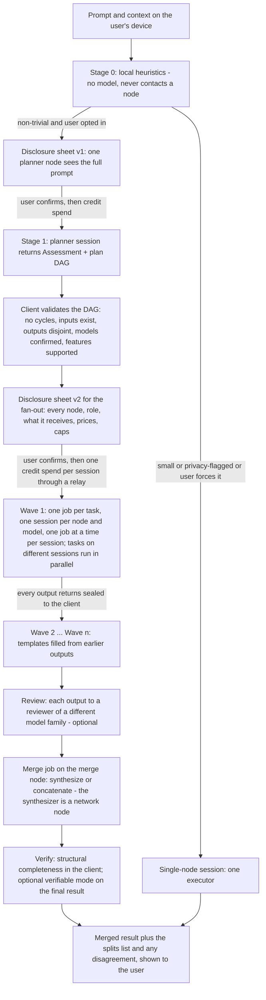

# Orchestration — assess, plan with parallelism in mind, execute in waves, merge

Author: Comuns contributors
Status: Draft
Category: Technical Proposal
Created: 2026-10-12

**Reference:** docs/evidence-register.md, docs/protocol/off-chain-api.md, docs/protocol/contracts-and-settlement.md, docs/protocol/collective-answers.md, docs/node/distributed-execution.md, docs/security/privacy-and-contexts.md, docs/security/inference-verification.md, docs/product/dapp-and-sdk.md, docs/economics/cost-and-pricing.md, docs/adr/0009-opt-in-client-orchestration.md, docs/adr/0010-anonymous-by-default.md, docs/adr/0011-anonymous-credits.md

---

## 1. Summary

Single-node execution is the default of Comuns: one request, one node, one session, one reader of the prompt. This document proposes how a client may, **per request and only by explicit opt-in**, use more than one node: it assesses the task, plans it with parallelism in mind, decomposes it into waves of sub-tasks with disjoint outputs, executes each wave in parallel across credit sessions, each funded by its own credit and reached through a relay, has the outputs reviewed by a different model family, merges them, and optionally verifies the integrated result. Five opt-in execution features exist, with the normative names of docs/security/privacy-and-contexts.md §8.2: `collective_answer`, `parallel_planning`, `task_decomposition`, `model_sharding` and `cross_node_speculation`. The last two are experimental Phase 3 spike work owned by docs/node/distributed-execution.md and are only summarized here.

Comuns is a community proposal; nothing runs yet, and the evidence that orchestration helps is mixed and task-dependent (section 18). The orchestrator is open-source code in the user's app. **Nothing orchestration-related is stored on-chain**: the chain sees only credit sessions, one per `(node, modelId)` the plan uses, each with no user address (docs/adr/0010-anonymous-by-default.md). Orchestration adds no contract and no function. The credit and relay names that every session now uses come from [CIP-0002](../cip/0002-anonymous-credits-relays-and-ownerless-contexts.md) (transcribed from docs/adr/0011-anonymous-credits.md); `NodeRegistry`, `ModelRegistry`, `ContextRegistry` and `SessionEscrow` otherwise stay as docs/protocol/contracts-and-settlement.md defines them; protocol fee 0; no token; no slashing; every session has its own fresh `sessionSigner`, an app-generated key on the user's client that is never delegated to a node in v1; a signed voucher is not reversed; **no payment moves between nodes**; and standard mode still means that each selected executing node can read the plaintext it is sent and should not learn who asked. Planner output and every intermediate text are untrusted data: they never authorize new recipients, new spending, tools or external actions. The capability this document adds is inference across several nodes, not permission for agents to act.

## 2. Scope and non-goals

In scope: the assessment stages; the plan representation and its validation rules; routing by difficulty within the pools the user confirmed; execution in waves over sessions; merge, review and verify; the optional orchestrator node; payment and caps; the disclosure sheet and fail-closed behavior; failure handling; composition with the privacy modes; the client's order of operations; and an honest account of when orchestration hurts.

Non-goals, each deliberately:

- No trained router in v1. Routing uses price, measured speed, reputation, mode and class from the pool, and the assessment's size class; the learned routers of evidence register §13 are motivation for a later CIP, not a v1 component.
- No mandatory matcher or scheduler, and no project-operated relay. Relays are a registered role that anyone may run (docs/adr/0010-anonymous-by-default.md); a node that advertises orchestration (section 11) is optional and no protocol component depends on it.
- No `PlanRegistry`, `OrchestratorRegistry`, pool payee or pass-through payment (docs/protocol/contracts-and-settlement.md §14).
- No llama.cpp RPC server on an open network: its own documentation calls it a proof of concept, fragile and insecure (evidence register §10 [V]).
- No claim that more nodes mean a better answer. Section 18 lists where the evidence says the opposite.
- No agency. A plan may say "ask node B for X"; it may never say "call this tool", "pay this address" or "add this node". The client ignores any such content and shows it to the user as text.

Evidence tags: **[V]** verified in docs/evidence-register.md, **[L]** likely, **[U]** unsure; anything else is UNVERIFIED or this document's proposal.

## 3. The pattern

Assess, plan with parallelism in mind, decompose into waves with disjoint outputs, execute a wave in parallel, review with a different model family, verify the integrated result. Each arrow below is a client-side step; the only remote steps are the credit spends that open sessions and the jobs inside those sessions, all reached through a relay. Consent is confirmed before the first `openSessionFromCredit`, and every session is its own credit spend: a plan with N sessions spends N notes.



Replanning is allowed after any wave (section 6); it re-runs the validation and, if it adds a node or widens what any node receives, the sheet is re-shown and signed for before the next wave.

## 4. Roles

| Role | Where it runs | Reads the full prompt? |
|---|---|---|
| **SDK orchestrator** | Open-source code in the user's client; the default. It handles transport, orchestration and sampling decisions and runs no model | It is the user's own device; not a reader |
| **Assessor / planner node** | A credit session on a node the user chose from the planner model's pool, in stage 1 | Yes |
| **Executor** | A credit session on a node chosen from the pool of the task's confirmed `modelId` | Yes unless the client verified its sub-task payload contains no prompt text (docs/security/privacy-and-contexts.md §8.2) |
| **Answerer** | In `collective_answer`: each of k nodes receives the full prompt sealed separately | Yes |
| **Reviewer** | Receives one output (and in collective answers, the prompt plus all anonymized answers); chosen from a different model family than the producer | Yes (reviewers receive the prompt, or sub-task outputs assumed to quote it) |
| **Synthesizer** | Receives all answers and critiques; always a network node reached through a relay, never the client | Yes |
| **Merge node** | A job that receives the outputs it names, sealed to it by the client | Yes (its inputs are assumed to quote the prompt) |
| **Orchestrator node** (optional) | A node advertising `roles.orchestration`, serving thin clients through a credit session (section 11) | Yes, whenever it plans, merges or synthesizes |
| **Shard holder** (spike only) | Receives activations through a relay; treated as able to read the prompt; an unpaid volunteer node | Yes — inversion recovers 88.4 % of tokens on a 65B model (evidence register §10 [V]) |
| **Draft node / target node** (spike only) | Draft receives the prompt to draft; target receives the prompt plus drafts | Both yes |
| **Verifier** (verifiable mode) | A user-chosen second node re-executing under a demonstrated deterministic profile | Yes |

The reader list is a floor, never a ceiling (docs/security/privacy-and-contexts.md §8.2): the client derives `readersOfFullPrompt` from the actual payloads it seals, and any node that receives prompt text under any role is counted. An attested recipient is counted too, because the bytes reach it; it is counted separately in `counts.attestedRecipients` and is not operator-readable (section 13).

On the wire, the `role` field of a job's AAD uses exactly the canonical tokens of docs/security/privacy-and-contexts.md §6 — `executor`, `planner`, `answerer`, `reviewer`, `synthesizer`, `merge`, `orchestrator`, `shard holder`, `draft`, `target`, `verifier` — and no variant of them; an assessor is a planner session and carries `planner`. `planId`, `taskId` and `role` are bound into the AAD; `wave` is advisory metadata, not bound, and a node must not rely on it. The disclosure sheet's `roles[]` values are the same canonical tokens (docs/security/privacy-and-contexts.md §8.3); a user-facing table may add a label beside a token, but the JSON value is the token.

## 5. Assessment

**Stage 0 — local heuristics.** On the user's device, before anything is sent and without contacting any node, the client runs no model: it scores the request on: prompt length; attached context size; the user's explicit choice; presence of code or tables; and dependency structure (does the prompt ask for one thing, or for several things that depend on each other?). Stage 0 may keep a short prompt on one node; it may never escalate to a remote assessment on its own, and it never replaces a network node with local computation. Its output has the same shape as stage 1's and `source: "local-heuristics"`.

**Stage 1 — planner session.** Only when the user opted into orchestration for this request and stage 0 says the task is non-trivial, the client spends a credit through a relay to open a session with a planner model on a node the user chose from that model's pool — after a first disclosure sheet stating that **one planner node will see the full prompt**. The planner session is paid with the normal formula (`priceInPerMillion × inputTokens + priceOutPerMillion × outputTokens`, over 1,000,000) through ordinary vouchers; nothing about it is special on-chain. It returns an **Assessment**:

| Field | Values |
|---|---|
| `sizeClass` | `small`, `medium`, `large` |
| `riskFlags[]` | `privacy-sensitive`, `needs-exact-math-or-code`, `time-critical`, `decomposition-poor-fit` |
| `recommendedExecutionFeatures[]` | drawn from the five feature names; empty means single-node |
| `subTaskModelSuggestions[]` | per sub-task `modelId` suggestions; the user confirms every `modelId` before any session opens |

**Rules.** The user confirms the recommendation or forces single-node. When the assessment is uncertain or the prompt is privacy-flagged, the recommendation is single-node. `collective_answer` is recommended only for tasks the assessment classifies as `large` **and** open-ended; it is never recommended for checkable math or code, where the recommendation is self-consistency (k samples of one strong model and a majority vote over a short extracted answer, only when the answer is a number, choice or label) or a single strong model plus a test the user runs (docs/protocol/collective-answers.md). A plurality vote is never applied to free text. When one strong model is in a pool, the client **suggests** self-consistency or Self-MoA first; the collective is always the user's choice, and the user may still opt into `collective_answer`. The assessment is data: it recommends; it does not dispatch.

## 6. Plan representation

A plan is a client-side JSON object. It is off-chain, never a contract, never stored in any registry, and never sent to a node except as the sealed output of a planner session back to the client. The user sees every `modelId` in it before confirming. The example is illustrative; `estimatedCapWei` carries no wei value in this document.

```json
{
  "planId": "0x0000000000000000000000000000000000000000000000000000000000009101",
  "version": 1,
  "requestHash": "0x0000000000000000000000000000000000000000000000000000000000004e02",
  "createdBy": {
    "modelId": "0x0000000000000000000000000000000000000000000000000000000000000a02",
    "node": "0x00000000000000000000000000000000000000c3"
  },
  "tasks": [
    {
      "taskId": "0x0000000000000000000000000000000000000000000000000000000000000701",
      "wave": 1,
      "dependsOn": [],
      "modelId": "0x0000000000000000000000000000000000000000000000000000000000000a01",
      "role": "executor",
      "promptTemplate": "From the brief below, extract every dated obligation as a table with columns date, party, obligation.\n\n${request.brief}",
      "visibility": "subTask",
      "outputName": "obligationsTable",
      "outputSchema": "markdown-table",
      "maxOutputTokens": 600
    },
    {
      "taskId": "0x0000000000000000000000000000000000000000000000000000000000000702",
      "wave": 1,
      "dependsOn": [],
      "modelId": "0x0000000000000000000000000000000000000000000000000000000000000a01",
      "role": "executor",
      "promptTemplate": "From the brief below, list the undefined terms and propose a one-line definition for each.\n\n${request.brief}",
      "visibility": "subTask",
      "outputName": "undefinedTerms",
      "outputSchema": "bullet-list",
      "maxOutputTokens": 600
    },
    {
      "taskId": "0x0000000000000000000000000000000000000000000000000000000000000703",
      "wave": 2,
      "dependsOn": [
        "0x0000000000000000000000000000000000000000000000000000000000000701"
      ],
      "modelId": "0x0000000000000000000000000000000000000000000000000000000000000a02",
      "role": "reviewer",
      "promptTemplate": "Check this table for obligations that contradict one another and flag each pair.\n\n${obligationsTable}",
      "visibility": "subTask",
      "outputName": "obligationContradictions",
      "outputSchema": "bullet-list",
      "maxOutputTokens": 400
    },
    {
      "taskId": "0x0000000000000000000000000000000000000000000000000000000000000704",
      "wave": 2,
      "dependsOn": [
        "0x0000000000000000000000000000000000000000000000000000000000000702"
      ],
      "modelId": "0x0000000000000000000000000000000000000000000000000000000000000a02",
      "role": "reviewer",
      "promptTemplate": "Which of these proposed definitions would a careful reader dispute, and why?\n\n${undefinedTerms}",
      "visibility": "subTask",
      "outputName": "disputedDefinitions",
      "outputSchema": "bullet-list",
      "maxOutputTokens": 400
    }
  ],
  "merge": {
    "modelId": "0x0000000000000000000000000000000000000000000000000000000000000a02",
    "strategy": "synthesize"
  },
  "collective": null,
  "estimatedTokens": 4800,
  "estimatedCapWei": "ILLUSTRATIVE_NO_VALUE_SET"
}
```

Field meanings: `planId` and `version` identify the plan and its revision; `requestHash` binds it to the request; `createdBy` names the planner model and node (or the client itself); each task has a `taskId`, a `wave`, a `dependsOn` list of task ids **in earlier waves only**, a `modelId` the user confirmed, a `role` of `executor` or `reviewer`, a `promptTemplate` with `${outputName}` placeholders (and `${request.…}` placeholders for the request's own fields), a `visibility` of `fullPrompt` or `subTask`, a unique `outputName` — the task's output identity, which is also its placeholder — an `outputSchema`, which is the output's shape and **may repeat across tasks**, and a `maxOutputTokens`; `merge` names the merge model and a `strategy` of `synthesize` or `concatenate`; the optional `collective` carries `{k, reviewerModelIds, synthesizerModelId}` for a collective-answer stage; `estimatedTokens` and `estimatedCapWei` are illustrative.

**DAG rules.** A plan is a directed acyclic graph. Waves are its topological levels: a task's wave is one more than the highest wave it depends on. Tasks in one wave have disjoint outputs and no dependency on one another, so they can be dispatched concurrently across sessions. Validation rejects: cycles; a placeholder naming an `outputName` no task produces; two tasks with the same `outputName` — the overlap check is on `outputName` uniqueness only, never on `outputSchema`, since many tasks legitimately produce a `bullet-list` or `text`; a task whose `modelId` the user has not confirmed; a feature or role no confirmed node supports; `visibility: fullPrompt` on a task the sheet lists as sub-task only. A task whose template needs an output not yet produced waits for it; it is never dispatched with an empty placeholder. Example plans must pass their own validator: the plan above has four distinct `outputName` values (three of them with the schema `bullet-list`), every placeholder names one of them, and every dependency lies in an earlier wave.

**One job at a time per session.** A session serves one job at a time (`maxConcurrentJobsPerSession = 1`, docs/protocol/off-chain-api.md §3), because receipts and vouchers form one chain per session. Tasks of one wave that fall on the same `(node, modelId)` session therefore run one after the other: in the plan above, `…0703` and `…0704` both go to the reviewer session on node `…00d4` with model `…0a02` and run sequentially, so wave 2 takes two review jobs' time on that session. A client that wants them in parallel opens a second session for the same `(node, modelId)` — another credit spend, another note and cap — and that session is on the sheet before anything is signed; the reference plan does not, and the sheet of section 13 lists one session per pair.

**Replanning.** After any wave the client (or the planner session, if the user approved one) may revise the remaining waves. The revised plan gets `version + 1`, is re-validated, and — if it adds a node, widens what any node receives or raises a cap — the disclosure sheet is re-shown and signed for before the next wave. A replan that only removes tasks needs no new signature but is shown.

## 7. Routing by difficulty and pools

Each task is routed to a node from the pool of the `modelId` the user confirmed for it — the pool being every node whose `NodeRegistry` entry has `prices[modelId]` with a non-zero `modelBenchmarkHash`, read through a relay-tunnelled RPC or indexer query, never directly from the user's connection (docs/protocol/contracts-and-settlement.md §9). Within that pool the node is chosen by price, measured speed, reputation, mode and class — **never by a class-to-tier table, and never by a claim that a larger model is always better**. Any class may appear in any pool; a stronger class costs more for the same model because the bands are ordered; `maxTier` is information.

Routing by difficulty means: easy work (extraction, formatting, listing) to the cheaper confirmed model; hard work (synthesis, contradiction finding, review) to the strongest confirmed model. The evidence that this saves money is real but is **motivation only** for v1: RouteLLM cut cost "over 2 times in certain cases" and sent only 14 % of MT-Bench calls to the strong model (evidence register §13 [V]); FrugalGPT reports up to 98 % lower cost, Hybrid LLM up to 40 % fewer large-model calls, AutoMix more than 50 % lower cost (evidence register §13 [V]). All of these use a trained router; v1 has none, so the difficulty split comes from the assessment's size class and the user's confirmation, and the saving is whatever the user's own choice of models produces.

The client never widens a pool, never substitutes a node not on the confirmed sheet, and never changes a task's `modelId` without re-showing the sheet.

## 8. Execution and sessions

**Sessions.** The plan uses one `SessionEscrow` credit session per distinct `(node, modelId)`, and every session is its own credit spend: one note and one Semaphore proof per session, submitted through a relay by the node or by a broadcaster and never from a wallet (`openSessionFromCredit` with the node, a randomly chosen relay, the model, the mode, a fresh app-generated `sessionSigner`, the two prices from the confirmed sheet as `expectedPriceInPerMillion` / `expectedPriceOutPerMillion`, and the proof; docs/adr/0011-anonymous-credits.md). The note's denomination is the session's cap, there is no `topUp`, and consent is confirmed on the sheet before any proof is handed to any node. A session is reused across the waves of the **same confirmed request**. A later request may reuse an open session only after the client shows that request's own disclosure sheet (a new sheet version for the new request) and the user explicitly confirms it; the client records the confirmation, binds `requestId` and the sheet `version` into every job's AAD and metadata, and never dispatches a job for an unconfirmed request. On a reused session the sheet shows the **remaining allowance**: the session's cap (its note's denomination) minus the highest `cumulativeWei` the client has signed in that session, redeemed or not — never the cap minus `settledWei`, which would advertise vouchers awaiting redemption as available. That allowance is counted once and never shared by two pending requests, so a request is confirmed only against budget that is actually free. A reused session carries forward only **signed totals**: the next input receipt builds on the last voucher the client signed, and the tokens of any job it abandoned unsigned never enter the counts (docs/protocol/off-chain-api.md §8). A session reused across requests lets its node link those requests, so the client warns before it reuses one, and a funded session never implies consent to a new request (docs/security/privacy-and-contexts.md §8.3); the reference client prefers a new credit spend. Batching several credit spends is an open question (section 20).

**Jobs.** Each task is one encrypted job in its node's session (docs/protocol/off-chain-api.md §6) with `planId`, `taskId` and `role` bound into the AAD and `wave` as advisory metadata that is not bound and that no node relies on. These fields are what the node may log; they never carry another node's plaintext. A session runs **one job at a time** (section 6), so the tasks of a wave are dispatched concurrently **across different sessions** and sequentially within one; the wave ends when its slowest session finishes its last task (LLMCompiler's observation that the slowest parallel task sets the pace, evidence register §12 [V]). Every output returns sealed to the client first; the client decrypts it, fills the templates of the next wave, and re-seals only the approved parts to the next disclosed recipient. Nodes never receive one another's envelope keys.

**Failures.** A failed task is retried only on a node that was on the confirmed sheet (a pre-confirmed fallback), with a new credit session, under the retry rule of docs/protocol/off-chain-api.md §11; the vouchers signed on the failed node's session stand. Before signing the input voucher of any session the client re-reads that session's copied prices **on-chain** through a relay (session record or `SessionOpened`) and aborts with the contract's `closeSession`, authorised by a `sessionSigner` signature and submitted through a relay or broadcaster, if they differ from the sheet the user confirmed (defence in depth behind the on-chain price binding); prices a node reports in its `welcome` are informational and never trigger a close.

```mermaid
sequenceDiagram
    participant C as Client (SDK orchestrator, sessionSigner)
    participant E as SessionEscrow
    participant L as Relay
    participant P as Planner node
    participant A as Node A (model a01)
    participant B as Node B (model a01)
    participant M as Merge node (model a02)
    Note over C,M: every client-node arrow below goes via the session's relay (OHTTP); none is a direct connection
    C->>C: stage 0 heuristics, no model: non-trivial; user opted in
    C-->>C: sheet v1: planner sees full prompt; user confirms
    C->>L: credit spend for the planner session, submitted via the relay
    L->>E: openSessionFromCredit(P, relay, plannerModel, ...)
    C->>L: job: full prompt (sealed, signed, OHTTP) via the relay
    L->>P: job; receipts and vouchers as usual
    P-->>C: Assessment + plan DAG (sealed to the client, via the session relay)
    C->>C: validate DAG; user confirms every modelId and node
    C->>C: compute sheet v2 (A, B, M, and the verifier if mode 2 is wanted; roles; receives; prices; caps)
    C-->>C: user confirms sheet v2 — models never change after this without a sheet v3
    par one credit spend per (node, modelId), each its own note
        C->>L: spend for A, a01
        C->>L: spend for B, a01
        C->>L: spend for M, a02
    end
    L->>E: openSessionFromCredit for each session
    C->>C: re-read on-chain copied prices of each session; abort with closeSession on any difference
    par wave 1, dispatched concurrently across two sessions
        C->>A: job t701 (planId, taskId, wave 1, role executor) (via the session relay)
        C->>B: job t702 (planId, taskId, wave 1, role executor) (via the session relay)
    end
    A-->>C: output obligationsTable sealed to the client (receipts, vouchers per chunk) (via the session relay)
    B-->>C: output undefinedTerms sealed to the client (via the session relay)
    Note over C: wave 1 ends when the slowest session finishes
    C->>M: wave 2, job t703 with ${obligationsTable} sealed to M (via the session relay)
    M-->>C: output obligationContradictions (via the session relay)
    C->>M: wave 2, job t704 with ${undefinedTerms} — after t703, one job at a time per session (via the session relay)
    M-->>C: output disputedDefinitions (via the session relay)
    C->>M: merge job: named outputs sealed to M; strategy synthesize (via the session relay)
    M-->>C: merged result (via the session relay)
    C->>C: structural completeness check; optional verifiable-mode session on the final result, only with the verifier already on sheet v2
    par cooperative close of each session with a final voucher
        C->>A: voucher isFinal = true (via the session relay)
        C->>B: voucher isFinal = true (via the session relay)
        C->>M: voucher isFinal = true (via the session relay)
        C->>P: voucher isFinal = true (via the session relay)
    end
    A->>E: closeWithVoucher
    B->>E: closeWithVoucher
    M->>E: closeWithVoucher
    P->>E: closeWithVoucher
    Note over C,E: each session pays the relay then the node; the unspent remainder is pendingWei, claimed by claimChange into fresh notes, dust to the node
```

## 9. Merge, review and verify

**Merge** is a job on the merge node that receives exactly the outputs the plan names, sealed to it by the client. Strategy `concatenate` joins outputs in task order in the client and needs no merge node at all; `synthesize` asks the merge model to produce one text from the named outputs. The merge node is a full-prompt reader because its inputs are assumed to quote the prompt.

**Review** is optional and routes each task output to a reviewer from a different model family than the producer, with the prompt or sub-task and the output; the reviewer returns critiques, not a replacement answer. The client shows critiques beside the output. Judging has known biases: the strongest judge in the LLM-as-a-judge study was consistent on only 65.0 % of swapped orders, and verbosity and self-preference biases were observed (evidence register §11 [V]); the reference client therefore judges twice with positions swapped when it compares two outputs, and never lets a reviewer's verdict discard an output without showing the user both. Disagreement between the two swapped passes is expected and never marks a synthesis incomplete; an empty splits list is valid; a synthesis is incomplete only when required fields are missing or malformed. Details in docs/protocol/collective-answers.md.

**Verify** means two things and nothing more: structural completeness in the client (every task produced an output matching its `outputSchema`; every placeholder was filled; the merge consumed every named output), and, as a separate opt-in, verifiable mode on the final result — re-execution of the merge job by a user-chosen second node under a demonstrated deterministic profile (docs/security/inference-verification.md), which makes that node a reader of the merged text. **The verifier is on the sheet before any credit is spent**: if verifiable mode is wanted for an orchestrated result, the verifier node is a recipient of the fan-out sheet with its role, mode, prices and cap, reached through a relay and funded by its own credit; wanting it later is a new sheet version and a new confirmation before the verifier session opens. A session's mode is public on-chain, so a verifiable-mode check covers only that verifiable-mode session, and an operator can behave honestly only there; the only mitigation is opt-in, unannounced client-side spot checks of standard-mode sessions, where the user re-runs a sampled prompt on another node that then reads it and is disclosed. Verify is **not** a zero-knowledge proof and **not** slashing; a mismatch is shown to the user and recorded as a reputation event, and no voucher is reversed.

## 10. Parallel planning and collective answers

`parallel_planning` (several planners each see the full prompt, plan reviewers see the prompt plus anonymized plans, a plan synthesizer sees the prompt plus the critiques) and `collective_answer` (k answerers, reviewers, a synthesizer) delegate entirely to docs/protocol/collective-answers.md. Two rules are restated here because they bind this document:

- The **objection round** is not blind and the sheet says so: reviewers see the prompt and the other answers or plans; every planner, plan reviewer and the plan synthesizer is a full-prompt reader. Each answer or plan carries a stable anonymous ID (A1…Ak), assigned once per request by a random permutation; positions are shuffled between the two review passes, but every critique, score and split refers to the stable ID. A node serving a different model in another role gets its own session: sessions are per `(node, modelId)`, never "one per node".
- There is **no auto-executed rank**: a ranked list of plans or answers is shown to the user, who picks or forces single-node; the client never executes the top-ranked plan on its own, and never presents a synthesized answer as verified or hides a disagreement inside it.

The cost is real: debate variants cost 2.1–3.4× the tokens of self-correction for equal or lower accuracy, and agents flip correct answers to incorrect under peer pressure (evidence register §11 [V]). The cheaper variants — self-consistency for short checkable answers, Self-MoA for free text — are different methods and the sheet names which one is in use.

## 11. Orchestrator nodes

A node may advertise `roles.orchestration` with `plannerModelIds` in its capability document (docs/protocol/off-chain-api.md §4). It exists for **thin clients** that cannot run the SDK's planner logic; a client that can run the SDK needs no orchestrator node, and no protocol component depends on one.

How it is used: the user spends a credit through a relay to open a session with the orchestrator node on its planner model, after a disclosure sheet saying that this node will see the full prompt and the plan. The node assesses and plans — and may merge or synthesize, as further jobs in that same session — and returns the list of `(node, modelId, cap)` it needs, sealed to the client. **The user's client** then opens those sessions (one credit spend each, through a relay), seals the sub-tasks to each downstream node, and signs their vouchers. The orchestrator node:

- holds no `sessionSigner` and custodies no session;
- takes no cut and receives no pass-through in v1;
- is paid for its own session's tokens at its offer inside the band, through ordinary vouchers on its credit session, exactly like any other node;
- is a full-prompt reader whenever it plans, merges or synthesizes, and the sheet counts it;
- cannot add a recipient, raise a cap or change a model: its output is data the client validates and the user confirms.

Delegation of `sessionSigner` for thin clients that cannot sign per chunk is not v1; it is an open question for a later CIP (docs/protocol/contracts-and-settlement.md §16).

## 12. Payment and caps

Vouchers are per session, exactly as today; nothing about a plan changes the voucher type, the payment rule or the contract. The client computes the request's **combined cap** as the sum of the per-session caps, each being the denomination of the note that funds the session, and shows it on the sheet as `totalCapWei` before any signature, with the L2 gas estimate shown separately. During execution the client keeps settled spend plus unpaid signed liabilities plus unspent reservations within that combined cap, per session and in total. No payment moves between nodes; pools are not payees; an orchestrator node that wanted to pay other nodes would have to open its own credit sessions with its own notes, which this proposal does not use. Each session pays the relay's share first, then the node; a session's unspent remainder is not refunded to a user but recorded as `pendingWei` after settlement, and the client claims it back with `claimChange` into fresh fixed-denomination notes, with dust below the smallest denomination going to the node (docs/adr/0011-anonymous-credits.md). N sessions need N credit spends and N closes plus L2 gas, which the node bears for the spend and prices into its offer, and which is the honest cost of fan-out (docs/protocol/contracts-and-settlement.md §3); protocol fee 0. The relay fee is a governance parameter with no value set in any document.

What the user pays for a plan, in words: the planner session's tokens; every task's input and output tokens on its executor's session; every review's tokens; the merge job's tokens; and, if chosen, the verifier's re-execution. A task that is retried on a fallback node pays both the failed node's signed vouchers and the fallback's.

## 13. Disclosure sheet and fail-closed

Every non-empty `executionFeatures` set is opt-in per request. The disclosure sheet — field list owned by docs/security/privacy-and-contexts.md §8.3 — is computed from the plan before any session opens and re-shown whenever the plan changes. Its counts cover full prompt, sub-task, other answers, activations and draft tokens; an experimental label appears whenever a spike feature is involved. A required mode missing on any node, no available relay, or a pool that cannot fill the confirmed set fails the whole request closed. An attested orchestration fails closed unless every plaintext recipient on the sheet is attested: the client never mixes an attested executor with an operator-readable planner, reviewer, synthesizer, merge node or verifier. There is no silent downgrade and no fallback that was not pre-confirmed on the sheet. Any change of node, model, data scope, price, cap or reader set creates a new sheet version that must be confirmed before any credit spend or job under it; the order is pick models → see the sheet → confirm → spend, never confirm and then change models.

**The sheet JSON is normative.** The table a client shows is generated from the sheet JSON and must match it field for field; a table that says less than the JSON would have the user agree to something other than what the client sends. The sheet for the plan of section 6, as the table generated from the JSON below:

| Session | Node | Operator | Roles | Model | Mode | Operator-readable | Receives | Price in / out (wei per M) | Cap (note denomination) |
|---|---|---|---|---|---|---|---|---|---|
| 1 | `…00c3` | `…00c3` | planner | `…0a02` | standard | yes | full prompt | 100000000000 / 320000000000 | illustrative |
| 2 | `…00a1` | `…00a1` | executor | `…0a01` | standard | yes | sub-task | 20000000000 / 40000000000 | illustrative |
| 3 | `…00b2` | `…00b2` | executor | `…0a01` | standard | yes | sub-task | 21000000000 / 41000000000 | illustrative |
| 4 | `…00d4` | `…00d4` | reviewer, merge | `…0a02` | standard | yes | sub-task outputs, which may quote the prompt | 100000000000 / 320000000000 | illustrative |
| | | | | | | **operatorReadable:** 4, **attestedRecipients:** 0 | **counts:** fullPrompt 1, subTask 2, otherAnswers 1, activations 0, draftTokens 0 | **readersOfFullPrompt:** 4 nodes, 4 operators | **totalCapWei:** sum of caps; L2 gas shown separately, both displayed in ETH |

The same sheet as the client holds it:

```json
{
  "requestId": "0x0000000000000000000000000000000000000000000000000000000000004e02",
  "planId": "0x0000000000000000000000000000000000000000000000000000000000009101",
  "version": 2,
  "recipients": [
    {
      "node": "0x00000000000000000000000000000000000000c3",
      "operator": "0x00000000000000000000000000000000000000c3",
      "roles": ["planner"],
      "modelId": "0x0000000000000000000000000000000000000000000000000000000000000a02",
      "mode": "standard",
      "operatorReadable": true,
      "receives": ["full prompt"],
      "priceInPerMillion": "100000000000",
      "priceOutPerMillion": "320000000000",
      "capWei": "ILLUSTRATIVE_NO_VALUE_SET"
    },
    {
      "node": "0x00000000000000000000000000000000000000a1",
      "operator": "0x00000000000000000000000000000000000000a1",
      "roles": ["executor"],
      "modelId": "0x0000000000000000000000000000000000000000000000000000000000000a01",
      "mode": "standard",
      "operatorReadable": true,
      "receives": ["sub-task"],
      "priceInPerMillion": "20000000000",
      "priceOutPerMillion": "40000000000",
      "capWei": "ILLUSTRATIVE_NO_VALUE_SET"
    },
    {
      "node": "0x00000000000000000000000000000000000000b2",
      "operator": "0x00000000000000000000000000000000000000b2",
      "roles": ["executor"],
      "modelId": "0x0000000000000000000000000000000000000000000000000000000000000a01",
      "mode": "standard",
      "operatorReadable": true,
      "receives": ["sub-task"],
      "priceInPerMillion": "21000000000",
      "priceOutPerMillion": "41000000000",
      "capWei": "ILLUSTRATIVE_NO_VALUE_SET"
    },
    {
      "node": "0x00000000000000000000000000000000000000d4",
      "operator": "0x00000000000000000000000000000000000000d4",
      "roles": ["reviewer", "merge"],
      "modelId": "0x0000000000000000000000000000000000000000000000000000000000000a02",
      "mode": "standard",
      "operatorReadable": true,
      "receives": ["sub-task outputs, which may quote the prompt"],
      "priceInPerMillion": "100000000000",
      "priceOutPerMillion": "320000000000",
      "capWei": "ILLUSTRATIVE_NO_VALUE_SET"
    }
  ],
  "counts": {
    "fullPrompt": 1,
    "subTask": 2,
    "otherAnswers": 1,
    "activations": 0,
    "draftTokens": 0,
    "operatorReadable": 4,
    "attestedRecipients": 0
  },
  "readersOfFullPrompt": {
    "nodes": 4,
    "operators": 4
  },
  "anonymity": {
    "transport": "every hop through an OHTTP relay; no direct client-to-node path",
    "relay": [
      {
        "node": "0x00000000000000000000000000000000000000c3",
        "relay": "0x00000000000000000000000000000000000000e1",
        "eligibleRelaySetSize": "OBSERVED_PLACEHOLDER"
      },
      {
        "node": "0x00000000000000000000000000000000000000a1",
        "relay": "0x00000000000000000000000000000000000000e2",
        "eligibleRelaySetSize": "OBSERVED_PLACEHOLDER"
      },
      {
        "node": "0x00000000000000000000000000000000000000b2",
        "relay": "0x00000000000000000000000000000000000000e1",
        "eligibleRelaySetSize": "OBSERVED_PLACEHOLDER"
      },
      {
        "node": "0x00000000000000000000000000000000000000d4",
        "relay": "0x00000000000000000000000000000000000000e3",
        "eligibleRelaySetSize": "OBSERVED_PLACEHOLDER"
      }
    ],
    "funding": [
      {
        "node": "0x00000000000000000000000000000000000000c3",
        "denominationIndex": 1,
        "observedGroupSize": "OBSERVED_PLACEHOLDER",
        "belowThreshold": "THRESHOLD_UNSET_PLACEHOLDER"
      },
      {
        "node": "0x00000000000000000000000000000000000000a1",
        "denominationIndex": 0,
        "observedGroupSize": "OBSERVED_PLACEHOLDER",
        "belowThreshold": "THRESHOLD_UNSET_PLACEHOLDER"
      },
      {
        "node": "0x00000000000000000000000000000000000000b2",
        "denominationIndex": 0,
        "observedGroupSize": "OBSERVED_PLACEHOLDER",
        "belowThreshold": "THRESHOLD_UNSET_PLACEHOLDER"
      },
      {
        "node": "0x00000000000000000000000000000000000000d4",
        "denominationIndex": 1,
        "observedGroupSize": "OBSERVED_PLACEHOLDER",
        "belowThreshold": "THRESHOLD_UNSET_PLACEHOLDER"
      }
    ],
    "contextLinkage": []
  },
  "totalCapWei": "ILLUSTRATIVE_NO_VALUE_SET",
  "l2GasEstimate": "SHOWN_SEPARATELY",
  "experimental": false
}
```

`receives[]` says what each node is literally sent, and `counts` agrees with it node by node: `fullPrompt` 1 (the planner), `subTask` 2 (the executors), `otherAnswers` 1 (the reviewer-and-merge node, sent sub-task outputs), each node under exactly one kind. `counts.operatorReadable` is the number of recipients whose operator can read what they receive (4 here) and `counts.attestedRecipients` the number of verified attested recipients (0 here); each recipient's `operatorReadable` is false only for an attested recipient whose quote the client has verified. The `anonymity` object has exactly the shape of docs/protocol/off-chain-api.md §6.1, which is normative for it: `transport`; `relay[]` of `{node, relay, eligibleRelaySetSize}`; `funding[]` of `{node, denominationIndex, observedGroupSize, belowThreshold}`; and `contextLinkage[]` of `{contextId, node, grantedToThisNodeBefore, anchored}`, empty here because this plan grants no context. Observed values are explicit placeholders and the threshold is unset. `readersOfFullPrompt` is the separate floor of nodes that **can read** the prompt, always ≥ `counts.fullPrompt` and never reduced because a recipient is attested: the two executors are readers because their sub-task templates embed the brief, and the reviewer-and-merge node because its inputs may quote it; had the client verified that a sub-task carried no prompt text, that node would still be under `subTask` in `counts` but would leave `readersOfFullPrompt` (docs/security/privacy-and-contexts.md §8.2, floor rule). The headline banner is computed from `counts.operatorReadable` ("4 nodes can read your prompt"), with `readersOfFullPrompt` shown beside it as the floor, and lists the payload kinds from `counts` without counting any node twice (docs/product/dapp-and-sdk.md §5); when `counts.attestedRecipients` is above zero the headline adds how many more process the prompt inside a TEE and should not be able to read it. Each recipient line uses the verbatim banner sentence of docs/adr/0010-anonymous-by-default.md for its mode, and the relay sentence is shown with every sheet; caps and gas are displayed in ETH, never in raw wei.

## 14. Failure handling

| Failure | Client behavior | Funds |
|---|---|---|
| Task failure (error frame, truncated stream, schema mismatch) | Mark the task failed; retry once on a pre-confirmed fallback node from the sheet with a new credit session; otherwise stop the plan and show partial results | signed vouchers on the failed session stand; the fallback is a new credit session with its own note and cap |
| Node offline mid-wave | Same as task failure after `reconnectWindow`; the wave waits for the retry or the user's decision | as above |
| Replan | New plan version; re-validate; re-show the sheet if it adds a node, widens what a node receives or raises a cap | nothing until the user confirms |
| Cap exhausted on one session | The client never signs above that session's cap; its task pauses; `topUp` reverts on a credit session, so the user may open a new credit session with a new note (a new sheet version, confirmed first) or stop the plan; other sessions continue | that session's signed total |
| Lost voucher log for a session | The client signs nothing more on that session and never resumes from the node's reported totals; it closes **unilaterally** — the contract's `closeSession` with a `sessionSigner` signature through a relay or broadcaster, no final voucher, then `finalize` after `closeDeadline` — and, if the user continues, opens a new credit session for that `(node, modelId)`. The new session is a new note and a new cap, so it needs a **new sheet version**, confirmed before its credit spend, even though the node was already on the sheet | vouchers the node holds stand; the remainder is recorded as `pendingWei` at `finalize` and claimed back with `claimChange`; the new session is bounded by the newly confirmed cap |
| Contested merge (the merge output omits or contradicts a named input; a reviewer objected) | Show the merge, the inputs and the objection side by side; never present the merge as verified | all sessions' signed totals |
| Stale sheet (plan, node, model, price or cap changed after confirmation) | Send nothing further for the request until the new version is shown and signed for | unsent parts cost nothing |
| Only some of the N credit spends are submitted or accepted | Send no job; say so; offer `closeSession` on the sessions already opened (settlement through the node's `closeWithVoucher` or `finalize` after `closeDeadline`); a proof whose transaction reverted consumes no nullifier | the full denomination of each opened session returns as `pendingWei` and is claimed with `claimChange`; the node bore the spend gas |
| Prices copied into a session **on-chain** differ from the sheet | Sign nothing; the contract's `closeSession` with a `sessionSigner` signature through a relay or broadcaster; show the new offer. A price a node merely reports in `welcome` is informational and never triggers this | the full denomination returns as `pendingWei` and is claimed with `claimChange` |
| Pool cannot fill the confirmed set (a sheet node left the pool, deregistered or refused admission; no pre-confirmed fallback) | Fail the whole request closed; close any opened sessions | each opened session's remainder returns as `pendingWei` and is claimed with `claimChange` |

## 15. Composition with privacy modes

Each feature still chooses a privacy mode per node: a plan may put one executor on an attested node and another on a standard node, and the sheet shows the mode per session. The reader floor of docs/security/privacy-and-contexts.md §8.2 is unchanged: every role that receives prompt text is counted in `readersOfFullPrompt`, attested recipients included, and an attested recipient is also counted in `counts.attestedRecipients`.

- **Standard mode** on a selected node means that node can read what it is sent and should not learn who asked: it sees no wallet, no account and no network address, because every hop goes through a relay and every session is funded by a credit (docs/adr/0010-anonymous-by-default.md).
- **Attested mode** means this node should not be able to read your prompt, and a physical attack on the hardware can break that (evidence register §14 [V]). It still fails closed when no eligible node exists, and an attested orchestration fails closed unless every plaintext recipient on the sheet is attested: a plan never mixes an attested executor with an operator-readable planner, reviewer, synthesizer, merge node or verifier.
- **Verifiable mode** on the final result is a separate opt-in; the verifier is reached through a relay, funded by its own credit, and sees the text it checks. `cross_node_speculation` combined with verifiable mode fails explicitly: the deterministic profile needs byte-identical output that speculative engines do not guarantee (mistral.rs states no token-for-token equivalence, evidence register §9 [V]), and TOPLOC cannot detect speculative decoding (evidence register §5 [V]).
- **No payer.** No session names a payer: each is funded by a credit with `user = address(0)`. What a plan still reveals is its shape. The N credit spends of one request fall in one time window, and several credit sessions opened in the same window, on the same relay or on related pools, are correlatable; the spend proofs hide which notes paid, not that the sessions coincided (docs/security/privacy-and-contexts.md §9). A relay sees timing and sizes for every session it carries, and a relay that carries several sessions of one plan can tie them together by timing. Padding and batching narrow this and do not close it. The sheet says that fan-out is visible in this way, and the user opts in knowing it.
- **Synthesizers and merge nodes are network nodes.** A synthesizer is always a network node reached through a relay and funded by its own credit, and it is always a reader. The client never synthesizes locally and never runs a model; its local heuristics (section 5) are arithmetic over the request's own fields.

## 16. Experimental features

`model_sharding` and `cross_node_speculation` are Phase 3 verification spike work owned by docs/node/distributed-execution.md. This document records only:

- every shard holder is treated as able to read the prompt: prompt inversion from activations recovers 88.4 % of tokens on a 65B model, vec2text recovers 92 % of 32-token inputs exactly from embeddings, and a 4,112-token medical prompt was nearly fully inverted from a middle layer (evidence register §10 [V]);
- the contracts have no activation meter, so a shard that emits no completion tokens cannot be paid by the payment rule; **sharding is not paid by activation bytes in v1**; shard holders — including the nodes that run the embedding and the output layers — are unpaid volunteers that hold no session, in v1 or in the spike, and the reference client never spends a credit or signs a voucher for one; the unpaid spike is exempt from the rule that every paid recipient has a credit session, and from nothing else. Embedding and output-layer computation run on disclosed network nodes, which are readers like the other holders; the client performs no model computation and keeps transport, orchestration and sampling decisions only. In the spike's data path the client mediates every stage boundary: it sends each holder exactly its inputs, receives each holder's activations and forwards them, and takes the sampling decision from the last stage's output, so no holder needs another holder's keys. Activations to each holder travel through a relay, OHTTP-encapsulated to the holder's registered `ohttpKeyConfig`, with no inner job HPKE envelope; there is no direct client-to-holder connection and none that skips the relay, and activations go only to holders listed on the sheet. A lost shard holder means restarting the generation on a new chain of holders from the sheet; because the client holds the activations it forwarded it may replay them instead, at a latency cost the spike measures and does not promise;
- cross-node drafting gives no promised WAN speed-up: at WAN round-trip times the cloud round trip remains too large for pipelined distributed speculative decoding to beat co-located speculative decoding — the preprint says so [V], and the result is not independently replicated [U] (evidence register §9); larger draft models raise the acceptance rate α but cost more (higher c) [V]; **WAN speculative decoding must not be promised as faster**. A speculative generation is one job per session on each of the draft and target nodes; each round is a request frame inside that job carrying the accepted tokens and the rollback point, and the draft node rolls its KV cache back to the accepted prefix before drafting again; the prompt is input-billed once per job. Drafts carry the draft model's per-token probability distributions as sealed metadata, which are **not** billable output tokens (billing counts tokens only), or the spike is limited to greedy decoding at temperature 0, where tokens suffice; a draft of γ ≤ `MAX_DRAFT_TOKENS` tokens bounds the target's per-round work; the draft node's session bills drafted tokens, accepted or rejected, and the target's session is billed for the drafted tokens it scores, which the spike measures. The greedy exact-match preservation test is valid only under the spike's own measured determinism (1,000 temperature-0 runs gave 80 unique outputs without batch-invariant kernels, evidence register §5 [V]);
- under mainnet parameters the reference client **refuses both** `model_sharding` and `cross_node_speculation`; both run only with testnet-only, non-normative prices (docs/protocol/contracts-and-settlement.md §9);
- both spikes may end in a published negative result, which this proposal would consider a success of the spike.

## 17. Client order

1. Stage 0 heuristic on the device; if small, privacy-flagged or the user forces it: single-node, stop here.
2. Disclosure sheet v1 (one planner node sees the full prompt); the user confirms; one credit spend through a relay opens the planner session.
3. Planner session returns the Assessment and the plan; the client validates the DAG.
4. The user confirms every `modelId`, every node and the feature set — including whether verifiable mode is wanted on the final result — or forces single-node. Models are fixed here, before the sheet.
5. Disclosure sheet v2 for the fan-out, generated from the sheet JSON: every node, role, what it receives, operator-readable or attested, prices, caps, combined cap, L2 gas separately, the anonymity block, and the verifier as a recipient if mode 2 was chosen in step 4; an attested request fails closed here unless every plaintext recipient is attested; the user confirms. Nothing confirmed here changes afterwards without a sheet v3 and a new confirmation.
6. One credit spend per `(node, modelId)` for the wave's sessions, each its own note, through a relay chosen at random per session and in parallel (a second session for the same pair only if the sheet listed it); the client re-reads each session's copied prices on-chain through a relay and aborts on any difference; sessions are held in a map keyed by the pair, never by node or model alone.
7. Vouchers per session as usual: input receipt, input voucher, chunk receipts, cumulative vouchers, never above a session's cap, always from the client's own log; one job at a time per session.
8. Review sessions, if chosen, on a different model family (on the sheet since step 5).
9. Verifiable mode on the final result, only if the verifier was on the sheet signed in step 5; a verifier wanted now is a new sheet version and a new confirmation before its session opens.
10. Show the merged result, the splits list and every disagreement; close each session cooperatively with a final voucher — or, for a session whose node is gone or whose voucher log is lost, unilaterally with the contract's `closeSession` (a `sessionSigner` signature, submitted through a relay or broadcaster) and `finalize` after `closeDeadline`; then claim each session's `pendingWei` back with `claimChange`.

## 18. When orchestration hurts

Orchestration is a cost until shown otherwise, and the evidence register says where it hurts (evidence register §12 [V]):

- **Small tasks.** Skeleton-of-Thought's own authors use a ~0.04 s router to decide *when not* to use it; a short prompt gains nothing from fan-out and pays N sessions' L2 gas.
- **Planner overhead.** LLMCompiler reports up to 3.7× lower latency and 6.7× lower cost than sequential execution and a ~9 % accuracy gain on its benchmarks, but the planner and the final join cannot be parallelized, and planner overhead made it slower on one benchmark. A plan with two tasks rarely beats one call.
- **Dependent tasks.** Skeleton-of-Thought ignores dependencies between points, and the slowest parallel task sets the pace; a chain of dependent steps gains nothing from waves.
- **Math, coding, Fermi estimates and writing.** Skeleton-of-Thought reaches up to 2.39× speedup with quality at least as good in roughly 60 % of cases — which means worse in a large share — and is poor for math, coding, Fermi and writing tasks. Decomposed writing loses voice; decomposed code loses interfaces. The assessment flags `needs-exact-math-or-code` and `decomposition-poor-fit` for this reason, and `collective_answer` is never recommended for checkable math or code.
- **Collective answers.** Debate costs 2.1–3.4× the tokens for equal or lower accuracy in one study, and judges show position bias (evidence register §11 [V]).

The reference client's default is therefore single-node, and the assessment must argue its way out of it.

## 19. Risks

### R1 — The planner sees everything **[RISK] · High**

Stage 1 gives one remote node the full prompt and the structure of the user's problem. Mitigation: stage 0 never contacts a node; the first sheet says so before the planner session opens; privacy-flagged prompts stay single-node.

### R2 — More readers **[RISK] · High**

Every feature adds nodes that read the prompt or parts of it, and sub-task payloads usually quote it. Mitigation: `readersOfFullPrompt` counted by node and operator as a floor; opt-in per request; fail-closed.

### R3 — Cost multiplication and sycophancy **[RISK] · Medium**

N sessions cost N credit spends and N closes plus tokens; collective variants cost 2.1–3.4× tokens and agents conform to wrong peers (evidence register §11 [V]). Mitigation: the combined cap on the sheet; the assessment rule for `collective_answer`; the disagreement view.

### R4 — Slowest-task latency **[RISK] · Medium**

A wave ends when its slowest task ends (evidence register §12 [V]); one slow node delays the whole request. Mitigation: measured speed in routing; per-task `maxOutputTokens`; the user can stop a wave.

### R5 — Activation inversion if sharding is turned on **[RISK] · High**

Shard holders, including the nodes that run the embedding and output layers, recover prompts from activations (88.4 % token accuracy on a 65B model, evidence register §10 [V]). Mitigation: sharding is a spike, refused under mainnet parameters, and every shard holder is counted as a full-prompt reader.

### R6 — WAN speculation disappointing **[RISK] · Medium**

No WAN speed-up is promised (evidence register §9, [V] for the quote, [U] for replication) and rejected drafts are billed. Mitigation: experimental label, hidden without a testnet price, published negative result accepted.

### R7 — Stale pool offer **[RISK] · Medium**

A sheet node may leave the pool or refuse admission between confirmation and execution. Mitigation: pre-confirmed fallbacks on the sheet; fail-closed when none; price binding in the spend message so no note is spent at an unconfirmed price.

### R8 — `sessionSigner` delegation if a later CIP allows it **[RISK] · High**

Delegating the signer to an orchestrator node would let it sign envelopes and vouchers up to the cap on the user's behalf. Not v1. Mitigation if ever proposed: bounded caps, revocation, and a CIP that amends docs/protocol/contracts-and-settlement.md.

### R9 — Quality loss on decomposed writing or code **[RISK] · Medium**

Decomposition is poor for writing, coding, math and Fermi tasks (evidence register §12 [V]). Mitigation: the assessment's `decomposition-poor-fit` flag; single-node recommendation; the user's own test for code.

### R10 — Planner output treated as authority **[RISK] · High**

A plan that names recipients, caps or actions could, in a careless client, become instructions. Mitigation: the client validates the DAG against the confirmed models and nodes, ignores any field it did not define, never adds a recipient from plan text, and routes every action through the user's signature.

### R11 — Spends of one plan are correlatable **[RISK] · Medium**

The N credit spends of one request, and the relay traffic of its sessions, fall in one window; an observer can infer that a multi-node feature was used and estimate its shape, and a relay, or a relay and node that collude, can tie the sessions together by timing and sizes. No payer is named, but the plan is visible. Mitigation: opt-in per request, the sheet's statement of this, relays chosen at random per session, padding and batching; none removes it in v1 (docs/security/privacy-and-contexts.md §9).

## 20. Open questions

1. **Batching credit spends.** Whether N spends for one plan should be submitted together, staggered across a window, or submitted separately through different relays, weighing gas and latency against the correlation of spends in one window (docs/security/privacy-and-contexts.md §9). Any batch entry point would be a CIP (docs/protocol/contracts-and-settlement.md §16).
2. **Plan caching.** Whether a validated plan for a request shape may be reused for a later request, and how the sheet re-confirmation rule applies.
3. **Reputation for planners.** How indexers can score planner nodes when the plan's quality is only visible to the client.
4. **Standard plan schema CIP.** Whether the JSON of section 6 should be frozen by a CIP so that orchestrator nodes and clients interoperate.
5. **Thin clients that cannot sign per chunk.** Whether delegation of `sessionSigner`, session keys or account abstraction should be proposed in a later CIP, and with what bounds. The deposit key of proposed [ADR 0016](../adr/0016-funding-edge-and-deposit-key.md) is a deposit-only authority, not a delegation of `sessionSigner`; `sessionSigner` delegation stays deferred and would need its own CIP.
6. **Client-side caps on k and wave width.** Reasonable defaults for the number of answerers and the number of concurrent tasks per wave; these are client settings, **not protocol constants**.
7. **Sub-task payload verification.** A reliable client-side test that a sub-task contains no prompt text, so that an executor may leave `readersOfFullPrompt`.
8. **Second sessions on one pair.** Whether the reference client should offer a second session for the same `(node, modelId)` automatically when two tasks of a wave land on it, or always run them sequentially; the trade is another note and credit spend against wave latency.
9. **Spike replay cost.** Whether client-mediated replay after a lost shard holder is worth its latency and the client's cache of every stage's inputs, or whether the spike should only restart; a measurement question for Phase 3.
