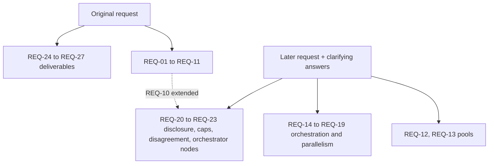

# Comuns — Requirements traceability

Author: Comuns contributors
Status: Draft
Category: Technical Proposal
Created: 2026-10-12
**Reference:** [project-charter.md](project-charter.md), [evidence-register.md](evidence-register.md), [protocol/contracts-and-settlement.md](protocol/contracts-and-settlement.md), [security/privacy-and-contexts.md](security/privacy-and-contexts.md), [protocol/orchestration.md](protocol/orchestration.md), [protocol/collective-answers.md](protocol/collective-answers.md), [node/distributed-execution.md](node/distributed-execution.md), [product/dapp-and-sdk.md](product/dapp-and-sdk.md), [adr/0008-model-first-pools.md](adr/0008-model-first-pools.md), [adr/0009-opt-in-client-orchestration.md](adr/0009-opt-in-client-orchestration.md)

---

## 1. Purpose

This document traces every requirement in the original request, and in the later request that added model-first pools and multi-node execution, to a proposed interpretation, the document(s) that own it, an acceptance condition, and a status. It changes nothing by itself: every interpretation is PROPOSED and follows the binding positions in [project-charter.md](project-charter.md) section 4.

## 2. Status values

- **Proposed** — the interpretation is drafted and can be met as stated once the owning documents are accepted through a CIP.
- **Conditional** — the requirement can be met only in part, or only under stated conditions; the condition is written in the row.
- **Unresolved** — no acceptable interpretation exists yet. No row currently has this status.

## 3. Sources of the wording

- The **original request** asked for a plan, a pitch deck, an architectural design and documentation for an open-source, community-built, decentralized AI system, with a bulleted list of properties, and scoped it to LLM inference.
- The **later request** (quoted verbatim, including its spelling) said: "node can run any model so user can choose a model they want that can be provide for a set o nodes running that model." and "WE need to think about a consensus mechanism or a way to parallelize the execution if possible. We can think about this orchestrator architecture where it first assess the size of the task and plan the execution ever for planing task with parallelization in mind."
- The user's answers to clarifying questions fixed five decisions: consensus means "collective answer"; the orchestrator is client-side SDK code by default with optional orchestrator nodes; all four kinds of parallelism are covered; every multi-node mode is opt-in per request and disclosed; pools are model-first.

## 4. Traceability matrix

| ID | Original request wording | Proposed interpretation | Owning document(s) | Acceptance condition | Status |
|---|---|---|---|---|---|
| REQ-01 | "Be decentralized using a blockchain(Open source blockchain L2 such as Arbitrum one) to execute inferences on LLMs models" | Settlement and registries on Arbitrum One with Solidity/EVM contracts NodeRegistry, ModelRegistry, ContextRegistry, SessionEscrow, with a closed list of fifteen state-changing functions (the fourteen registry and session functions plus `withdraw`); payments are pull-based: contracts credit `balances[address]` and only `withdraw()` sends ETH; `registerModel` and `updateModel` are governance-only in v1; inference itself runs off-chain on independent nodes because a model cannot run inside a contract; Stylus is not v1 (activations paused since 2026-10-02, evidence register §1 [V]). | docs/protocol/contracts-and-settlement.md; docs/adr/0001-settle-on-arbitrum-one-evm-not-stylus.md; docs/architecture/deployment-and-decentralization.md | The four contracts are specified with their fifteen functions and events, every event defined once with its field order; no function other than `withdraw` sends ETH; no document places inference on-chain; the single-sequencer dependency and the outage residual risk are disclosed. | Proposed |
| REQ-02 | "Nodes should run 1-to-many models and accept prompts as inputs" | A Rust node serves many models through pluggable backends (llama.cpp first, mistral.rs second) and refuses work that does not fit; prompts arrive HPKE-sealed. | docs/node/node-design.md; docs/protocol/off-chain-api.md; docs/adr/0002-off-chain-rust-inference.md | The node design shows a per-model offer list and an admission check; the API accepts sealed prompts. | Proposed |
| REQ-03 | "Each wallet in the blockchain should have 1-to-many contexts shared between the nodes" | Each wallet owns many versioned, content-addressed contexts encrypted under per-version keys (a random 256-bit `K_v` per version; contentHash = keccak256 of the complete stored blob); "shared between the nodes" means the owner wraps exactly the `K_v` of the granted versions to a chosen node's HPKE key with an `expiresAt` in unix seconds; every `K_v` is also wrapped to the client's identity HPKE key, and the mandatory backup export holds the identity key plus every key-wrap record — it restores the keys, not ciphertext that existed only on a lost device, so at least one context host or a second device is recommended for the blobs; nodes never exchange plaintext; the chain stores owner, contextId and the latest (version, contentHash) only and emits ContextSet per version. | docs/security/privacy-and-contexts.md; docs/protocol/contracts-and-settlement.md | ContextRegistry stores only owner, contextId, version, contentHash; a grant flow wrapping per-version keys to a node's HPKE key, with `expiresAt` in seconds, is specified; the backup export is specified as identity key plus key-wrap records and no document claims the backup alone restores every context; a setContext race reverts and is never merged silently. | Proposed |
| REQ-04 | "Users that want to run an inference can pay gas to nodes so it can use to pay for resources for executing it" | Interpreted as an inference payment to nodes that is distinct from L2 gas: ETH session escrow with openSession (which takes expectedPriceInPerMillion and expectedPriceOutPerMillion and reverts if the node's current offer differs) and a maxSpendWei cap (effective cap min(depositWei, maxSpendWei), raisable by topUp), a node-signed input receipt (sessionId, jobId, jobInputTokens, cumulativeInputTokensAfter) checked by the client against its own tokenization and against lastInputTokens + jobInputTokens before it signs the input voucher before prefill, cumulative EIP-712 vouchers of the one canonical Voucher type (type string without spaces after commas; cumulative token counts, strictly increasing seq, outputCommitment under a session commitKey, `final` meaning only session close) per chunk of at most CHUNK_TOKENS output tokens; redeemVoucher credits the node and never a refund; closeWithVoucher on the happy path credits the node and the refund depositWei − settledWei to the user in one call; finalize after closeDeadline credits the refund; an abandoned client is handled by redeemVoucher of the highest non-final voucher, then closeSession, then finalize; funds collected through withdraw(); protocol fee 0; L2 gas is paid separately to the chain. | docs/protocol/contracts-and-settlement.md; docs/adr/0004-sessions-vouchers-and-no-slashing.md; docs/economics/cost-and-pricing.md | The payment formula with integer floor division is specified and recomputed on-chain; the settlement accounting states and tests the invariant that a settled session credits node plus user exactly depositWei; no sentence says redeemVoucher credits a refund; the input receipt precedes the input voucher, carries per-job and cumulative counts, and its residual risk (a node may redeem the input fee without running the prompt) is stated; no document calls the inference payment "gas". | Proposed |
| REQ-05 | "Nodes should be implement with the most performant language such as Rust" | The node is written in Rust; llama.cpp kernels (C/C++) are used through Rust bindings and mistral.rs is a Rust engine; Rust alone is not claimed to make inference faster. | docs/node/node-design.md; docs/adr/0002-off-chain-rust-inference.md | The node design names Rust for the node and makes no speed claim for Rust alone. | Proposed |
| REQ-06 | "Dapps can be built on top of this AI blockchain so users can interact with it with a good UX" | A client SDK and reference dapp hide sessions, vouchers and sealing; the user picks a model, sees its pool, and confirms a disclosure sheet. | docs/product/dapp-and-sdk.md | The dapp flow covers model choice, pool view, disclosure, signing, streaming and refund. | Proposed |
| REQ-07 | "Cost calculations needs to be very well defined so greater performant hardware can charge more gas and lower performant hardware will have to charge less." | Hardware classes S<M<L<X by public self-benchmark; governance-set price bands for every (tier, class) pair, input and output separately, with floor(class c+1) strictly above ceiling(class c); no wei value adopted; bands set by a later CIP. | docs/economics/cost-and-pricing.md; docs/node/hardware-classes-and-benchmarks.md; docs/adr/0005-hardware-classes-and-price-bands.md; docs/economics/pricing-examples.json | The band ordering rule is stated and checked by scripts/check-pricing.py on non-normative fixtures; mainnet is marked not deployable until the bands CIP. | Proposed |
| REQ-08 | "It needs to be democratic so everyone with a minimum hardware can run small models and better hardwares can run bigger models so less complex tasks can be run on less performant hardware and more complex task can be run on more performant hardware" | Participation by class: any node with minimum hardware can join and offer the models it can load; model tiers T0–T4 are labels; class selects the price band; routing easy work to cheaper models is a client choice. The earlier rule tying classes to tiers is withdrawn (see REQ-13). | docs/node/hardware-classes-and-benchmarks.md; docs/economics/cost-and-pricing.md; docs/adr/0008-model-first-pools.md | A node of any class can register an offer for a model it can load; the client can route by difficulty. | Proposed |
| REQ-09 | "It's development needs to be driven by the community" | Apache-2.0 and DCO; CIPs (Draft → Review → Last Call 14 days → Final; Stagnant after 6 months); working groups; no maintainers seated; no coin vote. | GOVERNANCE.md; CONTRIBUTING.md; docs/cip/README.md; docs/adr/0006-apache-2-0-and-dco.md | Governance documents describe the CIP lifecycle and contain no coin vote. | Proposed |
| REQ-10 | "It needs to be secure so prompts needs to be encrypted with 2 way encryption so no one can see what each other is asking LLMs besides the owner of the wallet" | HPKE (RFC 9180, X25519, HKDF-SHA256, ChaCha20-Poly1305) both ways. True against third parties: relays, indexers, other nodes and chain observers see ciphertext only. Not true against the chosen executing node in standard mode: that node sees the prompt in plaintext. HPKE stays base mode; every job envelope is signed by the session's sessionSigner and a node rejects envelopes that do not verify, which stops third parties injecting jobs into someone else's session. Single-node standard mode is unchanged by the later request (the chosen node sees plaintext; others see ciphertext). Each opt-in multi-node feature adds at least the full-prompt readers listed in charter 4.16 (executor, verifier, answerers, reviewers, remote synthesizer, planners, plan reviewers, plan synthesizer, draft and target node, shard holders, an orchestrator node that plans, merges or synthesizes, merge node, any remote assessor or planner in any feature, any sub-task executor or reviewer whose payload contains prompt text) — a floor, never a ceiling, since the sheet derives the count from the actual payloads — and is never the default. Attested mode narrows but does not remove this (not a defense against physical access); local execution is the only owner-only option. | docs/security/privacy-and-contexts.md; docs/security/threat-model.md; docs/adr/0003-hpke-and-the-executor-plaintext-limit.md | Every user-facing flow discloses the executor plaintext limit before signing; the disclosure sheet counts every full-prompt reader by distinct node and distinct operator for multi-node requests; the sessionSigner-signed envelope is specified. | Conditional |
| REQ-11 | "Please scope it to only LLM inference and do not include federate learning as it requires training models in a decentralized way" | Scope is LLM inference only; training, fine-tuning and federated learning are non-goals and appear only as non-goals. | docs/project-charter.md | No document proposes training, fine-tuning or federated learning except as a non-goal. | Proposed |
| REQ-12 | "node can run any model so user can choose a model they want that can be provide for a set o nodes running that model." | Model-first pools: a node offers any registered model it can load through prices[modelId] = (priceInPerMillion, priceOutPerMillion, modelBenchmarkHash) with a non-zero modelBenchmarkHash; the set of nodes with a current offer for a modelId is that model's pool, enumerated off-chain; the client picks node(s) by price, measured speed, reputation, privacy mode and class; the chain never stores pool lists; updateNode replaces the whole offer list and emits a cleared OfferSet for every removed model; "registered model" means one registered by the governance timelock (registerModel and updateModel are governance-only in v1; Sepolia models come from a testnet-only CIP). | docs/adr/0008-model-first-pools.md; docs/protocol/contracts-and-settlement.md; docs/node/model-registry-and-licenses.md; docs/product/dapp-and-sdk.md | NodeRegistry stores per-model offers written replace-all; the client enumerates a pool and says so when a pool is thin rather than switching models. | Proposed |
| REQ-13 | "node can run any model so user can choose a model they want that can be provide for a set o nodes running that model." | No hardware class is barred from a model tier it can load; memory fit and the per-model self-benchmark are the node's own admission decision; maxTier is informational and never an openSession gate; class selects the price band only. | docs/adr/0008-model-first-pools.md; docs/node/hardware-classes-and-benchmarks.md; docs/economics/cost-and-pricing.md | No document states a protocol rule restricting a class to a tier, except where it names the withdrawn rule. | Proposed |
| REQ-14 | "We can think about this orchestrator architecture where it first assess the size of the task and plan the execution ever for planing task with parallelization in mind." | An orchestrator assesses task size, complexity and risk, then plans execution with parallelism in mind. It is open-source client SDK code by default; assessment starts with local heuristics; an optional remote planning call runs on a user-chosen node, paid as an ordinary session, after disclosure; planner output is untrusted data. Optional orchestrator nodes exist (REQ-23). | docs/protocol/orchestration.md; docs/adr/0009-opt-in-client-orchestration.md; docs/product/dapp-and-sdk.md | The orchestrator pipeline (assess, plan, decompose, execute a wave, review, verify) is specified as client code; no step adds a mandatory trusted party. | Proposed |
| REQ-15 | "WE need to think about a consensus mechanism or a way to parallelize the execution if possible." | Consensus is interpreted as collective_answer: k ≥ 2 nodes, possibly different models, answer independently; reviewers cross-check blind with positions swapped; a user-chosen synthesizer merges the answers and returns splits and an agreement level. A quality aid at k times the cost — not same-model integrity replication, not plan-only consensus, not verification, no payment consequence. | docs/protocol/collective-answers.md; docs/protocol/orchestration.md; docs/adr/0009-opt-in-client-orchestration.md | The collective_answer flow, its cost and its "contested" label are specified; when a strong model is in a pool the client offers the cheaper single-model variant as two distinct methods — self-consistency (majority vote over a short checkable answer only) and Self-MoA (synthesizer over k samples, for free text) — and never applies a plurality vote to free text. | Proposed |
| REQ-16 | "plan the execution ever for planing task with parallelization in mind." | parallel_planning: several planners propose plans independently, reviewers cross-check blind, a synthesizer keeps converged parts and lists splits as questions, an objection round (not blind) follows, and the user confirms before any execution session opens; a judge's rank is never executed automatically. | docs/protocol/collective-answers.md; docs/protocol/orchestration.md | The user-confirmation gate before execution is specified and the objection round is disclosed as not blind. | Proposed |
| REQ-17 | "a way to parallelize the execution if possible." | task_decomposition: a plan is a DAG of sub-tasks grouped in waves; tasks in one wave have disjoint outputs and run concurrently on different node pools; a merge job joins outputs; results may be reviewed by a different model family; a final verify job checks structure; math, coding, Fermi and tight writing are not decomposed by default (evidence register §12 [V]). | docs/protocol/orchestration.md; docs/adr/0009-opt-in-client-orchestration.md | Wave semantics, merge, review and verify jobs are specified; the plan stays off-chain. | Proposed |
| REQ-18 | "a way to parallelize the execution if possible." | model_sharding: contiguous layer segments of one model on several small machines. Experimental Phase 3 spike only; every shard holder can read the prompt (evidence register §10 [V]); slow over the internet; not paid under mainnet parameters in v1 because there is no activation meter; llama.cpp's RPC backend never on an open network. | docs/node/distributed-execution.md; docs/security/privacy-and-contexts.md | The spike is measured against a single node of the same class and may end in a published negative result; shard holders count as full-prompt readers. | Conditional |
| REQ-19 | "a way to parallelize the execution if possible." | cross_node_speculation: a cheaper draft node drafts tokens, a target node verifies. Experimental Phase 3 spike only; no WAN speed-up is promised — a preprint states that at WAN round-trip times pipelined distributed speculative decoding does not beat co-located speculative decoding (evidence register §9, quote [V], not independently replicated [U]); the draft node and the target node are both full-prompt readers and the target also sees the drafts; incompatible with verifiable mode because the deterministic profile needs byte-identical output that speculative engines do not guarantee (evidence register §9 [V]). | docs/node/distributed-execution.md; docs/security/privacy-and-contexts.md | The spike is measured against a single node of the same class — a baseline the preprint does not cover, since its baseline is co-located speculative decoding — and may end in a published negative result; no WAN speed-up is promised; the disclosure sheet counts the draft node and the target node as full-prompt readers. | Conditional |
| REQ-20 | "WE need to think about a consensus mechanism or a way to parallelize the execution if possible." | Every multi-node feature is opt-in per request; single-node is the default; before signing any openSession the client shows the disclosure sheet with every node's role, what it receives, privacy mode, prices and cap, and the counts of full-prompt readers by distinct node and distinct operator (charter 4.16 list, a floor derived from the actual payloads); the sheet binds the confirmed prices: openSession takes the expected prices and reverts if the node's offer differs, and as defence in depth, if the prices copied into a session still differ, the client signs nothing and calls closeSession; reused sessions need fresh confirmation; missing modes or unfillable pools fail closed. | docs/protocol/orchestration.md; docs/security/privacy-and-contexts.md; docs/product/dapp-and-sdk.md; docs/adr/0009-opt-in-client-orchestration.md | No flow sends a job for a non-empty executionFeatures set before the user confirms that request's disclosure sheet; no voucher is signed for a session whose prices differ from the confirmed sheet. | Proposed |
| REQ-21 | "a way to parallelize the execution if possible." | Aggregate request cap: one session per distinct (node, modelId); the disclosure sheet shows the sum of session caps; the client keeps settled spend plus unpaid signed liabilities plus unspent reservations within that sum; N sessions need N openSession/closeWithVoucher pairs plus L2 gas. | docs/protocol/contracts-and-settlement.md; docs/protocol/orchestration.md; docs/product/dapp-and-sdk.md | The aggregate cap is displayed and enforced client-side; no contract or function beyond the fifteen of the contracts document is introduced. | Proposed |
| REQ-22 | "WE need to think about a consensus mechanism" | Disagreement between nodes is shown to the user, never hidden: a splits list and an agreement level; the result is labeled "contested" when splits exist or agreement is low; every original answer and critique is available on request; disagreement has no payment consequence. | docs/protocol/collective-answers.md; docs/product/dapp-and-sdk.md | The dapp displays the contested label and offers the original answers. | Proposed |
| REQ-23 | "We can think about this orchestrator architecture" | Orchestrator nodes are optional, serve thin clients, run the same open-source orchestrator, are paid only as an ordinary session on their planner model, take no cut, hold no sessionSigner in v1, are counted as full-prompt readers whenever they plan, merge or synthesize, and are never a mandatory trusted party. | docs/protocol/orchestration.md; docs/adr/0009-opt-in-client-orchestration.md; docs/protocol/contracts-and-settlement.md | Every orchestrator flow works without an orchestrator node; no contract recognizes an orchestrator role; the disclosure sheet counts an orchestrator node that plans, merges or synthesizes as a full-prompt reader. | Proposed |
| REQ-24 | "I would like to create a plan for this project" | Deliverable: a phased project plan (Phase 0 Documentation baseline to Phase 4 External review, which ends with a go/no-go CIP), relative order, no dates. | docs/project-plan.md; docs/project-charter.md | The plan lists the five phases with exit criteria and no dates. | Proposed |
| REQ-25 | "with a pitch deck" | Deliverable: a pitch deck in Markdown and HTML, with no claims of a mainnet date, audit, grant, partnership, users or lower prices. | pitch/pitch-deck.md; pitch/pitch-deck.html; scripts/check-deck.py | The deck exists in both formats and passes scripts/check-deck.py. | Proposed |
| REQ-26 | "an architectural design" | Deliverable: system and deployment architecture with mermaid diagrams. | docs/architecture/system-architecture.md; docs/architecture/deployment-and-decentralization.md | Both documents exist and diagrams are fenced mermaid only. | Proposed |
| REQ-27 | "and any important documentation for a system of an open source decentralized AI for everyone" | Deliverable: the documentation set in the charter's document map, emphasizing community and open-source development. | docs/project-charter.md; docs/README.md; GOVERNANCE.md | Every path in the charter's document map exists and passes scripts/check-docs.py. | Proposed |

## 5. Coverage

## 6. Risks

### R1 — The confidentiality requirement is read as absolute **[RISK] · High**

REQ-10 is Conditional: the chosen node in standard mode reads the prompt, and multi-node features add readers. Readers of a summary may miss this. Mitigation: every user-facing flow and the pitch deck state it plainly.

### R2 — Interpretation drift from the verbatim wording **[RISK] · Medium**

"pay gas to nodes" and "consensus mechanism" are interpreted, not taken literally. Mitigation: the interpretation column states the reading; a CIP can change it.

### R3 — Conditional rows turn into promises **[RISK] · Medium**

REQ-18 and REQ-19 are experiments that may fail (evidence register §9, §10). Mitigation: Phase 3 allows a published negative result; no document promises a speed-up.

### R4 — Multi-node features raise cost above single-node **[RISK] · Medium**

REQ-15 to REQ-17 need several sessions and several transactions. Mitigation: the aggregate cap and the disclosure sheet show the cost; the cheaper single-model variants are suggested.

### R5 — The input fee can be collected for a prompt that was never run **[RISK] · Medium**

REQ-04's input voucher is signed before prefill, so a node can redeem it and skip inference. The loss is bounded by one prompt's input fee, and the input receipt lets the client check the amount before signing. Mitigation: stop signing, record a reputation event, keep per-session caps small.

## 7. Open questions

1. Should "democratic" (REQ-08) also cover governance participation by node operators, or stay limited to node participation by class?
2. What local heuristic threshold should trigger a suggestion to use task_decomposition or collective_answer?
3. Should the default k for collective_answer be 2 or 3, given that the blind cross-check is optional at k = 2 and on by default at k ≥ 3?
4. How should a thin client that cannot sign per chunk be served without giving an orchestrator node a sessionSigner (a later CIP)?
5. How should a stolen sessionSigner be rotated or revoked before closeDeadline, given that closeSession does not stop it (a later CIP)?
6. Should an anyone-can-close idle timeout be added for `open` sessions that neither user nor node closes (charter R14), given that a lost user wallet cannot recover its credited refund (a later CIP)?
