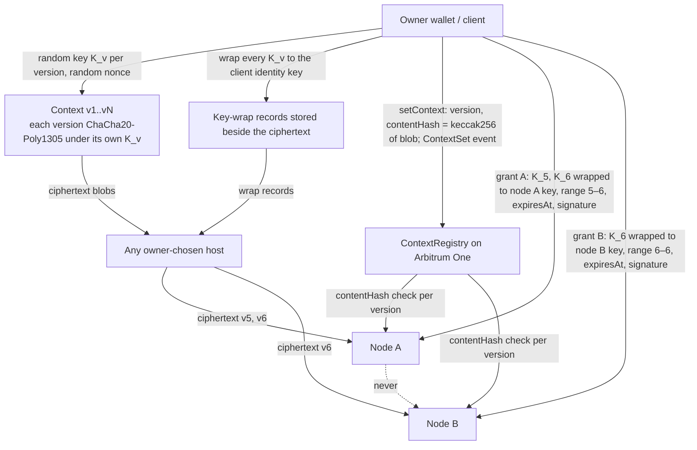

# Privacy and contexts — two-way HPKE and wallet-owned contexts

Author: Comuns contributors
Status: Draft
Category: Technical Proposal
Created: 2026-10-12

**Reference:** docs/evidence-register.md, docs/protocol/contracts-and-settlement.md, docs/protocol/off-chain-api.md, docs/node/node-design.md, docs/product/dapp-and-sdk.md, docs/adr/0003-hpke-and-the-executor-plaintext-limit.md

---

## 1. Summary

In standard mode the node that executes a request sees the prompt, the granted context and the completion in plaintext. Comuns is a proposal for open-source decentralized LLM inference settled on Arbitrum One with Rust nodes; nothing described here runs yet, and no audit of any part of this design has been performed. This document fixes what the proposal can promise about confidentiality, which is less than "nobody but the owner reads the prompt": every party that computes on a prompt must read it unless fully homomorphic encryption, multi-party computation or a trusted execution environment is used, and the evidence register records that the first two are far from practical for interactive inference (evidence register, FHE and MPC entries [L]).

What the proposal does promise is narrower and checkable:

- Everyone who is not selected to execute a request — other operators, the Arbitrum sequencer, RPC providers, indexers and network observers — sees only ciphertext and the public metadata listed in section 9. This is achieved with two-way HPKE (RFC 9180): the client seals the prompt and context grant to the node's registered public key; the node seals every completion chunk back to a per-job client key.
- Single-node execution is the default. Unless the user opts into something else, exactly one remote party reads the prompt. Opting into a multi-node execution feature (section 8) adds exactly the readers listed on the disclosure sheet the user signs for that request, and nothing else.
- The number of nodes that can read the full prompt is a first-class disclosed quantity, shown before the user signs and bound into every envelope the client sends.
- Contexts (transcripts, documents, system prompts) are owned by a wallet, encrypted client-side under a separate random key per context version, and shared with a node only by an owner-signed grant that wraps the keys of exactly the granted versions to that node's HPKE key. Every version key is also wrapped to the client's long-lived identity key, and the backup export carries the identity key together with every key-wrap record; it does not carry ciphertext, so a context whose ciphertext existed only on a lost device is gone even with the backup (section 5). Nodes never exchange plaintext or keys.
- Every job envelope is signed by the session's `sessionSigner`, so nobody but the client that opened a session can submit work to it; every voucher is signed by the same key and binds the output through a keyed commitment that reveals nothing on-chain.
- Where a stronger guarantee is wanted, attested mode (TEE) is available at a cost in throughput and with a documented physical-attack gap; local execution is the only owner-only option.

Strict owner-only confidentiality against the chosen remote operator is an unmet requirement of this proposal. The user picks whom to trust, pays that party, and the protocol makes the trust boundary explicit rather than invisible.

## 2. Scope

This document covers the confidentiality of inference traffic only: prompts, completions, contexts, context grants, the keys that protect them, and the metadata that stays public. It defines the privacy modes a node advertises, the execution features a client may request, and the disclosure sheet a client must show before any session is opened or reused.

Out of scope here, and owned elsewhere: settlement and escrow semantics (docs/protocol/contracts-and-settlement.md), the off-chain API transport (docs/protocol/off-chain-api.md), the node process design (docs/node/node-design.md), the dapp and SDK (docs/product/dapp-and-sdk.md), the verification of outputs in verifiable mode (docs/security/inference-verification.md) and the multi-node orchestration protocol (docs/protocol/orchestration.md). The threat analysis is in docs/security/threat-model.md.

## 3. The limit

An executor must see plaintext unless FHE, MPC or a TEE is used [L]. The evidence register records the state of each alternative:

- FHE: a hybrid scheme costs roughly 2.2 MB of ciphertext per token, and a partly encrypted LLaMA-3-8B runs at about 18 s per token on 8 GPUs [L].
- MPC: about 5 min per token for a 7B model [L].
- TEE: for an 8B model the throughput cost is −6.85 % / −8.84 % and time-to-first-token rises +19–21 %; for a 70B model the overhead is roughly 0–2.3 % [V]. The cost is acceptable, but the trust assumption moves to the CPU and GPU vendor and to the attestation service, and the TEE.fail result (October 2025) showed a DDR5 interposer extracting TDX and SEV-SNP keys, including attestation keys, in a way that can also undermine NVIDIA GPU confidential-computing attestation; vendors treat physical attacks as out of scope [L].

The consequence, adopted in docs/adr/0003-hpke-and-the-executor-plaintext-limit.md, is that v1 encrypts the hop, not the computation. The protocol's job is therefore to make sure that only the parties the user chose can decrypt, that the user knows exactly who those parties are before paying, and that nothing silently widens that set.

The following sequence shows who sees plaintext in standard, single-node execution.

```mermaid
sequenceDiagram
    participant U as User client
    participant C as Chain (SessionEscrow, NodeRegistry)
    participant S as Sequencer / RPC / observers
    participant N as Selected node (standard mode)
    participant O as Other operators
    U->>U: show disclosure sheet, user signs openSession
    U->>C: openSession (payer, node, model, cap) — metadata only
    Note over C,S: sees payer, node, model, cap, timing; never prompt
    U->>N: HPKE envelope: prompt + context grant (+ commitKey in the session's first job) sealed to node key, signed by sessionSigner
    Note over N: verifies the envelope signature, decrypts — reads prompt and context in plaintext
    N->>U: node-signed input receipt (sessionId, jobId, jobInputTokens, cumulativeInputTokensAfter) before prefill
    U->>N: input voucher (cumulative total), signed only if the client's own token counts match
    N->>U: HPKE frames: completion chunks sealed to clientJobPublicKey, each with a node-signed receipt
    Note over U: decrypts — only the client reads the completion
    Note over O: never receive an envelope; ciphertext only if observed on the wire
    U->>N: cumulative voucher (sessionId, seq, cumulativeWei, inputTokens, outputTokens, outputCommitment, final)
    N->>C: redeemVoucher — token counts and amounts public, outputCommitment reveals nothing; node later calls withdraw()
```

## 4. Algorithms

The cipher suite is fixed, not negotiated, so that a downgrade cannot be requested:

| Component | Choice |
|---|---|
| Public-key encryption | RFC 9180 HPKE, base mode |
| KEM | DHKEM(X25519, HKDF-SHA256) |
| KDF | HKDF-SHA256 |
| AEAD | ChaCha20-Poly1305 |
| Context content encryption | ChaCha20-Poly1305 under a random 256-bit key per context version (`K_v`), 12-byte random nonce, AAD as in section 7 |
| Hash | keccak256, for `contentHash`, `transcriptHash`, `outputCommitment` and the envelope-signature digest |
| Output commitment key | `commitKey`, a random 32-byte key per session from the client CSPRNG, sent sealed in the session's first job envelope (section 10) |
| Job authentication | `sessionSigner` signature over the envelope digest (section 6); HPKE stays base mode |
| Transport | TLS 1.3 on every client–node and node–node hop, in addition to HPKE |

The reference implementation is expected to use the Rust `hpke` crate, version 0.14.1, which implements RFC 9180; its documentation reports that no paid audit has been performed [V]. Comuns has not audited it either. No homegrown cipher, KDF or mode of operation is permitted (section 11).

TLS protects against passive observation of envelope sizes and timing on the hop and authenticates the node endpoint; HPKE protects the content end to end so that a terminating proxy, a load balancer or a misconfigured node front-end cannot read it. Both are required; neither replaces the other.

## 5. Keys

**Client encryption keys.** The client's HPKE keys are application-managed. They are generated from the operating-system CSPRNG, are never the wallet signing key and are never derived from it, and are stored encrypted at rest on the client. There are two kinds:

- The **long-lived identity key** is mandatory. Every context version key `K_v` the client ever generates is wrapped to it (section 7). The **backup export** is an encrypted file that contains the identity key **and every key-wrap record** (every `K_v` wrapped to the identity key). It contains no ciphertext. Restoring it on a new device restores the ability to decrypt every context version whose ciphertext can still be fetched — from a context host or from a second device of the owner. Ciphertext that existed only on a lost device is gone even with the backup; the backup alone does not restore every context, and no document may claim that it does. Users should therefore keep at least one context host or a second device holding the ciphertext. Losing the identity key and its backup loses every context, permanently, whatever ciphertext survives.
- For each job the client additionally generates a fresh **per-job keypair** whose public half, `clientJobPublicKey`, is sent to the node so that completion chunks are sealed to it. Per-job keys are discarded when the job closes. They play no part in the output commitment: its key, `commitKey`, is a separate per-session secret (section 10) that is not derived from any HPKE context and outlives every job of the session.
- The **session commit key** `commitKey` is a random 32-byte key the client generates from the OS CSPRNG when it opens a session and sends to the node sealed inside the session's first job envelope (section 6). Client and node both keep it until the session is settled; it is known to nobody else. One `commitKey` covers every job of the session, so a multi-job session has one commitment chain under one key.

**Wallet keys.** Wallet signatures authorize `openSession` and context grants. The `sessionSigner` key the client registers at `openSession` (docs/protocol/contracts-and-settlement.md) signs two things and nothing else: every job envelope sent on that session (section 6) and every voucher (section 10). Wallet and session-signer keys never derive encryption keys.

**Rejected default: sign-to-derive.** A common pattern derives an encryption key by asking the wallet to sign a fixed message and hashing the signature. It is rejected as a default for two reasons:

- It requires deterministic signatures (RFC 6979) [L]. Contract wallets, MPC wallets and some hardware wallets may not sign deterministically, so the derived key is not reproducible and the user's contexts become unreadable.
- Any site that obtains that one signature obtains every context key the user has ever derived from it. A single phishing page turns into a total loss of confidentiality, retroactively.

It may be offered later as an explicit, clearly labelled opt-in for users who accept both risks; it is not the default and the client must not fall back to it silently.

**Forbidden wallet APIs.** `eth_getEncryptionPublicKey` and `eth_decrypt` are forbidden: they have been deprecated since 2022 [V] and expose the wallet's key material to a browser-side decryption flow that the user cannot inspect. ERC-5630 is a Draft [V] and is not a dependency of this proposal.

**Node HPKE key.** Generated on the operator's machine from the OS CSPRNG, stored encrypted at rest, and registered in `NodeRegistry` under a signature by the operator's Ethereum account together with a proof of possession of the HPKE private key (a signature or HPKE-sealed challenge over the registration payload, exact form owned by docs/protocol/contracts-and-settlement.md). Rotation is a registry update (`updateNode` publishes the new key); clients seal to the node's current registered key — the one in the latest `NodeRegistered` or `NodeUpdated` event when they open or reuse the session (docs/protocol/contracts-and-settlement.md §9). `openSession` binds the two expected prices but not the key, so a same-price `updateNode` ordered just ahead of `openSession` can swap the key in flight; binding the key hash at `openSession` is an open question in both documents (section 14, question 11). The node keeps a **keyring** of every HPKE key used by any session that is not yet settled, however many rotations have happened since, and deletes an old key only after every session that used it is settled. A key that is still on the keyring serves envelopes sealed to it exactly as the current key does. In attested mode (section 8) the node key must be generated inside the TEE and never leave protected memory.

**Logging policy.** Nodes never log prompt, context or completion plaintext. This is an operator policy enforced by the reference node software, not a protection against a malicious operator: an operator who modifies the node can log whatever it decrypts.

## 6. Request and response envelopes

Each job uses one HPKE context per direction. The client opens a sender context to the node's registered key; the node opens a sender context to `clientJobPublicKey`. Every envelope and frame carries associated data (AAD) that binds it to exactly one place in exactly one job, so that a ciphertext cannot be replayed into another session, chain, contract, context version or position.

**Associated data (both directions), in order:**

| Field | Meaning |
|---|---|
| `chainId` | EIP-155 chain id of Arbitrum One, commonly published as 42161 (UNVERIFIED in this document; confirm at implementation) |
| `escrow` | Address of the `SessionEscrow` contract |
| `sessionId` | Session the job is paid from |
| `jobId` | Job within the session |
| `requestId` | Client-side request this job belongs to (section 8) |
| `sheetVersion` | Version of the disclosure sheet the user confirmed for this request |
| `planId` | Plan identifier; zero for single-node execution |
| `taskId` | Task within the plan; zero for single-node execution |
| `role` | Role of the receiving node in the plan. **The canonical role tokens**, owned by this document and reused verbatim by every other document, the disclosure sheet's `roles[]` (section 8.3), the capability document and the wire protocol — never a camelCase or suffixed variant: `executor`, `planner`, `answerer`, `reviewer`, `synthesizer`, `merge`, `orchestrator`, `shard holder`, `draft`, `target`, `verifier`. There is no separate assessor token: an assessment is the output of a planner session and carries `planner` |
| `contextId` | Context granted for this job, or zero |
| `contextVersion` | Context version granted, or zero |
| `direction` | client-to-node or node-to-client |
| `seq` | Frame sequence number, starting at zero per direction. This is a transport counter; it is never the voucher `seq` of section 10, which is a separate per-session counter starting at 1 |
| `endOfJob` | Last-frame flag of a job. It is never copied into a voucher's `final`, which means something else (the client closes the session, section 10) |

**Job authentication (envelope signature).** HPKE base mode does not authenticate the sender, and `sessionId`, `chainId` and the escrow address are public in `SessionOpened`; without a signature anyone could seal a job to the node's key under someone else's session. Every request envelope therefore carries, outside the AEAD, a signature by the session's `sessionSigner` over `(chainId, escrow, sessionId, jobId, requestId, sheetVersion, keccak256(enc ‖ ciphertext))`, where `enc` is the HPKE encapsulated key. The node looks up the `sessionSigner` recorded on-chain for that session and rejects any envelope whose signature does not verify against it before decrypting or scheduling anything. A multi-frame request signs every frame the same way. The signature is what stops a third party from injecting jobs into an open session; the AAD is what stops replay of an honest envelope into another place.

**Request envelope (client → node), plaintext fields inside the AEAD:**

- `clientJobPublicKey` — the per-job public key the node must seal responses to;
- `commitKey` — in the session's first job envelope only: the random 32-byte session commit key of section 10; absent in every later envelope of the session;
- `prompt` — the prompt body, or in a multi-node plan the sub-task text, plan or answers this node is entitled to receive;
- `contextGrant` — the owner-signed grant described in section 7, or absent;
- `params` — sampling and length parameters;
- `modelId` — must match the session's model.

**Input receipt (node → client, before prefill).** After verifying the signature, decrypting the envelope and tokenizing the prompt and the granted context with the tokenizer pinned in the model manifest, and before any prefill, the node sends a node-signed **input receipt** over `(sessionId, jobId, jobInputTokens, cumulativeInputTokensAfter)`, where `jobInputTokens` is the token count of this job's prompt and granted context and `cumulativeInputTokensAfter` is the session's cumulative input total once this job is counted. The client checks two things: `jobInputTokens` must equal its own tokenization of this job's prompt and granted context with the same pinned tokenizer, and `cumulativeInputTokensAfter` must equal `lastInputTokens + jobInputTokens`, where `lastInputTokens` is the cumulative `inputTokens` of the last voucher the client signed on this session (zero for the first job). Only if both hold does the client sign the input voucher (section 10), whose `inputTokens` field carries the cumulative total `cumulativeInputTokensAfter`; otherwise it signs nothing and abandons the job. This is what lets the second and every later job of a session be paid: the voucher's cumulative counts never fall below the previous voucher, and the client has checked the increment job by job. The node starts prefill when it holds the input voucher.

**Response frames (node → client).** The node streams completion chunks as HPKE frames, one per chunk, with `seq` increasing by one and `endOfJob` set only on the last frame. Every frame carries a node-signed **chunk receipt** over `(sessionId, jobId, cumulative inputTokens, cumulative outputTokens, keccak256 of the chunk plaintext)`, where both counts are cumulative for the whole session across all its jobs, in the same way as the input receipt. **The receipt travels inside the sealed frame plaintext, never outside it**: no hash of the chunk plaintext appears outside encryption, because a TLS-terminating proxy could otherwise hash candidate short answers, labels or numbers and identify the completion despite HPKE; any hash that must appear outside encryption is keyed, `keccak256(commitKey ‖ chunk)`, under the session commit key of section 10 (docs/protocol/off-chain-api.md §7). The client checks the receipt against the decrypted chunk, checks that the cumulative output count rose by exactly the tokens of that chunk, and then signs the next cumulative voucher, so payment and delivery advance one chunk at a time and neither side waits on the other for the whole job. The client:

- rejects a frame whose AAD does not match the expected tuple (replay);
- rejects a frame whose `seq` is not the next expected value (reordering, injection);
- rejects a frame whose receipt does not match the decrypted chunk or whose cumulative counts are lower than the previous receipt, and signs no voucher covering it;
- rejects a stream that ends without a frame carrying `endOfJob` (truncation) and does not sign a voucher that covers the missing output;
- rejects an `endOfJob` frame followed by anything further.

The node applies the AAD and `seq` rules to request envelopes in a multi-frame request (for example a large context attached in several frames).

**Multi-node plans.** Each participating node has its own session, its own HPKE envelope and its own `clientJobPublicKey`. In `collective_answer`, `parallel_planning` and `task_decomposition` every intermediate result returns sealed to the client, which decrypts it, applies the user's approved plan and re-seals only the approved parts to the next disclosed recipient. Nodes never receive another node's envelope keys. The only data that travels without an HPKE envelope is the activation traffic of the experimental `model_sharding` spike, and even there nothing moves node to node: the client mediates every stage boundary, sending each shard holder exactly its inputs and receiving its activations over a mutual TLS 1.3 link bound to the holder's registered operator key (docs/node/distributed-execution.md §5), and the disclosure sheet says so.

## 7. Contexts and grants

A context is a versioned, content-addressed blob — transcript, documents, system prompt — owned by a wallet. A wallet may own many contexts.

**Encryption: one key per version.** Each context version `v` has its own random 256-bit key `K_v`, generated from the client CSPRNG. The stored blob of a version is `header ‖ ciphertext ‖ tag`, where:

- `ciphertext ‖ tag` = ChaCha20-Poly1305(`K_v`, `nonce`, `AAD`, plaintext);
- `nonce` is 12 random bytes, stored in the blob header; a fresh key and a fresh nonce per version means no two messages are ever sealed under the same (key, nonce) pair;
- `AAD` = `owner ‖ contextId ‖ v ‖ prevContentHash`, where `prevContentHash` is the `contentHash` of version `v − 1` (zero for version 1), so version `v` is cryptographically chained to the version it was derived from;
- `contentHash` = keccak256 of the complete stored blob (`header ‖ ciphertext ‖ tag`). This is the one canonical definition; client, node, host and `ContextRegistry` all mean this value, and nothing hashes the plaintext.

Because keys are per version, possessing `K_v` opens exactly one version and nothing published before or after it. The blob is stored client-side and optionally at any host the owner chooses; a host sees ciphertext only.

**Key-wrap records and backup.** Every `K_v` is wrapped (HPKE-sealed) to the client's long-lived identity key the moment it is generated, and the wrap record is stored beside the ciphertext, at the client and at any host. This is mandatory, not optional. The backup export of section 5 contains the identity key and every one of these wrap records, so a restored backup can open any version whose ciphertext the client can still obtain. The backup does not contain the ciphertext: hosting is optional, and a user who keeps contexts only on one device and loses it has lost the ciphertext of every version, which neither the backup nor the registry can bring back (`ContextRegistry` holds hashes only). The recommendation is at least one context host or a second device holding the blobs. A client that loses its working copy fetches the blobs from the host or the second device and unwraps their keys with the wrap records restored from the backup; wrap records found beside the ciphertext at a host serve the same purpose when the backup predates the latest versions.

**On-chain record.** `ContextRegistry` stores, per `(owner, contextId)`, only the latest `(version, contentHash)`, and `setContext` requires `version == previous + 1` (docs/protocol/contracts-and-settlement.md). Every accepted version emits a `ContextSet(owner, contextId, version, contentHash)` event, so the full history is on-chain in the event log even though state keeps only the head. A node verifying an older version reads its `contentHash` from the `ContextSet` event history, not from the head slot; a grant for a version that is no longer the head is therefore still verifiable. The registry stores no content and no keys.

**Grant.** "Shared between the nodes" means portable owner-wrapped ciphertext, never shared plaintext. To let a node use a context the owner issues a grant:

| Field | Meaning |
|---|---|
| `contextId`, `fromVersion`, `toVersion` | The version range the node may decrypt |
| `wrappedKeys[]` | Exactly the keys `K_fromVersion … K_toVersion`, each HPKE-sealed to the node's registered public key; the grant carries no other key, so a narrow grant restricts decryption cryptographically, not only by policy |
| `expiresAt` | Unix time in seconds (`uint64`) after which the node must discard the keys; never a block number |
| `nodeKeyHash` | Hash of the HPKE public key the grant was sealed to, so a rotated node cannot claim it |
| `ownerSignature` | Wallet signature over all fields above |

The receiving node verifies the signature against the on-chain owner, checks that each version it is given hashes (keccak256 of the complete blob) to the `contentHash` recorded for that version in `ContextRegistry` or its `ContextSet` history, checks that the AAD chain links each version to the previous one, unwraps the keys, and uses them only within the range and before `expiresAt`. A second node receives its own grant with its own wraps; nodes never exchange plaintext or keys.



**Revocation.** Because every version has its own key, a node holds only the keys it was granted. Revocation is therefore simply not granting: the owner stops issuing grants to the revoked node, and every later version is unreadable to it because its key `K_{N+1}` was never wrapped to that node. A node that already decrypted the granted versions cannot be made to forget them; revocation limits future versions, not the past. This document says so plainly because the alternative claim would be false.

**Concurrent edits.** `setContext` accepts one next version per context. If two clients of the same owner publish competing versions `N+1`, the first transaction included wins and the second reverts; nothing is merged on-chain and nothing is silently overwritten. The losing client keeps its local edit, reads the new head, rebases its edit onto it as version `N+2` (with `prevContentHash` = the winner's `contentHash` and a fresh `K_{N+2}`) and publishes again, surfacing the conflict to the owner where the edits touch the same material. Nodes never resolve conflicts.

**Retention and deletion.** A node must discard the granted keys at `expiresAt` or when the job closes, whichever is earlier, and must not persist decrypted context beyond the job. Hosts must delete a blob when the owner requests it. Neither rule can be verified remotely in standard mode; attested mode binds the node build to a measurement that includes the retention code, which raises the cost of silent violation but does not prove deletion. Deletion on-chain is impossible: `ContextRegistry` entries are permanent, but they contain only hashes.

## 8. Privacy modes and execution features

### 8.1 Privacy modes (per node)

The mode names are normative. A node advertises the modes it supports in `NodeRegistry`; a user requires a mode per request.

**`standard` (mode 0).** Third parties, nodes not selected for this request, the sequencer, RPC providers and indexers see only ciphertext and the public metadata of section 9. Every node selected to execute sees plaintext. The default selection is exactly one node. The client must display, before the user signs, that the selected node and its operator will read the prompt in plaintext.

**`attested` (mode 1).** The node runs inside a TEE — CPU TDX or SEV-SNP plus GPU confidential computing — and presents a quote that the client verifies, before sealing anything, against a published measurement list bound to the node build and the model manifest. Requirements:

- the node's HPKE keypair is generated inside the TEE and never leaves protected memory;
- the quote's report data commits to the hash of that HPKE public key together with a client-supplied nonce;
- the client refuses to seal unless this binding verifies — a valid quote for an unrelated key proves nothing about the key the client is about to encrypt to;
- quote verification is client-side in v1. On-chain verification is a later option; the evidence register puts a direct on-chain check at roughly 3M gas and a ZK-wrapped check at roughly 350k gas [V/L]. Intel's EPID attestation and IAS were discontinued in April 2025, so DCAP or Intel Trust Authority are the remaining CPU attestation paths [L];
- attested mode does not defend against physical access. TEE.fail extracted TDX and SEV-SNP attestation keys with a DDR5 interposer and can undermine GPU confidential-computing attestation; vendors treat physical attacks as out of scope [L]. A user who needs protection against an operator with physical access to the machine has no remote option in this proposal.
- When the user requires attested mode and no eligible node exists, the request fails closed. The client never silently downgrades to standard mode.

**`verifiable` (mode 2).** Opt-in. The prompt is disclosed to a user-chosen second node that re-executes the request under a **demonstrated deterministic profile** — an engine configuration the node has shown to produce byte-identical output for identical input — and the two outputs are compared. This mode trades confidentiality for integrity; its details are owned by docs/security/inference-verification.md. The verifier counts as a full-prompt reader on the disclosure sheet. `cross_node_speculation` is incompatible with this mode: the deterministic profile needs byte-identical output, speculative engines do not guarantee it (mistral.rs states that token-for-token equivalence is not guaranteed, evidence register §9 [V]), and TOPLOC, a candidate checker, cannot detect speculative decoding either (evidence register §5 [V]).

### 8.2 Execution features (per request)

Orthogonal to the mode is `executionFeatures`, a per-request, client-side set that is never stored on-chain. The feature names are normative.

| Feature | Who reads what |
|---|---|
| (empty) — **single-node** | The default. Exactly one remote party reads the prompt, unless the user also chose verifiable mode, which adds the user-chosen verifier as a second full-prompt reader listed on the sheet. |
| `collective_answer` | k ≥ 2 answerer nodes, possibly running different models, each receive the full prompt sealed separately and answer independently. Reviewers then receive the prompt plus all anonymized answers. A user-chosen synthesizer receives the prompt, all answers and all critiques; a remote synthesizer is a full-prompt reader, a local one is not. Two cheaper variants exist and are different methods: self-consistency (k samples of one strong model and a majority vote over a short extracted answer, only for tasks with a short checkable answer such as a number, choice or label) and Self-MoA (k samples of one strong model combined by a synthesizer, for free text); a plurality vote is never applied to free text. Both variants sample one node k times, so the reader count is one node plus the synthesizer if remote. |
| `task_decomposition` | A remote assessor or planner node sees the full prompt and is a full-prompt reader. Each sub-task node sees its sub-task text, which may quote the prompt; it is a full-prompt reader unless the client has verified that its payload contains no prompt text. A merge node sees all outputs it merges and is a full-prompt reader. An optional reviewer sees one sub-task and its output and is a full-prompt reader under the same payload rule as the sub-task node. |
| `parallel_planning` | Several planner nodes each see the full prompt. Plan reviewers receive the prompt plus the anonymized plans, and the plan synthesizer receives the prompt plus the critiques; every planner, every plan reviewer and the plan synthesizer is a full-prompt reader. The objection round is not blind and the sheet says so. |
| `model_sharding` | EXPERIMENTAL, Phase 3 spike. Every shard holder receives activations and is treated as able to read the prompt: inversion from activations recovers 88.4 % of tokens on a 65B model (evidence register §10 [V]). Activations move only between the client and each holder, over mutual TLS 1.3 bound to the holder's registered operator key and without an HPKE envelope; the client mediates every stage boundary, no holder talks to another holder, and activations go only to holders listed on the sheet (docs/node/distributed-execution.md §5). Shard holders hold no session and are never paid. |
| `cross_node_speculation` | EXPERIMENTAL, Phase 3 spike. Both the draft node (which receives the prompt to draft) and the target node (which receives the prompt plus the drafts to verify them) are full-prompt readers. Incompatible with verifiable mode (section 8.1). |
| optional orchestrator node | Sees the full prompt whenever it plans, merges or synthesizes for the user, and the plan when the user delegates planning to it; it is a full-prompt reader in each of those roles. Paid through an ordinary session; holds no `sessionSigner` in v1. |

**Who counts as a full-prompt reader.** The sheet's `readersOfFullPrompt` counts, by distinct node and by distinct operator, at least every one of: the executor; in verifiable mode the verifier; in `collective_answer` every answerer, every reviewer (reviewers receive the prompt) and a remote synthesizer; in `parallel_planning` every planner, every plan reviewer and the plan synthesizer; in `cross_node_speculation` both the draft node and the target node; every shard holder; an orchestrator node whenever it plans, merges or synthesizes; a merge node, whose inputs are assumed to quote the prompt; any remote assessor or planner in any feature, including `task_decomposition`; and any sub-task executor or sub-task reviewer whose payload contains prompt text. A sub-task payload is assumed to contain prompt text unless the client has verified that it contains none; the client decides this from the actual payload, never from the planner's description of it. **This list is a floor, never a ceiling:** the client derives `readersOfFullPrompt` from the actual payloads it is about to seal, and any node that receives prompt text under a role not named here is counted too.

**Opt-in rule.** Every non-empty `executionFeatures` set is opt-in per request. Consent given for an earlier request, or implied by an already funded session, is not consent for this one.

### 8.3 The disclosure sheet

Before the user signs any `openSession` for a request — and before any job is sent for a request that opens no new session but reuses open ones — the client shows the **disclosure sheet**. The field list below is normative and is reused by docs/protocol/orchestration.md, docs/protocol/off-chain-api.md and docs/product/dapp-and-sdk.md.

| Field | Content |
|---|---|
| `requestId` | Client-side identifier of this request |
| `planId` | Plan identifier, zero for single-node |
| `version` | Sheet version; incremented every time the sheet changes |
| `recipients[]` | One entry per **session**, that is per distinct `(node, modelId)` |
| `recipients[].node` | Node identifier from `NodeRegistry` |
| `recipients[].operator` | Operator's Ethereum account |
| `recipients[].roles[]` | Array, since one session may serve several roles, drawn verbatim from the canonical role tokens of section 6: `executor`, `planner` (an assessor is a planner session), `answerer`, `reviewer`, `synthesizer`, `merge`, `orchestrator`, `shard holder`, `draft`, `target`, `verifier`. User-facing tables may render a token with a label beside it, but the JSON value is the token |
| `recipients[].modelId` | Model the session is opened for |
| `recipients[].mode` | `standard`, `attested` or `verifiable` |
| `recipients[].receives[]` | Array drawn from: full prompt; sub-task; sub-task outputs, which may quote the prompt; the plan; all answers and critiques; activations of layers a–b; prompt plus draft tokens; context versions whose keys are granted |
| `recipients[].priceInPerMillion` | Input price per million tokens |
| `recipients[].priceOutPerMillion` | Output price per million tokens |
| `recipients[].capWei` | `min(depositWei, maxSpendWei)` for a new session, or the remaining allowance for a reused one |
| `counts` | `{fullPrompt, subTask, otherAnswers, activations, draftTokens}` — number of distinct nodes receiving each |
| `readersOfFullPrompt` | Counted over distinct nodes **and** distinct operators; k nodes run by one operator are one operator |
| `totalCapWei` | Sum of session caps |
| `l2GasEstimate` | Shown separately from `totalCapWei`, never folded into it |

**Confirmation and binding.** The user's confirmation is recorded by the client, and `requestId` and `version` are bound into the AAD of every job envelope and frame (section 6). A node that receives an envelope whose sheet version it was not disclosed under cannot tell, but the client can never produce such an envelope without first obtaining a confirmation for that version. A funded session never implies consent to a new request.

**Re-show rule.** The sheet is shown again before execution sessions when a planner session ran first, and whenever the plan adds a node, widens what any node receives, or raises any cap. A changed node, model, data scope, price or cap invalidates the sheet before transmission (stale consent, threat model).

**Price confirmation.** The sheet binds the prices the user confirmed, and `openSession` binds them on-chain: it takes `expectedPriceInPerMillion` and `expectedPriceOutPerMillion`, the prices on the confirmed sheet, and reverts if the node's current offer for that model differs from them when the transaction is included. An operator who changes the offer between confirmation and inclusion therefore causes a revert, not a session at an unconfirmed price, and an offer change can never lock a deposit. As defence in depth, after `openSession` is included the client still reads the prices copied into the session; if they differ from the confirmed sheet, the client signs nothing for that session and calls `closeSession`, and the deposit returns through `finalize` after `closeDeadline`. No job is ever sent on a session whose prices are not the confirmed ones.

**Fail-closed rule.** If any node on the sheet lacks the required mode, or the pool cannot fill the confirmed set, the whole request fails closed. The client never switches a request to a multi-node feature, adds a node, or falls back to a node not on the confirmed sheet silently.

**Client-mediated re-sealing.** Each participating node keeps its own privacy mode and its own HPKE envelope: one session per node, sub-tasks and answers sealed separately to each node. In `collective_answer`, `parallel_planning` and `task_decomposition` every intermediate result returns sealed to the client, which re-seals only the approved parts to the next disclosed recipient. Intermediate text is data: it never carries authority over which recipients exist or what they are paid.

**Local execution.** Running the model locally is the only option in which nobody but the owner reads the prompt. Strict owner-only confidentiality against the chosen remote operator is an unmet requirement, in every mode and every feature set.

## 9. Metadata that stays public

HPKE hides content, not the fact of a transaction. The following is visible on-chain or to any observer of the chain:

- payer address, node, operator and `modelId` of every session;
- the cumulative token counts and amounts in redeemed vouchers, hence the size of each job;
- the `outputCommitment` of each redeemed voucher, which is keyed under a secret known only to client and node (section 10) and so reveals nothing about the output, not even whether a short answer was "yes" or "no";
- prices, caps, deposits and top-ups;
- timing: when sessions open, when vouchers are redeemed, when sessions close, when operators and users call `withdraw`;
- context registry entries: owner, `contextId`, version and `contentHash` (and the `ContextSet` history) — which reveal that a wallet maintains a context and how often it changes, not what it contains.

A multi-node request additionally reveals that several sessions were opened by the same payer at about the same time and which pools or node sets were used, which is enough for an observer to infer that a multi-node feature was in use and to estimate its shape from the token counts.

Network observers between client and node see TLS-protected traffic to a node endpoint; sizes and timing of envelopes are observable unless padded.

Future mitigations, none of which are in v1: payment through a relayer or privacy pool to unlink payer and session; batching voucher redemptions to blur per-job sizes; padding of envelopes and frames to fixed sizes; and cross-session correlation defences, such as opening the sessions of one request through distinct payers or with staggered timing. Each is listed as an open question rather than a plan.

## 10. Receipts and vouchers

Settlement never carries content. Node-signed receipts and client-signed vouchers alternate, one step at a time, so that neither party ever waits on the other for the whole job.

**Receipts (node-signed).** Two kinds, both defined in section 6:

- the **input receipt** over `(sessionId, jobId, jobInputTokens, cumulativeInputTokensAfter)`, sent after tokenization with the manifest's pinned tokenizer and before prefill; the client checks `jobInputTokens` against its own tokenization of this job's prompt and granted context, checks `cumulativeInputTokensAfter = lastInputTokens + jobInputTokens`, and signs the input voucher only if both hold;
- a **chunk receipt** on every output frame, over the session-cumulative token counts and the hash of that chunk; the client checks it against the decrypted chunk and then signs the next voucher.

**Vouchers (client-signed).** The one canonical voucher is the EIP-712 type defined in docs/protocol/contracts-and-settlement.md and referenced here without change; the type string has no spaces after the commas, as EIP-712 encoding requires:

`Voucher(bytes32 sessionId,uint64 seq,uint256 cumulativeWei,uint64 inputTokens,uint64 outputTokens,bytes32 outputCommitment,bool final)`

- `inputTokens` and `outputTokens` are cumulative for the whole session, across all its jobs; `cumulativeWei = (priceInPerMillion × inputTokens + priceOutPerMillion × outputTokens) / 1000000` with the session's prices, recomputed on-chain.
- `seq` starts at 1 and strictly increases; it is a per-session counter and has nothing to do with the frame `seq` of section 6. The contract also requires `inputTokens`, `outputTokens` and `cumulativeWei` to be at least the values of the last accepted voucher, so a later voucher can never lower what is owed.
- The first voucher of a job (the **input voucher**) carries as `inputTokens` the cumulative total `cumulativeInputTokensAfter` of the input receipt, that is, the previous cumulative total plus this job's input; each following voucher adds the output of one more received chunk to the cumulative `outputTokens`.
- `final` means one thing only: the client closes the session. It is never the frame flag `endOfJob`; a job ending does not close a session, and later jobs on the same session keep drawing on it. `redeemVoucher` rejects any voucher with `final == true`; a closing voucher goes only through `closeWithVoucher`, which credits the node and credits the refund `depositWei − settledWei` to the user in the same call.
- The effective cap is `min(depositWei, maxSpendWei)`; a voucher above it is paid only up to the cap. The client may raise it with `topUp(newMaxSpendWei)`, which is payable and never lowers `maxSpendWei`; after a top-up the client re-signs the same cumulative totals under a new `seq` so the node can collect the rest.
- Legality is decided by the session `status`, never by a zero `closeDeadline`: `redeemVoucher` and `closeWithVoucher` are accepted while the session is `open`, or `closing` before `closeDeadline`; `finalize` requires `closing` and `block.timestamp ≥ closeDeadline`; a settled session accepts nothing. `redeemVoucher` credits the node and never credits a refund; only `closeWithVoucher` and `finalize` credit the refund `depositWei − settledWei` to the user.
- A node never relies on `closeWithVoucher` without a voucher whose `final` is true. When the client disappears, or either side's key is lost, the node redeems its highest non-final voucher with `redeemVoucher` while that is legal, then calls `closeSession`; `finalize` after `closeDeadline` credits the remainder to the user. Either the user or the node may call `closeSession` at any time; nothing closes a session automatically.
- Payment is by pull: redemption credits an internal balance and the only function that sends ETH is `withdraw()`, which pays the caller its whole balance. A contract wallet that cannot receive ETH can therefore never block a payment or a refund.

The prompt, the completion and the context are not part of the voucher.

**`outputCommitment`.** The field binds a voucher to the output delivered so far without letting anyone on-chain learn it:

`outputCommitment = keccak256(commitKey ‖ sessionId ‖ seq ‖ transcriptHash)`

where `commitKey` is the random 32-byte **session commit key** of section 5: generated by the client for the session, sent to the node sealed inside the session's first job envelope, kept by both until the session is settled, and known to nobody else. It is not derived from any HPKE context, so it survives the per-job keys and is the same for every job of the session. `transcriptHash` is one hash chain over every output chunk of every job in the session, in delivery order: `transcriptHash = keccak256(prev ‖ chunkHash)`, chained from zero, where `chunkHash` is the keccak256 of the chunk plaintext carried in that chunk's receipt. Because `commitKey` is secret, a chain observer cannot test candidate answers against the commitment, so low-entropy completions ("yes", a label, a number) stay hidden. The commitment is not checked on-chain. Opening it to a third party — in a dispute, for instance — discloses `commitKey` and the transcript, that is, the session's whole output, to that party; because one key covers the whole session, opening it opens every job of that session, not one. The commitment is a binding record, not a proof without disclosure, and a signed voucher is not reversible.

**Bounds and residual risk.** A dishonest input count is caught before any payment, because the client signs the input voucher only when its own tokenizer agrees; a dishonest output count is bounded by the one chunk the client declines to sign. What remains, stated plainly: a node can collect the input voucher and never run the prompt. The user's loss is bounded by that prompt's input fee, the remedy is to stop signing and record a reputation event, and nothing in v1 refunds it. Nodes should redeem promptly — `redeemVoucher` is allowed at any time while legal — because an outage that starts shortly before `closeDeadline` can still cost a node its unredeemed vouchers (threat model). Automatic voucher signing checks token counts, not answer quality.

## 11. What is forbidden

- Any cipher suite other than the one in section 4; no negotiation, no "compatibility" fallback.
- Any homegrown cipher, KDF, MAC or mode of operation.
- `eth_getEncryptionPublicKey` and `eth_decrypt` — deprecated since 2022 [V] and prohibited in every client.
- Deriving an encryption key from a wallet signature as a default (section 5); if ever offered, only as a clearly labelled opt-in.
- Depending on ERC-5630 (a Draft [V]).
- Sending any envelope without the full AAD tuple of section 6, or accepting one whose AAD does not match.
- Silent downgrade of mode, silent change of node, silent addition of a node, silent widening of what a node receives, or silent raising of a cap.
- Sending any job for a request without a recorded confirmation of the current disclosure sheet version.
- Logging plaintext prompts, contexts or completions on a node.
- Running llama.cpp's RPC backend on v1 nodes: its documentation calls it a proof of concept, fragile and insecure, and says never to run the RPC server on an open network (evidence register §10 [V]).
- Accepting a job envelope without a valid `sessionSigner` signature, or signing a voucher whose `inputTokens` disagree with the client's own tokenization of the job (`jobInputTokens`) added to the previous cumulative total.
- Deriving `commitKey` from an HPKE exporter secret or any per-job key; it is the random per-session key of section 10. Writing the voucher type string with spaces after the commas.
- A node calling `closeWithVoucher` with a voucher whose `final` is false, or waiting for one instead of redeeming its highest non-final voucher and calling `closeSession` when the client has disappeared.
- Copying a frame's `endOfJob` flag into a voucher's `final`, or sealing two context versions under one key.
- Claiming that `outputCommitment` proves what was delivered without disclosing it.
- Moving activations or draft tokens to any node outside the explicitly experimental spikes; moving them node to node even inside a spike (the client mediates every stage boundary and every draft round); and in any case moving them outside TLS 1.3.
- Claiming, in any user-facing text, that a remote node cannot read the prompt in standard mode.

## 12. Review plan

None of the following has been done; this section lists what must happen before anything handles real prompts on mainnet.

1. Test vectors for every envelope and frame type, including the AAD tuple, published in the repository and checked by the reference client and node in CI.
2. Negative tests: replayed frames, reordered frames, truncated streams, AAD with each field altered, envelopes with a missing or wrong `sessionSigner` signature, input receipts whose `jobInputTokens` disagrees with the pinned tokenizer or whose `cumulativeInputTokensAfter` is not the previous total plus `jobInputTokens`, a second job on a session whose cumulative counts must not fall, a session whose first envelope carries no `commitKey`, grants past `expiresAt`, grants wrapped to a rotated key, grants whose wrapped keys do not open a version in range, contexts whose blob hash does not match the registry or the `ContextSet` history, a voucher with `final` set sent to `redeemVoucher`, and a voucher with `final` clear sent to `closeWithVoucher`.
3. Fuzzing of the envelope parser, the frame state machine and the grant verifier on both client and node.
4. Attestation tests for attested mode: quotes with the wrong measurement, quotes whose report data does not commit to the HPKE key or the nonce, expired collateral.
5. An external security review of this design and of the reference implementation. No audit has been performed on this proposal, on the reference implementation (which does not yet exist) or, according to its own documentation, on the `hpke` crate it intends to use [V].
6. A disclosure-sheet conformance test for every client: a request with each execution feature must produce a sheet whose counts match the actual envelopes sent, checked by replaying the client's log against the AAD it emitted.

## 13. Risks

### R1 — The executing node reads the prompt **[RISK] · High**

Inherent in v1 [L]. Mitigated only by making the reader explicit on the disclosure sheet, by attested mode for users who accept TEE trust, and by local execution.

### R2 — Attested mode broken by physical access **[RISK] · High**

TEE.fail extracted attestation keys with a DDR5 interposer [L]. An operator with physical access to an attested node can forge quotes. Attested mode must be described as protection against a remote or software-level compromise of the operator, not against the operator.

### R3 — Unaudited cryptographic implementation **[RISK] · High**

The `hpke` crate reports no paid audit [V]; the reference implementation does not exist; no audit of this design has been performed. Mitigation is the review plan of section 12, which is unfunded and unscheduled.

### R4 — Client key or ciphertext loss **[RISK] · Medium**

Losing the client identity key and its backup file loses every context, because every version key `K_v` is wrapped to that key. Losing the only device that held a context's ciphertext loses that context too, backup or not: the backup export carries the identity key and every key-wrap record but no ciphertext, and hosting is optional. Mitigation: the encrypted export file for keys, and at least one context host or a second device for ciphertext; the export's format is an open question.

### R5 — Compromised client **[RISK] · High**

A client that skips or under-counts the disclosure sheet, or that seals to the wrong key, defeats every guarantee here. Mitigation: open-source clients, the conformance test of section 12, and binding the sheet version into the AAD so that a log audit can detect divergence after the fact.

### R6 — Grant revocation cannot reach already-decrypted data **[RISK] · Medium**

A node that held a grant keeps what it decrypted. Mitigation: short `expiresAt`, narrow version ranges — which per-version keys make cryptographically binding, since a grant carries only the keys of the versions it names — and honest user-facing language.

### R7 — Metadata correlation **[RISK] · Medium**

Payer, node, model, token counts and timing are public; a multi-node request reveals its shape. No v1 mitigation; see section 9.

### R8 — Multi-node features widen the reader set **[RISK] · Medium**

Each feature adds nodes that read the prompt or parts of it, and the experimental sharding and speculation spikes add readers who are not obviously readers. Mitigation: the disclosure sheet's `readersOfFullPrompt` count, the opt-in rule and the fail-closed rule.

### R9 — Node key rotation window **[RISK] · Low**

Between a registry update and client refresh a client may seal to a retired key. Mitigation: the node keeps a keyring of every key used by any session not yet settled, so a second or third rotation does not strand an earlier session.

### R10 — Input voucher paid for a prompt that is never run **[RISK] · Low**

The node redeems the input voucher and produces nothing. Loss bounded by one prompt's input fee; mitigation is to stop signing and record a reputation event. No refund exists in v1.

### R11 — Stolen `sessionSigner` keeps signing after `closeSession` **[RISK] · Medium**

The signer can sign both job envelopes and vouchers up to the effective cap until the session is settled; `closeSession` does not stop it, since vouchers stay redeemable until `closeDeadline`. Mitigation: small per-session caps. Signer rotation or revocation is an open question.

## 14. Open questions

1. **Backup format.** The encrypted export file carries the client identity key and every key-wrap record (section 5); open are its password-based KDF, its versioning, how the client keeps it current as new versions are published, and whether an optional ciphertext bundle should be offered for users with no host and no second device.
2. **Hybrid post-quantum KEM.** Whether to add a hybrid X25519 plus post-quantum KEM once a standardized HPKE hybrid suite is available, and whether harvest-now-decrypt-later matters for prompts of the kind this network will carry.
3. **On-chain quote checks.** Whether attested mode should eventually verify quotes on-chain (roughly 3M gas direct or roughly 350k gas via ZK [V/L]) so that the node's attested status is a public fact rather than a client-side check, and who pays for it.
4. **Padding.** Whether envelopes and frames should be padded to fixed sizes, and at what bandwidth cost.
5. **Cross-session correlation.** Which of the mitigations in section 9 is worth building first for multi-node requests.
6. **Proof of possession format** for node key registration, and whether it should include an attested-mode quote when the node advertises mode 1.
7. **Context host protocol.** Whether the owner-chosen host needs any protocol beyond "store and return ciphertext and key-wrap records by hash".
8. **Session signer rotation or revocation.** Whether a later CIP should let the user replace or revoke the `sessionSigner` without settling the session, and what that does to voucher monotonicity and to the envelope signature check.
9. **Commitment scope.** Whether `outputCommitment` should also cover the input receipts of the session, and how `commitKey` is re-sent if the first job envelope is lost before the node acknowledges it (the client must not open a second session for that).
10. **Tokenizer agreement.** How the manifest pins the tokenizer so that client and node compute the same `inputTokens`, and what the client does when its tokenizer build differs from the node's.
11. **Key swap in flight.** `openSession` binds the two expected prices but not `hpkePublicKey` or `endpoint`, so a same-price `updateNode` ordered just ahead of `openSession` can replace the key the client is about to seal to. Both this document and the contracts document read the key for a new session from the latest `NodeRegistered` / `NodeUpdated` event; whether `openSession` should also bind the expected key hash, and whether both documents should then use the key copied into the session, is open (docs/protocol/contracts-and-settlement.md §16, questions 8 and 17).
12. **Non-session readers on the sheet.** `recipients[]` (section 8.3) has one entry per session, and shard holders in the `model_sharding` spike hold no session, so the sheet as specified cannot list them. A disclosure-sheet extension listing non-session readers — node, operator, layer range, `receives: activations` — must be specified by a CIP before the sharding spike runs; the project plan and the risk register (RR-38) block the spike on it.
