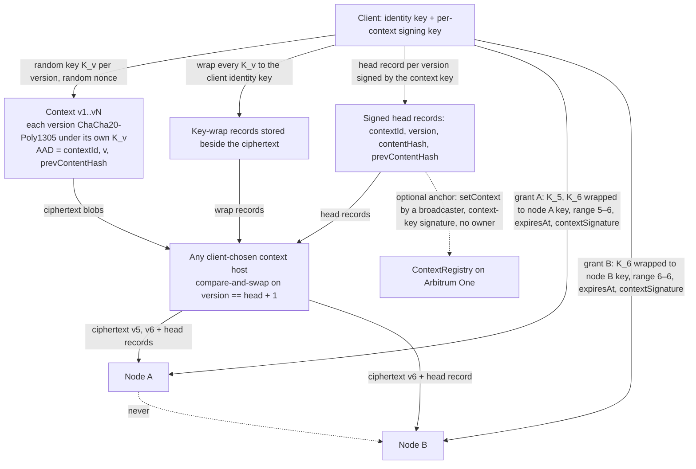

# Privacy and contexts — anonymous by default, two content tiers

Author: Comuns contributors
Status: Draft
Category: Technical Proposal
Created: 2026-10-12

**Reference:** docs/evidence-register.md, docs/protocol/contracts-and-settlement.md, docs/protocol/off-chain-api.md, docs/node/node-design.md, docs/product/dapp-and-sdk.md, docs/adr/0003-hpke-and-the-executor-plaintext-limit.md, docs/adr/0010-anonymous-by-default.md, docs/adr/0011-anonymous-credits.md, docs/adr/0012-contexts-without-a-wallet-link.md, docs/adr/0014-relay-authentication-to-gateways.md (proposed), docs/adr/0015-node-key-possession.md (proposed), docs/adr/0016-funding-edge-and-deposit-key.md (proposed), docs/adr/0017-accounts-and-decentralized-access.md (proposed)

---

## 1. Summary

Comuns is a proposal for open-source decentralized LLM inference settled on Arbitrum One with Rust nodes; nothing described here runs yet, and no audit of any part of this design has been performed. This document fixes what the proposal promises about privacy. There are two promises, they are different properties, and this document keeps them apart.

- **Standard tier, the default:** "the node can read your prompt but not who you are". The node that executes a request reads the prompt, the granted context and the completion in plaintext. It should not learn who sent them, and neither should a chain observer: no wallet address, account or persistent identifier reaches the node, the session is funded by an anonymous credit rather than a wallet transaction, and the client's network address is hidden behind a relay.
- **Attested tier, opt-in on TEE hardware:** the owner's requirement for this tier reads "the node cannot read your prompt either". What the proposal can promise is narrower: the node should not be able to read your prompt either, barring a physical attack (evidence register §14, [V]/[L]). The session is anonymous in the same way as the standard tier.

Inference runs only on network nodes. The client keeps transport, orchestration and sampling decisions and performs no model computation. Cryptographic private inference (MPC or FHE) is future work outside this proposal and no work on it is planned: the measured systems run at minutes per token for GPT-2-class models over the internet (evidence register §14, [V]).

What the proposal promises is checkable:

- Everyone who is not selected to execute a request — other operators, relays, the Arbitrum sequencer, RPC providers, indexers and network observers — sees only ciphertext and the public metadata listed in section 9. The inner envelope is two-way HPKE (RFC 9180): the client seals the prompt and context grant to the node's registered public key; the node seals every completion chunk back to a per-job client key. The outer hop is Oblivious HTTP (RFC 9458) through a registered relay, so the node never sees the client's network address and the relay never sees the envelope (section 6).
- No session names a payer. A credit session is opened by the node from a Semaphore proof over a deposited note; the chain records `user = address(0)` and learns the node, relay, model, mode, denomination and nullifier, not who deposited (docs/adr/0011-anonymous-credits.md, section 9).
- Single-node execution is the default. Unless the user opts into something else, exactly one network node reads the prompt in standard mode. Opting into a multi-node execution feature (section 8) adds exactly the readers listed on the disclosure sheet the user confirms for that request, and nothing else.
- The number of nodes that can read the full prompt, and the number whose operator can read it, are first-class disclosed quantities shown before the user confirms and bound into every envelope the client sends.
- Contexts (transcripts, documents, system prompts) are identified by a per-context signing key, not by a wallet. They are encrypted client-side under a separate random key per context version and shared with a node only by a context-key-signed grant that wraps the keys of exactly the granted versions to that node's HPKE key. Every version key is also wrapped to the client's long-lived identity key, and the backup export carries the identity key together with every key-wrap record; it does not carry ciphertext, so a context whose ciphertext existed only on a lost device is gone even with the backup (section 5). Nodes never exchange plaintext or keys, and neither a node nor the chain learns which wallet holds which context (section 7).
- Every job envelope is signed by the session's `sessionSigner`, a fresh key per session that is never reused, so nobody but the client that opened a session can submit work to it; every voucher is signed by the same key and binds the output through a keyed commitment that reveals nothing on-chain.

What the proposal does not promise, stated plainly: the executing node reads content in standard mode; attested mode is bounded by hardware attacks; identifying text and writing style can deanonymize the author whatever the transport hides (section 13); and anonymity sets are small at launch.

## 2. Scope

This document covers the confidentiality and anonymity of inference traffic: prompts, completions, contexts, context grants, the keys that protect them, the relay hop, the metadata that stays public, and what a credit-funded session reveals. It defines the privacy modes a node advertises, the execution features a client may request, and the disclosure sheet a client must show before any session is opened or reused.

Out of scope here, and owned elsewhere: the escrow, credit, change and ragequit semantics and every function signature (docs/adr/0011-anonymous-credits.md and docs/protocol/contracts-and-settlement.md), the off-chain API transport including the OHTTP wire format (docs/protocol/off-chain-api.md), the node process design (docs/node/node-design.md), the dapp and SDK (docs/product/dapp-and-sdk.md), the verification of outputs in verifiable mode (docs/security/inference-verification.md) and the multi-node orchestration protocol (docs/protocol/orchestration.md). The threat analysis is in docs/security/threat-model.md. The decisions this document restates are docs/adr/0010-anonymous-by-default.md (relays, modes, banners), docs/adr/0011-anonymous-credits.md (credits) and docs/adr/0012-contexts-without-a-wallet-link.md (contexts).

## 3. The limit

An executor must see plaintext unless FHE, MPC or a TEE is used. The evidence register records the state of each alternative (evidence register §14):

- MPC: the best measured client-plus-server scheme takes about 2.05 min per token on GPT2-base over a 400 Mbps / 4 ms WAN, and 7.96 min per token on LLaMA-7B on a LAN [V]; the best three-party scheme takes 233 s for GPT2-base over a 40 ms WAN and is secure only if at most 1 of 3 parties is corrupt [V]; no maliciously secure result at 1B parameters or more was found [L]/[U].
- FHE: generation runs at 1.31 min per token for GPT-2 and 5.18–6.79 min per token for Llama-3-8B on an A100 [V]; no FHE accelerator shipping for LLMs was found [V]. A 200-token answer at 7–13B with the best cryptographic results takes hours [U] (calc).
- TEE: the vendor reports a confidential-computing overhead of 1–8% [V, vendor]; an independent H100 + TDX study measured time-to-first-token up 21.8–27.8% and throughput down 11.5–21.1% [V]. The cost is acceptable, but the trust assumption moves to the CPU and GPU vendor and to the attestation service, and the hardware does not resist physical access: TEE.fail extracts TDX and SEV-SNP keys with a DDR5 interposer costing under $1,000, NVIDIA attestation reports are not VM-bound so a report can be relayed, and Intel and AMD consider physical attacks out of scope [V]; TDXRay recovers prompts from tokenizer memory-access patterns with 91.5–94.2% similarity [L].

The consequence, adopted in docs/adr/0010-anonymous-by-default.md, is that v1 encrypts the hop and hides the sender, not the computation. Attested mode additionally keeps the content from the operator, subject to the hardware attacks above. The protocol's job is therefore to make sure that only the parties the user chose can decrypt, that none of them learns who the user is, that the user knows exactly who those parties are before paying, and that nothing silently widens that set.

The following sequence shows who sees what in standard, single-node execution funded by a credit. There is no payer anywhere in it.

```mermaid
sequenceDiagram
    participant U as User client
    participant R as Relay (OHTTP)
    participant N as Node (OHTTP gateway, standard mode)
    participant C as Chain (SessionEscrow, NodeRegistry)
    U->>U: show disclosure sheet, user confirms; fresh sessionSigner; Semaphore proof over one credit note
    U->>R: OHTTP request encapsulated to the node's ohttpKeyConfig: spend proof (denomination, root, nullifier, points) with node, relay, model, mode, sessionSigner and the confirmed prices
    Note over R: sees the client's network address, sizes, timing and the target node; never the encapsulated content
    R->>N: forwards the encapsulated request
    Note over N: sees the spend parameters and the relay's address; never the client's address
    N->>C: openSessionFromCredit (node, relay, model, mode, sessionSigner, prices, denomination, proof) — submitted by the node
    Note over C: learns node, relay, model, mode, denomination and nullifier; records user = address(0); no payer
    N->>R: session_opened (sessionId)
    R->>U: session_opened
    U->>R: session read tunnelled through the relay: confirms sessionId, sessionSigner and the two prices copied into the session
    R->>U: session record
    U->>R: HPKE envelope: prompt + context grant (+ commitKey in the first job) sealed to the node key, AAD with sessionId, signed by sessionSigner
    R->>N: forwards the encapsulated envelope
    Note over N: verifies the envelope signature, decrypts — reads prompt and context in plaintext
    N->>R: node-signed input receipt (sessionId, jobId, jobInputTokens, cumulativeInputTokensAfter) before prefill
    R->>U: input receipt
    U->>R: input voucher (cumulative total), signed only if the client's own token counts match
    R->>N: input voucher
    N->>R: chunked OHTTP: HPKE frames sealed to clientJobPublicKey, each with a node-signed receipt
    R->>U: frames
    Note over U: decrypts the completion. The relay and the chain do not read it; in standard mode the node produced it and can read it.
    U->>R: cumulative voucher (sessionId, seq, cumulativeWei, inputTokens, outputTokens, outputCommitment, isFinal)
    R->>N: cumulative voucher
    N->>C: redeemVoucher — token counts and amounts public, relay fee split, outputCommitment reveals nothing
    U->>R: closeSession with a sessionSigner signature, then claimChange into fresh change notes — submitted by a broadcaster, never from the deposit wallet
    R->>C: session reads and submissions tunnelled through the relay
```

## 4. Algorithms

The cipher suite is fixed, not negotiated, so that a downgrade cannot be requested:

| Component | Choice |
|---|---|
| Public-key encryption | RFC 9180 HPKE, base mode |
| KEM | DHKEM(X25519, HKDF-SHA256) |
| KDF | HKDF-SHA256 |
| AEAD | ChaCha20-Poly1305 |
| Context content encryption | ChaCha20-Poly1305 under a random 256-bit key per context version (`K_v`), 12-byte random nonce, AAD as in section 7 |
| Hash | keccak256, for `contentHash`, `transcriptHash`, `outputCommitment` and the envelope-signature digest |
| Output commitment key | `commitKey`, a random 32-byte key per session from the client CSPRNG, sent sealed in the session's first job envelope (section 10) |
| Job authentication | `sessionSigner` signature over the envelope digest (section 6); HPKE stays base mode |
| Outer transport | RFC 9458 Oblivious HTTP: every request is encapsulated to the node's registered `ohttpKeyConfig` under a fresh HPKE context per request; streamed responses use chunked OHTTP (draft-ietf-ohai-chunked-ohttp, draft -08, approved and in the RFC Editor queue without an RFC number on 2026-10-15 (evidence register §15, recheck 2026-10-15, [V]); one non-interactive exchange per message per docs/protocol/off-chain-api.md section 3) for the frames (evidence register §15, [V]; section 6) |
| Transport | TLS 1.3 on the client–relay hop, the relay–node hop and every node–node hop, in addition to OHTTP and HPKE |

The reference implementation is expected to use the Rust `hpke` crate, version 0.14.1, which implements RFC 9180; its documentation reports that no paid audit has been performed (evidence register §4, [V]). Comuns has not audited it either. No homegrown cipher, KDF or mode of operation is permitted (section 11).

The three layers do different jobs. The inner HPKE job envelope, its associated data and its `sessionSigner` signature are unchanged from the design before relays existed and travel inside the OHTTP hop unchanged; they protect the content end to end so that a relay, a terminating proxy, a load balancer or a misconfigured node front-end cannot read it. The OHTTP layer hides the client's network address from the node and the envelope from the relay: the node's `ohttpKeyConfig` is registered once for every user, advertises exactly the suite above and nothing else, and a client rejects a configuration that lists any other suite. TLS authenticates each hop's endpoint and encrypts its contents; passive observers can still see traffic sizes and timing, which padding and batching only reduce (section 6). All three are required for job traffic; none replaces another. The experimental sharding spike is the exception in section 6: activations have no inner HPKE envelope.

## 5. Keys

**Client encryption keys.** The client's HPKE keys are application-managed. They are generated from the operating-system CSPRNG, are never the wallet signing key and are never derived from it, and are stored encrypted at rest on the client. There are two kinds:

- The **long-lived identity key** is mandatory. Every context version key `K_v` the client ever generates is wrapped to it (section 7). The **backup export** is an encrypted file that contains the identity key **and every key-wrap record** (every `K_v` wrapped to the identity key), together with the vault contents listed below. It contains no ciphertext. Restoring it on a new device restores the ability to decrypt every context version whose ciphertext can still be fetched — from a context host or from a second device of the owner. Ciphertext that existed only on a lost device is gone even with the backup; the backup alone does not restore every context, and no document may claim that it does. Users should therefore keep at least one context host or a second device holding the ciphertext. Losing the identity key and its backup loses every context, permanently, whatever ciphertext survives. The identity key is the root of the vault and is never derived from, wrapped by, stored with or recoverable through a wallet, an embedded-wallet or passkey provider, a recovery guardian, cloud sync or a login identity (docs/adr/0017-accounts-and-decentralized-access.md, proposed).
- For each job the client additionally generates a fresh **per-job keypair** whose public half, `clientJobPublicKey`, is sent to the node so that completion chunks are sealed to it. Per-job keys are discarded when the job closes. They play no part in the output commitment: its key, `commitKey`, is a separate per-session secret (section 10) that is not derived from any HPKE context and outlives every job of the session.
- The **session commit key** `commitKey` is a random 32-byte key the client generates from the OS CSPRNG when it opens a session and sends to the node sealed inside the session's first job envelope (section 6). Client and node both keep it until the session is settled; it is known to nobody else. One `commitKey` covers every job of the session, so a multi-job session has one commitment chain under one key.

**Session signer.** `sessionSigner` is a fresh signing key per session, generated from the OS CSPRNG, never reused across sessions and never derived from the wallet. It is bound into the spend message of `openSessionFromCredit`, so a note cannot be redirected to another signer (docs/adr/0011-anonymous-credits.md). It signs every job envelope sent on that session (section 6), every voucher (section 10), the `closeSession` message and the `claimChange` message for that session (docs/protocol/contracts-and-settlement.md), and nothing else. Reusing a `sessionSigner` across sessions would link them to every node and every chain observer; it is forbidden (section 11). The key is deleted once the session's change has been claimed.

**Context keys.** Each context has its own random signing key, generated from the OS CSPRNG, never the wallet key and never derived from it; `contextId = keccak256(contextPubKey)` (section 7). The context key signs head records, grants and any `setContext` anchor. Losing it means no further version can be signed; the content stays readable through the identity-key wraps.

**Note secrets.** Every credit note — deposit notes and change notes alike — carries a fresh Semaphore identity generated by the client, which stores the note secret durably in the vault before the commitment is published. A reused identity makes a second note unspendable, and the same commitment appearing in two groups links them publicly (docs/adr/0011-anonymous-credits.md). A note whose secret is lost is gone: there is no recovery and no admin.

**The vault.** The list of a wallet's context keys, its note secrets, its accepted context head checkpoints (section 7) and its key-wrap records live only in the local vault, encrypted under the identity key, and in the backup export. The vault is never sent to a node, never written on-chain and never shared with a relay or a context host.

**Wallet keys.** The reference client uses the wallet key for `depositNote`, `ragequit` and the `withdraw()` of a ragequit balance (docs/adr/0011-anonymous-credits.md); only if the user opts in does it also sign account setup, bounded swaps or intents in its own account, and, once, a deposit-key grant and its revocation (ADR 0016, proposed). The deposit key signs only `depositNote`. No account key, deposit key or login ever signs a voucher, envelope, spend, close or `claimChange`, and none is sent to a node or a relay. Neither the wallet key nor the deposit key ever signs a job, a context grant or a context anchor, and the wallet key is never presented to a node. `openSession`, `topUp` and user refunds remain specified for a direct caller (docs/adr/0011-anonymous-credits.md); the reference client has no call site for them. No document offers that path as a privacy mode. Wallet, session-signer and context keys never derive encryption keys.

**Rejected: sign-to-derive.** A common pattern derives an encryption key by asking the wallet to sign a fixed message and hashing the signature. It is rejected for two reasons:

- It requires deterministic signatures (RFC 6979) (evidence register §4, [L]). Contract wallets, MPC wallets and some hardware wallets may not sign deterministically, so the derived key is not reproducible and the user's contexts become unreadable.
- Any site that obtains that one signature obtains every context key the user has ever derived from it. A single phishing page turns into a total loss of confidentiality, retroactively.

It is not offered as an opt-in either. The vault rule of docs/adr/0017-accounts-and-decentralized-access.md (proposed) is unconditional: no vault, context, note or encryption key is ever derived from a wallet signature, and the client never falls back to such a derivation.

**Forbidden wallet APIs.** `eth_getEncryptionPublicKey` and `eth_decrypt` are forbidden: they have been deprecated since 2022 (evidence register §4, [V]) and expose the wallet's key material to a browser-side decryption flow that the user cannot inspect. ERC-5630 is a Draft (evidence register §4, [V]) and is not a dependency of this proposal.

**Node keys.** A node registers two public keys in `NodeRegistry` under a signature by the operator's Ethereum account: its HPKE key, to which the inner job envelope is sealed, and its OHTTP gateway key configuration `ohttpKeyConfig`, to which the outer hop is encapsulated (`registerNode` and `updateNode`, signatures in docs/adr/0011-anonymous-credits.md). Both are generated on the operator's machine from the OS CSPRNG and stored encrypted at rest. Registration binds the public keys to the operator and nothing more; it carries no proof of possession, and the contract checks none. Possession is verified by each client, before the credit spend, through the `key_probe` exchange of docs/adr/0015-node-key-possession.md (proposed): a fresh challenge sealed to `hpkePublicKey` and encapsulated to `ohttpKeyConfig`, answered under a MAC that binds the node's receipt-signing key, so one probe covers `hpkePublicKey`, `ohttpKeyConfig` and the receipt key. The attested-mode quote (section 8) is a separate check and does not replace the probe. A node publishes one `ohttpKeyConfig` for every user; a per-user gateway key would single that user out and is forbidden (section 11). Rotation is a registry update (`updateNode` publishes the new keys); clients seal to the node's current registered keys — the ones in the latest `NodeRegistered` or `NodeUpdated` event when they open or reuse the session (docs/protocol/contracts-and-settlement.md §9). The spend message of `openSessionFromCredit` binds the node, relay, model, mode, signer and the two expected prices but not the keys, so a same-price `updateNode` ordered just ahead of the spend can swap a key in flight; binding the key hashes is an open question in both documents (section 14, question 11). The node keeps a **keyring** of every HPKE key and every `ohttpKeyConfig` used by any session that is not yet settled, however many rotations have happened since, and deletes an old key only after every session that used it is settled. A key that is still on the keyring serves traffic sealed to it exactly as the current key does. In attested mode (section 8) both keys must be generated inside the TEE and never leave protected memory.

**Logging policy.** Nodes never log prompt, context or completion plaintext, and never log the relay's forwarded traffic beyond what settlement needs. This is an operator policy enforced by the reference node software, not a protection against a malicious operator: an operator who modifies the node can log whatever it decrypts.

## 6. Request and response envelopes

Each job uses one HPKE context per direction. The client opens a sender context to the node's registered key; the node opens a sender context to `clientJobPublicKey`. Every envelope and frame carries associated data (AAD) that binds it to exactly one place in exactly one job, so that a ciphertext cannot be replayed into another session, chain, contract, context version or position. The whole envelope, AAD included, travels inside the OHTTP hop of the relay transport below, so the relay sees none of these fields.

**Associated data (both directions), in order:**

| Field | Meaning |
|---|---|
| `chainId` | EIP-155 chain id of Arbitrum One, commonly published as 42161 (UNVERIFIED in this document; confirm at implementation) |
| `escrow` | Address of the `SessionEscrow` contract |
| `sessionId` | Session the job is paid from |
| `jobId` | Job within the session |
| `requestId` | Client-side request this job belongs to (section 8) |
| `sheetVersion` | Version of the disclosure sheet the user confirmed for this request |
| `planId` | Plan identifier; zero for single-node execution |
| `taskId` | Task within the plan; zero for single-node execution |
| `role` | Role of the receiving node in the plan. **The canonical role tokens**, owned by this document and reused verbatim by every other document, the disclosure sheet's `roles[]` (section 8.3), the capability document and the wire protocol — never a camelCase or suffixed variant: `executor`, `planner`, `answerer`, `reviewer`, `synthesizer`, `merge`, `orchestrator`, `shard holder`, `draft`, `target`, `verifier`. There is no separate assessor token: an assessment is the output of a planner session and carries `planner` |
| `contextId` | Context granted for this job, or zero |
| `contextVersion` | Context version granted, or zero |
| `direction` | client-to-node or node-to-client |
| `seq` | Frame sequence number, starting at zero per direction. This is a transport counter; it is never the voucher `seq` of section 10, which is a separate per-session counter starting at 1 |
| `endOfJob` | Last-frame flag of a job. It is never copied into a voucher's `isFinal`, which means something else (the client closes the session, section 10) |

**Job authentication (envelope signature).** HPKE base mode does not authenticate the sender, and `sessionId`, `chainId` and the escrow address are public in `SessionOpened`; without a signature anyone could seal a job to the node's key under someone else's session. Every request envelope therefore carries, outside the AEAD but inside the OHTTP encapsulation, a signature by the session's `sessionSigner` over `(chainId, escrow, sessionId, jobId, requestId, sheetVersion, keccak256(enc ‖ ciphertext))`, where `enc` is the HPKE encapsulated key. The node looks up the `sessionSigner` recorded on-chain for that session and rejects any envelope whose signature does not verify against it before decrypting or scheduling anything. A multi-frame request signs every frame the same way. The signature is what stops a third party from injecting jobs into an open session; the AAD is what stops replay of an honest envelope into another place. The signature identifies a session, never a person: the signer is fresh per session (section 5).

**Request envelope (client → node), plaintext fields inside the AEAD:**

- `clientJobPublicKey` — the per-job public key the node must seal responses to;
- `commitKey` — in the session's first job envelope only: the random 32-byte session commit key of section 10; absent in every later envelope of the session;
- `prompt` — the prompt body, or in a multi-node plan the sub-task text, plan or answers this node is entitled to receive;
- `contextGrant` — the context-key-signed grant described in section 7, or absent;
- `params` — sampling and length parameters;
- `modelId` — must match the session's model.

**Input receipt (node → client, before prefill).** After verifying the signature, decrypting the envelope and tokenizing the prompt and the granted context with the tokenizer pinned in the model manifest, and before any prefill, the node sends a node-signed **input receipt** over `(sessionId, jobId, jobInputTokens, cumulativeInputTokensAfter)`, where `jobInputTokens` is the token count of this job's prompt and granted context and `cumulativeInputTokensAfter` is the session's cumulative input total once this job is counted. The client checks two things: `jobInputTokens` must equal its own tokenization of this job's prompt and granted context with the same pinned tokenizer, and `cumulativeInputTokensAfter` must equal `lastInputTokens + jobInputTokens`, where `lastInputTokens` is the cumulative `inputTokens` of the last voucher the client signed on this session (zero for the first job). Only if both hold does the client sign the input voucher (section 10), whose `inputTokens` field carries the cumulative total `cumulativeInputTokensAfter`; otherwise it signs nothing and abandons the job. This is what lets the second and every later job of a session be paid: the voucher's cumulative counts never fall below the previous voucher, and the client has checked the increment job by job. The node starts prefill when it holds the input voucher.

**Response frames (node → client).** The node streams completion chunks as HPKE frames, one per chunk, with `seq` increasing by one and `endOfJob` set only on the last frame; the frames are carried as chunked OHTTP response chunks through the relay. Every frame carries a node-signed **chunk receipt** over `(sessionId, jobId, cumulative inputTokens, cumulative outputTokens, keccak256 of the chunk plaintext)`, where both counts are cumulative for the whole session across all its jobs, in the same way as the input receipt. **The receipt travels inside the sealed frame plaintext, never outside it**: no hash of the chunk plaintext appears outside encryption, because a relay or a TLS-terminating proxy could otherwise hash candidate short answers, labels or numbers and identify the completion despite HPKE; any hash that must appear outside encryption is keyed, `keccak256(commitKey ‖ chunk)`, under the session commit key of section 10 (docs/protocol/off-chain-api.md §7). The client checks the receipt against the decrypted chunk, checks that the cumulative output count rose by exactly the tokens of that chunk, and then signs the next cumulative voucher, so payment and delivery advance one chunk at a time and neither side waits on the other for the whole job. The client:

- rejects a frame whose AAD does not match the expected tuple (replay);
- rejects a frame whose `seq` is not the next expected value (reordering, injection);
- rejects a frame whose receipt does not match the decrypted chunk or whose cumulative counts are lower than the previous receipt, and signs no voucher covering it;
- rejects a stream that ends without a frame carrying `endOfJob`, other than a response that ends at the input-receipt or a payment boundary (docs/protocol/off-chain-api.md section 3) (truncation), and does not sign a voucher that covers the missing output;
- rejects an `endOfJob` frame followed by anything further.

The node applies the AAD and `seq` rules to request envelopes in a multi-frame request (for example a large context attached in several frames).

**Multi-node plans.** Each participating node has its own session, its own relay choice, its own HPKE envelope and its own `clientJobPublicKey`. In `collective_answer`, `parallel_planning` and `task_decomposition` every intermediate result returns sealed to the client, which decrypts it, applies the user's approved plan and re-seals only the approved parts to the next disclosed recipient. Nodes never receive another node's envelope keys. The only data that travels without the inner HPKE job envelope is the activation traffic of the experimental `model_sharding` spike, and even there nothing moves node to node and nothing bypasses the relay: the client mediates every stage boundary, sending each shard holder exactly its inputs and receiving its activations through a relay, encapsulated to the holder's registered `ohttpKeyConfig`, and the disclosure sheet says so. Embedding and output-layer computation in that spike run on disclosed network nodes, which are readers; the client performs no model computation.

### Relay transport

The outer hop of every job, frame, receipt and session-specific chain read is Oblivious HTTP (RFC 9458) through a relay, with chunked OHTTP for streamed frames (evidence register §15, [V]). The node process is the OHTTP gateway. The rules, decided in docs/adr/0010-anonymous-by-default.md:

- **Choice of relay.** Relays are a registered role in `NodeRegistry` (`registerRelay`, `updateRelay`, `deregisterRelay`; a relay posts a bond of at least `MIN_RELAY_BOND_WEI`, named and with no normative value set (a testnet-only, non-normative value is proposed in docs/cip/0004-sepolia-testnet-configuration.md), and is never slashed). Under proposed ADR 0014, the client draws an eligible transport relay at random for each OHTTP exchange. The fee relay is fixed by the spend message for the session; the chain records that fee recipient, not every relay that carried a later exchange. The shipping precedent chooses randomly among relays run by distinct third parties (evidence register §15, [V]).
- **Relay is not node.** The registry refuses to register an address as both a relay and a node, and `openSessionFromCredit` reverts when `relay == node`. This is the whole of the check. One person operating a relay and a node from two addresses is not detected on-chain: two addresses are two registrations. That Sybil residual is stated here and in the threat model, not hidden; what such an operator gains is the correlation of section 9 and R12, not the content of an attested session.
- **What the relay sees.** The client's network address, the size and timing of every encapsulated request and response, and the target node. Never the envelope, the AAD, the session, the prompt, the context or the completion. Relays hold no OHTTP key; only nodes register `ohttpKeyConfig`.
- **Relay authentication.** The relay authenticates to the gateway on every TLS connection with a credential signed under the relay record's operator key (an EIP-712 delegation and a signature over the gateway's fresh nonce), the gateway serves nothing on a connection that has not passed it, and the credential contains no client data: no session, nullifier, `sessionSigner` or client address (docs/adr/0014-relay-authentication-to-gateways.md, proposed).
- **What the node sees.** The envelope and everything inside it — in standard mode the plaintext content — and the relay's network address. Never the client's network address, wallet, account or any persistent identifier.
- **Chain reads.** Every session-specific chain read the reference client makes — session lookup, settlement and change monitoring, Merkle witness and root queries — goes through the same transport: RPC or indexer queries tunnelled through a relay. An indexer is a backend behind that transport, not an alternative to it. A session read from the user's own network address would undo what the job transport hides.
- **Padding and batching.** Job envelopes and streamed frames are padded to size buckets, and output tokens are batched per frame. The bucket sizes and batch sizes are unset (section 14). This reduces, and does not remove, what sizes and timing reveal: token lengths alone reconstruct 29% of responses and infer the topic of 55%, and Whisper Leak reaches often more than 98% AUPRC, with padding, batching and packet injection reducing it but none fully protecting (evidence register §16, [V]). No document claims that padding defeats these attacks.
- **Fee.** Relays are paid a global `RELAY_FEE_WEI`, a governance parameter with no normative value set (a testnet-only, non-normative value is proposed in docs/cip/0004-sepolia-testnet-configuration.md) and allowed to be 0, copied onto the session at open and paid from the first wei of the node's settled value, never by a user transaction (docs/adr/0011-anonymous-credits.md).
- **No direct path.** The reference client has no direct client-to-node job path. When no relay is available the request fails closed; the client does not fall back to a direct connection, because an opt-out that saves a round trip gets switched off.
- **Cost.** Each OHTTP exchange costs at least two HTTP requests; no millisecond figure is published and none is claimed here (evidence register §15, [V]). Chunked OHTTP lets either party measure round-trip time (evidence register §15, [V]). The reference shape follows the draft's section 7.2 guidance: no request chunk depends on a response chunk within one exchange, which also avoids in-exchange replay of interactively generated request chunks (evidence register §15, recheck 2026-10-15, [V]). The gateway still links a session's exchanges through the session fields inside them and can time the gap between a response and the client's next exchange, which includes the client's round trip; that cross-exchange timing remains a residual (R12, T37, RR-40).

The relay banner the client shows is normative and copied verbatim from docs/adr/0010-anonymous-by-default.md: The relay sees your network address and not your prompt. The node sees your prompt and not your network address.

### Metadata inside and outside the hop

| Party | Inside the OHTTP hop | Outside it |
|---|---|---|
| Relay | Nothing: the encapsulated request and response are opaque | Client network address, request and response sizes, timing, target node, the bucket a padded message fell into |
| Node, standard mode | Everything: the AAD tuple, the envelope signature, the prompt, the granted context versions, `commitKey`, the completion | Relay network address, sizes, timing; the session on-chain |
| Node, attested mode | The same bytes, decrypted inside the TEE; the operator should not be able to read them, barring a physical attack (evidence register §14, [V]/[L]) | Relay network address, sizes, timing; the session on-chain |
| Chain and chain observers | Nothing | The session record of section 9: node, relay, model, mode, denomination, nullifier, token counts, prices, timing, `pendingWei`, change commitments |
| Network observer, client–relay hop | Nothing | TLS traffic from the client's address to a relay endpoint; sizes and timing |
| Network observer, relay–node hop | Nothing | TLS traffic from the relay to a node endpoint; sizes and timing |

Two things follow. First, the AAD fields are inside the hop: a relay cannot tell two sessions apart by `sessionId`, and cannot tell a first job from a later one except by size and timing. Second, what is outside the hop is exactly what padding, batching and the random relay choice are meant to blur, and section 9 and section 13 state what they do not blur.

## 7. Contexts and grants

A context is a versioned, content-addressed blob — transcript, documents, system prompt. One wallet owns one-to-many contexts, and a context is shared with more than one node; neither a node nor a chain observer can link a context to the wallet. The decisions are docs/adr/0012-contexts-without-a-wallet-link.md.

**The context identity is a key.** The client generates a random per-context signing key from the OS CSPRNG (section 5). `contextId = keccak256(contextPubKey)`. A node verifies `keccak256(contextPubKey) == contextId` before it accepts anything about that context. There is no owner field anywhere: not on-chain, not in the AAD, not in the grant.

**Encryption: one key per version.** Each context version `v` has its own random 256-bit key `K_v`, generated from the client CSPRNG. The stored blob of a version is `header ‖ ciphertext ‖ tag`, where:

- `ciphertext ‖ tag` = ChaCha20-Poly1305(`K_v`, `nonce`, `AAD`, plaintext);
- `nonce` is 12 random bytes, stored in the blob header; a fresh key and a fresh nonce per version means no two messages are ever sealed under the same (key, nonce) pair;
- `AAD` = `contextId ‖ v ‖ prevContentHash`, where `prevContentHash` is the `contentHash` of version `v − 1` (zero for version 1), so version `v` is cryptographically chained to the version it was derived from;
- `contentHash` = keccak256 of the complete stored blob (`header ‖ ciphertext ‖ tag`). This is the one canonical definition; client, node, host and `ContextRegistry` all mean this value, and nothing hashes the plaintext.

Because keys are per version, possessing `K_v` opens exactly one version and nothing published before or after it. The blob is stored client-side and optionally at any host the owner chooses; a host sees ciphertext only.

**Head records and the hash chain.** Each version has a head record `(contextId, version, contentHash, prevContentHash)` signed as EIP-712 typed data by the context key. A node or a host verifies the signature and the chain: the record's `prevContentHash` equals the previous version's `contentHash`, back to version 1 whose `prevContentHash` is zero.

**Key-wrap records and backup.** Every `K_v` is wrapped (HPKE-sealed) to the client's long-lived identity key the moment it is generated, and the wrap record is stored beside the ciphertext, at the client and at any host. This is mandatory, not optional. The backup export of section 5 contains the identity key and every one of these wrap records, so a restored backup can open any version whose ciphertext the client can still obtain. The backup does not contain the ciphertext: hosting is optional, and a user who keeps contexts only on one device and loses it has lost the ciphertext of every version, which neither the backup nor the registry can bring back (`ContextRegistry` holds hashes only). The recommendation is at least one context host or a second device holding the blobs. A client that loses its working copy fetches the blobs from the host or the second device and unwraps their keys with the wrap records restored from the backup; wrap records found beside the ciphertext at a host serve the same purpose when the backup predates the latest versions.

**Context host: the default integrity path.** A context host stores the blobs, the wrap records and the signed head records, and returns them by `contextId` and version. It accepts a new version only by compare-and-swap on `version == head + 1`. With the chain no longer the default anchor, the host is trusted for sequencing as well as for availability, and this document says so. The client's defences are checkpoints: it persists every accepted head `(contextId, version, contentHash)` in the vault and in the backup, and rejects any head behind a checkpoint it holds. The limits of an unanchored context, stated plainly: a host can equivocate between two devices that have never compared checkpoints, serving each a different fork; and a device restored from a stale backup accepts a head that a newer device would reject until the two devices sync. A host sees which `contextId` is fetched from which network address unless the fetch also goes through a relay; the reference client fetches through a relay.

**On-chain record (optional anchor).** `ContextRegistry` keys a context by `contextId` alone and stores only the latest `(version, contentHash)`. `setContext(contextId, version, contentHash, contextPubKey, signature)` is callable by any address; the contract checks `keccak256(contextPubKey) == contextId`, `version == previous + 1`, `contentHash ≠ 0`, and that `signature` is the context key's EIP-712 signature over `(chainId, registry, contextId, version, contentHash)` (docs/adr/0011-anonymous-credits.md, docs/protocol/contracts-and-settlement.md). It is ownerless: nothing in the record or the `ContextSet` event names a wallet. In the reference client the transaction is submitted by a broadcaster or a node through a relay, never by the user's wallet. The anchor is optional: the default client does not need it. It is required whenever a globally consistent multi-device head is promised, because that is the only way two devices that have never synced can agree on the head. Every accepted version emits a `ContextSet` event, so the full history is on-chain in the event log even though state keeps only the head; a node verifying an older anchored version reads its `contentHash` from the event history, not from the head slot. The registry stores no content, no keys and no owner.

**Grant.** "Shared between the nodes" means portable client-wrapped ciphertext, never shared plaintext. To let a node use a context the client issues a grant, which travels inside the job plaintext under the job's HPKE envelope:

| Field | Meaning |
|---|---|
| `contextId`, `fromVersion`, `toVersion` | The version range the node may decrypt |
| `contextPubKey` | The context's public key; the node checks `keccak256(contextPubKey) == contextId` |
| `wrappedKeys[]` | Exactly the keys `K_fromVersion … K_toVersion`, each HPKE-sealed to the node's registered public key; the grant carries no other key, so a narrow grant restricts decryption cryptographically, not only by policy |
| `expiresAt` | Unix time in seconds (`uint64`) after which the node must discard the keys; never a block number |
| `nodeKeyHash` | Hash of the HPKE public key the grant was sealed to, so a rotated node cannot claim it |
| `contextSignature` | Signature by the context key over every grant field above — `contextId`, `contextPubKey`, `fromVersion`, `toVersion`, `wrappedKeys[]`, `expiresAt` and `nodeKeyHash`; never a wallet signature |
| `headRecords[]` | Sent beside the grant, outside its signed fields: the ancestor head records `(contextId, version, contentHash, prevContentHash)` from version 1 up to `toVersion`, each individually signed by the context key, without their decryption keys, so the node can verify the hash chain back to version 1 (docs/protocol/off-chain-api.md §9) |

The receiving node verifies `contextSignature` against `contextPubKey`, verifies the signed head records back to version 1 — each record's signature against `contextPubKey`, and each record's `prevContentHash` against the `contentHash` of the record for exactly version `v − 1`, down to version 1 whose `prevContentHash` is zero, reusing records it verified in an earlier grant for this `contextId` and kept — checks that each version it is given hashes (keccak256 of the complete blob) to the `contentHash` in that version's signed head record — or, for an anchored context, in `ContextRegistry` or its `ContextSet` history — checks that the AAD chain links each version to the previous one, unwraps the keys, and uses them only within the range and before `expiresAt`. The head records carry no keys: a node holding them can verify the chain of every version, and decrypt only the versions whose keys the grant wraps. A second node receives its own grant with its own wraps; nodes never exchange plaintext or keys.



**Revocation.** Because every version has its own key, a node holds only the keys it was granted. Revocation is therefore simply not granting: the client stops issuing grants to the revoked node, and every later version is unreadable to it because its key `K_{N+1}` was never wrapped to that node. A node that already decrypted the granted versions cannot be made to forget them; revocation limits future versions, not the past. This document says so plainly because the alternative claim would be false.

**Concurrent edits.** The host accepts one next version per context, by compare-and-swap. If two devices of the same owner publish competing versions `N+1`, the first accepted wins and the second is refused; nothing is merged and nothing is silently overwritten. The losing device keeps its local edit, reads the new head, rebases its edit onto it as version `N+2` (with `prevContentHash` = the winner's `contentHash` and a fresh `K_{N+2}`) and publishes again, surfacing the conflict to the owner where the edits touch the same material. An anchored context applies the same rule on-chain: `setContext` accepts one next version and the second transaction reverts. Nodes never resolve conflicts.

**Residual linkage.** A `contextId` is a pseudonym. Every node that receives grants for the same `contextId` can group the sessions that granted it, and a public anchor links that context's versions on-chain, though it does not itself publish which sessions grant the context. Turns within one conversation are inherently linkable; the shipping precedent accepts the same (evidence register §16, [V]). A client may fork a context under a new key to break the chain: the fork uses a new `contextId`, need not publish a parent pointer, and starts a new pseudonym with no history, but shared plaintext and timing can still link it to its parent. The disclosure sheet's `anonymity.contextLinkage` field states which of these apply to a request (section 8.3).

**Retention and deletion.** A node must discard the granted keys at `expiresAt` or when the job closes, whichever is earlier, and must not persist decrypted context beyond the job. Hosts must delete a blob when the client requests it. Neither rule can be verified remotely in standard mode; attested mode binds the node build to a measurement that includes the retention code, which raises the cost of silent violation but does not prove deletion. Deletion on-chain is impossible: anchored `ContextRegistry` entries are permanent, but they contain only hashes.

## 8. Privacy modes and execution features

### 8.1 Privacy modes (per node)

The mode names and numbers are normative and unchanged (docs/adr/0010-anonymous-by-default.md). A node advertises the modes it supports in `NodeRegistry`; a user requires a mode per request. Every mode is anonymous: no mode presents a wallet, account or network address to the node, and no mode names a payer on-chain. The modes differ in who can read the content. The banner sentences are normative and copied verbatim from the ADR; later documents copy them verbatim too.

**`standard` (mode 0).** The default. Third parties, nodes not selected for this request, relays, the sequencer, RPC providers and indexers see only ciphertext and the public metadata of section 9. Every node selected to execute reads the prompt, the granted context and the answer in plaintext; it should not learn who sent them. The default selection is exactly one node. The banner: This node can read your prompt and your answer. It should not learn who you are.

**`attested` (mode 1).** Opt-in. The session is anonymous in the same way as standard mode and, in addition, the operator should not be able to read the content, subject to the hardware attacks in evidence register §14. The node runs inside a TEE — CPU TDX or SEV-SNP plus GPU confidential computing — and presents a quote that the client verifies, before sealing anything, against a published measurement list bound to the node build and the model manifest. The banner: This node should not be able to read your prompt. A physical attack on the hardware can break that. Requirements:

- both the node's job HPKE keypair and its OHTTP gateway key `ohttpKeyConfig` are generated inside the TEE and never leave protected memory;
- the quote's report data commits to the hash of both public keys together with a client-supplied nonce; docs/adr/0015-node-key-possession.md (proposed) adds `receiptPublicKey` to the report data before attested mode is enabled, so that the quote binds all three keys, and the quote never replaces the `key_probe` check of section 5;
- the client refuses to seal unless this binding verifies — a valid quote for an unrelated key proves nothing about the keys the client is about to encrypt to;
- quote verification is client-side in v1. On-chain verification is a later option; the evidence register puts a direct on-chain check at roughly 3M gas and a ZK-wrapped check at roughly 350k gas (evidence register §4, [V/L]). Intel's EPID attestation and IAS were discontinued in April 2025, so DCAP or Intel Trust Authority are the remaining CPU attestation paths (evidence register §4, [L]);
- attested mode does not defend against physical access. TEE.fail extracts TDX and SEV-SNP keys with a DDR5 interposer costing under $1,000, and NVIDIA attestation reports are not VM-bound so a report can be relayed; Intel and AMD consider physical attacks out of scope (evidence register §14, [V]). TDXRay recovers prompts from tokenizer memory-access patterns with 91.5–94.2% similarity (evidence register §14, [L]). A user who needs protection against an operator with physical access to the machine has no option in this proposal;
- when the user requires attested mode and no eligible node exists, the request fails closed. The client never silently downgrades to standard mode, and an attested request fails closed unless every plaintext recipient on the disclosure sheet is attested (section 8.3).

**`verifiable` (mode 2).** Opt-in. The prompt is disclosed to a user-chosen second node that re-executes the request under a **demonstrated deterministic profile** — an engine configuration the node has shown to produce byte-identical output for identical input — and the two outputs are compared. The verifier is reached through a relay and funded by its own credit session like every other recipient. This mode adds a second content reader and trades confidentiality for integrity; it is not a privacy upgrade, and it is not combined with attested mode in v1. Its details are owned by docs/security/inference-verification.md. The banner: This node and the verifier you chose can read your prompt. They should not learn who you are. `cross_node_speculation` is incompatible with this mode: the deterministic profile needs byte-identical output, speculative engines do not guarantee it (mistral.rs states that token-for-token equivalence is not guaranteed, evidence register §9 [V]), and TOPLOC, a candidate checker, cannot detect speculative decoding either (evidence register §5 [V]).

### 8.2 Execution features (per request)

Orthogonal to the mode is `executionFeatures`, a per-request, client-side set that is never stored on-chain. The feature names are normative. Every recipient of any feature is a network node reached through a relay, and every paid recipient is funded by its own credit session with its own fresh `sessionSigner`; the unpaid shard holders of the sharding spike are the one exemption from the funding rule and no exemption from the relay rule.

| Feature | Who reads what |
|---|---|
| (empty) — **single-node** | The default. Exactly one network node reads the prompt, unless the user also chose verifiable mode, which adds the user-chosen verifier as a second full-prompt reader listed on the sheet. |
| `collective_answer` | k ≥ 2 answerer nodes, possibly running different models, each receive the full prompt sealed separately and answer independently. Reviewers then receive the prompt plus all anonymized answers. A user-chosen synthesizer receives the prompt, all answers and all critiques; the synthesizer is always a network node and always a full-prompt reader. Two cheaper variants exist and are different methods: self-consistency (k samples of one strong model and a majority vote over a short extracted answer, only for tasks with a short checkable answer such as a number, choice or label) and Self-MoA (k samples of one strong model combined by a synthesizer, for free text); a plurality vote is never applied to free text. Both variants sample one node k times, so the reader count is one node plus the synthesizer. |
| `task_decomposition` | A planner node (an assessor is a planner session) sees the full prompt and is a full-prompt reader. Each sub-task node sees its sub-task text, which may quote the prompt; it is a full-prompt reader unless the client has verified that its payload contains no prompt text. A merge node sees all outputs it merges and is a full-prompt reader. An optional reviewer sees one sub-task and its output and is a full-prompt reader under the same payload rule as the sub-task node. |
| `parallel_planning` | Several planner nodes each see the full prompt. Plan reviewers receive the prompt plus the anonymized plans, and the plan synthesizer receives the prompt plus the critiques; every planner, every plan reviewer and the plan synthesizer is a full-prompt reader. The objection round is not blind and the sheet says so. |
| `model_sharding` | EXPERIMENTAL, Phase 3 spike. Every shard holder receives activations and is treated as able to read the prompt: inversion from activations recovers 88.4 % of tokens on a 65B model (evidence register §10 [V]). Embedding and output-layer computation run on disclosed network nodes, which are readers like the other holders; the client performs no model computation. Activations move only between the client and each holder, through a relay and encapsulated to the holder's registered gateway key, without the inner HPKE job envelope; the client mediates every stage boundary, no holder talks to another holder, and activations go only to holders listed on the sheet. Shard holders hold no session and are never paid; they are unpaid volunteers, and the spike is exempt from the rule that every paid recipient has a credit session. |
| `cross_node_speculation` | EXPERIMENTAL, Phase 3 spike. Both the draft node (which receives the prompt to draft) and the target node (which receives the prompt plus the drafts to verify them) are full-prompt readers. Incompatible with verifiable mode (section 8.1). Speculative decoding inside one node — a draft model and a target model on the same executing node — is an engine detail of that node and adds no reader. |
| optional orchestrator node | Sees the full prompt whenever it plans, merges or synthesizes for the user, and the plan when the user delegates planning to it; it is a full-prompt reader in each of those roles. Paid through an ordinary credit session reached through a relay; holds no `sessionSigner` in v1. |

**Who counts as a full-prompt reader.** The sheet's `readersOfFullPrompt` counts, by distinct node and by distinct operator, at least every one of: the executor; in verifiable mode the verifier; in `collective_answer` every answerer, every reviewer (reviewers receive the prompt) and the synthesizer; in `parallel_planning` every planner, every plan reviewer and the plan synthesizer; in `cross_node_speculation` both the draft node and the target node; every shard holder, including the nodes that run the embedding and output layers; an orchestrator node whenever it plans, merges or synthesizes; a merge node, whose inputs are assumed to quote the prompt; any planner in any feature, including `task_decomposition`; and any sub-task executor or sub-task reviewer whose payload contains prompt text. A sub-task payload is assumed to contain prompt text unless the client has verified that it contains none; the client decides this from the actual payload, never from the planner's description of it. **This list is a floor, never a ceiling:** the client derives `readersOfFullPrompt` from the actual payloads it is about to seal, and any node that receives prompt text under a role not named here is counted too. An attested recipient is counted in `readersOfFullPrompt` like any other, because the bytes reach it; what differs is `operatorReadable` (section 8.3).

**Opt-in rule.** Every non-empty `executionFeatures` set is opt-in per request. Consent given for an earlier request, or implied by an already funded session, is not consent for this one.

### 8.3 The disclosure sheet

Before the client hands a spend proof to any node for `openSessionFromCredit` — and before any job is sent for a request that opens no new session but reuses open ones — the client shows the **disclosure sheet**. The field list below is normative and is reused by docs/protocol/orchestration.md, docs/protocol/off-chain-api.md and docs/product/dapp-and-sdk.md.

| Field | Content |
|---|---|
| `requestId` | Client-side identifier of this request |
| `planId` | Plan identifier, zero for single-node |
| `version` | Sheet version; incremented every time the sheet changes |
| `recipients[]` | One entry per **session**, that is per distinct `(node, modelId)` |
| `recipients[].node` | Node identifier from `NodeRegistry` |
| `recipients[].operator` | Operator's Ethereum account, as registered |
| `recipients[].roles[]` | Array, since one session may serve several roles, drawn verbatim from the canonical role tokens of section 6: `executor`, `planner` (an assessor is a planner session), `answerer`, `reviewer`, `synthesizer`, `merge`, `orchestrator`, `shard holder`, `draft`, `target`, `verifier`. User-facing tables may render a token with a label beside it, but the JSON value is the token |
| `recipients[].modelId` | Model the session is opened for |
| `recipients[].mode` | `standard`, `attested` or `verifiable` |
| `recipients[].operatorReadable` | `true` unless the recipient is attested; `false` only for an attested recipient whose quote the client has verified |
| `recipients[].receives[]` | Array drawn from: full prompt; sub-task; sub-task outputs, which may quote the prompt; the plan; all answers and critiques; activations of layers a–b; prompt plus draft tokens; context versions whose keys are granted |
| `recipients[].priceInPerMillion` | Input price per million tokens |
| `recipients[].priceOutPerMillion` | Output price per million tokens |
| `recipients[].capWei` | The denomination of the note that funds a new credit session, or the remaining allowance for a reused one |
| `counts` | `{fullPrompt, subTask, otherAnswers, activations, draftTokens, operatorReadable, attestedRecipients}` — number of distinct nodes receiving each, and the number of distinct nodes whose operator can read what they receive, and the number of attested recipients |
| `readersOfFullPrompt` | Counted over distinct nodes **and** distinct operators; k nodes run by one operator are one operator. This is the floor of section 8.2 and is unchanged by mode |
| `anonymity` | `{transport, relay, funding, contextLinkage}`, in the shape of docs/protocol/off-chain-api.md §6.1: `transport` states that every hop goes through a relay (OHTTP) and never directly; `relay[]` has one entry per session, `{node, relay, eligibleRelaySetSize}`, naming the relay chosen and the size of the relay set it was drawn from; `funding[]` has one entry per session, `{node, denominationIndex, observedGroupSize, belowThreshold}`, stating the denomination group it spends from, that group's observed size, and whether it is below the warning threshold of section 14; `contextLinkage[]` has one entry per granted context and node, `{contextId, node, grantedToThisNodeBefore, anchored}`, stating whether that `contextId` has been granted to the same node before and whether it is anchored on-chain (section 7) |
| `totalCapWei` | Sum of session caps |
| `l2GasEstimate` | Shown separately from `totalCapWei`, never folded into it; for a credit session the node bears the spend gas and prices it into its offer |

**Headline banner.** The headline is computed from `counts.operatorReadable`: "N nodes can read your prompt", using the standard banner sentence of section 8.1 for each such recipient. When `counts.attestedRecipients > 0` the headline adds "M more process it inside a TEE and should not be able to read it", using the attested banner sentence for each of them. The relay banner of section 6 is shown with every sheet. `readersOfFullPrompt` stays visible beside the headline as the floor: it never shrinks because a recipient is attested.

**Attested requests.** A request that requires attested mode fails closed unless every recipient that receives plaintext — every entry whose `receives[]` is non-empty — is attested with a verified quote. The client never mixes an attested executor with an operator-readable synthesizer, reviewer or verifier.

**Confirmation and binding.** The user's confirmation is recorded by the client, and `requestId` and `version` are bound into the AAD of every job envelope and frame (section 6). A node that receives an envelope whose sheet version it was not disclosed under cannot tell, but the client can never produce such an envelope without first obtaining a confirmation for that version. A funded session never implies consent to a new request.

**Re-show rule.** The sheet is shown again before execution sessions when a planner session ran first, and whenever the plan adds a node, widens what any node receives, or raises any cap. A changed node, relay, model, data scope, price or cap invalidates the sheet before transmission (stale consent, threat model).

**Price confirmation.** The sheet binds the prices the user confirmed, and `openSessionFromCredit` binds them on-chain: the spend message the contract computes includes `expectedPriceInPerMillion` and `expectedPriceOutPerMillion`, the prices on the confirmed sheet, and the call reverts if the node's current offer for that model differs from them when the transaction is included. An operator who changes the offer between confirmation and inclusion therefore causes a revert, not a session at an unconfirmed price, and an offer change can never lock a note: a proof whose transaction reverted consumes no nullifier. As defence in depth, after the session opens the client still reads, through a relay, the prices copied into the session; if they differ from the confirmed sheet, the client signs nothing for that session, submits `closeSession` with a `sessionSigner` signature through a relay or broadcaster, and recovers the full denomination as `pendingWei` after `finalize` by `claimChange` into fresh notes (section 10). No job is ever sent on a session whose prices are not the confirmed ones.

**Fail-closed rule.** If any node on the sheet lacks the required mode, if no relay is available, or if the pool cannot fill the confirmed set, the whole request fails closed. The client never switches a request to a multi-node feature, adds a node, connects directly, or falls back to a node not on the confirmed sheet silently.

**Client-mediated re-sealing.** Each participating node keeps its own privacy mode, its own relay and its own HPKE envelope: one session per node, sub-tasks and answers sealed separately to each node. In `collective_answer`, `parallel_planning` and `task_decomposition` every intermediate result returns sealed to the client, which re-seals only the approved parts to the next disclosed recipient. Intermediate text is data: it never carries authority over which recipients exist or what they are paid.

Confidentiality of content against the chosen operator is not offered in standard mode, in any feature set, and is bounded by hardware attacks in attested mode. Anonymity of the sender is offered in every mode, bounded by what section 9 and section 13 list.

## 9. Metadata that stays public

HPKE hides content and the relay hides the sender's network address; neither hides the fact of a session. The following is visible on-chain or to any observer of the chain for every credit session:

- the session: its `sessionId`, node, operator, relay, `modelId`, mode, `funding = credit` and the denomination index it was spent from;
- the nullifier of the spent note, which proves that one note of that denomination group was spent and never which one;
- the cumulative token counts and amounts in redeemed vouchers, hence the size of each job, and the relay's share of each payout;
- the `outputCommitment` of each redeemed voucher, which is keyed under a secret known only to client and node (section 10) and so reveals nothing about the output, not even whether a short answer was "yes" or "no";
- the two prices copied into the session;
- timing: when the session opens, when vouchers are redeemed, when it closes and is finalized, when `claimChange` runs, and when operators and relays call `withdraw`;
- `pendingWei` at settlement and the change commitments and denominations inserted by `claimChange`, which reveal how much of the note was unused and into which groups the change went, never who holds the change;
- anchored context entries, if the context is anchored: `contextId`, version and `contentHash` (and the `ContextSet` history), which reveal that some context changes and how often, not what it contains and not whose it is.

What is gone, compared with a wallet-funded session: there is no payer, because the session records `user = address(0)` and the spend proof hides which note was spent; and there is no context owner, because `ContextRegistry` has no owner field. The deposit transaction still shows the depositor: `depositNote` is the one public, wallet-linked step, and it shows the depositor's address, the denomination and the commitment. A `ragequit` is public and linkable by design. There is no dedicated anonymous withdrawal entry point. A credit holder who operates a node can open a session to it, sign vouchers and withdraw that node's balance, because the contract does not verify that inference happened. Regulatory classification is UNVERIFIED and is a Phase 4 review item (facts in evidence register §16, not legal advice). A wallet-funded `openSession` would show the payer; the reference client has no call site for it.

What remains correlatable, stated plainly:

- a deposit followed by a spend from the same denomination group within a short window is linkable by timing while the group is small; the client delays, and the delay is unset (section 14);
- a deposit sent by a deposit key just before a spend is the same linkage. A refill made with the deposit key therefore follows an unspent-note threshold or a schedule with random jitter and never fires at cap exhaustion, on a send or resume event, or just before a spend (docs/adr/0016-funding-edge-and-deposit-key.md, proposed); the threshold, the schedule, the jitter and both delays are unset, and buffering and scheduling are mitigations, not guarantees;
- several credit sessions opened in one window on the same relay, or on related pools, are correlatable, which is enough for an observer to infer that a multi-node feature was in use and to estimate its shape from the token counts; the spend proofs hide which notes paid, not that the sessions coincided;
- the relay and the node each see sizes and timing on their hop; one party holding both roles under two addresses, or two parties that collude, can correlate a client address with a session (section 6, R12). Timing side channels have been found in a shipping IP-blinding relay (evidence register §16, [V]);
- a change note spent soon after its session settles is linkable by timing to that session (docs/adr/0011-anonymous-credits.md);
- the anonymity set of a session is the group of its denomination, small at launch, and no authoritative minimum anonymity-set size was found (evidence register §15, [U]). Mixer anonymity sets have been measured to shrink 27.34% on average on Ethereum, and address reuse and fund-flow links traced 5.1–12.6% of one pool's withdrawals with FIFO timing adding 15–22 percentage points; v3 of that paper was withdrawn over reference errors (evidence register §15, [V]).

Network observers between client and relay see TLS traffic to a relay endpoint; between relay and node they see TLS traffic to a node endpoint. Sizes and timing on both hops are observable within the padding buckets and batches, whose sizes are unset.

## 10. Receipts and vouchers

Settlement never carries content. Node-signed receipts and client-signed vouchers alternate, one step at a time, so that neither party ever waits on the other for the whole job. Every receipt and voucher travels through the relay like every other message.

**Receipts (node-signed).** Two kinds, both defined in section 6:

- the **input receipt** over `(sessionId, jobId, jobInputTokens, cumulativeInputTokensAfter)`, sent after tokenization with the manifest's pinned tokenizer and before prefill; the client checks `jobInputTokens` against its own tokenization of this job's prompt and granted context, checks `cumulativeInputTokensAfter = lastInputTokens + jobInputTokens`, and signs the input voucher only if both hold;
- a **chunk receipt** on every output frame, over the session-cumulative token counts and the hash of that chunk; the client checks it against the decrypted chunk and then signs the next voucher.

**Vouchers (client-signed).** The one canonical voucher is the EIP-712 type defined in docs/protocol/contracts-and-settlement.md and referenced here without change; the type string has no spaces after the commas, as EIP-712 encoding requires:

`Voucher(bytes32 sessionId,uint64 seq,uint256 cumulativeWei,uint64 inputTokens,uint64 outputTokens,bytes32 outputCommitment,bool isFinal)`

- `inputTokens` and `outputTokens` are cumulative for the whole session, across all its jobs; `cumulativeWei = (priceInPerMillion × inputTokens + priceOutPerMillion × outputTokens) / 1000000` with the session's prices, recomputed on-chain.
- `seq` starts at 1 and strictly increases; it is a per-session counter and has nothing to do with the frame `seq` of section 6. The contract also requires `inputTokens`, `outputTokens` and `cumulativeWei` to be at least the values of the last accepted voucher, so a later voucher can never lower what is owed.
- The first voucher of a job (the **input voucher**) carries as `inputTokens` the cumulative total `cumulativeInputTokensAfter` of the input receipt, that is, the previous cumulative total plus this job's input; each following voucher adds the output of one more received chunk to the cumulative `outputTokens`.
- `isFinal` means one thing only: the client closes the session. It is never the frame flag `endOfJob`; a job ending does not close a session, and later jobs on the same session keep drawing on it. `redeemVoucher` rejects any voucher with `isFinal == true`; a closing voucher goes only through `closeWithVoucher`. For a credit session every payout is split between the relay's share and the node (docs/adr/0011-anonymous-credits.md), and a credit session never credits `balances[user]`: there is no user. The unused part of the note is recorded as `pendingWei` and recovered by `claimChange` into fresh change notes, with dust to the node; `pendingWei`, `claimChange` and the dust rule are specified in docs/protocol/contracts-and-settlement.md and are not restated here.
- The effective cap of a credit session is the denomination of the note that funded it; a voucher above it is paid only up to the cap. `topUp` reverts on a credit session. When the cap is exhausted the client opens a new credit session with a new note, a new `sessionSigner` and a new sheet version; the two sessions are unlinkable on-chain except by the timing of section 9.
- Legality is decided by the session `status`, never by a zero `closeDeadline`: `redeemVoucher` and `closeWithVoucher` are accepted while the session is `open`, or `closing` before `closeDeadline`; `finalize` requires `closing` and `block.timestamp ≥ closeDeadline`; a settled session accepts nothing except `claimChange`, the one documented exception. `redeemVoucher` credits the node and the relay's share and never records change; only `closeWithVoucher` and `finalize` record `pendingWei`.
- A node never relies on `closeWithVoucher` without a voucher whose `isFinal` is true. When the client disappears, or either side's key is lost, the node redeems its highest non-final voucher with `redeemVoucher` while that is legal, then calls `closeSession`; `finalize` after `closeDeadline` records the remainder as `pendingWei`, which anyone holding the `sessionSigner` can later claim as change. The client closes a credit session with a `sessionSigner` signature submitted through a relay or broadcaster, never from the deposit wallet; if both the node and the `sessionSigner` key are gone, the session stays open. Nothing closes a session automatically.
- Payment is by pull: redemption credits an internal balance and the only function that sends ETH is `withdraw()`, which pays the caller its whole balance. A contract wallet that cannot receive ETH can therefore never block a payment.

The prompt, the completion and the context are not part of the voucher, and no voucher names a person.

**`outputCommitment`.** The field binds a voucher to the output delivered so far without letting anyone on-chain learn it:

`outputCommitment = keccak256(commitKey ‖ sessionId ‖ seq ‖ transcriptHash)`

where `commitKey` is the random 32-byte **session commit key** of section 5: generated by the client for the session, sent to the node sealed inside the session's first job envelope, kept by both until the session is settled, and known to nobody else. It is not derived from any HPKE context, so it survives the per-job keys and is the same for every job of the session. `transcriptHash` is one hash chain over every output chunk of every job in the session, in delivery order: `transcriptHash = keccak256(prev ‖ chunkHash)`, chained from zero, where `chunkHash` is the keccak256 of the chunk plaintext carried in that chunk's receipt. Because `commitKey` is secret, a chain observer cannot test candidate answers against the commitment, so low-entropy completions ("yes", a label, a number) stay hidden. The commitment is not checked on-chain. Opening it to a third party — in a dispute, for instance — discloses `commitKey` and the transcript, that is, the session's whole output, to that party; because one key covers the whole session, opening it opens every job of that session, not one. The commitment is a binding record, not a proof without disclosure, and a signed voucher is not reversible.

**Bounds and residual risk.** A dishonest input count is caught before any payment, because the client signs the input voucher only when its own tokenizer agrees; a dishonest output count is bounded by the one chunk the client declines to sign. What remains, stated plainly: a node can collect the input voucher and never run the prompt. The user's loss is bounded by that prompt's input fee, the remedy is to stop signing and record a reputation event, and nothing in v1 refunds it. Nodes should redeem promptly — `redeemVoucher` is allowed at any time while legal — because an outage that starts shortly before `closeDeadline` can still cost a node its unredeemed vouchers (threat model). Automatic voucher signing checks token counts, not answer quality. A stolen `sessionSigner` can sign vouchers up to the cap and can also sign `claimChange`, directing the change notes to commitments the thief controls (R16).

## 11. What is forbidden

- Any cipher suite other than the one in section 4; no negotiation, no "compatibility" fallback, and no `ohttpKeyConfig` that advertises any other suite.
- Any homegrown cipher, KDF, MAC or mode of operation.
- `eth_getEncryptionPublicKey` and `eth_decrypt` — deprecated since 2022 (evidence register §4, [V]) and prohibited in every client.
- Deriving an encryption key, a vault key or any other client key from a wallet signature, as a default or as an opt-in (section 5; docs/adr/0017-accounts-and-decentralized-access.md, proposed).
- Depending on ERC-5630 (a Draft, evidence register §4, [V]).
- A direct job connection that skips the relay, in the reference client, for any message: jobs, frames, receipts, vouchers, `closeSession`, `claimChange` or session-specific chain reads.
- A per-user gateway key: a node publishes one `ohttpKeyConfig` for every user.
- Sending a wallet address, an account, an API key or any persistent identifier to a node or a relay.
- Reusing a `sessionSigner` across sessions.
- Reusing a Semaphore identity across notes: every deposit note and every change note carries a fresh identity.
- A wallet-signed context grant, head record or `setContext`; the context key signs all three.
- Offering inference on the user's own device as a privacy option, or describing it as one.
- Claiming that attested mode stops a physical attacker, or stating the attested promise without its physical-attack caveat; the normative sentence is "should not be able to read", and the owner's stronger phrase appears only as a quoted requirement (section 1).
- Claiming that the relay hides what the prompt says; it hides who sent it.
- Claiming, in any user-facing text, that a node cannot read the prompt in standard mode.
- Sending any job envelope or frame without the full AAD tuple of section 6, or accepting one whose AAD does not match. The `key_probe` envelope of docs/adr/0015-node-key-possession.md is the only other HPKE envelope, and it carries its own probe tuple, never a job tuple.
- Silent downgrade of mode, silent change of node or relay, silent addition of a node, silent widening of what a node receives, or silent raising of a cap.
- Sending any job for a request without a recorded confirmation of the current disclosure sheet version.
- Logging plaintext prompts, contexts or completions on a node.
- Running llama.cpp's RPC backend on v1 nodes: its documentation calls it a proof of concept, fragile and insecure, and says never to run the RPC server on an open network (evidence register §10 [V]).
- A node accepting a client-to-node job envelope or request frame without a valid `sessionSigner` signature (this rule covers client-to-node job envelopes and request frames; response frames carry node-signed receipts, which the client verifies under the pinned `receiptPublicKey` of docs/adr/0015-node-key-possession.md; the `key_probe` exchange of docs/adr/0015-node-key-possession.md is the only other HPKE open, under its own `info` and AAD, and carries no `sessionSigner`), or signing a voucher whose `inputTokens` disagree with the client's own tokenization of the job (`jobInputTokens`) added to the previous cumulative total.
- Deriving `commitKey` from an HPKE exporter secret or any per-job key; it is the random per-session key of section 10. Writing the voucher type string with spaces after the commas.
- A node calling `closeWithVoucher` with a voucher whose `isFinal` is false, or waiting for one instead of redeeming its highest non-final voucher and calling `closeSession` when the client has disappeared.
- Copying a frame's `endOfJob` flag into a voucher's `isFinal`, or sealing two context versions under one key.
- Claiming that `outputCommitment` proves what was delivered without disclosing it.
- Moving activations or draft tokens to any node outside the explicitly experimental spikes; moving them node to node even inside a spike (the client mediates every stage boundary and every draft round); moving them outside the relay transport; and in any case moving them outside TLS 1.3.
- Writing an adopted normative (mainnet) value for any denomination, relay fee, bond, padding bucket, batch size, delay or warning threshold: all are unset. A testnet-only CIP may write values that are labelled testnet-only and non-normative and are never defaults; docs/cip/0004-sepolia-testnet-configuration.md is that CIP, and it sets no padding bucket, batch size, delay or warning threshold.

## 12. Review plan

None of the following has been done; this section lists what must happen before anything handles real prompts on mainnet.

1. Test vectors for every envelope and frame type, including the AAD tuple, published in the repository and checked by the reference client and node in CI.
2. OHTTP interoperability vectors: encapsulation of a job envelope to a registered `ohttpKeyConfig` and decapsulation at the gateway, chunked responses carrying HPKE frames with `Incremental: ?1`, no request chunk sent after a response chunk within one exchange, and rejection of a voucher carried as a later request chunk (the non-interactive shape of docs/protocol/off-chain-api.md section 3), and a rejected configuration listing any suite other than section 4, checked against an independent RFC 9458 implementation, and against one independent chunked-OHTTP implementation (evidence register §15, recheck 2026-10-15: the Rust ohttp crate 0.8.0 has a streaming API [V], with the draft revision it targets not stated [U], and Google QUICHE has a chunked OHTTP gateway commit [V]); none of this has been done.
3. Negative tests: replayed frames, reordered frames, truncated streams, AAD with each field altered, envelopes with a missing or wrong `sessionSigner` signature, input receipts whose `jobInputTokens` disagrees with the pinned tokenizer or whose `cumulativeInputTokensAfter` is not the previous total plus `jobInputTokens`, a second job on a session whose cumulative counts must not fall, a session whose first envelope carries no `commitKey`, grants past `expiresAt`, grants wrapped to a rotated key, grants whose wrapped keys do not open a version in range, grants whose `contextPubKey` does not hash to `contextId` or whose `contextSignature` fails, head records that break the chain, contexts whose blob hash does not match the signed head record or the `ContextSet` history, a voucher with `isFinal` set sent to `redeemVoucher`, and a voucher with `isFinal` clear sent to `closeWithVoucher`.
4. Semaphore integration review of `SessionEscrow`: the escrow's own trees, nullifier set and root window; the contract-computed scope and message and their hashing; the `noteSeen` check; the relay split, the `pendingWei` and `claimChange` accounting and the invariants of docs/adr/0011-anonymous-credits.md; and the proof arguments. No Semaphore audit transfers to this wrapper. The production artifacts come from the 2025 Binary Merkle Root Fix ceremony [V]; its participant count, close date and final beacon, and per-file artifact hashes, were not found in the sources examined on 2026-10-15 [U] (evidence register §15, recheck 2026-10-15); GPL coverage of the generated verifier is RR-50, which this review does not decide.
5. Relay conformance: a relay never receives a decryptable envelope; the client selects a relay at random and never connects directly; `relay == node` and an unregistered or deregistering relay are refused on-chain; relay unavailability fails closed; and session-specific chain reads go through the relay.
6. Padding measurement: with the bucket and batch sizes proposed in the CIP, measure what request and response sizes and inter-frame timing still reveal about prompt length, output length and topic, against the published attacks (evidence register §16, [V]), and publish the numbers before claiming anything about them.
7. Fuzzing of the envelope parser, the OHTTP decapsulation path, the frame state machine and the grant verifier on both client and node.
8. Attestation tests for attested mode: quotes with the wrong measurement, quotes whose report data does not commit to both the HPKE key and the `ohttpKeyConfig` or to the nonce, expired collateral, and a sheet mixing an attested executor with an operator-readable recipient.
9. An external security review of this design and of the reference implementation. No audit has been performed on this proposal, on the reference implementation (which does not yet exist) or, according to its own documentation, on the `hpke` crate it intends to use (evidence register §4, [V]).
10. A disclosure-sheet conformance test for every client: a request with each execution feature and each mode must produce a sheet whose counts, `operatorReadable` flags and `anonymity` object match the actual envelopes sent and the relays used, checked by replaying the client's log against the AAD it emitted.

## 13. Risks

### R1 — The executing node reads content in standard mode **[RISK] · High**

Inherent in v1: the executor must see plaintext unless a TEE is used (section 3). Mitigation: the standard banner of section 8.1 makes the reader explicit before the user confirms, the sheet counts every reader, and attested mode is available for users who accept TEE trust and the hardware-attack bound of R2.

### R2 — Attested mode broken by physical access to the hardware **[RISK] · High**

TEE.fail extracts TDX and SEV-SNP keys with a DDR5 interposer costing under $1,000 and NVIDIA attestation reports can be relayed (evidence register §14, [V]); TDXRay recovers prompts from tokenizer memory-access patterns (evidence register §14, [L]). An operator with physical access to an attested node can forge quotes or read memory. Attested mode must be described as protection against a remote or software-level compromise of the operator, not against an operator with physical access, and the banner says so.

### R3 — Unaudited cryptographic implementation **[RISK] · High**

The `hpke` crate reports no paid audit (evidence register §4, [V]); the reference implementation does not exist; no audit of this design, of the OHTTP integration or of the Comuns wrapper around the Semaphore verifier has been performed. Mitigation is the review plan of section 12, which is unfunded and unscheduled.

### R4 — Client key, note secret or ciphertext loss **[RISK] · Medium**

Losing the client identity key and its backup file loses every context, because every version key `K_v` is wrapped to that key, and loses the vault with the list of context keys and every note secret. Losing a note secret loses that note; there is no admin and no recovery. Losing the only device that held a context's ciphertext loses that context too, backup or not: the backup export carries keys and key-wrap records but no ciphertext, and hosting is optional. Mitigation: the encrypted export file for keys, and at least one context host or a second device for ciphertext; the export's format is an open question.

### R5 — Compromised client **[RISK] · High**

A client that skips or under-counts the disclosure sheet, that seals to the wrong key, that connects directly, or that presents a wallet address to a node defeats every guarantee here. Mitigation: open-source clients, the conformance tests of section 12, and binding the sheet version into the AAD so that a log audit can detect divergence after the fact.

### R6 — Grant revocation cannot reach already-decrypted data **[RISK] · Medium**

A node that held a grant keeps what it decrypted. Mitigation: short `expiresAt`, narrow version ranges — which per-version keys make cryptographically binding, since a grant carries only the keys of the versions it names — and honest user-facing language.

### R7 — Metadata correlation across sessions **[RISK] · Medium**

No session names a payer, but node, relay, model, mode, denomination, token counts and timing are public; several credit sessions in one window reveal that a multi-node request happened and its shape, and a change note spent too soon is linkable to its session. Mitigation: the unset delays of section 14; otherwise none in v1 (section 9).

### R8 — Multi-node features widen the reader set **[RISK] · Medium**

Each feature adds nodes that read the prompt or parts of it, and the experimental sharding and speculation spikes add readers who are not obviously readers, including the nodes that run the embedding and output layers. Mitigation: the disclosure sheet's `readersOfFullPrompt` and `counts.operatorReadable`, the opt-in rule and the fail-closed rule.

### R9 — Node key rotation window **[RISK] · Low**

Between a registry update and client refresh a client may seal or encapsulate to a retired key. Mitigation: the node keeps a keyring of every HPKE key and `ohttpKeyConfig` used by any session not yet settled, so a second or third rotation does not strand an earlier session.

### R10 — Input voucher paid for a prompt that is never run **[RISK] · Low**

The node redeems the input voucher and produces nothing. Loss bounded by one prompt's input fee; mitigation is to stop signing and record a reputation event. No refund exists in v1.

### R11 — Stolen `sessionSigner` keeps signing after `closeSession` **[RISK] · Medium**

The signer can sign both job envelopes and vouchers up to the cap until the session is settled; `closeSession` does not stop it, since vouchers stay redeemable until `closeDeadline`. Mitigation: the cap is one denomination. Signer rotation or revocation is an open question.

### R12 — Relay and node run by one operator or in collusion **[RISK] · Medium**

The registry refuses one address in both roles and the spend refuses `relay == node`, but two addresses are two registrations and Sybil operators are not detected on-chain. A relay and node that share an operator or collude see a client's network address on one side and the session, and in standard mode the content, on the other, and can correlate them by sizes and timing; chunked OHTTP lets either party measure round-trip time, and timing side channels have been found in a shipping IP-blinding relay (evidence register §15, [V]; §16, [V]). Mitigation: random relay choice from a registry the client can inspect, padding and batching, and the `anonymity.relay` field showing the size of the relay set. The residual is stated, not closed.

### R13 — Deposit-to-spend timing links a deposit to a session **[RISK] · Medium**

`depositNote` shows the depositor, and a spend from the same denomination group shortly afterwards is linkable by timing while the group is small; FIFO timing added 15–22 percentage points to the 5.1–12.6% of withdrawals traced in one pool; v3 of that paper was withdrawn over reference errors (evidence register §15, [V]). Mitigation: a client-side deposit-to-spend delay and a delay before spending change, both unset, and the group-size warning of section 14. No adopted delay closes this. An automatic refill made with a deposit key is not an exception: it never fires at cap exhaustion or just before a spend and it waits out the same unset delays (docs/adr/0016-funding-edge-and-deposit-key.md, proposed).

### R14 — Identifying text and stylometry **[RISK] · High**

The node reads the prompt in standard mode, and what the prompt says can identify its author whatever the transport hides: attribute inference from text reaches up to 85% top-1 accuracy and pseudonymous-profile linking up to 68% recall at 90% precision in the cited studies (evidence register §16, [L]/[V]); the AOL query-log precedent is the same risk (evidence register §16, [L]). Multi-turn contexts link turns to one another by design (section 7). Mitigation: the client warns that names, addresses and writing style identify the author, and the sheet states context linkage; the protocol cannot prevent this.

### R15 — Small anonymity sets with no adopted minimum **[RISK] · High**

The anonymity set of a session is the group of its denomination, and the relay set is the registered relays; both are small at launch. No authoritative minimum anonymity-set size was found (evidence register §15, [U]), and mixer anonymity sets shrink 27.34% on average on Ethereum and 46.02% on BSC, and advertised sizes are mostly inaccurate (evidence register §15, [V]). Mitigation: the client shows the observed group size and warns below a threshold that is unset; it claims no minimum.

### R16 — Stolen `sessionSigner` claims the change **[RISK] · Medium**

`claimChange` is authorised by a `sessionSigner` signature and callable by anyone with no deadline while `pendingWei > 0`. A thief holding the signer after settlement can direct the change notes to commitments it controls and the user's unused value is gone. Mitigation: the client claims change promptly after settlement and deletes the signer afterwards; it applies the unset delay before spending the resulting change notes. The loss is bounded by one denomination.

### R17 — Trusted setup **[RISK] · Medium**

Every spend and every ragequit is a Groth16 proof under Semaphore's trusted setup, whose production artifacts come from the 2025 Binary Merkle Root Fix ceremony [V], run after an under-constrained circuit bug fix [V]; its participant count, close date and final beacon were not found in the sources examined on 2026-10-15 [U]; the original 2024 ceremony, with more than 400 participants, is historical (evidence register §15, recheck 2026-10-15). A compromised setup would allow forged membership proofs, that is, spending notes that were never deposited, draining the pool. Mitigation: none within this proposal beyond choosing a widely used ceremony; a forged spend is indistinguishable on-chain from an honest one, and the accounting invariant does not provide a forgery detector (docs/adr/0011-anonymous-credits.md).

### R18 — Context host trusted for sequencing **[RISK] · Medium**

With the chain no longer the default anchor, the context host can serve a stale or forked head to a device that holds no newer checkpoint, and two devices that have never synced can be shown different forks (section 7). Mitigation: persisted head checkpoints in the vault and the backup, rejection of any head behind a checkpoint, and the optional anonymous on-chain anchor whenever a globally consistent multi-device head is promised.

### R19 — Funding-side identity linkage and refill timing **[RISK] · Medium**

A social login, a KYC on-ramp or an embedded-wallet provider can link a person to the public address that calls `depositNote`. Each researched on-ramp documents a KYC or identity step (evidence register §16, client UX research 2026-10-15, [V] per provider), and that every on-ramp ties the receiving address to an identity is a researcher inference (evidence register §15, client UX research 2026-10-15, [L]); the embedded-wallet privacy policies that were found list identifiers, the wallet address and IP and device data (evidence register §16, client UX research 2026-10-15, [V]). That each provider can therefore link every deposit from that address to the login identity is a researcher analysis that stays unverified (evidence register §4, client UX research 2026-10-15, [U]). A refill fired when a session runs dry would add timing to that link (section 9). Mitigation: funding at the edge in the user's own account and a refill rule that never fires at cap exhaustion or just before a spend (docs/adr/0016-funding-edge-and-deposit-key.md, proposed); every provider is optional, disclosed and confined to the funding surface, which receives only public funding data (docs/adr/0017-accounts-and-decentralized-access.md, proposed); the deposit key and its grant never name a node or a relay. The funding surface says: "Your deposits are public, and the provider can link them to your identity. Sessions do not include your wallet address or login identity. Timing, small groups, identifying content and collusion can still link activity." No adopted delay closes this; the threshold, the schedule, the jitter and both delays are unset.

## 14. Open questions

1. **Backup format.** The encrypted export file carries the client identity key, every key-wrap record, the context keys, the note secrets and the accepted head checkpoints (section 5); open are its password-based KDF, its versioning, how the client keeps it current as new versions, notes and checkpoints are created, and whether an optional ciphertext bundle should be offered for users with no host and no second device.
2. **Hybrid post-quantum KEM.** Whether to add a hybrid X25519 plus post-quantum KEM once a standardized HPKE hybrid suite is available, for both the inner envelope and the OHTTP key configuration, and whether harvest-now-decrypt-later matters for prompts of the kind this network will carry.
3. **On-chain quote checks.** Whether attested mode should eventually verify quotes on-chain (roughly 3M gas direct or roughly 350k gas via ZK, evidence register §4, [V/L]) so that the node's attested status is a public fact rather than a client-side check, and who pays for it.
4. **Padding buckets and batch sizes.** The size buckets for job envelopes and frames and the number of output tokens batched per frame are unset; the bandwidth and latency cost of each candidate, and what each still reveals, are to be measured (section 12).
5. **Cross-session correlation.** Which mitigation for multi-node requests is worth building first: staggered session opening, distinct relays per session, or batching voucher redemptions to blur per-job sizes.
6. **Proof of possession format** for node key registration, whether it should cover `ohttpKeyConfig` as well as the HPKE key, and whether it should include an attested-mode quote when the node advertises mode 1. Proposed resolution: docs/adr/0015-node-key-possession.md (no registration-time proof; a client `key_probe` that covers `ohttpKeyConfig` as well as the HPKE key; the quote a separate check). The RFC 9180 export and RFC 9458 response-key readings are confirmed (evidence register §4, recheck 2026-10-15, [V]; the combined decapsulation conclusion [L]); the proposed ADR 0015 resolution stays.
7. **Context host protocol.** What the client-chosen host needs beyond "store and return ciphertext, key-wrap records and signed head records by `contextId` and version, with compare-and-swap on the version", and whether hosts should exchange checkpoints to narrow equivocation.
8. **Session signer rotation or revocation.** Whether a later CIP should let the user replace or revoke the `sessionSigner` without settling the session, and what that does to voucher monotonicity, to the envelope signature check and to `claimChange`.
9. **Commitment scope.** Whether `outputCommitment` should also cover the input receipts of the session, and how `commitKey` is re-sent if the first job envelope is lost before the node acknowledges it (the client must not open a second session for that).
10. **Tokenizer agreement.** How the manifest pins the tokenizer so that client and node compute the same `inputTokens`, and what the client does when its tokenizer build differs from the node's.
11. **Key swap in flight.** The spend message of `openSessionFromCredit` binds the two expected prices but not `hpkePublicKey`, `ohttpKeyConfig` or `endpoint`, so a same-price `updateNode` ordered just ahead of the spend can replace the keys the client is about to seal to. Both this document and the contracts document read the keys for a new session from the latest `NodeRegistered` / `NodeUpdated` event; whether the spend message should also bind the expected key hashes, and whether both documents should then use the keys copied into the session, is open (docs/protocol/contracts-and-settlement.md §16).
12. **Non-session readers on the sheet.** `recipients[]` (section 8.3) has one entry per session, and shard holders in the `model_sharding` spike hold no session, so the sheet as specified cannot list them. A disclosure-sheet extension listing non-session readers — node, operator, layer range, `receives: activations` — must be specified by a CIP before the sharding spike runs; the project plan and the risk register (RR-38) block the spike on it.
13. **Delays before spending.** The client-side delay before spending a change note and the deposit-to-spend delay are unset; what values the CIP proposes, and whether the client should randomize them; and what refill threshold, schedule and jitter the deposit key uses (docs/adr/0016-funding-edge-and-deposit-key.md, proposed); automatic refill does not choose the delay values.
14. **Denominations.** No normative (mainnet) denomination ladder is set in any document; the Phase 1 Sepolia slice needs at least two testnet-only denominations, and a testnet-only, non-normative ladder is proposed in docs/cip/0004-sepolia-testnet-configuration.md. The mainnet ladder stays open and is a CIP decision bounded by the `MAX_CHANGE_NOTES` compatibility rule of docs/adr/0011-anonymous-credits.md.
15. **Warning threshold.** The group size below which the client warns that the anonymity set is small is unset, and no source gives an authoritative minimum (evidence register §15, [U]). docs/cip/0004-sepolia-testnet-configuration.md proposes the testnet ladder but sets no threshold: in Phase 1 the client shows the observed group size and states that no minimum is adopted. The mainnet threshold stays open.
16. **Funding-provider disclosure.** How the funding surface discloses that a provider links the deposit address to a login identity, beyond the verbatim copy in R19, and whether passkey-only sign-up without an email or social identity is available from any candidate: it was not found for Rhinestone, and no explicit Privy statement of it was found (evidence register §4, client UX research 2026-10-15, [U]; docs/adr/0017-accounts-and-decentralized-access.md, proposed).
